# Run report: `openrouter_agent_allocation_v1`

**Final: every planned checkpoint is known and costs are reconciled.**

- Run directory: `openrouter_agent_allocation_v1`
- Input digest (sha256 over every input file): `9fbd6a3a15330a35e26415537bd2478a3af956c3dfb2efe0e0a1da19ca0a2875`
- Config source: configs/balanced150.json
- Bootstrap replicates: 10000 (item-clustered within benchmark strata)

## Scope and labels

- BBH is the **BBH four-subtask zero-shot subset** (four subtasks, zero-shot), not the official full BBH score; its aggregate weights the four subtasks equally.
- MBPP+ delivered accuracy uses the **public-test selector** (MBPP+ pinned inventory; official-visible-examples selection): candidates are ranked by prompt-visible examples only and reported as public_select@k, never vote@k.
- Requested reasoning allowances (A=1024 main, A=4096 high) are soft API settings, not realized reasoning; realized reasoning and completion tokens are reported beside them (Operations).
- This is a token- and API-cost-accounted study, not a FLOP-matched experiment.
- Frontiers are descriptive: the best among evaluated configurations on this sample, never a validated optimal policy. Everything except the two primary contrasts is exploratory or descriptive.
- Oracle pass@k (an unavailable selector) is reported separately from achievable vote@k / public_select@k.
- Macro averages weight the four benchmarks equally; per-benchmark results are always shown.
- Panel variants (high allowance, second-model replication) are compared with main on shared item ids only (never the 96-item panel against all main items).

## Collection status

- Generation nodes terminal: 67514 / 67514
- Checkpoint rows with a known delivered outcome: 101088 / 101088

No unfinished partitions.

Independent-item counts per analysis population (the bootstrap cluster is the source item):

| population | partition_id | checkpoints | independent_items | items_math500 | items_mmlu_pro | items_bbh_logic4 | items_mbpp_plus | strata |
|---|---|---|---|---|---|---|---|---|
| high:population_0 (deep+peer+private_single+private_team+sample) | high | 93 | 96 | 24 | 24 | 24 | 24 | math500=24;mmlu_pro=24;bbh_logic4/logical_deduction_seven_objects=6;bbh_logic4/tracking_shuffled_objects_seven_objects=6;bbh_logic4/boolean_expressions=6;bbh_logic4/temporal_sequences=6;mbpp_plus=24 |
| main:population_0 (deep+peer+private_single+private_team+sample) | main | 95 | 400 | 100 | 100 | 100 | 100 | math500=100;mmlu_pro=100;bbh_logic4/logical_deduction_seven_objects=25;bbh_logic4/tracking_shuffled_objects_seven_objects=25;bbh_logic4/boolean_expressions=25;bbh_logic4/temporal_sequences=25;mbpp_plus=100 |
| main:population_1 (cp+pooled) | main | 5 | 192 | 48 | 48 | 48 | 48 | math500=48;mmlu_pro=48;bbh_logic4/logical_deduction_seven_objects=12;bbh_logic4/tracking_shuffled_objects_seven_objects=12;bbh_logic4/boolean_expressions=12;bbh_logic4/temporal_sequences=12;mbpp_plus=48 |
| pilot:population_0 (deep+peer+private_single+private_team+sample) | pilot | 12 | 32 | 8 | 8 | 8 | 8 | math500=8;mmlu_pro=8;bbh_logic4/logical_deduction_seven_objects=2;bbh_logic4/tracking_shuffled_objects_seven_objects=2;bbh_logic4/boolean_expressions=2;bbh_logic4/temporal_sequences=2;mbpp_plus=8 |
| pilot:population_1 (peer) | pilot | 1 | 16 | 4 | 4 | 4 | 4 | math500=4;mmlu_pro=4;bbh_logic4/logical_deduction_seven_objects=1;bbh_logic4/tracking_shuffled_objects_seven_objects=1;bbh_logic4/boolean_expressions=1;bbh_logic4/temporal_sequences=1;mbpp_plus=4 |
| replication:population_0 (deep+peer+private_single+private_team+sample) | replication | 47 | 48 | 12 | 12 | 12 | 12 | math500=12;mmlu_pro=12;bbh_logic4/logical_deduction_seven_objects=3;bbh_logic4/tracking_shuffled_objects_seven_objects=3;bbh_logic4/boolean_expressions=3;bbh_logic4/temporal_sequences=3;mbpp_plus=12 |

## Selection seals

Private grades are joined onto a selection only when its append-only batch seal verifies (file-byte sha256, count, chained previous seal).

| partition | batch | records | seal_count | hash_ok | chain | sealed_at | valid | problems |
|---|---|---|---|---|---|---|---|---|
| high | 0 | 17856 | 17856 | yes | genesis | 2026-09-17T17:57:14.962514+00:00 | yes |  |
| main | 0 | 77920 | 77920 | yes | genesis | 2026-09-17T17:56:16.818653+00:00 | yes |  |
| pilot | 0 | 800 | 800 | yes | genesis | 2026-09-17T15:32:10.498409+00:00 | yes |  |
| replication | 0 | 4512 | 4512 | yes | genesis | 2026-09-17T17:57:35.085590+00:00 | yes |  |

Partitions with planned checkpoints but no sealed selection batch: canary.

## Primary contrasts (frozen, main allowance)

Per-item contrast first, then equal-benchmark macro (BBH subtasks equal). Intervals: studentized item-cluster bootstrap when complete (at small n it can extend past the parameter range; the percentile interval is shown beside it), otherwise known-only percentile intervals labeled partial with fixed-population bounds. P-values (Holm over exactly these two) are reported only when both populations are fully known.

| contrast | level | n_items | n_complete | status | estimate | ci95 studentized | ci95 percentile | bounds | p | p_holm |
|---|---|---|---|---|---|---|---|---|---|---|
| primary_i_peer_vs_private_team_n4_r4 | macro | 400 | 400 | complete | -0.0250 | [-0.046, -0.008] | [-0.045, -0.007] | [-0.025, -0.025] | 0.0135 | 0.0270 |
| primary_i_peer_vs_private_team_n4_r4 | math500 | 100 | 100 | complete | -0.0300 | [-0.064, -0.003] | [-0.070, 0.000] | [-0.030, -0.030] | not reported (per-benchmark) | - |
| primary_i_peer_vs_private_team_n4_r4 | mmlu_pro | 100 | 100 | complete | 0.0000 | [0.000, 0.000] | [0.000, 0.000] | [0.000, 0.000] | not reported (per-benchmark) | - |
| primary_i_peer_vs_private_team_n4_r4 | bbh_logic4 | 100 | 100 | complete | 0.0000 | [0.000, 0.000] | [0.000, 0.000] | [0.000, 0.000] | not reported (per-benchmark) | - |
| primary_i_peer_vs_private_team_n4_r4 | mbpp_plus | 100 | 100 | complete | -0.0700 | [-0.144, -0.010] | [-0.140, -0.010] | [-0.070, -0.070] | not reported (per-benchmark) | - |
| primary_ii_cp_minus_private_team_gain_h3 | macro | 192 | 192 | complete | -0.0052 | [-0.025, 0.009] | [-0.026, 0.010] | [-0.005, -0.005] | 0.5669 | 0.5669 |
| primary_ii_cp_minus_private_team_gain_h3 | math500 | 48 | 48 | complete | -0.0208 | [-0.021, 0.004] | [-0.062, 0.000] | [-0.021, -0.021] | not reported (per-benchmark) | - |
| primary_ii_cp_minus_private_team_gain_h3 | mmlu_pro | 48 | 48 | complete | 0.0000 | [0.000, 0.000] | [0.000, 0.000] | [0.000, 0.000] | not reported (per-benchmark) | - |
| primary_ii_cp_minus_private_team_gain_h3 | bbh_logic4 | 48 | 48 | complete | 0.0000 | [0.000, 0.000] | [0.000, 0.000] | [0.000, 0.000] | not reported (per-benchmark) | - |
| primary_ii_cp_minus_private_team_gain_h3 | mbpp_plus | 48 | 48 | complete | 0.0000 | [-0.053, 0.053] | [-0.062, 0.062] | [0.000, 0.000] | not reported (per-benchmark) | - |

### CP decomposition (descriptive)

`L = mean(Y_CP,h=0 - Y_PRIVATE_TEAM,r=1)`; `H(h) = mean[(Y_CP,h - Y_CP,0) - (Y_PRIVATE_TEAM,1+h - Y_PRIVATE_TEAM,1)]`. A descriptive decomposition of a paired controlled-exposure comparison at matched nominal generations; H alone is not a cost-optimized causal frontier.

| contrast | role | level | n_items | status | estimate | ci95 | bounds |
|---|---|---|---|---|---|---|---|
| L | descriptive | macro | 192 | complete | 0.0104 | [0.000, 0.026] | [0.010, 0.010] |
| L | descriptive | math500 | 48 | complete | 0.0208 | [0.000, 0.062] | [0.021, 0.021] |
| L | descriptive | mmlu_pro | 48 | complete | 0.0000 | [0.000, 0.000] | [0.000, 0.000] |
| L | descriptive | bbh_logic4 | 48 | complete | 0.0000 | [0.000, 0.000] | [0.000, 0.000] |
| L | descriptive | mbpp_plus | 48 | complete | 0.0208 | [0.000, 0.062] | [0.021, 0.021] |
| H(1) | descriptive | macro | 192 | complete | 0.0000 | [0.000, 0.000] | [0.000, 0.000] |
| H(1) | descriptive | math500 | 48 | complete | 0.0000 | [0.000, 0.000] | [0.000, 0.000] |
| H(1) | descriptive | mmlu_pro | 48 | complete | 0.0000 | [0.000, 0.000] | [0.000, 0.000] |
| H(1) | descriptive | bbh_logic4 | 48 | complete | 0.0000 | [0.000, 0.000] | [0.000, 0.000] |
| H(1) | descriptive | mbpp_plus | 48 | complete | 0.0000 | [0.000, 0.000] | [0.000, 0.000] |
| H(2) | descriptive | macro | 192 | complete | -0.0156 | [-0.042, 0.000] | [-0.016, -0.016] |
| H(2) | descriptive | math500 | 48 | complete | -0.0208 | [-0.062, 0.000] | [-0.021, -0.021] |
| H(2) | descriptive | mmlu_pro | 48 | complete | 0.0000 | [0.000, 0.000] | [0.000, 0.000] |
| H(2) | descriptive | bbh_logic4 | 48 | complete | 0.0000 | [0.000, 0.000] | [0.000, 0.000] |
| H(2) | descriptive | mbpp_plus | 48 | complete | -0.0417 | [-0.125, 0.000] | [-0.042, -0.042] |
| H(3) | descriptive | macro | 192 | complete | -0.0052 | [-0.021, 0.010] | [-0.005, -0.005] |
| H(3) | descriptive | math500 | 48 | complete | -0.0208 | [-0.062, 0.000] | [-0.021, -0.021] |
| H(3) | descriptive | mmlu_pro | 48 | complete | 0.0000 | [0.000, 0.000] | [0.000, 0.000] |
| H(3) | descriptive | bbh_logic4 | 48 | complete | 0.0000 | [0.000, 0.000] | [0.000, 0.000] |
| H(3) | descriptive | mbpp_plus | 48 | complete | 0.0000 | [-0.062, 0.062] | [0.000, 0.000] |
| cp/0 - private_team/4/1 | exploratory | macro | 192 | complete | 0.0104 | [0.000, 0.026] | [0.010, 0.010] |
| cp/0 - private_team/4/1 | exploratory | math500 | 48 | complete | 0.0208 | [0.000, 0.062] | [0.021, 0.021] |
| cp/0 - private_team/4/1 | exploratory | mmlu_pro | 48 | complete | 0.0000 | [0.000, 0.000] | [0.000, 0.000] |
| cp/0 - private_team/4/1 | exploratory | bbh_logic4 | 48 | complete | 0.0000 | [0.000, 0.000] | [0.000, 0.000] |
| cp/0 - private_team/4/1 | exploratory | mbpp_plus | 48 | complete | 0.0208 | [0.000, 0.062] | [0.021, 0.021] |
| cp/0 - peer/4/1 | exploratory | macro | 192 | complete | 0.0000 | [0.000, 0.000] | [0.000, 0.000] |
| cp/0 - peer/4/1 | exploratory | math500 | 48 | complete | 0.0000 | [0.000, 0.000] | [0.000, 0.000] |
| cp/0 - peer/4/1 | exploratory | mmlu_pro | 48 | complete | 0.0000 | [0.000, 0.000] | [0.000, 0.000] |
| cp/0 - peer/4/1 | exploratory | bbh_logic4 | 48 | complete | 0.0000 | [0.000, 0.000] | [0.000, 0.000] |
| cp/0 - peer/4/1 | exploratory | mbpp_plus | 48 | complete | 0.0000 | [0.000, 0.000] | [0.000, 0.000] |
| cp/1 - private_team/4/2 | exploratory | macro | 192 | complete | 0.0104 | [0.000, 0.026] | [0.010, 0.010] |
| cp/1 - private_team/4/2 | exploratory | math500 | 48 | complete | 0.0208 | [0.000, 0.062] | [0.021, 0.021] |
| cp/1 - private_team/4/2 | exploratory | mmlu_pro | 48 | complete | 0.0000 | [0.000, 0.000] | [0.000, 0.000] |
| cp/1 - private_team/4/2 | exploratory | bbh_logic4 | 48 | complete | 0.0000 | [0.000, 0.000] | [0.000, 0.000] |
| cp/1 - private_team/4/2 | exploratory | mbpp_plus | 48 | complete | 0.0208 | [0.000, 0.062] | [0.021, 0.021] |
| cp/1 - peer/4/2 | exploratory | macro | 192 | complete | 0.0365 | [0.016, 0.062] | [0.036, 0.036] |
| cp/1 - peer/4/2 | exploratory | math500 | 48 | complete | 0.0625 | [0.000, 0.146] | [0.062, 0.062] |
| cp/1 - peer/4/2 | exploratory | mmlu_pro | 48 | complete | 0.0000 | [0.000, 0.000] | [0.000, 0.000] |
| cp/1 - peer/4/2 | exploratory | bbh_logic4 | 48 | complete | 0.0000 | [0.000, 0.000] | [0.000, 0.000] |
| cp/1 - peer/4/2 | exploratory | mbpp_plus | 48 | complete | 0.0833 | [0.021, 0.167] | [0.083, 0.083] |
| cp/2 - private_team/4/3 | exploratory | macro | 192 | complete | -0.0052 | [-0.026, 0.010] | [-0.005, -0.005] |
| cp/2 - private_team/4/3 | exploratory | math500 | 48 | complete | 0.0000 | [-0.062, 0.062] | [0.000, 0.000] |
| cp/2 - private_team/4/3 | exploratory | mmlu_pro | 48 | complete | 0.0000 | [0.000, 0.000] | [0.000, 0.000] |
| cp/2 - private_team/4/3 | exploratory | bbh_logic4 | 48 | complete | 0.0000 | [0.000, 0.000] | [0.000, 0.000] |
| cp/2 - private_team/4/3 | exploratory | mbpp_plus | 48 | complete | -0.0208 | [-0.062, 0.000] | [-0.021, -0.021] |
| cp/2 - peer/4/3 | exploratory | macro | 192 | complete | 0.0365 | [0.010, 0.062] | [0.036, 0.036] |
| cp/2 - peer/4/3 | exploratory | math500 | 48 | complete | 0.0833 | [0.021, 0.167] | [0.083, 0.083] |
| cp/2 - peer/4/3 | exploratory | mmlu_pro | 48 | complete | 0.0000 | [0.000, 0.000] | [0.000, 0.000] |
| cp/2 - peer/4/3 | exploratory | bbh_logic4 | 48 | complete | 0.0000 | [0.000, 0.000] | [0.000, 0.000] |
| cp/2 - peer/4/3 | exploratory | mbpp_plus | 48 | complete | 0.0625 | [0.000, 0.146] | [0.062, 0.062] |
| cp/3 - private_team/4/4 | exploratory | macro | 192 | complete | 0.0052 | [0.000, 0.016] | [0.005, 0.005] |
| cp/3 - private_team/4/4 | exploratory | math500 | 48 | complete | 0.0000 | [0.000, 0.000] | [0.000, 0.000] |
| cp/3 - private_team/4/4 | exploratory | mmlu_pro | 48 | complete | 0.0000 | [0.000, 0.000] | [0.000, 0.000] |
| cp/3 - private_team/4/4 | exploratory | bbh_logic4 | 48 | complete | 0.0000 | [0.000, 0.000] | [0.000, 0.000] |
| cp/3 - private_team/4/4 | exploratory | mbpp_plus | 48 | complete | 0.0208 | [0.000, 0.062] | [0.021, 0.021] |
| cp/3 - peer/4/4 | exploratory | macro | 192 | complete | 0.0417 | [0.016, 0.068] | [0.042, 0.042] |
| cp/3 - peer/4/4 | exploratory | math500 | 48 | complete | 0.0417 | [0.000, 0.104] | [0.042, 0.042] |
| cp/3 - peer/4/4 | exploratory | mmlu_pro | 48 | complete | 0.0000 | [0.000, 0.000] | [0.000, 0.000] |
| cp/3 - peer/4/4 | exploratory | bbh_logic4 | 48 | complete | 0.0000 | [0.000, 0.000] | [0.000, 0.000] |
| cp/3 - peer/4/4 | exploratory | mbpp_plus | 48 | complete | 0.1250 | [0.042, 0.229] | [0.125, 0.125] |

- cp/0 - peer/4/1 is identically 0 by construction: its terms name the same checkpoint pool (cp/0 is the peer/4/1 pool), so this row is a tautology, not a finding [cp/0 - peer/4/1:macro, cp/0 - peer/4/1:math500, cp/0 - peer/4/1:mmlu_pro, cp/0 - peer/4/1:bbh_logic4, cp/0 - peer/4/1:mbpp_plus]
- zero-width interval: every per-item difference is exactly 0, so the bootstrap is degenerate (se=0); read it as no item ever flipping, never as a precisely estimated null [primary_i_peer_vs_private_team_n4_r4:mmlu_pro, primary_i_peer_vs_private_team_n4_r4:bbh_logic4, primary_ii_cp_minus_private_team_gain_h3:mmlu_pro, primary_ii_cp_minus_private_team_gain_h3:bbh_logic4, L:mmlu_pro, L:bbh_logic4, +24 more]

## Delivered accuracy (current view, every checkpoint)

Cells: accuracy (95% item-cluster percentile interval). `unknown [lower, upper]` gives fixed-denominator bounds when any outcome is unknown or unrun; `*` marks known-only partial intervals. Readouts: last answer for PRIVATE_SINGLE/DEEP/POOLED, plurality for text sample/team arms, public-test selection for MBPP+. BBH subtask rows are in `tables/accuracy_summary`.

### Partition `high`

| checkpoint | macro | math500 | mmlu_pro | bbh_logic4 | mbpp_plus |
|---|---|---|---|---|---|
| sample/1 | 0.875 (0.812-0.938) | 0.917 (0.792-1.000) | 0.792 (0.625-0.958) | 1.000 (1.000-1.000) | 0.792 (0.625-0.917) |
| sample/2 | 0.875 (0.812-0.938) | 0.917 (0.792-1.000) | 0.792 (0.625-0.958) | 1.000 (1.000-1.000) | 0.792 (0.625-0.917) |
| sample/3 | 0.885 (0.823-0.938) | 0.958 (0.875-1.000) | 0.750 (0.583-0.917) | 1.000 (1.000-1.000) | 0.833 (0.667-0.958) |
| sample/4 | 0.906 (0.844-0.958) | 0.958 (0.875-1.000) | 0.833 (0.667-0.958) | 1.000 (1.000-1.000) | 0.833 (0.667-0.958) |
| sample/5 | 0.885 (0.823-0.938) | 0.958 (0.875-1.000) | 0.792 (0.625-0.958) | 1.000 (1.000-1.000) | 0.792 (0.625-0.917) |
| sample/6 | 0.885 (0.823-0.938) | 0.958 (0.875-1.000) | 0.792 (0.625-0.958) | 1.000 (1.000-1.000) | 0.792 (0.625-0.917) |
| sample/7 | 0.896 (0.833-0.948) | 0.958 (0.875-1.000) | 0.792 (0.625-0.958) | 1.000 (1.000-1.000) | 0.833 (0.667-0.958) |
| sample/8 | 0.906 (0.844-0.958) | 0.958 (0.875-1.000) | 0.833 (0.667-0.958) | 1.000 (1.000-1.000) | 0.833 (0.667-0.958) |
| sample/9 | 0.896 (0.833-0.948) | 0.958 (0.875-1.000) | 0.833 (0.667-0.958) | 1.000 (1.000-1.000) | 0.792 (0.625-0.958) |
| sample/10 | 0.875 (0.812-0.938) | 0.958 (0.875-1.000) | 0.792 (0.625-0.958) | 1.000 (1.000-1.000) | 0.750 (0.583-0.917) |
| sample/11 | 0.885 (0.823-0.938) | 0.958 (0.875-1.000) | 0.792 (0.625-0.958) | 1.000 (1.000-1.000) | 0.792 (0.625-0.917) |
| sample/12 | 0.885 (0.823-0.938) | 0.958 (0.875-1.000) | 0.792 (0.625-0.958) | 1.000 (1.000-1.000) | 0.792 (0.625-0.917) |
| sample/13 | 0.885 (0.823-0.938) | 0.958 (0.875-1.000) | 0.792 (0.625-0.958) | 1.000 (1.000-1.000) | 0.792 (0.625-0.917) |
| sample/14 | 0.885 (0.823-0.938) | 0.958 (0.875-1.000) | 0.792 (0.625-0.958) | 1.000 (1.000-1.000) | 0.792 (0.625-0.917) |
| sample/15 | 0.885 (0.823-0.938) | 0.958 (0.875-1.000) | 0.792 (0.625-0.958) | 1.000 (1.000-1.000) | 0.792 (0.625-0.917) |
| sample/16 | 0.885 (0.823-0.938) | 0.958 (0.875-1.000) | 0.792 (0.625-0.958) | 1.000 (1.000-1.000) | 0.792 (0.625-0.917) |
| sample/17 | 0.885 (0.823-0.938) | 0.958 (0.875-1.000) | 0.792 (0.625-0.958) | 1.000 (1.000-1.000) | 0.792 (0.625-0.917) |
| sample/18 | 0.885 (0.823-0.938) | 0.958 (0.875-1.000) | 0.792 (0.625-0.958) | 1.000 (1.000-1.000) | 0.792 (0.625-0.917) |
| sample/19 | 0.875 (0.812-0.938) | 0.958 (0.875-1.000) | 0.792 (0.625-0.958) | 1.000 (1.000-1.000) | 0.750 (0.583-0.917) |
| sample/20 | 0.875 (0.812-0.938) | 0.958 (0.875-1.000) | 0.792 (0.625-0.958) | 1.000 (1.000-1.000) | 0.750 (0.583-0.917) |
| sample/21 | 0.875 (0.812-0.938) | 0.958 (0.875-1.000) | 0.792 (0.625-0.958) | 1.000 (1.000-1.000) | 0.750 (0.583-0.917) |
| sample/22 | 0.875 (0.812-0.938) | 0.958 (0.875-1.000) | 0.792 (0.625-0.958) | 1.000 (1.000-1.000) | 0.750 (0.583-0.917) |
| sample/23 | 0.875 (0.812-0.938) | 0.958 (0.875-1.000) | 0.792 (0.625-0.958) | 1.000 (1.000-1.000) | 0.750 (0.583-0.917) |
| sample/24 | 0.885 (0.823-0.938) | 0.958 (0.875-1.000) | 0.792 (0.625-0.958) | 1.000 (1.000-1.000) | 0.792 (0.625-0.917) |
| sample/25 | 0.885 (0.823-0.938) | 0.958 (0.875-1.000) | 0.792 (0.625-0.958) | 1.000 (1.000-1.000) | 0.792 (0.625-0.917) |
| private_single/1 | 0.875 (0.812-0.938) | 0.917 (0.792-1.000) | 0.792 (0.625-0.958) | 1.000 (1.000-1.000) | 0.792 (0.625-0.917) |
| private_single/2 | 0.917 (0.865-0.969) | 0.958 (0.875-1.000) | 0.875 (0.750-1.000) | 1.000 (1.000-1.000) | 0.833 (0.667-0.958) |
| private_single/3 | 0.917 (0.865-0.969) | 0.958 (0.875-1.000) | 0.833 (0.667-0.958) | 1.000 (1.000-1.000) | 0.875 (0.750-1.000) |
| private_single/4 | 0.917 (0.865-0.969) | 0.958 (0.875-1.000) | 0.833 (0.667-0.958) | 1.000 (1.000-1.000) | 0.875 (0.750-1.000) |
| private_single/5 | 0.896 (0.833-0.948) | 0.917 (0.792-1.000) | 0.792 (0.625-0.958) | 1.000 (1.000-1.000) | 0.875 (0.750-1.000) |
| private_single/6 | 0.896 (0.833-0.948) | 1.000 (1.000-1.000) | 0.750 (0.583-0.917) | 1.000 (1.000-1.000) | 0.833 (0.667-0.958) |
| private_single/7 | 0.906 (0.844-0.958) | 1.000 (1.000-1.000) | 0.792 (0.625-0.958) | 1.000 (1.000-1.000) | 0.833 (0.667-0.958) |
| private_single/8 | 0.906 (0.844-0.958) | 1.000 (1.000-1.000) | 0.792 (0.625-0.958) | 1.000 (1.000-1.000) | 0.833 (0.667-0.958) |
| private_single/9 | 0.885 (0.823-0.938) | 0.958 (0.875-1.000) | 0.750 (0.583-0.917) | 1.000 (1.000-1.000) | 0.833 (0.667-0.958) |
| private_single/10 | 0.906 (0.844-0.958) | 0.958 (0.875-1.000) | 0.833 (0.667-0.958) | 1.000 (1.000-1.000) | 0.833 (0.667-0.958) |
| private_single/11 | 0.906 (0.844-0.958) | 0.958 (0.875-1.000) | 0.833 (0.667-0.958) | 1.000 (1.000-1.000) | 0.833 (0.667-0.958) |
| private_single/12 | 0.896 (0.833-0.948) | 0.958 (0.875-1.000) | 0.833 (0.667-0.958) | 0.958 (0.875-1.000) | 0.833 (0.667-0.958) |
| private_single/13 | 0.896 (0.833-0.948) | 0.958 (0.875-1.000) | 0.792 (0.625-0.958) | 1.000 (1.000-1.000) | 0.833 (0.667-0.958) |
| private_single/14 | 0.896 (0.833-0.948) | 0.958 (0.875-1.000) | 0.792 (0.625-0.958) | 1.000 (1.000-1.000) | 0.833 (0.667-0.958) |
| private_single/15 | 0.885 (0.823-0.938) | 0.958 (0.875-1.000) | 0.750 (0.583-0.917) | 1.000 (1.000-1.000) | 0.833 (0.667-0.958) |
| private_single/16 | 0.896 (0.833-0.948) | 0.958 (0.875-1.000) | 0.792 (0.625-0.958) | 1.000 (1.000-1.000) | 0.833 (0.667-0.958) |
| private_single/17 | 0.885 (0.823-0.938) | 0.958 (0.875-1.000) | 0.750 (0.583-0.917) | 1.000 (1.000-1.000) | 0.833 (0.667-0.958) |
| private_single/18 | 0.896 (0.833-0.948) | 0.958 (0.875-1.000) | 0.792 (0.625-0.958) | 1.000 (1.000-1.000) | 0.833 (0.667-0.958) |
| private_single/19 | 0.906 (0.844-0.958) | 0.958 (0.875-1.000) | 0.833 (0.667-0.958) | 1.000 (1.000-1.000) | 0.833 (0.667-0.958) |
| private_single/20 | 0.906 (0.844-0.958) | 0.958 (0.875-1.000) | 0.833 (0.667-0.958) | 1.000 (1.000-1.000) | 0.833 (0.667-0.958) |
| private_single/21 | 0.906 (0.844-0.958) | 0.958 (0.875-1.000) | 0.833 (0.667-0.958) | 1.000 (1.000-1.000) | 0.833 (0.667-0.958) |
| private_single/22 | 0.906 (0.844-0.958) | 0.958 (0.875-1.000) | 0.833 (0.667-0.958) | 1.000 (1.000-1.000) | 0.833 (0.667-0.958) |
| private_single/23 | 0.906 (0.844-0.958) | 0.958 (0.875-1.000) | 0.833 (0.667-0.958) | 1.000 (1.000-1.000) | 0.833 (0.667-0.958) |
| private_single/24 | 0.906 (0.844-0.958) | 0.958 (0.875-1.000) | 0.833 (0.667-0.958) | 1.000 (1.000-1.000) | 0.833 (0.667-0.958) |
| private_single/25 | 0.896 (0.833-0.948) | 0.958 (0.875-1.000) | 0.792 (0.625-0.958) | 1.000 (1.000-1.000) | 0.833 (0.667-0.958) |
| private_team/2/0 | 0.875 (0.812-0.938) | 0.917 (0.792-1.000) | 0.792 (0.625-0.958) | 1.000 (1.000-1.000) | 0.792 (0.625-0.917) |
| private_team/2/1 | 0.906 (0.844-0.958) | 0.958 (0.875-1.000) | 0.875 (0.750-1.000) | 1.000 (1.000-1.000) | 0.792 (0.625-0.917) |
| private_team/2/2 | 0.896 (0.833-0.948) | 0.958 (0.875-1.000) | 0.833 (0.667-0.958) | 1.000 (1.000-1.000) | 0.792 (0.625-0.958) |
| private_team/2/3 | 0.896 (0.833-0.948) | 0.958 (0.875-1.000) | 0.833 (0.667-0.958) | 1.000 (1.000-1.000) | 0.792 (0.625-0.958) |
| private_team/2/4 | 0.906 (0.844-0.958) | 0.958 (0.875-1.000) | 0.833 (0.667-0.958) | 1.000 (1.000-1.000) | 0.833 (0.667-0.958) |
| private_team/3/0 | 0.885 (0.823-0.938) | 0.958 (0.875-1.000) | 0.750 (0.583-0.917) | 1.000 (1.000-1.000) | 0.833 (0.667-0.958) |
| private_team/3/1 | 0.906 (0.844-0.958) | 0.958 (0.875-1.000) | 0.875 (0.750-1.000) | 1.000 (1.000-1.000) | 0.792 (0.625-0.917) |
| private_team/3/2 | 0.896 (0.833-0.948) | 0.958 (0.875-1.000) | 0.833 (0.667-0.958) | 1.000 (1.000-1.000) | 0.792 (0.625-0.958) |
| private_team/3/3 | 0.896 (0.833-0.948) | 0.958 (0.875-1.000) | 0.833 (0.667-0.958) | 1.000 (1.000-1.000) | 0.792 (0.625-0.958) |
| private_team/3/4 | 0.906 (0.844-0.958) | 0.958 (0.875-1.000) | 0.792 (0.625-0.958) | 1.000 (1.000-1.000) | 0.875 (0.750-1.000) |
| private_team/4/0 | 0.906 (0.844-0.958) | 0.958 (0.875-1.000) | 0.833 (0.667-0.958) | 1.000 (1.000-1.000) | 0.833 (0.667-0.958) |
| private_team/4/1 | 0.896 (0.833-0.948) | 0.958 (0.875-1.000) | 0.833 (0.667-0.958) | 1.000 (1.000-1.000) | 0.792 (0.625-0.917) |
| private_team/4/2 | 0.917 (0.865-0.969) | 0.958 (0.875-1.000) | 0.833 (0.667-0.958) | 1.000 (1.000-1.000) | 0.875 (0.750-1.000) |
| private_team/4/3 | 0.896 (0.833-0.948) | 0.958 (0.875-1.000) | 0.833 (0.667-0.958) | 1.000 (1.000-1.000) | 0.792 (0.625-0.958) |
| private_team/4/4 | 0.917 (0.865-0.969) | 0.958 (0.875-1.000) | 0.833 (0.667-0.958) | 1.000 (1.000-1.000) | 0.875 (0.750-1.000) |
| private_team/5/0 | 0.885 (0.823-0.938) | 0.958 (0.875-1.000) | 0.792 (0.625-0.958) | 1.000 (1.000-1.000) | 0.792 (0.625-0.917) |
| private_team/5/1 | 0.917 (0.865-0.969) | 0.958 (0.875-1.000) | 0.875 (0.750-1.000) | 1.000 (1.000-1.000) | 0.833 (0.667-0.958) |
| private_team/5/2 | 0.906 (0.844-0.958) | 0.958 (0.875-1.000) | 0.792 (0.625-0.958) | 1.000 (1.000-1.000) | 0.875 (0.750-1.000) |
| private_team/5/3 | 0.896 (0.833-0.948) | 0.958 (0.875-1.000) | 0.833 (0.667-0.958) | 1.000 (1.000-1.000) | 0.792 (0.625-0.958) |
| private_team/5/4 | 0.917 (0.865-0.969) | 0.958 (0.875-1.000) | 0.833 (0.667-0.958) | 1.000 (1.000-1.000) | 0.875 (0.750-1.000) |
| peer/2/0 | 0.875 (0.812-0.938) | 0.917 (0.792-1.000) | 0.792 (0.625-0.958) | 1.000 (1.000-1.000) | 0.792 (0.625-0.917) |
| peer/2/1 | 0.906 (0.844-0.958) | 0.958 (0.875-1.000) | 0.833 (0.667-0.958) | 1.000 (1.000-1.000) | 0.833 (0.667-0.958) |
| peer/2/2 | 0.917 (0.865-0.969) | 0.958 (0.875-1.000) | 0.833 (0.667-0.958) | 1.000 (1.000-1.000) | 0.875 (0.750-1.000) |
| peer/2/3 | 0.906 (0.844-0.958) | 0.958 (0.875-1.000) | 0.833 (0.667-0.958) | 1.000 (1.000-1.000) | 0.833 (0.667-0.958) |
| peer/2/4 | 0.906 (0.844-0.958) | 0.958 (0.875-1.000) | 0.792 (0.625-0.958) | 1.000 (1.000-1.000) | 0.875 (0.750-1.000) |
| peer/3/0 | 0.885 (0.823-0.938) | 0.958 (0.875-1.000) | 0.750 (0.583-0.917) | 1.000 (1.000-1.000) | 0.833 (0.667-0.958) |
| peer/3/1 | 0.917 (0.865-0.969) | 0.958 (0.875-1.000) | 0.875 (0.750-1.000) | 1.000 (1.000-1.000) | 0.833 (0.667-0.958) |
| peer/3/2 | 0.906 (0.844-0.958) | 0.958 (0.875-1.000) | 0.833 (0.667-0.958) | 1.000 (1.000-1.000) | 0.833 (0.667-0.958) |
| peer/3/3 | 0.906 (0.844-0.958) | 0.958 (0.875-1.000) | 0.833 (0.667-0.958) | 1.000 (1.000-1.000) | 0.833 (0.667-0.958) |
| peer/3/4 | 0.906 (0.844-0.958) | 0.958 (0.875-1.000) | 0.833 (0.667-0.958) | 1.000 (1.000-1.000) | 0.833 (0.667-0.958) |
| peer/4/0 | 0.906 (0.844-0.958) | 0.958 (0.875-1.000) | 0.833 (0.667-0.958) | 1.000 (1.000-1.000) | 0.833 (0.667-0.958) |
| peer/4/1 | 0.906 (0.844-0.958) | 0.917 (0.792-1.000) | 0.875 (0.750-1.000) | 1.000 (1.000-1.000) | 0.833 (0.667-0.958) |
| peer/4/2 | 0.917 (0.865-0.969) | 0.917 (0.792-1.000) | 0.875 (0.750-1.000) | 1.000 (1.000-1.000) | 0.875 (0.750-1.000) |
| peer/4/3 | 0.906 (0.844-0.958) | 0.917 (0.792-1.000) | 0.833 (0.667-0.958) | 1.000 (1.000-1.000) | 0.875 (0.750-1.000) |
| peer/4/4 | 0.917 (0.865-0.969) | 0.917 (0.792-1.000) | 0.875 (0.750-1.000) | 1.000 (1.000-1.000) | 0.875 (0.750-1.000) |
| peer/5/0 | 0.885 (0.823-0.938) | 0.958 (0.875-1.000) | 0.792 (0.625-0.958) | 1.000 (1.000-1.000) | 0.792 (0.625-0.917) |
| peer/5/1 | 0.917 (0.865-0.969) | 0.958 (0.875-1.000) | 0.875 (0.750-1.000) | 1.000 (1.000-1.000) | 0.833 (0.667-0.958) |
| peer/5/2 | 0.906 (0.844-0.958) | 0.958 (0.875-1.000) | 0.833 (0.667-0.958) | 1.000 (1.000-1.000) | 0.833 (0.667-0.958) |
| peer/5/3 | 0.917 (0.865-0.969) | 0.958 (0.875-1.000) | 0.833 (0.667-0.958) | 1.000 (1.000-1.000) | 0.875 (0.750-1.000) |
| peer/5/4 | 0.927 (0.875-0.969) | 0.958 (0.875-1.000) | 0.875 (0.750-1.000) | 1.000 (1.000-1.000) | 0.875 (0.750-1.000) |
| deep/1 | 0.875 (0.812-0.938) | 0.917 (0.792-1.000) | 0.792 (0.625-0.958) | 1.000 (1.000-1.000) | 0.792 (0.625-0.917) |
| deep/2 | 0.885 (0.823-0.938) | 0.917 (0.792-1.000) | 0.833 (0.667-0.958) | 1.000 (1.000-1.000) | 0.792 (0.625-0.917) |
| deep/4 | 0.885 (0.823-0.938) | 0.958 (0.875-1.000) | 0.792 (0.625-0.958) | 1.000 (1.000-1.000) | 0.792 (0.625-0.917) |

### Partition `main`

| checkpoint | macro | math500 | mmlu_pro | bbh_logic4 | mbpp_plus |
|---|---|---|---|---|---|
| sample/1 | 0.835 (0.800-0.870) | 0.890 (0.830-0.950) | 0.640 (0.540-0.730) | 1.000 (1.000-1.000) | 0.810 (0.730-0.880) |
| sample/2 | 0.867 (0.835-0.900) | 0.940 (0.890-0.980) | 0.720 (0.630-0.810) | 1.000 (1.000-1.000) | 0.810 (0.730-0.880) |
| sample/3 | 0.865 (0.833-0.897) | 0.930 (0.880-0.970) | 0.730 (0.640-0.820) | 1.000 (1.000-1.000) | 0.800 (0.720-0.880) |
| sample/4 | 0.867 (0.835-0.900) | 0.940 (0.890-0.980) | 0.720 (0.630-0.810) | 1.000 (1.000-1.000) | 0.810 (0.730-0.880) |
| sample/5 | 0.870 (0.838-0.902) | 0.940 (0.890-0.980) | 0.730 (0.640-0.820) | 1.000 (1.000-1.000) | 0.810 (0.730-0.880) |
| sample/6 | 0.873 (0.840-0.903) | 0.960 (0.920-0.990) | 0.720 (0.630-0.810) | 1.000 (1.000-1.000) | 0.810 (0.730-0.880) |
| sample/7 | 0.873 (0.843-0.903) | 0.960 (0.920-0.990) | 0.730 (0.640-0.820) | 1.000 (1.000-1.000) | 0.800 (0.720-0.880) |
| sample/8 | 0.867 (0.835-0.898) | 0.960 (0.920-0.990) | 0.720 (0.630-0.810) | 1.000 (1.000-1.000) | 0.790 (0.710-0.870) |
| sample/9 | 0.867 (0.835-0.898) | 0.960 (0.920-0.990) | 0.720 (0.630-0.810) | 1.000 (1.000-1.000) | 0.790 (0.710-0.870) |
| sample/10 | 0.873 (0.840-0.903) | 0.960 (0.920-0.990) | 0.740 (0.650-0.820) | 1.000 (1.000-1.000) | 0.790 (0.710-0.870) |
| sample/11 | 0.877 (0.845-0.907) | 0.960 (0.920-0.990) | 0.760 (0.670-0.840) | 1.000 (1.000-1.000) | 0.790 (0.710-0.870) |
| sample/12 | 0.875 (0.845-0.905) | 0.960 (0.920-0.990) | 0.750 (0.660-0.830) | 1.000 (1.000-1.000) | 0.790 (0.710-0.870) |
| sample/13 | 0.873 (0.840-0.902) | 0.960 (0.920-0.990) | 0.740 (0.650-0.820) | 1.000 (1.000-1.000) | 0.790 (0.710-0.870) |
| sample/14 | 0.873 (0.840-0.902) | 0.960 (0.920-0.990) | 0.740 (0.650-0.820) | 1.000 (1.000-1.000) | 0.790 (0.710-0.870) |
| sample/15 | 0.875 (0.843-0.905) | 0.960 (0.920-0.990) | 0.750 (0.660-0.830) | 1.000 (1.000-1.000) | 0.790 (0.710-0.870) |
| sample/16 | 0.873 (0.840-0.902) | 0.960 (0.920-0.990) | 0.750 (0.660-0.830) | 1.000 (1.000-1.000) | 0.780 (0.690-0.860) |
| sample/17 | 0.870 (0.838-0.900) | 0.960 (0.920-0.990) | 0.740 (0.650-0.820) | 1.000 (1.000-1.000) | 0.780 (0.690-0.860) |
| sample/18 | 0.870 (0.838-0.900) | 0.960 (0.920-0.990) | 0.740 (0.650-0.820) | 1.000 (1.000-1.000) | 0.780 (0.690-0.860) |
| sample/19 | 0.870 (0.838-0.900) | 0.960 (0.920-0.990) | 0.740 (0.650-0.820) | 1.000 (1.000-1.000) | 0.780 (0.690-0.860) |
| sample/20 | 0.870 (0.838-0.900) | 0.960 (0.920-0.990) | 0.740 (0.650-0.820) | 1.000 (1.000-1.000) | 0.780 (0.690-0.860) |
| sample/21 | 0.867 (0.835-0.898) | 0.960 (0.920-0.990) | 0.730 (0.640-0.820) | 1.000 (1.000-1.000) | 0.780 (0.690-0.860) |
| sample/22 | 0.870 (0.838-0.900) | 0.960 (0.920-0.990) | 0.740 (0.650-0.820) | 1.000 (1.000-1.000) | 0.780 (0.690-0.860) |
| sample/23 | 0.873 (0.840-0.903) | 0.960 (0.920-0.990) | 0.740 (0.650-0.820) | 1.000 (1.000-1.000) | 0.790 (0.710-0.870) |
| sample/24 | 0.870 (0.838-0.900) | 0.960 (0.920-0.990) | 0.740 (0.650-0.820) | 1.000 (1.000-1.000) | 0.780 (0.700-0.860) |
| sample/25 | 0.875 (0.845-0.905) | 0.960 (0.920-0.990) | 0.750 (0.660-0.830) | 1.000 (1.000-1.000) | 0.790 (0.710-0.870) |
| private_single/1 | 0.835 (0.800-0.870) | 0.890 (0.830-0.950) | 0.640 (0.540-0.730) | 1.000 (1.000-1.000) | 0.810 (0.730-0.880) |
| private_single/2 | 0.870 (0.837-0.902) | 0.930 (0.880-0.980) | 0.760 (0.670-0.840) | 0.990 (0.970-1.000) | 0.800 (0.720-0.880) |
| private_single/3 | 0.868 (0.835-0.900) | 0.900 (0.840-0.950) | 0.770 (0.680-0.850) | 1.000 (1.000-1.000) | 0.800 (0.720-0.880) |
| private_single/4 | 0.863 (0.830-0.895) | 0.910 (0.850-0.960) | 0.750 (0.660-0.830) | 1.000 (1.000-1.000) | 0.790 (0.710-0.870) |
| private_single/5 | 0.870 (0.838-0.900) | 0.920 (0.860-0.970) | 0.750 (0.660-0.830) | 1.000 (1.000-1.000) | 0.810 (0.730-0.880) |
| private_single/6 | 0.865 (0.833-0.897) | 0.920 (0.860-0.970) | 0.740 (0.650-0.830) | 0.990 (0.970-1.000) | 0.810 (0.730-0.880) |
| private_single/7 | 0.870 (0.837-0.900) | 0.930 (0.880-0.980) | 0.750 (0.660-0.830) | 1.000 (1.000-1.000) | 0.800 (0.720-0.880) |
| private_single/8 | 0.873 (0.840-0.903) | 0.920 (0.860-0.970) | 0.780 (0.700-0.860) | 0.990 (0.970-1.000) | 0.800 (0.720-0.880) |
| private_single/9 | 0.868 (0.835-0.900) | 0.920 (0.860-0.970) | 0.760 (0.670-0.840) | 0.990 (0.970-1.000) | 0.800 (0.720-0.880) |
| private_single/10 | 0.873 (0.840-0.903) | 0.930 (0.880-0.980) | 0.750 (0.660-0.830) | 1.000 (1.000-1.000) | 0.810 (0.730-0.880) |
| private_single/11 | 0.873 (0.840-0.902) | 0.940 (0.890-0.980) | 0.750 (0.660-0.830) | 1.000 (1.000-1.000) | 0.800 (0.720-0.880) |
| private_single/12 | 0.870 (0.838-0.902) | 0.940 (0.890-0.980) | 0.740 (0.650-0.820) | 0.990 (0.970-1.000) | 0.810 (0.730-0.880) |
| private_single/13 | 0.873 (0.840-0.905) | 0.930 (0.880-0.970) | 0.760 (0.670-0.840) | 0.990 (0.970-1.000) | 0.810 (0.730-0.880) |
| private_single/14 | 0.880 (0.848-0.910) | 0.950 (0.900-0.990) | 0.770 (0.680-0.850) | 0.990 (0.970-1.000) | 0.810 (0.730-0.880) |
| private_single/15 | 0.875 (0.843-0.905) | 0.950 (0.900-0.990) | 0.750 (0.660-0.830) | 0.990 (0.970-1.000) | 0.810 (0.730-0.880) |
| private_single/16 | 0.877 (0.845-0.907) | 0.960 (0.920-0.990) | 0.760 (0.670-0.840) | 0.990 (0.970-1.000) | 0.800 (0.720-0.880) |
| private_single/17 | 0.875 (0.843-0.907) | 0.950 (0.900-0.990) | 0.760 (0.680-0.840) | 0.990 (0.970-1.000) | 0.800 (0.720-0.880) |
| private_single/18 | 0.875 (0.843-0.905) | 0.950 (0.900-0.990) | 0.760 (0.670-0.840) | 0.990 (0.970-1.000) | 0.800 (0.720-0.880) |
| private_single/19 | 0.873 (0.840-0.903) | 0.960 (0.920-0.990) | 0.730 (0.640-0.820) | 0.990 (0.970-1.000) | 0.810 (0.730-0.880) |
| private_single/20 | 0.863 (0.830-0.895) | 0.950 (0.900-0.990) | 0.740 (0.650-0.820) | 0.990 (0.970-1.000) | 0.770 (0.680-0.850) |
| private_single/21 | 0.863 (0.830-0.895) | 0.940 (0.890-0.980) | 0.730 (0.640-0.820) | 0.990 (0.970-1.000) | 0.790 (0.710-0.870) |
| private_single/22 | 0.877 (0.845-0.907) | 0.950 (0.900-0.990) | 0.770 (0.690-0.850) | 0.990 (0.970-1.000) | 0.800 (0.720-0.880) |
| private_single/23 | 0.875 (0.843-0.905) | 0.940 (0.890-0.980) | 0.770 (0.690-0.850) | 0.990 (0.970-1.000) | 0.800 (0.720-0.880) |
| private_single/24 | 0.875 (0.843-0.905) | 0.950 (0.900-0.990) | 0.770 (0.690-0.850) | 0.990 (0.970-1.000) | 0.790 (0.710-0.870) |
| private_single/25 | 0.873 (0.840-0.903) | 0.950 (0.900-0.990) | 0.770 (0.690-0.850) | 0.980 (0.950-1.000) | 0.790 (0.710-0.870) |
| private_team/2/0 | 0.867 (0.835-0.900) | 0.940 (0.890-0.980) | 0.720 (0.630-0.810) | 1.000 (1.000-1.000) | 0.810 (0.730-0.880) |
| private_team/2/1 | 0.877 (0.845-0.907) | 0.950 (0.900-0.990) | 0.760 (0.670-0.840) | 0.990 (0.970-1.000) | 0.810 (0.730-0.880) |
| private_team/2/2 | 0.873 (0.840-0.903) | 0.930 (0.880-0.980) | 0.750 (0.660-0.830) | 1.000 (1.000-1.000) | 0.810 (0.730-0.880) |
| private_team/2/3 | 0.873 (0.840-0.903) | 0.930 (0.880-0.980) | 0.740 (0.650-0.820) | 1.000 (1.000-1.000) | 0.820 (0.740-0.890) |
| private_team/2/4 | 0.867 (0.835-0.900) | 0.910 (0.850-0.960) | 0.740 (0.650-0.820) | 1.000 (1.000-1.000) | 0.820 (0.740-0.890) |
| private_team/3/0 | 0.865 (0.833-0.897) | 0.930 (0.880-0.970) | 0.730 (0.640-0.820) | 1.000 (1.000-1.000) | 0.800 (0.720-0.880) |
| private_team/3/1 | 0.883 (0.852-0.912) | 0.940 (0.890-0.980) | 0.780 (0.700-0.860) | 1.000 (1.000-1.000) | 0.810 (0.730-0.880) |
| private_team/3/2 | 0.877 (0.847-0.907) | 0.940 (0.890-0.980) | 0.770 (0.690-0.850) | 1.000 (1.000-1.000) | 0.800 (0.720-0.880) |
| private_team/3/3 | 0.880 (0.850-0.910) | 0.940 (0.890-0.980) | 0.770 (0.690-0.850) | 1.000 (1.000-1.000) | 0.810 (0.730-0.880) |
| private_team/3/4 | 0.885 (0.855-0.915) | 0.950 (0.900-0.990) | 0.770 (0.690-0.850) | 1.000 (1.000-1.000) | 0.820 (0.740-0.890) |
| private_team/4/0 | 0.867 (0.835-0.900) | 0.940 (0.890-0.980) | 0.720 (0.630-0.810) | 1.000 (1.000-1.000) | 0.810 (0.730-0.880) |
| private_team/4/1 | 0.883 (0.852-0.912) | 0.950 (0.900-0.990) | 0.770 (0.680-0.850) | 1.000 (1.000-1.000) | 0.810 (0.730-0.880) |
| private_team/4/2 | 0.875 (0.843-0.905) | 0.940 (0.890-0.980) | 0.760 (0.670-0.840) | 1.000 (1.000-1.000) | 0.800 (0.720-0.880) |
| private_team/4/3 | 0.877 (0.847-0.907) | 0.940 (0.890-0.980) | 0.760 (0.670-0.840) | 1.000 (1.000-1.000) | 0.810 (0.730-0.880) |
| private_team/4/4 | 0.880 (0.850-0.910) | 0.950 (0.900-0.990) | 0.760 (0.670-0.840) | 1.000 (1.000-1.000) | 0.810 (0.730-0.880) |
| private_team/5/0 | 0.870 (0.838-0.902) | 0.940 (0.890-0.980) | 0.730 (0.640-0.820) | 1.000 (1.000-1.000) | 0.810 (0.730-0.880) |
| private_team/5/1 | 0.883 (0.853-0.912) | 0.950 (0.900-0.990) | 0.780 (0.700-0.860) | 1.000 (1.000-1.000) | 0.800 (0.720-0.880) |
| private_team/5/2 | 0.883 (0.853-0.912) | 0.960 (0.920-0.990) | 0.770 (0.690-0.850) | 1.000 (1.000-1.000) | 0.800 (0.720-0.880) |
| private_team/5/3 | 0.887 (0.857-0.917) | 0.960 (0.920-0.990) | 0.780 (0.700-0.860) | 1.000 (1.000-1.000) | 0.810 (0.730-0.880) |
| private_team/5/4 | 0.887 (0.857-0.917) | 0.960 (0.920-0.990) | 0.770 (0.690-0.850) | 1.000 (1.000-1.000) | 0.820 (0.740-0.890) |
| peer/2/0 | 0.867 (0.835-0.900) | 0.940 (0.890-0.980) | 0.720 (0.630-0.810) | 1.000 (1.000-1.000) | 0.810 (0.730-0.880) |
| peer/2/1 | 0.873 (0.840-0.903) | 0.940 (0.890-0.980) | 0.740 (0.650-0.820) | 1.000 (1.000-1.000) | 0.810 (0.730-0.880) |
| peer/2/2 | 0.870 (0.838-0.902) | 0.930 (0.880-0.980) | 0.750 (0.660-0.830) | 1.000 (1.000-1.000) | 0.800 (0.720-0.880) |
| peer/2/3 | 0.870 (0.838-0.902) | 0.950 (0.900-0.990) | 0.740 (0.650-0.820) | 1.000 (1.000-1.000) | 0.790 (0.710-0.870) |
| peer/2/4 | 0.867 (0.835-0.900) | 0.950 (0.900-0.990) | 0.740 (0.650-0.820) | 1.000 (1.000-1.000) | 0.780 (0.700-0.860) |
| peer/3/0 | 0.865 (0.833-0.897) | 0.930 (0.880-0.970) | 0.730 (0.640-0.820) | 1.000 (1.000-1.000) | 0.800 (0.720-0.880) |
| peer/3/1 | 0.867 (0.835-0.900) | 0.940 (0.890-0.980) | 0.740 (0.650-0.830) | 1.000 (1.000-1.000) | 0.790 (0.710-0.870) |
| peer/3/2 | 0.865 (0.833-0.897) | 0.940 (0.890-0.980) | 0.740 (0.650-0.830) | 1.000 (1.000-1.000) | 0.780 (0.700-0.860) |
| peer/3/3 | 0.860 (0.828-0.892) | 0.940 (0.890-0.980) | 0.750 (0.660-0.830) | 1.000 (1.000-1.000) | 0.750 (0.660-0.830) |
| peer/3/4 | 0.860 (0.828-0.892) | 0.940 (0.890-0.980) | 0.740 (0.650-0.820) | 1.000 (1.000-1.000) | 0.760 (0.670-0.840) |
| peer/4/0 | 0.867 (0.835-0.900) | 0.940 (0.890-0.980) | 0.720 (0.630-0.810) | 1.000 (1.000-1.000) | 0.810 (0.730-0.880) |
| peer/4/1 | 0.882 (0.852-0.912) | 0.950 (0.900-0.990) | 0.760 (0.670-0.840) | 1.000 (1.000-1.000) | 0.820 (0.740-0.890) |
| peer/4/2 | 0.863 (0.830-0.895) | 0.920 (0.860-0.970) | 0.760 (0.670-0.840) | 1.000 (1.000-1.000) | 0.770 (0.680-0.850) |
| peer/4/3 | 0.858 (0.825-0.890) | 0.900 (0.840-0.950) | 0.760 (0.670-0.840) | 1.000 (1.000-1.000) | 0.770 (0.690-0.850) |
| peer/4/4 | 0.855 (0.823-0.887) | 0.920 (0.860-0.970) | 0.760 (0.670-0.840) | 1.000 (1.000-1.000) | 0.740 (0.650-0.830) |
| peer/5/0 | 0.870 (0.838-0.902) | 0.940 (0.890-0.980) | 0.730 (0.640-0.820) | 1.000 (1.000-1.000) | 0.810 (0.730-0.880) |
| peer/5/1 | 0.875 (0.845-0.905) | 0.950 (0.900-0.990) | 0.750 (0.660-0.830) | 1.000 (1.000-1.000) | 0.800 (0.720-0.880) |
| peer/5/2 | 0.868 (0.835-0.900) | 0.930 (0.880-0.980) | 0.750 (0.660-0.830) | 1.000 (1.000-1.000) | 0.790 (0.710-0.870) |
| peer/5/3 | 0.858 (0.825-0.890) | 0.920 (0.860-0.970) | 0.750 (0.660-0.830) | 1.000 (1.000-1.000) | 0.760 (0.680-0.840) |
| peer/5/4 | 0.850 (0.818-0.883) | 0.930 (0.880-0.980) | 0.750 (0.660-0.830) | 1.000 (1.000-1.000) | 0.720 (0.630-0.810) |
| deep/1 | 0.835 (0.800-0.870) | 0.890 (0.830-0.950) | 0.640 (0.540-0.730) | 1.000 (1.000-1.000) | 0.810 (0.730-0.880) |
| deep/2 | 0.865 (0.833-0.897) | 0.910 (0.850-0.960) | 0.740 (0.660-0.820) | 1.000 (1.000-1.000) | 0.810 (0.730-0.880) |
| deep/4 | 0.863 (0.830-0.895) | 0.900 (0.840-0.960) | 0.760 (0.680-0.840) | 1.000 (1.000-1.000) | 0.790 (0.710-0.870) |
| deep/8 | 0.885 (0.855-0.915) | 0.950 (0.900-0.990) | 0.770 (0.690-0.850) | 1.000 (1.000-1.000) | 0.820 (0.740-0.890) |
| deep/16 | 0.880 (0.850-0.910) | 0.960 (0.920-0.990) | 0.740 (0.650-0.820) | 1.000 (1.000-1.000) | 0.820 (0.740-0.890) |
| cp/0 | 0.896 (0.854-0.937) | 0.958 (0.896-1.000) | 0.771 (0.646-0.875) | 1.000 (1.000-1.000) | 0.854 (0.750-0.938) |
| cp/1 | 0.896 (0.854-0.937) | 0.958 (0.896-1.000) | 0.771 (0.646-0.875) | 1.000 (1.000-1.000) | 0.854 (0.750-0.938) |
| cp/2 | 0.885 (0.844-0.927) | 0.938 (0.854-1.000) | 0.771 (0.646-0.875) | 1.000 (1.000-1.000) | 0.833 (0.729-0.938) |
| cp/3 | 0.891 (0.849-0.932) | 0.938 (0.854-1.000) | 0.771 (0.646-0.875) | 1.000 (1.000-1.000) | 0.854 (0.750-0.938) |
| pooled/4 | 0.880 (0.833-0.922) | 0.938 (0.854-1.000) | 0.771 (0.646-0.875) | 1.000 (1.000-1.000) | 0.812 (0.688-0.917) |

### Partition `pilot`

| checkpoint | macro | math500 | mmlu_pro | bbh_logic4 | mbpp_plus |
|---|---|---|---|---|---|
| sample/1 | 0.750 (0.625-0.875) | 0.875 (0.625-1.000) | 0.500 (0.125-0.875) | 1.000 (1.000-1.000) | 0.625 (0.250-0.875) |
| sample/2 | 0.719 (0.562-0.844) | 0.875 (0.625-1.000) | 0.500 (0.125-0.875) | 0.875 (0.750-1.000) | 0.625 (0.250-0.875) |
| sample/3 | 0.781 (0.656-0.906) | 0.875 (0.625-1.000) | 0.625 (0.250-1.000) | 1.000 (1.000-1.000) | 0.625 (0.250-0.875) |
| private_single/1 | 0.750 (0.625-0.875) | 0.875 (0.625-1.000) | 0.500 (0.125-0.875) | 1.000 (1.000-1.000) | 0.625 (0.250-0.875) |
| private_single/2 | 0.781 (0.656-0.906) | 0.750 (0.375-1.000) | 0.750 (0.375-1.000) | 1.000 (1.000-1.000) | 0.625 (0.250-0.875) |
| private_single/3 | 0.844 (0.719-0.938) | 0.875 (0.625-1.000) | 0.875 (0.625-1.000) | 1.000 (1.000-1.000) | 0.625 (0.250-0.875) |
| private_team/3/0 | 0.781 (0.656-0.906) | 0.875 (0.625-1.000) | 0.625 (0.250-1.000) | 1.000 (1.000-1.000) | 0.625 (0.250-0.875) |
| private_team/3/1 | 0.844 (0.719-0.938) | 0.875 (0.625-1.000) | 0.875 (0.625-1.000) | 1.000 (1.000-1.000) | 0.625 (0.250-0.875) |
| private_team/3/2 | 0.875 (0.781-0.969) | 1.000 (1.000-1.000) | 0.875 (0.625-1.000) | 1.000 (1.000-1.000) | 0.625 (0.250-0.875) |
| peer/3/0 | 0.781 (0.656-0.906) | 0.875 (0.625-1.000) | 0.625 (0.250-1.000) | 1.000 (1.000-1.000) | 0.625 (0.250-0.875) |
| peer/3/1 | 0.844 (0.719-0.938) | 1.000 (1.000-1.000) | 0.875 (0.625-1.000) | 0.875 (0.750-1.000) | 0.625 (0.250-0.875) |
| peer/3/2 | 1.000 (1.000-1.000) | 1.000 (1.000-1.000) | 1.000 (1.000-1.000) | 1.000 (1.000-1.000) | 1.000 (1.000-1.000) |
| deep/1 | 0.750 (0.625-0.875) | 0.875 (0.625-1.000) | 0.500 (0.125-0.875) | 1.000 (1.000-1.000) | 0.625 (0.250-0.875) |

### Partition `replication`

| checkpoint | macro | math500 | mmlu_pro | bbh_logic4 | mbpp_plus |
|---|---|---|---|---|---|
| sample/1 | 0.667 (0.542-0.792) | 0.667 (0.417-0.917) | 0.750 (0.500-1.000) | 0.750 (0.583-0.917) | 0.500 (0.250-0.750) |
| sample/2 | 0.771 (0.646-0.875) | 0.667 (0.417-0.917) | 0.833 (0.583-1.000) | 0.917 (0.750-1.000) | 0.667 (0.417-0.917) |
| sample/3 | 0.812 (0.708-0.917) | 0.833 (0.583-1.000) | 0.833 (0.583-1.000) | 0.917 (0.750-1.000) | 0.667 (0.417-0.917) |
| sample/4 | 0.833 (0.729-0.937) | 0.833 (0.583-1.000) | 0.833 (0.583-1.000) | 1.000 (1.000-1.000) | 0.667 (0.417-0.917) |
| sample/5 | 0.833 (0.729-0.937) | 0.833 (0.583-1.000) | 0.833 (0.583-1.000) | 1.000 (1.000-1.000) | 0.667 (0.417-0.917) |
| sample/6 | 0.833 (0.729-0.937) | 0.833 (0.583-1.000) | 0.833 (0.583-1.000) | 1.000 (1.000-1.000) | 0.667 (0.417-0.917) |
| sample/7 | 0.833 (0.729-0.937) | 0.833 (0.583-1.000) | 0.833 (0.583-1.000) | 1.000 (1.000-1.000) | 0.667 (0.417-0.917) |
| sample/8 | 0.833 (0.729-0.937) | 0.833 (0.583-1.000) | 0.833 (0.583-1.000) | 1.000 (1.000-1.000) | 0.667 (0.417-0.917) |
| sample/9 | 0.854 (0.750-0.938) | 0.833 (0.583-1.000) | 0.833 (0.583-1.000) | 1.000 (1.000-1.000) | 0.750 (0.500-1.000) |
| sample/10 | 0.854 (0.750-0.938) | 0.833 (0.583-1.000) | 0.833 (0.583-1.000) | 1.000 (1.000-1.000) | 0.750 (0.500-1.000) |
| sample/11 | 0.854 (0.750-0.938) | 0.833 (0.583-1.000) | 0.833 (0.583-1.000) | 1.000 (1.000-1.000) | 0.750 (0.500-1.000) |
| sample/12 | 0.854 (0.750-0.938) | 0.833 (0.583-1.000) | 0.833 (0.583-1.000) | 1.000 (1.000-1.000) | 0.750 (0.500-1.000) |
| sample/13 | 0.854 (0.750-0.938) | 0.833 (0.583-1.000) | 0.833 (0.583-1.000) | 1.000 (1.000-1.000) | 0.750 (0.500-1.000) |
| sample/14 | 0.854 (0.750-0.938) | 0.833 (0.583-1.000) | 0.833 (0.583-1.000) | 1.000 (1.000-1.000) | 0.750 (0.500-1.000) |
| sample/15 | 0.854 (0.750-0.938) | 0.833 (0.583-1.000) | 0.833 (0.583-1.000) | 1.000 (1.000-1.000) | 0.750 (0.500-1.000) |
| sample/16 | 0.854 (0.750-0.938) | 0.833 (0.583-1.000) | 0.833 (0.583-1.000) | 1.000 (1.000-1.000) | 0.750 (0.500-1.000) |
| private_single/1 | 0.667 (0.542-0.792) | 0.667 (0.417-0.917) | 0.750 (0.500-1.000) | 0.750 (0.583-0.917) | 0.500 (0.250-0.750) |
| private_single/2 | 0.750 (0.625-0.875) | 0.750 (0.500-1.000) | 0.667 (0.417-0.917) | 0.833 (0.667-1.000) | 0.750 (0.500-1.000) |
| private_single/3 | 0.812 (0.708-0.917) | 0.833 (0.583-1.000) | 0.750 (0.500-1.000) | 0.833 (0.667-1.000) | 0.833 (0.583-1.000) |
| private_single/4 | 0.792 (0.687-0.896) | 0.833 (0.583-1.000) | 0.667 (0.417-0.917) | 0.917 (0.750-1.000) | 0.750 (0.500-1.000) |
| private_single/5 | 0.812 (0.708-0.917) | 0.833 (0.583-1.000) | 0.750 (0.500-1.000) | 0.917 (0.750-1.000) | 0.750 (0.500-1.000) |
| private_single/6 | 0.792 (0.688-0.896) | 0.833 (0.583-1.000) | 0.583 (0.333-0.833) | 0.917 (0.750-1.000) | 0.833 (0.583-1.000) |
| private_single/7 | 0.854 (0.750-0.938) | 0.833 (0.583-1.000) | 0.750 (0.500-1.000) | 1.000 (1.000-1.000) | 0.833 (0.583-1.000) |
| private_single/8 | 0.854 (0.750-0.938) | 0.833 (0.583-1.000) | 0.750 (0.500-1.000) | 1.000 (1.000-1.000) | 0.833 (0.583-1.000) |
| private_single/9 | 0.812 (0.708-0.917) | 0.750 (0.500-1.000) | 0.750 (0.500-1.000) | 1.000 (1.000-1.000) | 0.750 (0.500-1.000) |
| private_single/10 | 0.812 (0.708-0.917) | 0.750 (0.500-1.000) | 0.667 (0.417-0.917) | 1.000 (1.000-1.000) | 0.833 (0.583-1.000) |
| private_single/11 | 0.833 (0.729-0.917) | 0.750 (0.500-1.000) | 0.750 (0.500-1.000) | 1.000 (1.000-1.000) | 0.833 (0.583-1.000) |
| private_single/12 | 0.833 (0.729-0.917) | 0.833 (0.583-1.000) | 0.667 (0.417-0.917) | 1.000 (1.000-1.000) | 0.833 (0.583-1.000) |
| private_single/13 | 0.833 (0.729-0.937) | 0.833 (0.583-1.000) | 0.750 (0.500-1.000) | 1.000 (1.000-1.000) | 0.750 (0.500-1.000) |
| private_single/14 | 0.854 (0.750-0.938) | 0.750 (0.500-1.000) | 0.833 (0.583-1.000) | 1.000 (1.000-1.000) | 0.833 (0.583-1.000) |
| private_single/15 | 0.812 (0.708-0.917) | 0.833 (0.583-1.000) | 0.667 (0.417-0.917) | 1.000 (1.000-1.000) | 0.750 (0.500-1.000) |
| private_single/16 | 0.833 (0.729-0.937) | 0.833 (0.583-1.000) | 0.750 (0.500-1.000) | 1.000 (1.000-1.000) | 0.750 (0.500-1.000) |
| private_team/3/0 | 0.812 (0.708-0.917) | 0.833 (0.583-1.000) | 0.833 (0.583-1.000) | 0.917 (0.750-1.000) | 0.667 (0.417-0.917) |
| private_team/3/1 | 0.854 (0.750-0.938) | 0.833 (0.583-1.000) | 0.833 (0.583-1.000) | 1.000 (1.000-1.000) | 0.750 (0.500-1.000) |
| private_team/3/2 | 0.896 (0.812-0.979) | 0.917 (0.750-1.000) | 0.833 (0.583-1.000) | 1.000 (1.000-1.000) | 0.833 (0.583-1.000) |
| private_team/5/0 | 0.833 (0.729-0.937) | 0.833 (0.583-1.000) | 0.833 (0.583-1.000) | 1.000 (1.000-1.000) | 0.667 (0.417-0.917) |
| private_team/5/1 | 0.875 (0.771-0.958) | 0.917 (0.750-1.000) | 0.833 (0.583-1.000) | 1.000 (1.000-1.000) | 0.750 (0.500-1.000) |
| private_team/5/2 | 0.896 (0.812-0.979) | 0.917 (0.750-1.000) | 0.833 (0.583-1.000) | 1.000 (1.000-1.000) | 0.833 (0.583-1.000) |
| peer/3/0 | 0.812 (0.708-0.917) | 0.833 (0.583-1.000) | 0.833 (0.583-1.000) | 0.917 (0.750-1.000) | 0.667 (0.417-0.917) |
| peer/3/1 | 0.833 (0.729-0.937) | 0.750 (0.500-1.000) | 0.833 (0.583-1.000) | 1.000 (1.000-1.000) | 0.750 (0.500-1.000) |
| peer/3/2 | 0.875 (0.792-0.958) | 0.917 (0.750-1.000) | 0.750 (0.500-1.000) | 1.000 (1.000-1.000) | 0.833 (0.583-1.000) |
| peer/5/0 | 0.833 (0.729-0.937) | 0.833 (0.583-1.000) | 0.833 (0.583-1.000) | 1.000 (1.000-1.000) | 0.667 (0.417-0.917) |
| peer/5/1 | 0.833 (0.729-0.937) | 0.750 (0.500-1.000) | 0.833 (0.583-1.000) | 1.000 (1.000-1.000) | 0.750 (0.500-1.000) |
| peer/5/2 | 0.833 (0.729-0.937) | 0.833 (0.583-1.000) | 0.750 (0.500-1.000) | 1.000 (1.000-1.000) | 0.750 (0.500-1.000) |
| deep/1 | 0.667 (0.542-0.792) | 0.667 (0.417-0.917) | 0.750 (0.500-1.000) | 0.750 (0.583-0.917) | 0.500 (0.250-0.750) |
| deep/4 | 0.708 (0.583-0.833) | 0.750 (0.500-1.000) | 0.500 (0.250-0.750) | 0.917 (0.750-1.000) | 0.667 (0.417-0.917) |
| deep/16 | 0.792 (0.687-0.896) | 0.833 (0.583-1.000) | 0.750 (0.500-1.000) | 0.917 (0.750-1.000) | 0.667 (0.417-0.917) |

## Coverage and selection gap (macro)

Oracle coverage of each checkpoint's own declared pool: the current view gives current coverage, the archive view archive coverage over candidates that policy really generated. `selection_gap = coverage - delivered` for candidate-only selectors on the same pool; empty for POOLED synthesis and whenever coverage or delivery is unknown. Per-benchmark rows: `tables/accuracy_summary`.

| partition_id | name | view | acc | coverage | selection_gap | n_coverage_unknown |
|---|---|---|---|---|---|---|
| high | sample/1 | archive | 0.875 | 0.875 | 0.000 | 0.000 |
| high | sample/1 | current | 0.875 | 0.875 | 0.000 | 0.000 |
| high | sample/2 | archive | 0.875 | 0.885 | 0.010 | 0.000 |
| high | sample/2 | current | 0.875 | 0.885 | 0.010 | 0.000 |
| high | sample/3 | archive | 0.885 | 0.917 | 0.031 | 0.000 |
| high | sample/3 | current | 0.885 | 0.917 | 0.031 | 0.000 |
| high | sample/4 | archive | 0.906 | 0.927 | 0.021 | 0.000 |
| high | sample/4 | current | 0.906 | 0.927 | 0.021 | 0.000 |
| high | sample/5 | archive | 0.885 | 0.927 | 0.042 | 0.000 |
| high | sample/5 | current | 0.885 | 0.927 | 0.042 | 0.000 |
| high | sample/6 | archive | 0.885 | 0.927 | 0.042 | 0.000 |
| high | sample/6 | current | 0.885 | 0.927 | 0.042 | 0.000 |
| high | sample/7 | archive | 0.896 | 0.938 | 0.042 | 0.000 |
| high | sample/7 | current | 0.896 | 0.938 | 0.042 | 0.000 |
| high | sample/8 | archive | 0.906 | 0.948 | 0.042 | 0.000 |
| high | sample/8 | current | 0.906 | 0.948 | 0.042 | 0.000 |
| high | sample/9 | archive | 0.896 | 0.948 | 0.052 | 0.000 |
| high | sample/9 | current | 0.896 | 0.948 | 0.052 | 0.000 |
| high | sample/10 | archive | 0.875 | 0.948 | 0.073 | 0.000 |
| high | sample/10 | current | 0.875 | 0.948 | 0.073 | 0.000 |
| high | sample/11 | archive | 0.885 | 0.948 | 0.062 | 0.000 |
| high | sample/11 | current | 0.885 | 0.948 | 0.062 | 0.000 |
| high | sample/12 | archive | 0.885 | 0.948 | 0.062 | 0.000 |
| high | sample/12 | current | 0.885 | 0.948 | 0.062 | 0.000 |
| high | sample/13 | archive | 0.885 | 0.948 | 0.062 | 0.000 |
| high | sample/13 | current | 0.885 | 0.948 | 0.062 | 0.000 |
| high | sample/14 | archive | 0.885 | 0.948 | 0.062 | 0.000 |
| high | sample/14 | current | 0.885 | 0.948 | 0.062 | 0.000 |
| high | sample/15 | archive | 0.885 | 0.948 | 0.062 | 0.000 |
| high | sample/15 | current | 0.885 | 0.948 | 0.062 | 0.000 |
| high | sample/16 | archive | 0.885 | 0.948 | 0.062 | 0.000 |
| high | sample/16 | current | 0.885 | 0.948 | 0.062 | 0.000 |
| high | sample/17 | archive | 0.885 | 0.948 | 0.062 | 0.000 |
| high | sample/17 | current | 0.885 | 0.948 | 0.062 | 0.000 |
| high | sample/18 | archive | 0.885 | 0.948 | 0.062 | 0.000 |
| high | sample/18 | current | 0.885 | 0.948 | 0.062 | 0.000 |
| high | sample/19 | archive | 0.875 | 0.948 | 0.073 | 0.000 |
| high | sample/19 | current | 0.875 | 0.948 | 0.073 | 0.000 |
| high | sample/20 | archive | 0.875 | 0.948 | 0.073 | 0.000 |
| high | sample/20 | current | 0.875 | 0.948 | 0.073 | 0.000 |
| high | sample/21 | archive | 0.875 | 0.948 | 0.073 | 0.000 |
| high | sample/21 | current | 0.875 | 0.948 | 0.073 | 0.000 |
| high | sample/22 | archive | 0.875 | 0.948 | 0.073 | 0.000 |
| high | sample/22 | current | 0.875 | 0.948 | 0.073 | 0.000 |
| high | sample/23 | archive | 0.875 | 0.948 | 0.073 | 0.000 |
| high | sample/23 | current | 0.875 | 0.948 | 0.073 | 0.000 |
| high | sample/24 | archive | 0.885 | 0.948 | 0.062 | 0.000 |
| high | sample/24 | current | 0.885 | 0.948 | 0.062 | 0.000 |
| high | sample/25 | archive | 0.885 | 0.948 | 0.062 | 0.000 |
| high | sample/25 | current | 0.885 | 0.948 | 0.062 | 0.000 |
| high | private_single/1 | archive | 0.875 | 0.875 | 0.000 | 0.000 |
| high | private_single/1 | current | 0.875 | 0.875 | 0.000 | 0.000 |
| high | private_single/2 | archive | 0.917 | 0.917 | 0.000 | 0.000 |
| high | private_single/2 | current | 0.917 | 0.917 | 0.000 | 0.000 |
| high | private_single/3 | archive | 0.917 | 0.927 | 0.010 | 0.000 |
| high | private_single/3 | current | 0.917 | 0.917 | 0.000 | 0.000 |
| high | private_single/4 | archive | 0.906 | 0.927 | 0.021 | 0.000 |
| high | private_single/4 | current | 0.917 | 0.917 | 0.000 | 0.000 |
| high | private_single/5 | archive | 0.906 | 0.927 | 0.021 | 0.000 |
| high | private_single/5 | current | 0.896 | 0.896 | 0.000 | 0.000 |
| high | private_single/6 | archive | 0.906 | 0.938 | 0.031 | 0.000 |
| high | private_single/6 | current | 0.896 | 0.896 | 0.000 | 0.000 |
| high | private_single/7 | archive | 0.896 | 0.938 | 0.042 | 0.000 |
| high | private_single/7 | current | 0.906 | 0.906 | 0.000 | 0.000 |
| high | private_single/8 | archive | 0.896 | 0.938 | 0.042 | 0.000 |
| high | private_single/8 | current | 0.906 | 0.906 | 0.000 | 0.000 |
| high | private_single/9 | archive | 0.906 | 0.938 | 0.031 | 0.000 |
| high | private_single/9 | current | 0.885 | 0.885 | 0.000 | 0.000 |
| high | private_single/10 | archive | 0.906 | 0.938 | 0.031 | 0.000 |
| high | private_single/10 | current | 0.906 | 0.906 | 0.000 | 0.000 |
| high | private_single/11 | archive | 0.906 | 0.938 | 0.031 | 0.000 |
| high | private_single/11 | current | 0.906 | 0.906 | 0.000 | 0.000 |
| high | private_single/12 | archive | 0.917 | 0.938 | 0.021 | 0.000 |
| high | private_single/12 | current | 0.896 | 0.896 | 0.000 | 0.000 |
| high | private_single/13 | archive | 0.917 | 0.938 | 0.021 | 0.000 |
| high | private_single/13 | current | 0.896 | 0.896 | 0.000 | 0.000 |
| high | private_single/14 | archive | 0.917 | 0.938 | 0.021 | 0.000 |
| high | private_single/14 | current | 0.896 | 0.896 | 0.000 | 0.000 |
| high | private_single/15 | archive | 0.906 | 0.938 | 0.031 | 0.000 |
| high | private_single/15 | current | 0.885 | 0.885 | 0.000 | 0.000 |
| high | private_single/16 | archive | 0.906 | 0.938 | 0.031 | 0.000 |
| high | private_single/16 | current | 0.896 | 0.896 | 0.000 | 0.000 |
| high | private_single/17 | archive | 0.906 | 0.938 | 0.031 | 0.000 |
| high | private_single/17 | current | 0.885 | 0.885 | 0.000 | 0.000 |
| high | private_single/18 | archive | 0.906 | 0.938 | 0.031 | 0.000 |
| high | private_single/18 | current | 0.896 | 0.896 | 0.000 | 0.000 |
| high | private_single/19 | archive | 0.906 | 0.938 | 0.031 | 0.000 |
| high | private_single/19 | current | 0.906 | 0.906 | 0.000 | 0.000 |
| high | private_single/20 | archive | 0.906 | 0.938 | 0.031 | 0.000 |
| high | private_single/20 | current | 0.906 | 0.906 | 0.000 | 0.000 |
| high | private_single/21 | archive | 0.906 | 0.938 | 0.031 | 0.000 |
| high | private_single/21 | current | 0.906 | 0.906 | 0.000 | 0.000 |
| high | private_single/22 | archive | 0.917 | 0.938 | 0.021 | 0.000 |
| high | private_single/22 | current | 0.906 | 0.906 | 0.000 | 0.000 |
| high | private_single/23 | archive | 0.906 | 0.938 | 0.031 | 0.000 |
| high | private_single/23 | current | 0.906 | 0.906 | 0.000 | 0.000 |
| high | private_single/24 | archive | 0.906 | 0.938 | 0.031 | 0.000 |
| high | private_single/24 | current | 0.906 | 0.906 | 0.000 | 0.000 |
| high | private_single/25 | archive | 0.906 | 0.938 | 0.031 | 0.000 |
| high | private_single/25 | current | 0.896 | 0.896 | 0.000 | 0.000 |
| high | private_team/2/0 | archive | 0.875 | 0.885 | 0.010 | 0.000 |
| high | private_team/2/0 | current | 0.875 | 0.885 | 0.010 | 0.000 |
| high | private_team/2/1 | archive | 0.906 | 0.927 | 0.021 | 0.000 |
| high | private_team/2/1 | current | 0.906 | 0.927 | 0.021 | 0.000 |
| high | private_team/2/2 | archive | 0.896 | 0.927 | 0.031 | 0.000 |
| high | private_team/2/2 | current | 0.896 | 0.917 | 0.021 | 0.000 |
| high | private_team/2/3 | archive | 0.885 | 0.927 | 0.042 | 0.000 |
| high | private_team/2/3 | current | 0.896 | 0.917 | 0.021 | 0.000 |
| high | private_team/2/4 | archive | 0.885 | 0.927 | 0.042 | 0.000 |
| high | private_team/2/4 | current | 0.906 | 0.917 | 0.010 | 0.000 |
| high | private_team/3/0 | archive | 0.885 | 0.917 | 0.031 | 0.000 |
| high | private_team/3/0 | current | 0.885 | 0.917 | 0.031 | 0.000 |
| high | private_team/3/1 | archive | 0.906 | 0.927 | 0.021 | 0.000 |
| high | private_team/3/1 | current | 0.906 | 0.927 | 0.021 | 0.000 |
| high | private_team/3/2 | archive | 0.896 | 0.927 | 0.031 | 0.000 |
| high | private_team/3/2 | current | 0.896 | 0.917 | 0.021 | 0.000 |
| high | private_team/3/3 | archive | 0.885 | 0.927 | 0.042 | 0.000 |
| high | private_team/3/3 | current | 0.896 | 0.917 | 0.021 | 0.000 |
| high | private_team/3/4 | archive | 0.885 | 0.927 | 0.042 | 0.000 |
| high | private_team/3/4 | current | 0.906 | 0.917 | 0.010 | 0.000 |
| high | private_team/4/0 | archive | 0.906 | 0.927 | 0.021 | 0.000 |
| high | private_team/4/0 | current | 0.906 | 0.927 | 0.021 | 0.000 |
| high | private_team/4/1 | archive | 0.906 | 0.927 | 0.021 | 0.000 |
| high | private_team/4/1 | current | 0.896 | 0.927 | 0.031 | 0.000 |
| high | private_team/4/2 | archive | 0.896 | 0.927 | 0.031 | 0.000 |
| high | private_team/4/2 | current | 0.917 | 0.917 | 0.000 | 0.000 |
| high | private_team/4/3 | archive | 0.896 | 0.927 | 0.031 | 0.000 |
| high | private_team/4/3 | current | 0.896 | 0.917 | 0.021 | 0.000 |
| high | private_team/4/4 | archive | 0.896 | 0.927 | 0.031 | 0.000 |
| high | private_team/4/4 | current | 0.917 | 0.927 | 0.010 | 0.000 |
| high | private_team/5/0 | archive | 0.885 | 0.927 | 0.042 | 0.000 |
| high | private_team/5/0 | current | 0.885 | 0.927 | 0.042 | 0.000 |
| high | private_team/5/1 | archive | 0.917 | 0.927 | 0.010 | 0.000 |
| high | private_team/5/1 | current | 0.917 | 0.927 | 0.010 | 0.000 |
| high | private_team/5/2 | archive | 0.906 | 0.927 | 0.021 | 0.000 |
| high | private_team/5/2 | current | 0.906 | 0.927 | 0.021 | 0.000 |
| high | private_team/5/3 | archive | 0.906 | 0.927 | 0.021 | 0.000 |
| high | private_team/5/3 | current | 0.896 | 0.917 | 0.021 | 0.000 |
| high | private_team/5/4 | archive | 0.906 | 0.927 | 0.021 | 0.000 |
| high | private_team/5/4 | current | 0.917 | 0.927 | 0.010 | 0.000 |
| high | peer/2/0 | archive | 0.875 | 0.885 | 0.010 | 0.000 |
| high | peer/2/0 | current | 0.875 | 0.885 | 0.010 | 0.000 |
| high | peer/2/1 | archive | 0.906 | 0.906 | 0.000 | 0.000 |
| high | peer/2/1 | current | 0.906 | 0.906 | 0.000 | 0.000 |
| high | peer/2/2 | archive | 0.917 | 0.917 | 0.000 | 0.000 |
| high | peer/2/2 | current | 0.917 | 0.917 | 0.000 | 0.000 |
| high | peer/2/3 | archive | 0.906 | 0.917 | 0.010 | 0.000 |
| high | peer/2/3 | current | 0.906 | 0.917 | 0.010 | 0.000 |
| high | peer/2/4 | archive | 0.906 | 0.917 | 0.010 | 0.000 |
| high | peer/2/4 | current | 0.906 | 0.917 | 0.010 | 0.000 |
| high | peer/3/0 | archive | 0.885 | 0.917 | 0.031 | 0.000 |
| high | peer/3/0 | current | 0.885 | 0.917 | 0.031 | 0.000 |
| high | peer/3/1 | archive | 0.917 | 0.927 | 0.010 | 0.000 |
| high | peer/3/1 | current | 0.917 | 0.927 | 0.010 | 0.000 |
| high | peer/3/2 | archive | 0.906 | 0.927 | 0.021 | 0.000 |
| high | peer/3/2 | current | 0.906 | 0.917 | 0.010 | 0.000 |
| high | peer/3/3 | archive | 0.906 | 0.927 | 0.021 | 0.000 |
| high | peer/3/3 | current | 0.906 | 0.906 | 0.000 | 0.000 |
| high | peer/3/4 | archive | 0.906 | 0.927 | 0.021 | 0.000 |
| high | peer/3/4 | current | 0.906 | 0.917 | 0.010 | 0.000 |
| high | peer/4/0 | archive | 0.906 | 0.927 | 0.021 | 0.000 |
| high | peer/4/0 | current | 0.906 | 0.927 | 0.021 | 0.000 |
| high | peer/4/1 | archive | 0.906 | 0.927 | 0.021 | 0.000 |
| high | peer/4/1 | current | 0.906 | 0.927 | 0.021 | 0.000 |
| high | peer/4/2 | archive | 0.917 | 0.927 | 0.010 | 0.000 |
| high | peer/4/2 | current | 0.917 | 0.917 | 0.000 | 0.000 |
| high | peer/4/3 | archive | 0.906 | 0.927 | 0.021 | 0.000 |
| high | peer/4/3 | current | 0.906 | 0.917 | 0.010 | 0.000 |
| high | peer/4/4 | archive | 0.906 | 0.927 | 0.021 | 0.000 |
| high | peer/4/4 | current | 0.917 | 0.917 | 0.000 | 0.000 |
| high | peer/5/0 | archive | 0.885 | 0.927 | 0.042 | 0.000 |
| high | peer/5/0 | current | 0.885 | 0.927 | 0.042 | 0.000 |
| high | peer/5/1 | archive | 0.917 | 0.927 | 0.010 | 0.000 |
| high | peer/5/1 | current | 0.917 | 0.917 | 0.000 | 0.000 |
| high | peer/5/2 | archive | 0.906 | 0.927 | 0.021 | 0.000 |
| high | peer/5/2 | current | 0.906 | 0.927 | 0.021 | 0.000 |
| high | peer/5/3 | archive | 0.906 | 0.927 | 0.021 | 0.000 |
| high | peer/5/3 | current | 0.917 | 0.927 | 0.010 | 0.000 |
| high | peer/5/4 | archive | 0.917 | 0.927 | 0.010 | 0.000 |
| high | peer/5/4 | current | 0.927 | 0.927 | 0.000 | 0.000 |
| high | deep/1 | archive | 0.875 | 0.875 | 0.000 | 0.000 |
| high | deep/1 | current | 0.875 | 0.875 | 0.000 | 0.000 |
| high | deep/2 | archive | 0.885 | 0.885 | 0.000 | 0.000 |
| high | deep/2 | current | 0.885 | 0.885 | 0.000 | 0.000 |
| high | deep/4 | archive | 0.885 | 0.885 | 0.000 | 0.000 |
| high | deep/4 | current | 0.885 | 0.885 | 0.000 | 0.000 |
| main | sample/1 | archive | 0.835 | 0.835 | 0.000 | 0.000 |
| main | sample/1 | current | 0.835 | 0.835 | 0.000 | 0.000 |
| main | sample/2 | archive | 0.867 | 0.880 | 0.013 | 0.000 |
| main | sample/2 | current | 0.867 | 0.880 | 0.013 | 0.000 |
| main | sample/3 | archive | 0.865 | 0.887 | 0.022 | 0.000 |
| main | sample/3 | current | 0.865 | 0.887 | 0.022 | 0.000 |
| main | sample/4 | archive | 0.867 | 0.900 | 0.033 | 0.000 |
| main | sample/4 | current | 0.867 | 0.900 | 0.033 | 0.000 |
| main | sample/5 | archive | 0.870 | 0.912 | 0.042 | 0.000 |
| main | sample/5 | current | 0.870 | 0.912 | 0.042 | 0.000 |
| main | sample/6 | archive | 0.873 | 0.920 | 0.047 | 0.000 |
| main | sample/6 | current | 0.873 | 0.920 | 0.047 | 0.000 |
| main | sample/7 | archive | 0.873 | 0.920 | 0.047 | 0.000 |
| main | sample/7 | current | 0.873 | 0.920 | 0.047 | 0.000 |
| main | sample/8 | archive | 0.867 | 0.925 | 0.058 | 0.000 |
| main | sample/8 | current | 0.867 | 0.925 | 0.058 | 0.000 |
| main | sample/9 | archive | 0.867 | 0.925 | 0.058 | 0.000 |
| main | sample/9 | current | 0.867 | 0.925 | 0.058 | 0.000 |
| main | sample/10 | archive | 0.873 | 0.927 | 0.055 | 0.000 |
| main | sample/10 | current | 0.873 | 0.927 | 0.055 | 0.000 |
| main | sample/11 | archive | 0.877 | 0.927 | 0.050 | 0.000 |
| main | sample/11 | current | 0.877 | 0.927 | 0.050 | 0.000 |
| main | sample/12 | archive | 0.875 | 0.927 | 0.052 | 0.000 |
| main | sample/12 | current | 0.875 | 0.927 | 0.052 | 0.000 |
| main | sample/13 | archive | 0.873 | 0.927 | 0.055 | 0.000 |
| main | sample/13 | current | 0.873 | 0.927 | 0.055 | 0.000 |
| main | sample/14 | archive | 0.873 | 0.930 | 0.057 | 0.000 |
| main | sample/14 | current | 0.873 | 0.930 | 0.057 | 0.000 |
| main | sample/15 | archive | 0.875 | 0.930 | 0.055 | 0.000 |
| main | sample/15 | current | 0.875 | 0.930 | 0.055 | 0.000 |
| main | sample/16 | archive | 0.873 | 0.930 | 0.057 | 0.000 |
| main | sample/16 | current | 0.873 | 0.930 | 0.057 | 0.000 |
| main | sample/17 | archive | 0.870 | 0.930 | 0.060 | 0.000 |
| main | sample/17 | current | 0.870 | 0.930 | 0.060 | 0.000 |
| main | sample/18 | archive | 0.870 | 0.932 | 0.062 | 0.000 |
| main | sample/18 | current | 0.870 | 0.932 | 0.062 | 0.000 |
| main | sample/19 | archive | 0.870 | 0.932 | 0.062 | 0.000 |
| main | sample/19 | current | 0.870 | 0.932 | 0.062 | 0.000 |
| main | sample/20 | archive | 0.870 | 0.935 | 0.065 | 0.000 |
| main | sample/20 | current | 0.870 | 0.935 | 0.065 | 0.000 |
| main | sample/21 | archive | 0.867 | 0.935 | 0.068 | 0.000 |
| main | sample/21 | current | 0.867 | 0.935 | 0.068 | 0.000 |
| main | sample/22 | archive | 0.870 | 0.935 | 0.065 | 0.000 |
| main | sample/22 | current | 0.870 | 0.935 | 0.065 | 0.000 |
| main | sample/23 | archive | 0.873 | 0.938 | 0.065 | 0.000 |
| main | sample/23 | current | 0.873 | 0.938 | 0.065 | 0.000 |
| main | sample/24 | archive | 0.870 | 0.938 | 0.068 | 0.000 |
| main | sample/24 | current | 0.870 | 0.938 | 0.068 | 0.000 |
| main | sample/25 | archive | 0.875 | 0.938 | 0.062 | 0.000 |
| main | sample/25 | current | 0.875 | 0.938 | 0.062 | 0.000 |
| main | private_single/1 | archive | 0.835 | 0.835 | 0.000 | 0.000 |
| main | private_single/1 | current | 0.835 | 0.835 | 0.000 | 0.000 |
| main | private_single/2 | archive | 0.860 | 0.875 | 0.015 | 0.000 |
| main | private_single/2 | current | 0.870 | 0.870 | 0.000 | 0.000 |
| main | private_single/3 | archive | 0.870 | 0.880 | 0.010 | 0.000 |
| main | private_single/3 | current | 0.868 | 0.868 | 0.000 | 0.000 |
| main | private_single/4 | archive | 0.868 | 0.882 | 0.015 | 0.000 |
| main | private_single/4 | current | 0.863 | 0.863 | 0.000 | 0.000 |
| main | private_single/5 | archive | 0.868 | 0.885 | 0.017 | 0.000 |
| main | private_single/5 | current | 0.870 | 0.870 | 0.000 | 0.000 |
| main | private_single/6 | archive | 0.870 | 0.885 | 0.015 | 0.000 |
| main | private_single/6 | current | 0.865 | 0.865 | 0.000 | 0.000 |
| main | private_single/7 | archive | 0.868 | 0.887 | 0.020 | 0.000 |
| main | private_single/7 | current | 0.870 | 0.870 | 0.000 | 0.000 |
| main | private_single/8 | archive | 0.873 | 0.895 | 0.022 | 0.000 |
| main | private_single/8 | current | 0.873 | 0.873 | 0.000 | 0.000 |
| main | private_single/9 | archive | 0.873 | 0.895 | 0.022 | 0.000 |
| main | private_single/9 | current | 0.868 | 0.868 | 0.000 | 0.000 |
| main | private_single/10 | archive | 0.873 | 0.897 | 0.025 | 0.000 |
| main | private_single/10 | current | 0.873 | 0.873 | 0.000 | 0.000 |
| main | private_single/11 | archive | 0.873 | 0.897 | 0.025 | 0.000 |
| main | private_single/11 | current | 0.873 | 0.873 | 0.000 | 0.000 |
| main | private_single/12 | archive | 0.873 | 0.900 | 0.027 | 0.000 |
| main | private_single/12 | current | 0.870 | 0.870 | 0.000 | 0.000 |
| main | private_single/13 | archive | 0.873 | 0.902 | 0.030 | 0.000 |
| main | private_single/13 | current | 0.873 | 0.873 | 0.000 | 0.000 |
| main | private_single/14 | archive | 0.873 | 0.907 | 0.035 | 0.000 |
| main | private_single/14 | current | 0.880 | 0.880 | 0.000 | 0.000 |
| main | private_single/15 | archive | 0.873 | 0.907 | 0.035 | 0.000 |
| main | private_single/15 | current | 0.875 | 0.875 | 0.000 | 0.000 |
| main | private_single/16 | archive | 0.873 | 0.907 | 0.035 | 0.000 |
| main | private_single/16 | current | 0.877 | 0.877 | 0.000 | 0.000 |
| main | private_single/17 | archive | 0.875 | 0.910 | 0.035 | 0.000 |
| main | private_single/17 | current | 0.875 | 0.875 | 0.000 | 0.000 |
| main | private_single/18 | archive | 0.875 | 0.910 | 0.035 | 0.000 |
| main | private_single/18 | current | 0.875 | 0.875 | 0.000 | 0.000 |
| main | private_single/19 | archive | 0.877 | 0.910 | 0.032 | 0.000 |
| main | private_single/19 | current | 0.873 | 0.873 | 0.000 | 0.000 |
| main | private_single/20 | archive | 0.875 | 0.910 | 0.035 | 0.000 |
| main | private_single/20 | current | 0.863 | 0.863 | 0.000 | 0.000 |
| main | private_single/21 | archive | 0.875 | 0.910 | 0.035 | 0.000 |
| main | private_single/21 | current | 0.863 | 0.863 | 0.000 | 0.000 |
| main | private_single/22 | archive | 0.875 | 0.912 | 0.037 | 0.000 |
| main | private_single/22 | current | 0.877 | 0.877 | 0.000 | 0.000 |
| main | private_single/23 | archive | 0.875 | 0.912 | 0.037 | 0.000 |
| main | private_single/23 | current | 0.875 | 0.875 | 0.000 | 0.000 |
| main | private_single/24 | archive | 0.877 | 0.912 | 0.035 | 0.000 |
| main | private_single/24 | current | 0.875 | 0.875 | 0.000 | 0.000 |
| main | private_single/25 | archive | 0.877 | 0.912 | 0.035 | 0.000 |
| main | private_single/25 | current | 0.873 | 0.873 | 0.000 | 0.000 |
| main | private_team/2/0 | archive | 0.867 | 0.880 | 0.013 | 0.000 |
| main | private_team/2/0 | current | 0.867 | 0.880 | 0.013 | 0.000 |
| main | private_team/2/1 | archive | 0.880 | 0.900 | 0.020 | 0.000 |
| main | private_team/2/1 | current | 0.877 | 0.897 | 0.020 | 0.000 |
| main | private_team/2/2 | archive | 0.883 | 0.905 | 0.022 | 0.000 |
| main | private_team/2/2 | current | 0.873 | 0.900 | 0.027 | 0.000 |
| main | private_team/2/3 | archive | 0.885 | 0.905 | 0.020 | 0.000 |
| main | private_team/2/3 | current | 0.873 | 0.897 | 0.025 | 0.000 |
| main | private_team/2/4 | archive | 0.883 | 0.907 | 0.025 | 0.000 |
| main | private_team/2/4 | current | 0.867 | 0.900 | 0.033 | 0.000 |
| main | private_team/3/0 | archive | 0.865 | 0.887 | 0.022 | 0.000 |
| main | private_team/3/0 | current | 0.865 | 0.887 | 0.022 | 0.000 |
| main | private_team/3/1 | archive | 0.880 | 0.912 | 0.032 | 0.000 |
| main | private_team/3/1 | current | 0.883 | 0.905 | 0.022 | 0.000 |
| main | private_team/3/2 | archive | 0.880 | 0.915 | 0.035 | 0.000 |
| main | private_team/3/2 | current | 0.877 | 0.905 | 0.028 | 0.000 |
| main | private_team/3/3 | archive | 0.880 | 0.917 | 0.037 | 0.000 |
| main | private_team/3/3 | current | 0.880 | 0.905 | 0.025 | 0.000 |
| main | private_team/3/4 | archive | 0.883 | 0.920 | 0.037 | 0.000 |
| main | private_team/3/4 | current | 0.885 | 0.902 | 0.017 | 0.000 |
| main | private_team/4/0 | archive | 0.867 | 0.900 | 0.033 | 0.000 |
| main | private_team/4/0 | current | 0.867 | 0.900 | 0.033 | 0.000 |
| main | private_team/4/1 | archive | 0.885 | 0.920 | 0.035 | 0.000 |
| main | private_team/4/1 | current | 0.883 | 0.912 | 0.030 | 0.000 |
| main | private_team/4/2 | archive | 0.883 | 0.922 | 0.040 | 0.000 |
| main | private_team/4/2 | current | 0.875 | 0.912 | 0.037 | 0.000 |
| main | private_team/4/3 | archive | 0.883 | 0.925 | 0.042 | 0.000 |
| main | private_team/4/3 | current | 0.877 | 0.915 | 0.038 | 0.000 |
| main | private_team/4/4 | archive | 0.885 | 0.927 | 0.042 | 0.000 |
| main | private_team/4/4 | current | 0.880 | 0.915 | 0.035 | 0.000 |
| main | private_team/5/0 | archive | 0.870 | 0.912 | 0.042 | 0.000 |
| main | private_team/5/0 | current | 0.870 | 0.912 | 0.042 | 0.000 |
| main | private_team/5/1 | archive | 0.880 | 0.930 | 0.050 | 0.000 |
| main | private_team/5/1 | current | 0.883 | 0.925 | 0.042 | 0.000 |
| main | private_team/5/2 | archive | 0.880 | 0.935 | 0.055 | 0.000 |
| main | private_team/5/2 | current | 0.883 | 0.927 | 0.045 | 0.000 |
| main | private_team/5/3 | archive | 0.885 | 0.935 | 0.050 | 0.000 |
| main | private_team/5/3 | current | 0.887 | 0.925 | 0.038 | 0.000 |
| main | private_team/5/4 | archive | 0.887 | 0.938 | 0.050 | 0.000 |
| main | private_team/5/4 | current | 0.887 | 0.927 | 0.040 | 0.000 |
| main | peer/2/0 | archive | 0.867 | 0.880 | 0.013 | 0.000 |
| main | peer/2/0 | current | 0.867 | 0.880 | 0.013 | 0.000 |
| main | peer/2/1 | archive | 0.873 | 0.895 | 0.022 | 0.000 |
| main | peer/2/1 | current | 0.873 | 0.882 | 0.010 | 0.000 |
| main | peer/2/2 | archive | 0.870 | 0.897 | 0.027 | 0.000 |
| main | peer/2/2 | current | 0.870 | 0.873 | 0.003 | 0.000 |
| main | peer/2/3 | archive | 0.875 | 0.900 | 0.025 | 0.000 |
| main | peer/2/3 | current | 0.870 | 0.870 | 0.000 | 0.000 |
| main | peer/2/4 | archive | 0.877 | 0.900 | 0.023 | 0.000 |
| main | peer/2/4 | current | 0.867 | 0.867 | 0.000 | 0.000 |
| main | peer/3/0 | archive | 0.865 | 0.887 | 0.022 | 0.000 |
| main | peer/3/0 | current | 0.865 | 0.887 | 0.022 | 0.000 |
| main | peer/3/1 | archive | 0.873 | 0.897 | 0.025 | 0.000 |
| main | peer/3/1 | current | 0.867 | 0.877 | 0.010 | 0.000 |
| main | peer/3/2 | archive | 0.873 | 0.905 | 0.032 | 0.000 |
| main | peer/3/2 | current | 0.865 | 0.873 | 0.008 | 0.000 |
| main | peer/3/3 | archive | 0.875 | 0.905 | 0.030 | 0.000 |
| main | peer/3/3 | current | 0.860 | 0.860 | 0.000 | 0.000 |
| main | peer/3/4 | archive | 0.875 | 0.905 | 0.030 | 0.000 |
| main | peer/3/4 | current | 0.860 | 0.863 | 0.003 | 0.000 |
| main | peer/4/0 | archive | 0.867 | 0.900 | 0.033 | 0.000 |
| main | peer/4/0 | current | 0.867 | 0.900 | 0.033 | 0.000 |
| main | peer/4/1 | archive | 0.880 | 0.907 | 0.027 | 0.000 |
| main | peer/4/1 | current | 0.882 | 0.890 | 0.008 | 0.000 |
| main | peer/4/2 | archive | 0.883 | 0.907 | 0.025 | 0.000 |
| main | peer/4/2 | current | 0.863 | 0.868 | 0.005 | 0.000 |
| main | peer/4/3 | archive | 0.880 | 0.912 | 0.032 | 0.000 |
| main | peer/4/3 | current | 0.858 | 0.865 | 0.007 | 0.000 |
| main | peer/4/4 | archive | 0.880 | 0.912 | 0.032 | 0.000 |
| main | peer/4/4 | current | 0.855 | 0.860 | 0.005 | 0.000 |
| main | peer/5/0 | archive | 0.870 | 0.912 | 0.042 | 0.000 |
| main | peer/5/0 | current | 0.870 | 0.912 | 0.042 | 0.000 |
| main | peer/5/1 | archive | 0.875 | 0.922 | 0.047 | 0.000 |
| main | peer/5/1 | current | 0.875 | 0.902 | 0.027 | 0.000 |
| main | peer/5/2 | archive | 0.877 | 0.925 | 0.048 | 0.000 |
| main | peer/5/2 | current | 0.868 | 0.885 | 0.017 | 0.000 |
| main | peer/5/3 | archive | 0.877 | 0.925 | 0.048 | 0.000 |
| main | peer/5/3 | current | 0.858 | 0.867 | 0.010 | 0.000 |
| main | peer/5/4 | archive | 0.877 | 0.925 | 0.048 | 0.000 |
| main | peer/5/4 | current | 0.850 | 0.855 | 0.005 | 0.000 |
| main | deep/1 | archive | 0.835 | 0.835 | 0.000 | 0.000 |
| main | deep/1 | current | 0.835 | 0.835 | 0.000 | 0.000 |
| main | deep/2 | archive | 0.865 | 0.865 | 0.000 | 0.000 |
| main | deep/2 | current | 0.865 | 0.865 | 0.000 | 0.000 |
| main | deep/4 | archive | 0.863 | 0.863 | 0.000 | 0.000 |
| main | deep/4 | current | 0.863 | 0.863 | 0.000 | 0.000 |
| main | deep/8 | archive | 0.885 | 0.885 | 0.000 | 0.000 |
| main | deep/8 | current | 0.885 | 0.885 | 0.000 | 0.000 |
| main | deep/16 | archive | 0.880 | 0.880 | 0.000 | 0.000 |
| main | deep/16 | current | 0.880 | 0.880 | 0.000 | 0.000 |
| main | cp/0 | archive | 0.896 | 0.922 | 0.026 | 0.000 |
| main | cp/0 | current | 0.896 | 0.906 | 0.010 | 0.000 |
| main | cp/1 | archive | 0.896 | 0.927 | 0.031 | 0.000 |
| main | cp/1 | current | 0.896 | 0.911 | 0.016 | 0.000 |
| main | cp/2 | archive | 0.896 | 0.927 | 0.031 | 0.000 |
| main | cp/2 | current | 0.885 | 0.917 | 0.031 | 0.000 |
| main | cp/3 | archive | 0.885 | 0.932 | 0.047 | 0.000 |
| main | cp/3 | current | 0.891 | 0.906 | 0.016 | 0.000 |
| main | pooled/4 | archive | 0.880 | 0.917 | unknown | 0.000 |
| main | pooled/4 | current | 0.880 | 0.880 | unknown | 0.000 |
| pilot | sample/1 | archive | 0.750 | 0.750 | 0.000 | 0.000 |
| pilot | sample/1 | current | 0.750 | 0.750 | 0.000 | 0.000 |
| pilot | sample/2 | archive | 0.719 | 0.781 | 0.062 | 0.000 |
| pilot | sample/2 | current | 0.719 | 0.781 | 0.062 | 0.000 |
| pilot | sample/3 | archive | 0.781 | 0.844 | 0.062 | 0.000 |
| pilot | sample/3 | current | 0.781 | 0.844 | 0.062 | 0.000 |
| pilot | private_single/1 | archive | 0.750 | 0.750 | 0.000 | 0.000 |
| pilot | private_single/1 | current | 0.750 | 0.750 | 0.000 | 0.000 |
| pilot | private_single/2 | archive | 0.781 | 0.812 | 0.031 | 0.000 |
| pilot | private_single/2 | current | 0.781 | 0.781 | 0.000 | 0.000 |
| pilot | private_single/3 | archive | 0.812 | 0.844 | 0.031 | 0.000 |
| pilot | private_single/3 | current | 0.844 | 0.844 | 0.000 | 0.000 |
| pilot | private_team/3/0 | archive | 0.781 | 0.844 | 0.062 | 0.000 |
| pilot | private_team/3/0 | current | 0.781 | 0.844 | 0.062 | 0.000 |
| pilot | private_team/3/1 | archive | 0.812 | 0.844 | 0.031 | 0.000 |
| pilot | private_team/3/1 | current | 0.844 | 0.844 | 0.000 | 0.000 |
| pilot | private_team/3/2 | archive | 0.875 | 0.906 | 0.031 | 0.000 |
| pilot | private_team/3/2 | current | 0.875 | 0.906 | 0.031 | 0.000 |
| pilot | peer/3/0 | archive | 0.781 | 0.844 | 0.062 | 0.000 |
| pilot | peer/3/0 | current | 0.781 | 0.844 | 0.062 | 0.000 |
| pilot | peer/3/1 | archive | 0.844 | 0.875 | 0.031 | 0.000 |
| pilot | peer/3/1 | current | 0.844 | 0.875 | 0.031 | 0.000 |
| pilot | peer/3/2 | archive | 1.000 | 1.000 | 0.000 | 0.000 |
| pilot | peer/3/2 | current | 1.000 | 1.000 | 0.000 | 0.000 |
| pilot | deep/1 | archive | 0.750 | 0.750 | 0.000 | 0.000 |
| pilot | deep/1 | current | 0.750 | 0.750 | 0.000 | 0.000 |
| replication | sample/1 | archive | 0.667 | 0.667 | 0.000 | 0.000 |
| replication | sample/1 | current | 0.667 | 0.667 | 0.000 | 0.000 |
| replication | sample/2 | archive | 0.771 | 0.771 | 0.000 | 0.000 |
| replication | sample/2 | current | 0.771 | 0.771 | 0.000 | 0.000 |
| replication | sample/3 | archive | 0.812 | 0.812 | 0.000 | 0.000 |
| replication | sample/3 | current | 0.812 | 0.812 | 0.000 | 0.000 |
| replication | sample/4 | archive | 0.833 | 0.833 | 0.000 | 0.000 |
| replication | sample/4 | current | 0.833 | 0.833 | 0.000 | 0.000 |
| replication | sample/5 | archive | 0.833 | 0.833 | 0.000 | 0.000 |
| replication | sample/5 | current | 0.833 | 0.833 | 0.000 | 0.000 |
| replication | sample/6 | archive | 0.833 | 0.833 | 0.000 | 0.000 |
| replication | sample/6 | current | 0.833 | 0.833 | 0.000 | 0.000 |
| replication | sample/7 | archive | 0.833 | 0.854 | 0.021 | 0.000 |
| replication | sample/7 | current | 0.833 | 0.854 | 0.021 | 0.000 |
| replication | sample/8 | archive | 0.833 | 0.854 | 0.021 | 0.000 |
| replication | sample/8 | current | 0.833 | 0.854 | 0.021 | 0.000 |
| replication | sample/9 | archive | 0.854 | 0.875 | 0.021 | 0.000 |
| replication | sample/9 | current | 0.854 | 0.875 | 0.021 | 0.000 |
| replication | sample/10 | archive | 0.854 | 0.875 | 0.021 | 0.000 |
| replication | sample/10 | current | 0.854 | 0.875 | 0.021 | 0.000 |
| replication | sample/11 | archive | 0.854 | 0.875 | 0.021 | 0.000 |
| replication | sample/11 | current | 0.854 | 0.875 | 0.021 | 0.000 |
| replication | sample/12 | archive | 0.854 | 0.875 | 0.021 | 0.000 |
| replication | sample/12 | current | 0.854 | 0.875 | 0.021 | 0.000 |
| replication | sample/13 | archive | 0.854 | 0.875 | 0.021 | 0.000 |
| replication | sample/13 | current | 0.854 | 0.875 | 0.021 | 0.000 |
| replication | sample/14 | archive | 0.854 | 0.875 | 0.021 | 0.000 |
| replication | sample/14 | current | 0.854 | 0.875 | 0.021 | 0.000 |
| replication | sample/15 | archive | 0.854 | 0.875 | 0.021 | 0.000 |
| replication | sample/15 | current | 0.854 | 0.875 | 0.021 | 0.000 |
| replication | sample/16 | archive | 0.854 | 0.875 | 0.021 | 0.000 |
| replication | sample/16 | current | 0.854 | 0.875 | 0.021 | 0.000 |
| replication | private_single/1 | archive | 0.667 | 0.667 | 0.000 | 0.000 |
| replication | private_single/1 | current | 0.667 | 0.667 | 0.000 | 0.000 |
| replication | private_single/2 | archive | 0.771 | 0.771 | 0.000 | 0.000 |
| replication | private_single/2 | current | 0.750 | 0.750 | 0.000 | 0.000 |
| replication | private_single/3 | archive | 0.812 | 0.833 | 0.021 | 0.000 |
| replication | private_single/3 | current | 0.812 | 0.812 | 0.000 | 0.000 |
| replication | private_single/4 | archive | 0.833 | 0.854 | 0.021 | 0.000 |
| replication | private_single/4 | current | 0.792 | 0.792 | 0.000 | 0.000 |
| replication | private_single/5 | archive | 0.854 | 0.875 | 0.021 | 0.000 |
| replication | private_single/5 | current | 0.812 | 0.812 | 0.000 | 0.000 |
| replication | private_single/6 | archive | 0.854 | 0.875 | 0.021 | 0.000 |
| replication | private_single/6 | current | 0.792 | 0.792 | 0.000 | 0.000 |
| replication | private_single/7 | archive | 0.875 | 0.896 | 0.021 | 0.000 |
| replication | private_single/7 | current | 0.854 | 0.854 | 0.000 | 0.000 |
| replication | private_single/8 | archive | 0.875 | 0.896 | 0.021 | 0.000 |
| replication | private_single/8 | current | 0.854 | 0.854 | 0.000 | 0.000 |
| replication | private_single/9 | archive | 0.875 | 0.896 | 0.021 | 0.000 |
| replication | private_single/9 | current | 0.812 | 0.812 | 0.000 | 0.000 |
| replication | private_single/10 | archive | 0.875 | 0.896 | 0.021 | 0.000 |
| replication | private_single/10 | current | 0.812 | 0.812 | 0.000 | 0.000 |
| replication | private_single/11 | archive | 0.875 | 0.896 | 0.021 | 0.000 |
| replication | private_single/11 | current | 0.833 | 0.833 | 0.000 | 0.000 |
| replication | private_single/12 | archive | 0.875 | 0.896 | 0.021 | 0.000 |
| replication | private_single/12 | current | 0.833 | 0.833 | 0.000 | 0.000 |
| replication | private_single/13 | archive | 0.875 | 0.896 | 0.021 | 0.000 |
| replication | private_single/13 | current | 0.833 | 0.833 | 0.000 | 0.000 |
| replication | private_single/14 | archive | 0.875 | 0.896 | 0.021 | 0.000 |
| replication | private_single/14 | current | 0.854 | 0.854 | 0.000 | 0.000 |
| replication | private_single/15 | archive | 0.875 | 0.896 | 0.021 | 0.000 |
| replication | private_single/15 | current | 0.812 | 0.812 | 0.000 | 0.000 |
| replication | private_single/16 | archive | 0.875 | 0.896 | 0.021 | 0.000 |
| replication | private_single/16 | current | 0.833 | 0.833 | 0.000 | 0.000 |
| replication | private_team/3/0 | archive | 0.812 | 0.812 | 0.000 | 0.000 |
| replication | private_team/3/0 | current | 0.812 | 0.812 | 0.000 | 0.000 |
| replication | private_team/3/1 | archive | 0.875 | 0.875 | 0.000 | 0.000 |
| replication | private_team/3/1 | current | 0.854 | 0.854 | 0.000 | 0.000 |
| replication | private_team/3/2 | archive | 0.896 | 0.896 | 0.000 | 0.000 |
| replication | private_team/3/2 | current | 0.896 | 0.896 | 0.000 | 0.000 |
| replication | private_team/5/0 | archive | 0.833 | 0.833 | 0.000 | 0.000 |
| replication | private_team/5/0 | current | 0.833 | 0.833 | 0.000 | 0.000 |
| replication | private_team/5/1 | archive | 0.875 | 0.896 | 0.021 | 0.000 |
| replication | private_team/5/1 | current | 0.875 | 0.896 | 0.021 | 0.000 |
| replication | private_team/5/2 | archive | 0.896 | 0.896 | 0.000 | 0.000 |
| replication | private_team/5/2 | current | 0.896 | 0.896 | 0.000 | 0.000 |
| replication | peer/3/0 | archive | 0.812 | 0.812 | 0.000 | 0.000 |
| replication | peer/3/0 | current | 0.812 | 0.812 | 0.000 | 0.000 |
| replication | peer/3/1 | archive | 0.854 | 0.854 | 0.000 | 0.000 |
| replication | peer/3/1 | current | 0.833 | 0.833 | 0.000 | 0.000 |
| replication | peer/3/2 | archive | 0.875 | 0.896 | 0.021 | 0.000 |
| replication | peer/3/2 | current | 0.875 | 0.875 | 0.000 | 0.000 |
| replication | peer/5/0 | archive | 0.833 | 0.833 | 0.000 | 0.000 |
| replication | peer/5/0 | current | 0.833 | 0.833 | 0.000 | 0.000 |
| replication | peer/5/1 | archive | 0.854 | 0.854 | 0.000 | 0.000 |
| replication | peer/5/1 | current | 0.833 | 0.833 | 0.000 | 0.000 |
| replication | peer/5/2 | archive | 0.875 | 0.875 | 0.000 | 0.000 |
| replication | peer/5/2 | current | 0.833 | 0.833 | 0.000 | 0.000 |
| replication | deep/1 | archive | 0.667 | 0.667 | 0.000 | 0.000 |
| replication | deep/1 | current | 0.667 | 0.667 | 0.000 | 0.000 |
| replication | deep/4 | archive | 0.708 | 0.708 | 0.000 | 0.000 |
| replication | deep/4 | current | 0.708 | 0.708 | 0.000 | 0.000 |
| replication | deep/16 | archive | 0.792 | 0.792 | 0.000 | 0.000 |
| replication | deep/16 | current | 0.792 | 0.792 | 0.000 | 0.000 |

## Sampling: oracle pass@k versus achievable readouts

Oracle pass@k is the finite-bank estimator on the full independent bank (items with a fully known bank); it is not an available selector. `prefix coverage` and the readout (vote@k for text, public_select@k for MBPP+) use the same fixed prefix root[0:k]; their difference is the same-pool selection gap.

### Partition `high`

| k | macro pass@k | macro readout@k | math500 pass@k | math500 vote@k | mmlu_pro pass@k | mmlu_pro vote@k | bbh_logic4 pass@k | bbh_logic4 vote@k | mbpp_plus pass@k | mbpp_plus public_select@k |
|---|---|---|---|---|---|---|---|---|---|---|
| 1 | 0.863 | 0.875 | 0.902 | 0.917 | 0.753 | 0.792 | 0.998 | 1.000 | 0.797 | 0.792 |
| 2 | 0.896 | 0.875 | 0.943 | 0.917 | 0.810 | 0.792 | 1.000 | 1.000 | 0.833 | 0.792 |
| 3 | 0.911 | 0.885 | 0.960 | 0.958 | 0.835 | 0.750 | 1.000 | 1.000 | 0.850 | 0.833 |
| 4 | 0.919 | 0.906 | 0.968 | 0.958 | 0.848 | 0.833 | 1.000 | 1.000 | 0.861 | 0.833 |
| 5 | 0.925 | 0.885 | 0.973 | 0.958 | 0.857 | 0.792 | 1.000 | 1.000 | 0.869 | 0.792 |
| 6 | 0.928 | 0.885 | 0.976 | 0.958 | 0.863 | 0.792 | 1.000 | 1.000 | 0.875 | 0.792 |
| 7 | 0.931 | 0.896 | 0.979 | 0.958 | 0.866 | 0.792 | 1.000 | 1.000 | 0.879 | 0.833 |
| 8 | 0.933 | 0.906 | 0.981 | 0.958 | 0.869 | 0.833 | 1.000 | 1.000 | 0.883 | 0.833 |
| 9 | 0.935 | 0.896 | 0.983 | 0.958 | 0.871 | 0.833 | 1.000 | 1.000 | 0.886 | 0.792 |
| 10 | 0.937 | 0.875 | 0.985 | 0.958 | 0.872 | 0.792 | 1.000 | 1.000 | 0.889 | 0.750 |
| 11 | 0.938 | 0.885 | 0.987 | 0.958 | 0.873 | 0.792 | 1.000 | 1.000 | 0.892 | 0.792 |
| 12 | 0.939 | 0.885 | 0.989 | 0.958 | 0.874 | 0.792 | 1.000 | 1.000 | 0.894 | 0.792 |
| 13 | 0.940 | 0.885 | 0.991 | 0.958 | 0.874 | 0.792 | 1.000 | 1.000 | 0.896 | 0.792 |
| 14 | 0.941 | 0.885 | 0.992 | 0.958 | 0.875 | 0.792 | 1.000 | 1.000 | 0.898 | 0.792 |
| 15 | 0.942 | 0.885 | 0.994 | 0.958 | 0.875 | 0.792 | 1.000 | 1.000 | 0.900 | 0.792 |
| 16 | 0.943 | 0.885 | 0.995 | 0.958 | 0.875 | 0.792 | 1.000 | 1.000 | 0.902 | 0.792 |
| 17 | 0.944 | 0.885 | 0.996 | 0.958 | 0.875 | 0.792 | 1.000 | 1.000 | 0.903 | 0.792 |
| 18 | 0.944 | 0.885 | 0.997 | 0.958 | 0.875 | 0.792 | 1.000 | 1.000 | 0.905 | 0.792 |
| 19 | 0.945 | 0.875 | 0.998 | 0.958 | 0.875 | 0.792 | 1.000 | 1.000 | 0.907 | 0.750 |
| 20 | 0.945 | 0.875 | 0.999 | 0.958 | 0.875 | 0.792 | 1.000 | 1.000 | 0.908 | 0.750 |
| 21 | 0.946 | 0.875 | 0.999 | 0.958 | 0.875 | 0.792 | 1.000 | 1.000 | 0.910 | 0.750 |
| 22 | 0.947 | 0.875 | 1.000 | 0.958 | 0.875 | 0.792 | 1.000 | 1.000 | 0.912 | 0.750 |
| 23 | 0.947 | 0.875 | 1.000 | 0.958 | 0.875 | 0.792 | 1.000 | 1.000 | 0.913 | 0.750 |
| 24 | 0.948 | 0.885 | 1.000 | 0.958 | 0.875 | 0.792 | 1.000 | 1.000 | 0.915 | 0.792 |
| 25 | 0.948 | 0.885 | 1.000 | 0.958 | 0.875 | 0.792 | 1.000 | 1.000 | 0.917 | 0.792 |

### Partition `main`

| k | macro pass@k | macro readout@k | math500 pass@k | math500 vote@k | mmlu_pro pass@k | mmlu_pro vote@k | bbh_logic4 pass@k | bbh_logic4 vote@k | mbpp_plus pass@k | mbpp_plus public_select@k |
|---|---|---|---|---|---|---|---|---|---|---|
| 1 | 0.845 | 0.835 | 0.885 | 0.890 | 0.699 | 0.640 | 0.994 | 1.000 | 0.802 | 0.810 |
| 2 | 0.879 | 0.867 | 0.930 | 0.940 | 0.755 | 0.720 | 1.000 | 1.000 | 0.831 | 0.810 |
| 3 | 0.893 | 0.865 | 0.947 | 0.930 | 0.782 | 0.730 | 1.000 | 1.000 | 0.844 | 0.800 |
| 4 | 0.902 | 0.867 | 0.957 | 0.940 | 0.799 | 0.720 | 1.000 | 1.000 | 0.853 | 0.810 |
| 5 | 0.908 | 0.870 | 0.963 | 0.940 | 0.811 | 0.730 | 1.000 | 1.000 | 0.859 | 0.810 |
| 6 | 0.913 | 0.873 | 0.967 | 0.960 | 0.820 | 0.720 | 1.000 | 1.000 | 0.864 | 0.810 |
| 7 | 0.916 | 0.873 | 0.970 | 0.960 | 0.827 | 0.730 | 1.000 | 1.000 | 0.868 | 0.800 |
| 8 | 0.919 | 0.867 | 0.973 | 0.960 | 0.833 | 0.720 | 1.000 | 1.000 | 0.871 | 0.790 |
| 9 | 0.922 | 0.867 | 0.976 | 0.960 | 0.837 | 0.720 | 1.000 | 1.000 | 0.874 | 0.790 |
| 10 | 0.924 | 0.873 | 0.978 | 0.960 | 0.841 | 0.740 | 1.000 | 1.000 | 0.876 | 0.790 |
| 11 | 0.925 | 0.877 | 0.980 | 0.960 | 0.844 | 0.760 | 1.000 | 1.000 | 0.878 | 0.790 |
| 12 | 0.927 | 0.875 | 0.982 | 0.960 | 0.847 | 0.750 | 1.000 | 1.000 | 0.879 | 0.790 |
| 13 | 0.928 | 0.873 | 0.983 | 0.960 | 0.849 | 0.740 | 1.000 | 1.000 | 0.881 | 0.790 |
| 14 | 0.929 | 0.873 | 0.985 | 0.960 | 0.851 | 0.740 | 1.000 | 1.000 | 0.882 | 0.790 |
| 15 | 0.930 | 0.875 | 0.986 | 0.960 | 0.852 | 0.750 | 1.000 | 1.000 | 0.883 | 0.790 |
| 16 | 0.931 | 0.873 | 0.988 | 0.960 | 0.853 | 0.750 | 1.000 | 1.000 | 0.884 | 0.780 |
| 17 | 0.932 | 0.870 | 0.989 | 0.960 | 0.855 | 0.740 | 1.000 | 1.000 | 0.885 | 0.780 |
| 18 | 0.933 | 0.870 | 0.991 | 0.960 | 0.856 | 0.740 | 1.000 | 1.000 | 0.886 | 0.780 |
| 19 | 0.934 | 0.870 | 0.992 | 0.960 | 0.856 | 0.740 | 1.000 | 1.000 | 0.887 | 0.780 |
| 20 | 0.935 | 0.870 | 0.994 | 0.960 | 0.857 | 0.740 | 1.000 | 1.000 | 0.888 | 0.780 |
| 21 | 0.935 | 0.867 | 0.995 | 0.960 | 0.858 | 0.730 | 1.000 | 1.000 | 0.888 | 0.780 |
| 22 | 0.936 | 0.870 | 0.996 | 0.960 | 0.859 | 0.740 | 1.000 | 1.000 | 0.889 | 0.780 |
| 23 | 0.936 | 0.873 | 0.998 | 0.960 | 0.859 | 0.740 | 1.000 | 1.000 | 0.889 | 0.790 |
| 24 | 0.937 | 0.870 | 0.999 | 0.960 | 0.860 | 0.740 | 1.000 | 1.000 | 0.890 | 0.780 |
| 25 | 0.938 | 0.875 | 1.000 | 0.960 | 0.860 | 0.750 | 1.000 | 1.000 | 0.890 | 0.790 |

### Partition `pilot`

| k | macro pass@k | macro readout@k | math500 pass@k | math500 vote@k | mmlu_pro pass@k | mmlu_pro vote@k | bbh_logic4 pass@k | bbh_logic4 vote@k | mbpp_plus pass@k | mbpp_plus public_select@k |
|---|---|---|---|---|---|---|---|---|---|---|
| 1 | 0.760 | 0.750 | 0.833 | 0.875 | 0.625 | 0.500 | 0.958 | 1.000 | 0.625 | 0.625 |
| 2 | 0.812 | 0.719 | 0.875 | 0.875 | 0.750 | 0.500 | 1.000 | 0.875 | 0.625 | 0.625 |
| 3 | 0.844 | 0.781 | 0.875 | 0.875 | 0.875 | 0.625 | 1.000 | 1.000 | 0.625 | 0.625 |

### Partition `replication`

| k | macro pass@k | macro readout@k | math500 pass@k | math500 vote@k | mmlu_pro pass@k | mmlu_pro vote@k | bbh_logic4 pass@k | bbh_logic4 vote@k | mbpp_plus pass@k | mbpp_plus public_select@k |
|---|---|---|---|---|---|---|---|---|---|---|
| 1 | 0.624 | 0.667 | 0.615 | 0.667 | 0.568 | 0.750 | 0.818 | 0.750 | 0.495 | 0.500 |
| 2 | 0.728 | 0.771 | 0.703 | 0.667 | 0.695 | 0.833 | 0.910 | 0.917 | 0.603 | 0.667 |
| 3 | 0.777 | 0.812 | 0.753 | 0.833 | 0.749 | 0.833 | 0.952 | 0.917 | 0.655 | 0.667 |
| 4 | 0.806 | 0.833 | 0.784 | 0.833 | 0.780 | 0.833 | 0.974 | 1.000 | 0.687 | 0.667 |
| 5 | 0.825 | 0.833 | 0.804 | 0.833 | 0.801 | 0.833 | 0.986 | 1.000 | 0.709 | 0.667 |
| 6 | 0.837 | 0.833 | 0.817 | 0.833 | 0.814 | 0.833 | 0.993 | 1.000 | 0.725 | 0.667 |
| 7 | 0.845 | 0.833 | 0.824 | 0.833 | 0.823 | 0.833 | 0.997 | 1.000 | 0.738 | 0.667 |
| 8 | 0.851 | 0.833 | 0.829 | 0.833 | 0.828 | 0.833 | 0.999 | 1.000 | 0.750 | 0.667 |
| 9 | 0.856 | 0.854 | 0.831 | 0.833 | 0.831 | 0.833 | 1.000 | 1.000 | 0.760 | 0.750 |
| 10 | 0.859 | 0.854 | 0.833 | 0.833 | 0.832 | 0.833 | 1.000 | 1.000 | 0.771 | 0.750 |
| 11 | 0.862 | 0.854 | 0.833 | 0.833 | 0.833 | 0.833 | 1.000 | 1.000 | 0.781 | 0.750 |
| 12 | 0.865 | 0.854 | 0.833 | 0.833 | 0.833 | 0.833 | 1.000 | 1.000 | 0.792 | 0.750 |
| 13 | 0.867 | 0.854 | 0.833 | 0.833 | 0.833 | 0.833 | 1.000 | 1.000 | 0.802 | 0.750 |
| 14 | 0.870 | 0.854 | 0.833 | 0.833 | 0.833 | 0.833 | 1.000 | 1.000 | 0.812 | 0.750 |
| 15 | 0.872 | 0.854 | 0.833 | 0.833 | 0.833 | 0.833 | 1.000 | 1.000 | 0.823 | 0.750 |
| 16 | 0.875 | 0.854 | 0.833 | 0.833 | 0.833 | 0.833 | 1.000 | 1.000 | 0.833 | 0.750 |

## Accuracy versus resources (policy ledger)

Per-item means of each checkpoint's own from-scratch ancestor set (source: agent 03 policy_cost_rows (cross-checked against local recomputation)); never total collection spend. `actual $` = successful + retry charges; retries also shown alone; `standardized $` prices all prompt tokens uncached at the planning snapshot. Macro rows weight benchmarks equally.

| partition | checkpoint | macro acc | actual $ | success $ | standardized $ | requested reasoning | realized tokens | reasoning tokens | nominal gens | retry $ |
|---|---|---|---|---|---|---|---|---|---|---|
| high | sample/1 | 0.875 | 0.000893 | 0.000893 | 0.000893 | 4096 | 2506 | 1781 | 1.0 | 0.000000 |
| high | sample/2 | 0.875 | 0.001798 | 0.001798 | 0.001798 | 8192 | 5043 | 3530 | 2.0 | 0.000000 |
| high | sample/3 | 0.885 | 0.002656 | 0.002656 | 0.002656 | 12288 | 7464 | 5231 | 3.0 | 0.000000 |
| high | sample/4 | 0.906 | 0.003538 | 0.003538 | 0.003538 | 16384 | 9942 | 7023 | 4.0 | 0.000000 |
| high | sample/5 | 0.885 | 0.004419 | 0.004419 | 0.004419 | 20480 | 12419 | 8790 | 5.0 | 0.000000 |
| high | sample/6 | 0.885 | 0.005268 | 0.005268 | 0.005268 | 24576 | 14815 | 10451 | 6.0 | 0.000000 |
| high | sample/7 | 0.896 | 0.006140 | 0.006140 | 0.006140 | 28672 | 17271 | 12201 | 7.0 | 0.000000 |
| high | sample/8 | 0.906 | 0.006995 | 0.006995 | 0.006995 | 32768 | 19683 | 13906 | 8.0 | 0.000000 |
| high | sample/9 | 0.896 | 0.007899 | 0.007899 | 0.007899 | 36864 | 22216 | 15682 | 9.0 | 0.000000 |
| high | sample/10 | 0.875 | 0.008784 | 0.008784 | 0.008784 | 40960 | 24704 | 17404 | 10.0 | 0.000000 |
| high | sample/11 | 0.885 | 0.009680 | 0.009680 | 0.009680 | 45056 | 27218 | 19182 | 11.0 | 0.000000 |
| high | sample/12 | 0.885 | 0.010558 | 0.010558 | 0.010558 | 49152 | 29688 | 20928 | 12.0 | 0.000000 |
| high | sample/13 | 0.885 | 0.011440 | 0.011440 | 0.011440 | 53248 | 32166 | 22696 | 13.0 | 0.000000 |
| high | sample/14 | 0.885 | 0.012344 | 0.012344 | 0.012344 | 57344 | 34701 | 24444 | 14.0 | 0.000000 |
| high | sample/15 | 0.885 | 0.013215 | 0.013215 | 0.013215 | 61440 | 37153 | 26187 | 15.0 | 0.000000 |
| high | sample/16 | 0.885 | 0.014061 | 0.014061 | 0.014061 | 65536 | 39541 | 27876 | 16.0 | 0.000000 |
| high | sample/17 | 0.885 | 0.014954 | 0.014954 | 0.014954 | 69632 | 42050 | 29649 | 17.0 | 0.000000 |
| high | sample/18 | 0.885 | 0.015817 | 0.015817 | 0.015817 | 73728 | 44480 | 31319 | 18.0 | 0.000000 |
| high | sample/19 | 0.875 | 0.016688 | 0.016688 | 0.016688 | 77824 | 46934 | 33071 | 19.0 | 0.000000 |
| high | sample/20 | 0.875 | 0.017584 | 0.017584 | 0.017584 | 81920 | 49447 | 34837 | 20.0 | 0.000000 |
| high | sample/21 | 0.875 | 0.018461 | 0.018461 | 0.018461 | 86016 | 51914 | 36568 | 21.0 | 0.000000 |
| high | sample/22 | 0.875 | 0.019366 | 0.019366 | 0.019366 | 90112 | 54450 | 38336 | 22.0 | 0.000000 |
| high | sample/23 | 0.875 | 0.020223 | 0.020223 | 0.020223 | 94208 | 56869 | 40022 | 23.0 | 0.000000 |
| high | sample/24 | 0.885 | 0.021082 | 0.021082 | 0.021082 | 98304 | 59289 | 41706 | 24.0 | 0.000000 |
| high | sample/25 | 0.885 | 0.021946 | 0.021946 | 0.021946 | 102400 | 61723 | 43453 | 25.0 | 0.000000 |
| high | private_single/1 | 0.875 | 0.000893 | 0.000893 | 0.000893 | 4096 | 2506 | 1781 | 1.0 | 0.000000 |
| high | private_single/2 | 0.917 | 0.001675 | 0.001675 | 0.001675 | 8192 | 5044 | 3234 | 2.0 | 0.000000 |
| high | private_single/3 | 0.917 | 0.002483 | 0.002483 | 0.002483 | 12288 | 7611 | 4748 | 3.0 | 0.000000 |
| high | private_single/4 | 0.917 | 0.003297 | 0.003297 | 0.003297 | 16384 | 10202 | 6264 | 4.0 | 0.000000 |
| high | private_single/5 | 0.896 | 0.004144 | 0.004144 | 0.004144 | 20480 | 12885 | 7823 | 5.0 | 0.000000 |
| high | private_single/6 | 0.896 | 0.004960 | 0.004960 | 0.004960 | 24576 | 15518 | 9338 | 6.0 | 0.000000 |
| high | private_single/7 | 0.906 | 0.005774 | 0.005774 | 0.005774 | 28672 | 18113 | 10860 | 7.0 | 0.000000 |
| high | private_single/8 | 0.906 | 0.006569 | 0.006569 | 0.006569 | 32768 | 20662 | 12338 | 8.0 | 0.000000 |
| high | private_single/9 | 0.885 | 0.007406 | 0.007406 | 0.007406 | 36864 | 23311 | 13876 | 9.0 | 0.000000 |
| high | private_single/10 | 0.906 | 0.008203 | 0.008203 | 0.008203 | 40960 | 25893 | 15349 | 10.0 | 0.000000 |
| high | private_single/11 | 0.906 | 0.009001 | 0.009001 | 0.009001 | 45056 | 28444 | 16839 | 11.0 | 0.000000 |
| high | private_single/12 | 0.896 | 0.009772 | 0.009772 | 0.009772 | 49152 | 30921 | 18260 | 12.0 | 0.000000 |
| high | private_single/13 | 0.896 | 0.010579 | 0.010579 | 0.010579 | 53248 | 33496 | 19776 | 13.0 | 0.000000 |
| high | private_single/14 | 0.896 | 0.011356 | 0.011356 | 0.011356 | 57344 | 35991 | 21190 | 14.0 | 0.000000 |
| high | private_single/15 | 0.885 | 0.012135 | 0.012135 | 0.012135 | 61440 | 38510 | 22614 | 15.0 | 0.000000 |
| high | private_single/16 | 0.896 | 0.012918 | 0.012918 | 0.012918 | 65536 | 41031 | 24044 | 16.0 | 0.000000 |
| high | private_single/17 | 0.885 | 0.013741 | 0.013741 | 0.013742 | 69632 | 43660 | 25579 | 17.0 | 0.000000 |
| high | private_single/18 | 0.896 | 0.014546 | 0.014546 | 0.014547 | 73728 | 46240 | 27055 | 18.0 | 0.000000 |
| high | private_single/19 | 0.906 | 0.015363 | 0.015363 | 0.015364 | 77824 | 48858 | 28573 | 19.0 | 0.000000 |
| high | private_single/20 | 0.906 | 0.016159 | 0.016159 | 0.016160 | 81920 | 51413 | 30044 | 20.0 | 0.000000 |
| high | private_single/21 | 0.906 | 0.016959 | 0.016959 | 0.016961 | 86016 | 53979 | 31505 | 21.0 | 0.000000 |
| high | private_single/22 | 0.906 | 0.017751 | 0.017751 | 0.017753 | 90112 | 56538 | 32970 | 22.0 | 0.000000 |
| high | private_single/23 | 0.906 | 0.018567 | 0.018567 | 0.018570 | 94208 | 59135 | 34501 | 23.0 | 0.000000 |
| high | private_single/24 | 0.906 | 0.019393 | 0.019393 | 0.019395 | 98304 | 61759 | 36051 | 24.0 | 0.000000 |
| high | private_single/25 | 0.896 | 0.020239 | 0.020239 | 0.020242 | 102400 | 64435 | 37655 | 25.0 | 0.000000 |
| high | private_team/2/0 | 0.875 | 0.001798 | 0.001798 | 0.001798 | 8192 | 5043 | 3530 | 2.0 | 0.000000 |
| high | private_team/2/1 | 0.906 | 0.003383 | 0.003383 | 0.003383 | 16384 | 10221 | 6447 | 4.0 | 0.000000 |
| high | private_team/2/2 | 0.896 | 0.004974 | 0.004974 | 0.004974 | 24576 | 15308 | 9409 | 6.0 | 0.000000 |
| high | private_team/2/3 | 0.896 | 0.006607 | 0.006607 | 0.006607 | 32768 | 20504 | 12418 | 8.0 | 0.000000 |
| high | private_team/2/4 | 0.906 | 0.008282 | 0.008282 | 0.008283 | 40960 | 25850 | 15503 | 10.0 | 0.000000 |
| high | private_team/3/0 | 0.885 | 0.002656 | 0.002656 | 0.002656 | 12288 | 7464 | 5231 | 3.0 | 0.000000 |
| high | private_team/3/1 | 0.906 | 0.005022 | 0.005022 | 0.005022 | 24576 | 15173 | 9612 | 6.0 | 0.000000 |
| high | private_team/3/2 | 0.896 | 0.007382 | 0.007382 | 0.007382 | 36864 | 22718 | 14024 | 9.0 | 0.000000 |
| high | private_team/3/3 | 0.896 | 0.009811 | 0.009811 | 0.009811 | 49152 | 30441 | 18541 | 12.0 | 0.000000 |
| high | private_team/3/4 | 0.906 | 0.012266 | 0.012266 | 0.012267 | 61440 | 38279 | 23084 | 15.0 | 0.000000 |
| high | private_team/4/0 | 0.906 | 0.003538 | 0.003538 | 0.003538 | 16384 | 9942 | 7023 | 4.0 | 0.000000 |
| high | private_team/4/1 | 0.896 | 0.006669 | 0.006669 | 0.006669 | 32768 | 20121 | 12822 | 8.0 | 0.000000 |
| high | private_team/4/2 | 0.917 | 0.009816 | 0.009816 | 0.009816 | 49152 | 30180 | 18711 | 12.0 | 0.000000 |
| high | private_team/4/3 | 0.896 | 0.013016 | 0.013016 | 0.013016 | 65536 | 40375 | 24663 | 16.0 | 0.000000 |
| high | private_team/4/4 | 0.917 | 0.016249 | 0.016249 | 0.016250 | 81920 | 50706 | 30615 | 20.0 | 0.000000 |
| high | private_team/5/0 | 0.885 | 0.004419 | 0.004419 | 0.004419 | 20480 | 12419 | 8790 | 5.0 | 0.000000 |
| high | private_team/5/1 | 0.917 | 0.008419 | 0.008419 | 0.008419 | 40960 | 25344 | 16186 | 10.0 | 0.000000 |
| high | private_team/5/2 | 0.906 | 0.012400 | 0.012400 | 0.012400 | 61440 | 38092 | 23608 | 15.0 | 0.000000 |
| high | private_team/5/3 | 0.896 | 0.016417 | 0.016417 | 0.016417 | 81920 | 50907 | 31091 | 20.0 | 0.000000 |
| high | private_team/5/4 | 0.917 | 0.020461 | 0.020461 | 0.020462 | 102400 | 63819 | 38571 | 25.0 | 0.000000 |
| high | peer/2/0 | 0.875 | 0.001798 | 0.001798 | 0.001798 | 8192 | 5043 | 3530 | 2.0 | 0.000000 |
| high | peer/2/1 | 0.906 | 0.003521 | 0.003521 | 0.003527 | 16384 | 11198 | 6646 | 4.0 | 0.000000 |
| high | peer/2/2 | 0.917 | 0.005195 | 0.005156 | 0.005161 | 24576 | 16840 | 9609 | 6.0 | 0.000039 |
| high | peer/2/3 | 0.906 | 0.006796 | 0.006757 | 0.006763 | 32768 | 22412 | 12463 | 8.0 | 0.000039 |
| high | peer/2/4 | 0.906 | 0.008436 | 0.008397 | 0.008404 | 40960 | 28113 | 15431 | 10.0 | 0.000039 |
| high | peer/3/0 | 0.885 | 0.002656 | 0.002656 | 0.002656 | 12288 | 7464 | 5231 | 3.0 | 0.000000 |
| high | peer/3/1 | 0.917 | 0.005464 | 0.005464 | 0.005482 | 24576 | 18107 | 10220 | 6.0 | 0.000000 |
| high | peer/3/2 | 0.906 | 0.007984 | 0.007984 | 0.008002 | 36864 | 27418 | 14629 | 9.0 | 0.000000 |
| high | peer/3/3 | 0.906 | 0.010552 | 0.010552 | 0.010570 | 49152 | 36859 | 19153 | 12.0 | 0.000000 |
| high | peer/3/4 | 0.906 | 0.013129 | 0.013129 | 0.013147 | 61440 | 46330 | 23682 | 15.0 | 0.000000 |
| high | peer/4/0 | 0.906 | 0.003538 | 0.003538 | 0.003538 | 16384 | 9942 | 7023 | 4.0 | 0.000000 |
| high | peer/4/1 | 0.906 | 0.007432 | 0.007432 | 0.007487 | 32768 | 25592 | 13796 | 8.0 | 0.000000 |
| high | peer/4/2 | 0.917 | 0.011069 | 0.011069 | 0.011125 | 49152 | 39629 | 20042 | 12.0 | 0.000000 |
| high | peer/4/3 | 0.906 | 0.014612 | 0.014612 | 0.014668 | 65536 | 53502 | 26037 | 16.0 | 0.000000 |
| high | peer/4/4 | 0.917 | 0.018139 | 0.018139 | 0.018194 | 81920 | 67305 | 31985 | 20.0 | 0.000000 |
| high | peer/5/0 | 0.885 | 0.004419 | 0.004419 | 0.004419 | 20480 | 12419 | 8790 | 5.0 | 0.000000 |
| high | peer/5/1 | 0.917 | 0.009508 | 0.009508 | 0.009536 | 40960 | 33785 | 17260 | 10.0 | 0.000000 |
| high | peer/5/2 | 0.906 | 0.014134 | 0.014134 | 0.014162 | 61440 | 52672 | 24892 | 15.0 | 0.000000 |
| high | peer/5/3 | 0.917 | 0.018749 | 0.018749 | 0.018777 | 81920 | 71628 | 32433 | 20.0 | 0.000000 |
| high | peer/5/4 | 0.927 | 0.023261 | 0.023261 | 0.023289 | 102400 | 90449 | 39669 | 25.0 | 0.000000 |
| high | deep/1 | 0.875 | 0.000893 | 0.000893 | 0.000893 | 4096 | 2506 | 1781 | 1.0 | 0.000000 |
| high | deep/2 | 0.885 | 0.001104 | 0.001104 | 0.001104 | 8192 | 3034 | 2387 | 1.0 | 0.000000 |
| high | deep/4 | 0.885 | 0.001135 | 0.001135 | 0.001135 | 16384 | 3112 | 2489 | 1.0 | 0.000000 |
| main | sample/1 | 0.835 | 0.000475 | 0.000475 | 0.000475 | 1024 | 1462 | 628 | 1.0 | 0.000000 |
| main | sample/2 | 0.867 | 0.000927 | 0.000927 | 0.000927 | 2048 | 2868 | 1252 | 2.0 | 0.000000 |
| main | sample/3 | 0.865 | 0.001411 | 0.001411 | 0.001411 | 3072 | 4352 | 1875 | 3.0 | 0.000000 |
| main | sample/4 | 0.867 | 0.001864 | 0.001864 | 0.001864 | 4096 | 5758 | 2493 | 4.0 | 0.000000 |
| main | sample/5 | 0.870 | 0.002339 | 0.002339 | 0.002339 | 5120 | 7222 | 3115 | 5.0 | 0.000000 |
| main | sample/6 | 0.873 | 0.002815 | 0.002815 | 0.002815 | 6144 | 8685 | 3741 | 6.0 | 0.000000 |
| main | sample/7 | 0.873 | 0.003273 | 0.003273 | 0.003273 | 7168 | 10106 | 4367 | 7.0 | 0.000000 |
| main | sample/8 | 0.867 | 0.003752 | 0.003752 | 0.003752 | 8192 | 11579 | 4990 | 8.0 | 0.000000 |
| main | sample/9 | 0.867 | 0.004227 | 0.004227 | 0.004227 | 9216 | 13040 | 5620 | 9.0 | 0.000000 |
| main | sample/10 | 0.873 | 0.004704 | 0.004704 | 0.004704 | 10240 | 14509 | 6247 | 10.0 | 0.000000 |
| main | sample/11 | 0.877 | 0.005169 | 0.005169 | 0.005169 | 11264 | 15944 | 6869 | 11.0 | 0.000000 |
| main | sample/12 | 0.875 | 0.005639 | 0.005639 | 0.005639 | 12288 | 17395 | 7493 | 12.0 | 0.000000 |
| main | sample/13 | 0.873 | 0.006105 | 0.006105 | 0.006105 | 13312 | 18834 | 8115 | 13.0 | 0.000000 |
| main | sample/14 | 0.873 | 0.006573 | 0.006573 | 0.006573 | 14336 | 20279 | 8735 | 14.0 | 0.000000 |
| main | sample/15 | 0.875 | 0.007042 | 0.007042 | 0.007042 | 15360 | 21727 | 9367 | 15.0 | 0.000000 |
| main | sample/16 | 0.873 | 0.007510 | 0.007510 | 0.007510 | 16384 | 23170 | 9993 | 16.0 | 0.000000 |
| main | sample/17 | 0.870 | 0.007980 | 0.007980 | 0.007980 | 17408 | 24621 | 10622 | 17.0 | 0.000000 |
| main | sample/18 | 0.870 | 0.008455 | 0.008455 | 0.008455 | 18432 | 26082 | 11251 | 18.0 | 0.000000 |
| main | sample/19 | 0.870 | 0.008913 | 0.008913 | 0.008913 | 19456 | 27503 | 11872 | 19.0 | 0.000000 |
| main | sample/20 | 0.870 | 0.009382 | 0.009382 | 0.009382 | 20480 | 28950 | 12495 | 20.0 | 0.000000 |
| main | sample/21 | 0.867 | 0.009855 | 0.009855 | 0.009855 | 21504 | 30407 | 13124 | 21.0 | 0.000000 |
| main | sample/22 | 0.870 | 0.010329 | 0.010329 | 0.010329 | 22528 | 31866 | 13751 | 22.0 | 0.000000 |
| main | sample/23 | 0.873 | 0.010797 | 0.010797 | 0.010797 | 23552 | 33310 | 14370 | 23.0 | 0.000000 |
| main | sample/24 | 0.870 | 0.011272 | 0.011272 | 0.011272 | 24576 | 34773 | 14987 | 24.0 | 0.000000 |
| main | sample/25 | 0.875 | 0.011746 | 0.011746 | 0.011746 | 25600 | 36232 | 15610 | 25.0 | 0.000000 |
| main | private_single/1 | 0.835 | 0.000475 | 0.000475 | 0.000475 | 1024 | 1462 | 628 | 1.0 | 0.000000 |
| main | private_single/2 | 0.870 | 0.000967 | 0.000967 | 0.000967 | 2048 | 3355 | 1270 | 2.0 | 0.000000 |
| main | private_single/3 | 0.868 | 0.001455 | 0.001455 | 0.001455 | 3072 | 5163 | 1917 | 3.0 | 0.000000 |
| main | private_single/4 | 0.863 | 0.001938 | 0.001938 | 0.001938 | 4096 | 6967 | 2571 | 4.0 | 0.000000 |
| main | private_single/5 | 0.870 | 0.002422 | 0.002422 | 0.002422 | 5120 | 8757 | 3222 | 5.0 | 0.000000 |
| main | private_single/6 | 0.865 | 0.002900 | 0.002900 | 0.002900 | 6144 | 10538 | 3873 | 6.0 | 0.000000 |
| main | private_single/7 | 0.870 | 0.003377 | 0.003377 | 0.003378 | 7168 | 12306 | 4524 | 7.0 | 0.000000 |
| main | private_single/8 | 0.873 | 0.003851 | 0.003851 | 0.003851 | 8192 | 14066 | 5166 | 8.0 | 0.000000 |
| main | private_single/9 | 0.868 | 0.004321 | 0.004321 | 0.004321 | 9216 | 15818 | 5817 | 9.0 | 0.000000 |
| main | private_single/10 | 0.873 | 0.004808 | 0.004808 | 0.004809 | 10240 | 17599 | 6461 | 10.0 | 0.000000 |
| main | private_single/11 | 0.873 | 0.005283 | 0.005283 | 0.005283 | 11264 | 19385 | 7110 | 11.0 | 0.000000 |
| main | private_single/12 | 0.870 | 0.005762 | 0.005762 | 0.005762 | 12288 | 21150 | 7759 | 12.0 | 0.000000 |
| main | private_single/13 | 0.873 | 0.006252 | 0.006252 | 0.006252 | 13312 | 22956 | 8404 | 13.0 | 0.000000 |
| main | private_single/14 | 0.880 | 0.006740 | 0.006740 | 0.006740 | 14336 | 24778 | 9054 | 14.0 | 0.000000 |
| main | private_single/15 | 0.875 | 0.007225 | 0.007225 | 0.007226 | 15360 | 26580 | 9710 | 15.0 | 0.000000 |
| main | private_single/16 | 0.877 | 0.007711 | 0.007711 | 0.007711 | 16384 | 28379 | 10354 | 16.0 | 0.000000 |
| main | private_single/17 | 0.875 | 0.008202 | 0.008202 | 0.008202 | 17408 | 30200 | 11005 | 17.0 | 0.000000 |
| main | private_single/18 | 0.875 | 0.008683 | 0.008683 | 0.008683 | 18432 | 31999 | 11641 | 18.0 | 0.000000 |
| main | private_single/19 | 0.873 | 0.009170 | 0.009170 | 0.009170 | 19456 | 33806 | 12289 | 19.0 | 0.000000 |
| main | private_single/20 | 0.863 | 0.009657 | 0.009657 | 0.009658 | 20480 | 35617 | 12934 | 20.0 | 0.000000 |
| main | private_single/21 | 0.863 | 0.010147 | 0.010147 | 0.010148 | 21504 | 37439 | 13584 | 21.0 | 0.000000 |
| main | private_single/22 | 0.877 | 0.010628 | 0.010628 | 0.010629 | 22528 | 39238 | 14238 | 22.0 | 0.000000 |
| main | private_single/23 | 0.875 | 0.011106 | 0.011106 | 0.011107 | 23552 | 41009 | 14881 | 23.0 | 0.000000 |
| main | private_single/24 | 0.875 | 0.011579 | 0.011579 | 0.011581 | 24576 | 42777 | 15526 | 24.0 | 0.000000 |
| main | private_single/25 | 0.873 | 0.012072 | 0.012072 | 0.012073 | 25600 | 44578 | 16176 | 25.0 | 0.000000 |
| main | private_team/2/0 | 0.867 | 0.000927 | 0.000927 | 0.000927 | 2048 | 2868 | 1252 | 2.0 | 0.000000 |
| main | private_team/2/1 | 0.877 | 0.001895 | 0.001895 | 0.001895 | 4096 | 6576 | 2536 | 4.0 | 0.000000 |
| main | private_team/2/2 | 0.873 | 0.002854 | 0.002854 | 0.002854 | 6144 | 10128 | 3822 | 6.0 | 0.000000 |
| main | private_team/2/3 | 0.873 | 0.003810 | 0.003810 | 0.003810 | 8192 | 13688 | 5119 | 8.0 | 0.000000 |
| main | private_team/2/4 | 0.867 | 0.004766 | 0.004766 | 0.004766 | 10240 | 17233 | 6421 | 10.0 | 0.000000 |
| main | private_team/3/0 | 0.865 | 0.001411 | 0.001411 | 0.001411 | 3072 | 4352 | 1875 | 3.0 | 0.000000 |
| main | private_team/3/1 | 0.883 | 0.002862 | 0.002862 | 0.002863 | 6144 | 9952 | 3798 | 6.0 | 0.000000 |
| main | private_team/3/2 | 0.877 | 0.004305 | 0.004305 | 0.004305 | 9216 | 15284 | 5728 | 9.0 | 0.000000 |
| main | private_team/3/3 | 0.880 | 0.005738 | 0.005738 | 0.005738 | 12288 | 20631 | 7673 | 12.0 | 0.000000 |
| main | private_team/3/4 | 0.885 | 0.007179 | 0.007179 | 0.007180 | 15360 | 25962 | 9615 | 15.0 | 0.000000 |
| main | private_team/4/0 | 0.867 | 0.001864 | 0.001864 | 0.001864 | 4096 | 5758 | 2493 | 4.0 | 0.000000 |
| main | private_team/4/1 | 0.883 | 0.003802 | 0.003802 | 0.003802 | 8192 | 13206 | 5067 | 8.0 | 0.000000 |
| main | private_team/4/2 | 0.875 | 0.005740 | 0.005740 | 0.005740 | 12288 | 20358 | 7649 | 12.0 | 0.000000 |
| main | private_team/4/3 | 0.877 | 0.007658 | 0.007658 | 0.007659 | 16384 | 27524 | 10251 | 16.0 | 0.000000 |
| main | private_team/4/4 | 0.880 | 0.009576 | 0.009576 | 0.009576 | 20480 | 34625 | 12840 | 20.0 | 0.000000 |
| main | private_team/5/0 | 0.870 | 0.002339 | 0.002339 | 0.002339 | 5120 | 7222 | 3115 | 5.0 | 0.000000 |
| main | private_team/5/1 | 0.883 | 0.004774 | 0.004774 | 0.004774 | 10240 | 16577 | 6336 | 10.0 | 0.000000 |
| main | private_team/5/2 | 0.883 | 0.007190 | 0.007190 | 0.007191 | 15360 | 25516 | 9565 | 15.0 | 0.000000 |
| main | private_team/5/3 | 0.887 | 0.009593 | 0.009593 | 0.009593 | 20480 | 34471 | 12819 | 20.0 | 0.000000 |
| main | private_team/5/4 | 0.887 | 0.011988 | 0.011988 | 0.011988 | 25600 | 43349 | 16054 | 25.0 | 0.000000 |
| main | peer/2/0 | 0.867 | 0.000927 | 0.000927 | 0.000927 | 2048 | 2868 | 1252 | 2.0 | 0.000000 |
| main | peer/2/1 | 0.873 | 0.001997 | 0.001997 | 0.001999 | 4096 | 7525 | 2596 | 4.0 | 0.000000 |
| main | peer/2/2 | 0.870 | 0.003028 | 0.003028 | 0.003029 | 6144 | 11769 | 3936 | 6.0 | 0.000000 |
| main | peer/2/3 | 0.870 | 0.004055 | 0.004055 | 0.004057 | 8192 | 16012 | 5289 | 8.0 | 0.000000 |
| main | peer/2/4 | 0.867 | 0.005081 | 0.005081 | 0.005083 | 10240 | 20217 | 6645 | 10.0 | 0.000000 |
| main | peer/3/0 | 0.865 | 0.001411 | 0.001411 | 0.001411 | 3072 | 4352 | 1875 | 3.0 | 0.000000 |
| main | peer/3/1 | 0.867 | 0.003205 | 0.003205 | 0.003219 | 6144 | 12974 | 3980 | 6.0 | 0.000000 |
| main | peer/3/2 | 0.865 | 0.004894 | 0.004894 | 0.004909 | 9216 | 20559 | 6072 | 9.0 | 0.000000 |
| main | peer/3/3 | 0.860 | 0.006575 | 0.006575 | 0.006589 | 12288 | 28045 | 8167 | 12.0 | 0.000000 |
| main | peer/3/4 | 0.860 | 0.008256 | 0.008256 | 0.008271 | 15360 | 35537 | 10253 | 15.0 | 0.000000 |
| main | peer/4/0 | 0.867 | 0.001864 | 0.001864 | 0.001864 | 4096 | 5758 | 2493 | 4.0 | 0.000000 |
| main | peer/4/1 | 0.882 | 0.004399 | 0.004399 | 0.004441 | 8192 | 18976 | 5300 | 8.0 | 0.000000 |
| main | peer/4/2 | 0.863 | 0.006799 | 0.006795 | 0.006838 | 12288 | 30476 | 8105 | 12.0 | 0.000004 |
| main | peer/4/3 | 0.858 | 0.009172 | 0.009168 | 0.009211 | 16384 | 41857 | 10871 | 16.0 | 0.000004 |
| main | peer/4/4 | 0.855 | 0.011553 | 0.011549 | 0.011593 | 20480 | 53247 | 13672 | 20.0 | 0.000004 |
| main | peer/5/0 | 0.870 | 0.002339 | 0.002339 | 0.002339 | 5120 | 7222 | 3115 | 5.0 | 0.000000 |
| main | peer/5/1 | 0.875 | 0.005737 | 0.005737 | 0.005788 | 10240 | 26128 | 6620 | 10.0 | 0.000000 |
| main | peer/5/2 | 0.868 | 0.008892 | 0.008892 | 0.008943 | 15360 | 42123 | 10122 | 15.0 | 0.000000 |
| main | peer/5/3 | 0.858 | 0.012040 | 0.012040 | 0.012091 | 20480 | 58077 | 13610 | 20.0 | 0.000000 |
| main | peer/5/4 | 0.850 | 0.015196 | 0.015196 | 0.015247 | 25600 | 74074 | 17095 | 25.0 | 0.000000 |
| main | deep/1 | 0.835 | 0.000475 | 0.000475 | 0.000475 | 1024 | 1462 | 628 | 1.0 | 0.000000 |
| main | deep/2 | 0.865 | 0.000598 | 0.000598 | 0.000598 | 2048 | 1770 | 997 | 1.0 | 0.000000 |
| main | deep/4 | 0.863 | 0.000892 | 0.000892 | 0.000892 | 4096 | 2506 | 1737 | 1.0 | 0.000000 |
| main | deep/8 | 0.885 | 0.001207 | 0.001207 | 0.001207 | 8192 | 3292 | 2613 | 1.0 | 0.000000 |
| main | deep/16 | 0.880 | 0.001255 | 0.001255 | 0.001255 | 16384 | 3413 | 2774 | 1.0 | 0.000000 |
| main | cp/0 | 0.896 | 0.004318 | 0.004318 | 0.004355 | 8192 | 18416 | 5320 | 8.0 | 0.000000 |
| main | cp/1 | 0.896 | 0.006241 | 0.006241 | 0.006278 | 12288 | 25502 | 7980 | 12.0 | 0.000000 |
| main | cp/2 | 0.885 | 0.008176 | 0.008176 | 0.008213 | 16384 | 32620 | 10583 | 16.0 | 0.000000 |
| main | cp/3 | 0.891 | 0.010094 | 0.010094 | 0.010132 | 20480 | 39769 | 13193 | 20.0 | 0.000000 |
| main | pooled/4 | 0.880 | 0.002451 | 0.002451 | 0.002451 | 5120 | 8823 | 3200 | 5.0 | 0.000000 |
| pilot | sample/1 | 0.750 | 0.000558 | 0.000558 | 0.000558 | 1024 | 1671 | 603 | 1.0 | 0.000000 |
| pilot | sample/2 | 0.719 | 0.001135 | 0.001135 | 0.001135 | 2048 | 3389 | 1191 | 2.0 | 0.000000 |
| pilot | sample/3 | 0.781 | 0.001690 | 0.001690 | 0.001690 | 3072 | 5050 | 1779 | 3.0 | 0.000000 |
| pilot | private_single/1 | 0.750 | 0.000558 | 0.000558 | 0.000558 | 1024 | 1671 | 603 | 1.0 | 0.000000 |
| pilot | private_single/2 | 0.781 | 0.001187 | 0.001187 | 0.001187 | 2048 | 4084 | 1248 | 2.0 | 0.000000 |
| pilot | private_single/3 | 0.844 | 0.001743 | 0.001743 | 0.001743 | 3072 | 6274 | 1891 | 3.0 | 0.000000 |
| pilot | private_team/3/0 | 0.781 | 0.001690 | 0.001690 | 0.001690 | 3072 | 5050 | 1779 | 3.0 | 0.000000 |
| pilot | private_team/3/1 | 0.844 | 0.003454 | 0.003454 | 0.003465 | 6144 | 12063 | 3694 | 6.0 | 0.000000 |
| pilot | private_team/3/2 | 0.875 | 0.005095 | 0.005095 | 0.005107 | 9216 | 18361 | 5609 | 9.0 | 0.000000 |
| pilot | peer/3/0 | 0.781 | 0.001690 | 0.001690 | 0.001690 | 3072 | 5050 | 1779 | 3.0 | 0.000000 |
| pilot | peer/3/1 | 0.844 | 0.003882 | 0.003882 | 0.003887 | 6144 | 16450 | 3925 | 6.0 | 0.000000 |
| pilot | peer/3/2 | 1.000 | 0.006427 | 0.006427 | 0.006427 | 9216 | 28670 | 6070 | 9.0 | 0.000000 |
| pilot | deep/1 | 0.750 | 0.000558 | 0.000558 | 0.000558 | 1024 | 1671 | 603 | 1.0 | 0.000000 |
| replication | sample/1 | 0.667 | 0.002484 | 0.002484 | 0.002484 | 1024 | 1322 | 587 | 1.0 | 0.000000 |
| replication | sample/2 | 0.771 | 0.005092 | 0.005092 | 0.005092 | 2048 | 2693 | 1197 | 2.0 | 0.000000 |
| replication | sample/3 | 0.812 | 0.007801 | 0.007801 | 0.007801 | 3072 | 4105 | 1795 | 3.0 | 0.000000 |
| replication | sample/4 | 0.833 | 0.010315 | 0.010315 | 0.010315 | 4096 | 5439 | 2411 | 4.0 | 0.000000 |
| replication | sample/5 | 0.833 | 0.013105 | 0.013105 | 0.013105 | 5120 | 6883 | 3016 | 5.0 | 0.000000 |
| replication | sample/6 | 0.833 | 0.015547 | 0.015547 | 0.015547 | 6144 | 8188 | 3604 | 6.0 | 0.000000 |
| replication | sample/7 | 0.833 | 0.018179 | 0.018179 | 0.018179 | 7168 | 9569 | 4218 | 7.0 | 0.000000 |
| replication | sample/8 | 0.833 | 0.020904 | 0.020904 | 0.020904 | 8192 | 10987 | 4831 | 8.0 | 0.000000 |
| replication | sample/9 | 0.854 | 0.023667 | 0.023667 | 0.023667 | 9216 | 12421 | 5436 | 9.0 | 0.000000 |
| replication | sample/10 | 0.854 | 0.026302 | 0.026302 | 0.026302 | 10240 | 13803 | 6034 | 10.0 | 0.000000 |
| replication | sample/11 | 0.854 | 0.028930 | 0.028930 | 0.028930 | 11264 | 15182 | 6615 | 11.0 | 0.000000 |
| replication | sample/12 | 0.854 | 0.031487 | 0.031487 | 0.031487 | 12288 | 16533 | 7208 | 12.0 | 0.000000 |
| replication | sample/13 | 0.854 | 0.034227 | 0.034227 | 0.034227 | 13312 | 17957 | 7835 | 13.0 | 0.000000 |
| replication | sample/14 | 0.854 | 0.036709 | 0.036709 | 0.036709 | 14336 | 19278 | 8439 | 14.0 | 0.000000 |
| replication | sample/15 | 0.854 | 0.039168 | 0.039168 | 0.039168 | 15360 | 20590 | 9059 | 15.0 | 0.000000 |
| replication | sample/16 | 0.854 | 0.041598 | 0.041598 | 0.041598 | 16384 | 21890 | 9629 | 16.0 | 0.000000 |
| replication | private_single/1 | 0.667 | 0.002484 | 0.002484 | 0.002484 | 1024 | 1322 | 587 | 1.0 | 0.000000 |
| replication | private_single/2 | 0.750 | 0.004927 | 0.004927 | 0.004927 | 2048 | 2994 | 1084 | 2.0 | 0.000000 |
| replication | private_single/3 | 0.812 | 0.007432 | 0.007432 | 0.007432 | 3072 | 4709 | 1668 | 3.0 | 0.000000 |
| replication | private_single/4 | 0.792 | 0.010093 | 0.010093 | 0.010093 | 4096 | 6429 | 2292 | 4.0 | 0.000000 |
| replication | private_single/5 | 0.812 | 0.012716 | 0.012716 | 0.012716 | 5120 | 8162 | 2923 | 5.0 | 0.000000 |
| replication | private_single/6 | 0.792 | 0.015290 | 0.015290 | 0.015290 | 6144 | 9852 | 3545 | 6.0 | 0.000000 |
| replication | private_single/7 | 0.854 | 0.017865 | 0.017865 | 0.017865 | 7168 | 11535 | 4168 | 7.0 | 0.000000 |
| replication | private_single/8 | 0.854 | 0.020451 | 0.020451 | 0.020451 | 8192 | 13223 | 4774 | 8.0 | 0.000000 |
| replication | private_single/9 | 0.812 | 0.023145 | 0.023145 | 0.023145 | 9216 | 14973 | 5424 | 9.0 | 0.000000 |
| replication | private_single/10 | 0.812 | 0.025702 | 0.025702 | 0.025702 | 10240 | 16664 | 6007 | 10.0 | 0.000000 |
| replication | private_single/11 | 0.833 | 0.028277 | 0.028277 | 0.028277 | 11264 | 18376 | 6614 | 11.0 | 0.000000 |
| replication | private_single/12 | 0.833 | 0.030962 | 0.030962 | 0.030962 | 12288 | 20114 | 7239 | 12.0 | 0.000000 |
| replication | private_single/13 | 0.833 | 0.033615 | 0.033615 | 0.033615 | 13312 | 21864 | 7828 | 13.0 | 0.000000 |
| replication | private_single/14 | 0.854 | 0.036171 | 0.036171 | 0.036171 | 14336 | 23594 | 8440 | 14.0 | 0.000000 |
| replication | private_single/15 | 0.812 | 0.038824 | 0.038824 | 0.038824 | 15360 | 25305 | 9068 | 15.0 | 0.000000 |
| replication | private_single/16 | 0.833 | 0.041454 | 0.041454 | 0.041454 | 16384 | 27033 | 9681 | 16.0 | 0.000000 |
| replication | private_team/3/0 | 0.812 | 0.007801 | 0.007801 | 0.007801 | 3072 | 4105 | 1795 | 3.0 | 0.000000 |
| replication | private_team/3/1 | 0.854 | 0.015265 | 0.015265 | 0.015265 | 6144 | 9269 | 3327 | 6.0 | 0.000000 |
| replication | private_team/3/2 | 0.896 | 0.023027 | 0.023027 | 0.023027 | 9216 | 14513 | 5080 | 9.0 | 0.000000 |
| replication | private_team/5/0 | 0.833 | 0.013105 | 0.013105 | 0.013105 | 5120 | 6883 | 3016 | 5.0 | 0.000000 |
| replication | private_team/5/1 | 0.875 | 0.025608 | 0.025608 | 0.025608 | 10240 | 15531 | 5646 | 10.0 | 0.000000 |
| replication | private_team/5/2 | 0.896 | 0.038676 | 0.038676 | 0.038676 | 15360 | 24276 | 8608 | 15.0 | 0.000000 |
| replication | peer/3/0 | 0.812 | 0.007801 | 0.007801 | 0.007801 | 3072 | 4105 | 1795 | 3.0 | 0.000000 |
| replication | peer/3/1 | 0.833 | 0.016738 | 0.016738 | 0.016738 | 6144 | 12055 | 3581 | 6.0 | 0.000000 |
| replication | peer/3/2 | 0.875 | 0.026059 | 0.026059 | 0.026059 | 9216 | 20145 | 5595 | 9.0 | 0.000000 |
| replication | peer/5/0 | 0.833 | 0.013105 | 0.013105 | 0.013105 | 5120 | 6883 | 3016 | 5.0 | 0.000000 |
| replication | peer/5/1 | 0.833 | 0.029667 | 0.029667 | 0.029690 | 10240 | 24526 | 6029 | 10.0 | 0.000000 |
| replication | peer/5/2 | 0.833 | 0.046117 | 0.046117 | 0.046140 | 15360 | 42590 | 9240 | 15.0 | 0.000000 |
| replication | deep/1 | 0.667 | 0.002484 | 0.002484 | 0.002484 | 1024 | 1322 | 587 | 1.0 | 0.000000 |
| replication | deep/4 | 0.708 | 0.004062 | 0.004062 | 0.004062 | 4096 | 1953 | 1161 | 1.0 | 0.000000 |
| replication | deep/16 | 0.792 | 0.004158 | 0.004158 | 0.004158 | 16384 | 1992 | 1301 | 1.0 | 0.000000 |

### Descriptive frontier (best among evaluated configurations on this sample; not validated)

| partition_id | measure | name | mean_cost | acc |
|---|---|---|---|---|
| high | total_charged_usd | sample/1 | 0.000893 | 0.875 |
| high | total_charged_usd | deep/2 | 0.001104 | 0.885 |
| high | total_charged_usd | private_single/2 | 0.001675 | 0.917 |
| high | total_charged_usd | peer/5/4 | 0.023261 | 0.927 |
| main | total_charged_usd | sample/1 | 0.000475 | 0.835 |
| main | total_charged_usd | deep/2 | 0.000598 | 0.865 |
| main | total_charged_usd | sample/2 | 0.000927 | 0.867 |
| main | total_charged_usd | private_single/2 | 0.000967 | 0.870 |
| main | total_charged_usd | deep/8 | 0.001207 | 0.885 |
| main | total_charged_usd | cp/0 | 0.004318 | 0.896 |
| pilot | total_charged_usd | sample/1 | 0.000558 | 0.750 |
| pilot | total_charged_usd | private_single/2 | 0.001187 | 0.781 |
| pilot | total_charged_usd | private_single/3 | 0.001743 | 0.844 |
| pilot | total_charged_usd | private_team/3/2 | 0.005095 | 0.875 |
| pilot | total_charged_usd | peer/3/2 | 0.006427 | 1.000 |
| replication | total_charged_usd | sample/1 | 0.002484 | 0.667 |
| replication | total_charged_usd | deep/4 | 0.004062 | 0.708 |
| replication | total_charged_usd | deep/16 | 0.004158 | 0.792 |
| replication | total_charged_usd | private_single/3 | 0.007432 | 0.812 |
| replication | total_charged_usd | sample/4 | 0.010315 | 0.833 |
| replication | total_charged_usd | private_team/3/1 | 0.015265 | 0.854 |
| replication | total_charged_usd | private_team/3/2 | 0.023027 | 0.896 |
| high | success_cost_usd | sample/1 | 0.000893 | 0.875 |
| high | success_cost_usd | deep/2 | 0.001104 | 0.885 |
| high | success_cost_usd | private_single/2 | 0.001675 | 0.917 |
| high | success_cost_usd | peer/5/4 | 0.023261 | 0.927 |
| main | success_cost_usd | sample/1 | 0.000475 | 0.835 |
| main | success_cost_usd | deep/2 | 0.000598 | 0.865 |
| main | success_cost_usd | sample/2 | 0.000927 | 0.867 |
| main | success_cost_usd | private_single/2 | 0.000967 | 0.870 |
| main | success_cost_usd | deep/8 | 0.001207 | 0.885 |
| main | success_cost_usd | cp/0 | 0.004318 | 0.896 |
| pilot | success_cost_usd | sample/1 | 0.000558 | 0.750 |
| pilot | success_cost_usd | private_single/2 | 0.001187 | 0.781 |
| pilot | success_cost_usd | private_single/3 | 0.001743 | 0.844 |
| pilot | success_cost_usd | private_team/3/2 | 0.005095 | 0.875 |
| pilot | success_cost_usd | peer/3/2 | 0.006427 | 1.000 |
| replication | success_cost_usd | sample/1 | 0.002484 | 0.667 |
| replication | success_cost_usd | deep/4 | 0.004062 | 0.708 |
| replication | success_cost_usd | deep/16 | 0.004158 | 0.792 |
| replication | success_cost_usd | private_single/3 | 0.007432 | 0.812 |
| replication | success_cost_usd | sample/4 | 0.010315 | 0.833 |
| replication | success_cost_usd | private_team/3/1 | 0.015265 | 0.854 |
| replication | success_cost_usd | private_team/3/2 | 0.023027 | 0.896 |
| high | standardized_uncached_cost_usd | sample/1 | 0.000893 | 0.875 |
| high | standardized_uncached_cost_usd | deep/2 | 0.001104 | 0.885 |
| high | standardized_uncached_cost_usd | private_single/2 | 0.001675 | 0.917 |
| high | standardized_uncached_cost_usd | peer/5/4 | 0.023289 | 0.927 |
| main | standardized_uncached_cost_usd | sample/1 | 0.000475 | 0.835 |
| main | standardized_uncached_cost_usd | deep/2 | 0.000598 | 0.865 |
| main | standardized_uncached_cost_usd | sample/2 | 0.000927 | 0.867 |
| main | standardized_uncached_cost_usd | private_single/2 | 0.000967 | 0.870 |
| main | standardized_uncached_cost_usd | deep/8 | 0.001207 | 0.885 |
| main | standardized_uncached_cost_usd | cp/0 | 0.004355 | 0.896 |
| pilot | standardized_uncached_cost_usd | sample/1 | 0.000558 | 0.750 |
| pilot | standardized_uncached_cost_usd | private_single/2 | 0.001187 | 0.781 |
| pilot | standardized_uncached_cost_usd | private_single/3 | 0.001743 | 0.844 |
| pilot | standardized_uncached_cost_usd | private_team/3/2 | 0.005107 | 0.875 |
| pilot | standardized_uncached_cost_usd | peer/3/2 | 0.006427 | 1.000 |
| replication | standardized_uncached_cost_usd | sample/1 | 0.002484 | 0.667 |
| replication | standardized_uncached_cost_usd | deep/4 | 0.004062 | 0.708 |
| replication | standardized_uncached_cost_usd | deep/16 | 0.004158 | 0.792 |
| replication | standardized_uncached_cost_usd | private_single/3 | 0.007432 | 0.812 |
| replication | standardized_uncached_cost_usd | sample/4 | 0.010315 | 0.833 |
| replication | standardized_uncached_cost_usd | private_team/3/1 | 0.015265 | 0.854 |
| replication | standardized_uncached_cost_usd | private_team/3/2 | 0.023027 | 0.896 |
| high | requested_reasoning_tokens | sample/1 | 4096.000000 | 0.875 |
| high | requested_reasoning_tokens | private_single/2 | 8192.000000 | 0.917 |
| high | requested_reasoning_tokens | peer/5/4 | 102400.000000 | 0.927 |
| main | requested_reasoning_tokens | sample/1 | 1024.000000 | 0.835 |
| main | requested_reasoning_tokens | private_single/2 | 2048.000000 | 0.870 |
| main | requested_reasoning_tokens | private_team/2/1 | 4096.000000 | 0.877 |
| main | requested_reasoning_tokens | pooled/4 | 5120.000000 | 0.880 |
| main | requested_reasoning_tokens | private_team/3/1 | 6144.000000 | 0.883 |
| main | requested_reasoning_tokens | cp/0 | 8192.000000 | 0.896 |
| pilot | requested_reasoning_tokens | sample/1 | 1024.000000 | 0.750 |
| pilot | requested_reasoning_tokens | private_single/2 | 2048.000000 | 0.781 |
| pilot | requested_reasoning_tokens | private_single/3 | 3072.000000 | 0.844 |
| pilot | requested_reasoning_tokens | peer/3/2 | 9216.000000 | 1.000 |
| replication | requested_reasoning_tokens | sample/1 | 1024.000000 | 0.667 |
| replication | requested_reasoning_tokens | sample/2 | 2048.000000 | 0.771 |
| replication | requested_reasoning_tokens | sample/3 | 3072.000000 | 0.812 |
| replication | requested_reasoning_tokens | sample/4 | 4096.000000 | 0.833 |
| replication | requested_reasoning_tokens | private_team/3/1 | 6144.000000 | 0.854 |
| replication | requested_reasoning_tokens | private_team/3/2 | 9216.000000 | 0.896 |
| high | realized_tokens | sample/1 | 2505.635417 | 0.875 |
| high | realized_tokens | deep/2 | 3033.802083 | 0.885 |
| high | realized_tokens | private_single/2 | 5043.875000 | 0.917 |
| high | realized_tokens | peer/5/4 | 90449.229167 | 0.927 |
| main | realized_tokens | sample/1 | 1461.935000 | 0.835 |
| main | realized_tokens | deep/2 | 1769.920000 | 0.865 |
| main | realized_tokens | sample/2 | 2867.702500 | 0.867 |
| main | realized_tokens | deep/8 | 3291.770000 | 0.885 |
| main | realized_tokens | cp/0 | 18416.395833 | 0.896 |
| pilot | realized_tokens | sample/1 | 1670.937500 | 0.750 |
| pilot | realized_tokens | private_single/2 | 4084.156250 | 0.781 |
| pilot | realized_tokens | private_single/3 | 6273.843750 | 0.844 |
| pilot | realized_tokens | private_team/3/2 | 18361.031250 | 0.875 |
| pilot | realized_tokens | peer/3/2 | 28669.562500 | 1.000 |
| replication | realized_tokens | sample/1 | 1321.916667 | 0.667 |
| replication | realized_tokens | deep/4 | 1952.812500 | 0.708 |
| replication | realized_tokens | deep/16 | 1991.541667 | 0.792 |
| replication | realized_tokens | sample/3 | 4105.166667 | 0.812 |
| replication | realized_tokens | sample/4 | 5438.791667 | 0.833 |
| replication | realized_tokens | private_team/3/1 | 9268.916667 | 0.854 |
| replication | realized_tokens | private_team/3/2 | 14512.895833 | 0.896 |
| high | reasoning_tokens | sample/1 | 1781.125000 | 0.875 |
| high | reasoning_tokens | deep/2 | 2387.177083 | 0.885 |
| high | reasoning_tokens | private_single/2 | 3233.822917 | 0.917 |
| high | reasoning_tokens | peer/5/4 | 39669.166667 | 0.927 |
| main | reasoning_tokens | sample/1 | 627.520000 | 0.835 |
| main | reasoning_tokens | deep/2 | 996.540000 | 0.865 |
| main | reasoning_tokens | sample/2 | 1251.690000 | 0.867 |
| main | reasoning_tokens | private_single/2 | 1270.182500 | 0.870 |
| main | reasoning_tokens | private_team/2/1 | 2536.387500 | 0.877 |
| main | reasoning_tokens | deep/8 | 2613.467500 | 0.885 |
| main | reasoning_tokens | cp/0 | 5319.807292 | 0.896 |
| pilot | reasoning_tokens | sample/1 | 603.062500 | 0.750 |
| pilot | reasoning_tokens | private_single/2 | 1248.375000 | 0.781 |
| pilot | reasoning_tokens | private_single/3 | 1890.875000 | 0.844 |
| pilot | reasoning_tokens | private_team/3/2 | 5609.031250 | 0.875 |
| pilot | reasoning_tokens | peer/3/2 | 6069.687500 | 1.000 |
| replication | reasoning_tokens | sample/1 | 586.895833 | 0.667 |
| replication | reasoning_tokens | private_single/2 | 1084.270833 | 0.750 |
| replication | reasoning_tokens | sample/2 | 1197.250000 | 0.771 |
| replication | reasoning_tokens | deep/16 | 1301.270833 | 0.792 |
| replication | reasoning_tokens | private_single/3 | 1668.375000 | 0.812 |
| replication | reasoning_tokens | sample/4 | 2410.770833 | 0.833 |
| replication | reasoning_tokens | private_team/3/1 | 3327.229167 | 0.854 |
| replication | reasoning_tokens | private_team/3/2 | 5080.437500 | 0.896 |
| high | nominal_generations | deep/2 | 1.000000 | 0.885 |
| high | nominal_generations | private_single/2 | 2.000000 | 0.917 |
| high | nominal_generations | peer/5/4 | 25.000000 | 0.927 |
| main | nominal_generations | deep/8 | 1.000000 | 0.885 |
| main | nominal_generations | cp/0 | 8.000000 | 0.896 |
| pilot | nominal_generations | sample/1 | 1.000000 | 0.750 |
| pilot | nominal_generations | private_single/2 | 2.000000 | 0.781 |
| pilot | nominal_generations | private_single/3 | 3.000000 | 0.844 |
| pilot | nominal_generations | peer/3/2 | 9.000000 | 1.000 |
| replication | nominal_generations | deep/16 | 1.000000 | 0.792 |
| replication | nominal_generations | sample/3 | 3.000000 | 0.812 |
| replication | nominal_generations | sample/4 | 4.000000 | 0.833 |
| replication | nominal_generations | private_team/3/1 | 6.000000 | 0.854 |
| replication | nominal_generations | private_team/3/2 | 9.000000 | 0.896 |

### Local CPU (separate from API dollars)

Public-check and selector CPU are deployable selection work; private grading CPU is research evaluation and is never charged to a policy.

| partition | checkpoint | public-check CPU s | selector CPU s | private grading CPU s |
|---|---|---|---|---|
| high | sample/1 | unknown | 0.000 | 0.003 |
| high | sample/2 | unknown | 0.000 | 0.009 |
| high | sample/3 | unknown | 0.000 | 0.015 |
| high | sample/4 | unknown | 0.000 | 0.017 |
| high | sample/5 | unknown | 0.000 | 0.024 |
| high | sample/6 | unknown | 0.000 | 0.029 |
| high | sample/7 | unknown | 0.000 | 0.035 |
| high | sample/8 | unknown | 0.000 | 0.043 |
| high | sample/9 | unknown | 0.000 | 0.050 |
| high | sample/10 | unknown | 0.000 | 0.053 |
| high | sample/11 | unknown | 0.000 | 0.056 |
| high | sample/12 | unknown | 0.000 | 0.065 |
| high | sample/13 | unknown | 0.000 | 0.068 |
| high | sample/14 | unknown | 0.000 | 0.074 |
| high | sample/15 | unknown | 0.000 | 0.080 |
| high | sample/16 | unknown | 0.000 | 0.082 |
| high | sample/17 | unknown | 0.000 | 0.085 |
| high | sample/18 | unknown | 0.000 | 0.089 |
| high | sample/19 | unknown | 0.000 | 0.098 |
| high | sample/20 | unknown | 0.000 | 0.107 |
| high | sample/21 | unknown | 0.000 | 0.110 |
| high | sample/22 | unknown | 0.000 | 0.118 |
| high | sample/23 | unknown | 0.000 | 0.120 |
| high | sample/24 | unknown | 0.000 | 0.128 |
| high | sample/25 | unknown | 0.000 | 0.131 |
| high | private_single/1 | unknown | 0.000 | 0.003 |
| high | private_single/2 | unknown | 0.000 | 0.003 |
| high | private_single/3 | unknown | 0.000 | 0.007 |
| high | private_single/4 | unknown | 0.000 | 0.009 |
| high | private_single/5 | unknown | 0.000 | 0.003 |
| high | private_single/6 | unknown | 0.000 | 0.003 |
| high | private_single/7 | unknown | 0.000 | 0.003 |
| high | private_single/8 | unknown | 0.000 | 0.006 |
| high | private_single/9 | unknown | 0.000 | 0.003 |
| high | private_single/10 | unknown | 0.000 | 0.010 |
| high | private_single/11 | unknown | 0.000 | 0.004 |
| high | private_single/12 | unknown | 0.000 | 0.003 |
| high | private_single/13 | unknown | 0.000 | 0.003 |
| high | private_single/14 | unknown | 0.000 | 0.003 |
| high | private_single/15 | unknown | 0.000 | 0.003 |
| high | private_single/16 | unknown | 0.000 | 0.006 |
| high | private_single/17 | unknown | 0.000 | 0.003 |
| high | private_single/18 | unknown | 0.000 | 0.003 |
| high | private_single/19 | unknown | 0.000 | 0.003 |
| high | private_single/20 | unknown | 0.000 | 0.003 |
| high | private_single/21 | unknown | 0.000 | 0.003 |
| high | private_single/22 | unknown | 0.000 | 0.006 |
| high | private_single/23 | unknown | 0.000 | 0.006 |
| high | private_single/24 | unknown | 0.000 | 0.003 |
| high | private_single/25 | unknown | 0.000 | 0.006 |
| high | private_team/2/0 | unknown | 0.000 | 0.009 |
| high | private_team/2/1 | unknown | 0.000 | 0.006 |
| high | private_team/2/2 | unknown | 0.000 | 0.010 |
| high | private_team/2/3 | unknown | 0.000 | 0.012 |
| high | private_team/2/4 | unknown | 0.000 | 0.018 |
| high | private_team/3/0 | unknown | 0.000 | 0.015 |
| high | private_team/3/1 | unknown | 0.000 | 0.015 |
| high | private_team/3/2 | unknown | 0.000 | 0.016 |
| high | private_team/3/3 | unknown | 0.000 | 0.015 |
| high | private_team/3/4 | unknown | 0.000 | 0.022 |
| high | private_team/4/0 | unknown | 0.000 | 0.017 |
| high | private_team/4/1 | unknown | 0.000 | 0.017 |
| high | private_team/4/2 | unknown | 0.000 | 0.021 |
| high | private_team/4/3 | unknown | 0.000 | 0.021 |
| high | private_team/4/4 | unknown | 0.000 | 0.024 |
| high | private_team/5/0 | unknown | 0.000 | 0.024 |
| high | private_team/5/1 | unknown | 0.000 | 0.020 |
| high | private_team/5/2 | unknown | 0.000 | 0.028 |
| high | private_team/5/3 | unknown | 0.000 | 0.026 |
| high | private_team/5/4 | unknown | 0.000 | 0.030 |
| high | peer/2/0 | unknown | 0.000 | 0.009 |
| high | peer/2/1 | unknown | 0.000 | 0.012 |
| high | peer/2/2 | unknown | 0.000 | 0.009 |
| high | peer/2/3 | unknown | 0.000 | 0.005 |
| high | peer/2/4 | unknown | 0.000 | 0.005 |
| high | peer/3/0 | unknown | 0.000 | 0.015 |
| high | peer/3/1 | unknown | 0.000 | 0.012 |
| high | peer/3/2 | unknown | 0.000 | 0.009 |
| high | peer/3/3 | unknown | 0.000 | 0.018 |
| high | peer/3/4 | unknown | 0.000 | 0.014 |
| high | peer/4/0 | unknown | 0.000 | 0.017 |
| high | peer/4/1 | unknown | 0.000 | 0.020 |
| high | peer/4/2 | unknown | 0.000 | 0.018 |
| high | peer/4/3 | unknown | 0.000 | 0.023 |
| high | peer/4/4 | unknown | 0.000 | 0.015 |
| high | peer/5/0 | unknown | 0.000 | 0.024 |
| high | peer/5/1 | unknown | 0.000 | 0.022 |
| high | peer/5/2 | unknown | 0.000 | 0.025 |
| high | peer/5/3 | unknown | 0.000 | 0.022 |
| high | peer/5/4 | unknown | 0.000 | 0.024 |
| high | deep/1 | unknown | 0.000 | 0.003 |
| high | deep/2 | unknown | 0.000 | 0.003 |
| high | deep/4 | unknown | 0.000 | 0.009 |
| main | sample/1 | unknown | 0.000 | 0.012 |
| main | sample/2 | unknown | 0.001 | 0.019 |
| main | sample/3 | unknown | 0.000 | 0.025 |
| main | sample/4 | unknown | 0.000 | 0.032 |
| main | sample/5 | unknown | 0.000 | 0.041 |
| main | sample/6 | unknown | 0.000 | 0.047 |
| main | sample/7 | unknown | 0.000 | 0.053 |
| main | sample/8 | unknown | 0.000 | 0.058 |
| main | sample/9 | unknown | 0.000 | 0.065 |
| main | sample/10 | unknown | 0.000 | 0.069 |
| main | sample/11 | unknown | 0.000 | 0.075 |
| main | sample/12 | unknown | 0.000 | 0.084 |
| main | sample/13 | unknown | 0.000 | 0.091 |
| main | sample/14 | unknown | 0.000 | 0.097 |
| main | sample/15 | unknown | 0.000 | 0.102 |
| main | sample/16 | unknown | 0.000 | 0.109 |
| main | sample/17 | unknown | 0.000 | 0.114 |
| main | sample/18 | unknown | 0.000 | 0.120 |
| main | sample/19 | unknown | 0.000 | 0.177 |
| main | sample/20 | unknown | 0.000 | 0.184 |
| main | sample/21 | unknown | 0.001 | 0.191 |
| main | sample/22 | unknown | 0.000 | 0.197 |
| main | sample/23 | unknown | 0.000 | 0.205 |
| main | sample/24 | unknown | 0.000 | 0.210 |
| main | sample/25 | unknown | 0.000 | 0.216 |
| main | private_single/1 | unknown | 0.000 | 0.012 |
| main | private_single/2 | unknown | 0.000 | 0.011 |
| main | private_single/3 | unknown | 0.000 | 0.009 |
| main | private_single/4 | unknown | 0.000 | 0.006 |
| main | private_single/5 | unknown | 0.000 | 0.009 |
| main | private_single/6 | unknown | 0.000 | 0.007 |
| main | private_single/7 | unknown | 0.000 | 0.007 |
| main | private_single/8 | unknown | 0.000 | 0.005 |
| main | private_single/9 | unknown | 0.000 | 0.009 |
| main | private_single/10 | unknown | 0.000 | 0.006 |
| main | private_single/11 | unknown | 0.000 | 0.007 |
| main | private_single/12 | unknown | 0.000 | 0.005 |
| main | private_single/13 | unknown | 0.000 | 0.008 |
| main | private_single/14 | unknown | 0.000 | 0.006 |
| main | private_single/15 | unknown | 0.000 | 0.004 |
| main | private_single/16 | unknown | 0.000 | 0.006 |
| main | private_single/17 | unknown | 0.000 | 0.006 |
| main | private_single/18 | unknown | 0.000 | 0.008 |
| main | private_single/19 | unknown | 0.000 | 0.006 |
| main | private_single/20 | unknown | 0.000 | 0.008 |
| main | private_single/21 | unknown | 0.000 | 0.006 |
| main | private_single/22 | unknown | 0.000 | 0.009 |
| main | private_single/23 | unknown | 0.000 | 0.007 |
| main | private_single/24 | unknown | 0.000 | 0.009 |
| main | private_single/25 | unknown | 0.000 | 0.006 |
| main | private_team/2/0 | unknown | 0.000 | 0.019 |
| main | private_team/2/1 | unknown | 0.000 | 0.017 |
| main | private_team/2/2 | unknown | 0.000 | 0.015 |
| main | private_team/2/3 | unknown | 0.000 | 0.012 |
| main | private_team/2/4 | unknown | 0.000 | 0.014 |
| main | private_team/3/0 | unknown | 0.000 | 0.025 |
| main | private_team/3/1 | unknown | 0.000 | 0.024 |
| main | private_team/3/2 | unknown | 0.000 | 0.024 |
| main | private_team/3/3 | unknown | 0.000 | 0.019 |
| main | private_team/3/4 | unknown | 0.000 | 0.020 |
| main | private_team/4/0 | unknown | 0.000 | 0.032 |
| main | private_team/4/1 | unknown | 0.000 | 0.032 |
| main | private_team/4/2 | unknown | 0.000 | 0.032 |
| main | private_team/4/3 | unknown | 0.000 | 0.025 |
| main | private_team/4/4 | unknown | 0.000 | 0.026 |
| main | private_team/5/0 | unknown | 0.000 | 0.041 |
| main | private_team/5/1 | unknown | 0.000 | 0.037 |
| main | private_team/5/2 | unknown | 0.000 | 0.038 |
| main | private_team/5/3 | unknown | 0.000 | 0.031 |
| main | private_team/5/4 | unknown | 0.000 | 0.033 |
| main | peer/2/0 | unknown | 0.000 | 0.019 |
| main | peer/2/1 | unknown | 0.000 | 0.014 |
| main | peer/2/2 | unknown | 0.000 | 0.011 |
| main | peer/2/3 | unknown | 0.000 | 0.015 |
| main | peer/2/4 | unknown | 0.000 | 0.012 |
| main | peer/3/0 | unknown | 0.000 | 0.025 |
| main | peer/3/1 | unknown | 0.000 | 0.018 |
| main | peer/3/2 | unknown | 0.000 | 0.022 |
| main | peer/3/3 | unknown | 0.000 | 0.016 |
| main | peer/3/4 | unknown | 0.000 | 0.019 |
| main | peer/4/0 | unknown | 0.000 | 0.032 |
| main | peer/4/1 | unknown | 0.000 | 0.027 |
| main | peer/4/2 | unknown | 0.000 | 0.026 |
| main | peer/4/3 | unknown | 0.000 | 0.025 |
| main | peer/4/4 | unknown | 0.000 | 0.023 |
| main | peer/5/0 | unknown | 0.000 | 0.041 |
| main | peer/5/1 | unknown | 0.000 | 0.035 |
| main | peer/5/2 | unknown | 0.000 | 0.033 |
| main | peer/5/3 | unknown | 0.000 | 0.036 |
| main | peer/5/4 | unknown | 0.000 | 0.029 |
| main | deep/1 | unknown | 0.000 | 0.012 |
| main | deep/2 | unknown | 0.000 | 0.007 |
| main | deep/4 | unknown | 0.000 | 0.005 |
| main | deep/8 | unknown | 0.000 | 0.006 |
| main | deep/16 | unknown | 0.000 | 0.006 |
| main | cp/0 | unknown | 0.000 | 0.026 |
| main | cp/1 | unknown | 0.000 | 0.021 |
| main | cp/2 | unknown | 0.000 | 0.025 |
| main | cp/3 | unknown | 0.000 | 0.018 |
| main | pooled/4 | unknown | 0.000 | 0.004 |
| pilot | sample/1 | unknown | 0.000 | 0.075 |
| pilot | sample/2 | unknown | 0.006 | 0.128 |
| pilot | sample/3 | unknown | 0.001 | 0.187 |
| pilot | private_single/1 | unknown | 0.000 | 0.075 |
| pilot | private_single/2 | unknown | 0.000 | 0.082 |
| pilot | private_single/3 | unknown | 0.000 | 0.083 |
| pilot | private_team/3/0 | unknown | 0.000 | 0.187 |
| pilot | private_team/3/1 | unknown | 0.000 | 0.215 |
| pilot | private_team/3/2 | unknown | 0.000 | 0.210 |
| pilot | peer/3/0 | unknown | 0.000 | 0.187 |
| pilot | peer/3/1 | unknown | 0.000 | 0.210 |
| pilot | peer/3/2 | unknown | 0.000 | 0.405 |
| pilot | deep/1 | unknown | 0.000 | 0.075 |
| replication | sample/1 | unknown | 0.000 | 0.003 |
| replication | sample/2 | unknown | 0.000 | 0.017 |
| replication | sample/3 | unknown | 0.000 | 0.025 |
| replication | sample/4 | unknown | 0.000 | 0.040 |
| replication | sample/5 | unknown | 0.000 | 0.047 |
| replication | sample/6 | unknown | 0.000 | 0.055 |
| replication | sample/7 | unknown | 0.000 | 0.063 |
| replication | sample/8 | unknown | 0.000 | 0.070 |
| replication | sample/9 | unknown | 0.000 | 0.073 |
| replication | sample/10 | unknown | 0.000 | 0.075 |
| replication | sample/11 | unknown | 0.000 | 0.077 |
| replication | sample/12 | unknown | 0.000 | 0.097 |
| replication | sample/13 | unknown | 0.000 | 0.110 |
| replication | sample/14 | unknown | 0.000 | 0.122 |
| replication | sample/15 | unknown | 0.000 | 0.142 |
| replication | sample/16 | unknown | 0.000 | 0.157 |
| replication | private_single/1 | unknown | 0.000 | 0.003 |
| replication | private_single/2 | unknown | 0.000 | 0.021 |
| replication | private_single/3 | unknown | 0.000 | 0.014 |
| replication | private_single/4 | unknown | 0.000 | 0.015 |
| replication | private_single/5 | unknown | 0.000 | 0.010 |
| replication | private_single/6 | unknown | 0.000 | 0.020 |
| replication | private_single/7 | unknown | 0.000 | 0.003 |
| replication | private_single/8 | unknown | 0.000 | 0.016 |
| replication | private_single/9 | unknown | 0.000 | 0.014 |
| replication | private_single/10 | unknown | 0.000 | 0.004 |
| replication | private_single/11 | unknown | 0.000 | 0.022 |
| replication | private_single/12 | unknown | 0.000 | 0.016 |
| replication | private_single/13 | unknown | 0.000 | 0.010 |
| replication | private_single/14 | unknown | 0.000 | 0.015 |
| replication | private_single/15 | unknown | 0.000 | 0.010 |
| replication | private_single/16 | unknown | 0.000 | 0.010 |
| replication | private_team/3/0 | unknown | 0.000 | 0.025 |
| replication | private_team/3/1 | unknown | 0.000 | 0.033 |
| replication | private_team/3/2 | unknown | 0.000 | 0.032 |
| replication | private_team/5/0 | unknown | 0.000 | 0.047 |
| replication | private_team/5/1 | unknown | 0.000 | 0.057 |
| replication | private_team/5/2 | unknown | 0.000 | 0.049 |
| replication | peer/3/0 | unknown | 0.000 | 0.025 |
| replication | peer/3/1 | unknown | 0.000 | 0.009 |
| replication | peer/3/2 | unknown | 0.000 | 0.020 |
| replication | peer/5/0 | unknown | 0.000 | 0.047 |
| replication | peer/5/1 | unknown | 0.000 | 0.028 |
| replication | peer/5/2 | unknown | 0.000 | 0.065 |
| replication | deep/1 | unknown | 0.000 | 0.003 |
| replication | deep/4 | unknown | 0.000 | 0.015 |
| replication | deep/16 | unknown | 0.000 | 0.010 |

### Price units

| check | passed | detail |
|---|---|---|
| planning_prices_per_million | yes | google/gemini-2.5-flash-lite: in 0.10/M out 0.40/M; google/gemini-2.5-flash: in 0.30/M out 2.50/M |
| realized_cost_over_standardized_ratio | yes | median actual/standardized = 1.0000 over 67513 generations (a unit error shows as ~1e6 or ~1e-6; cache discounts and price drift move it moderately) |

## Panel variants versus main (shared item ids only, exploratory)

Higher allowance (`high`) and the optional second-model panel (`replication`) are compared with `main` only on the item ids both planned; within-Gemini replication does not establish cross-family transfer.

| variant | contrast | shared_items | status | estimate | ci95 |
|---|---|---|---|---|---|
| high | sample/1: high - main | 96 | complete | 0.0521 | [0.010, 0.104] |
| high | sample/2: high - main | 96 | complete | 0.0104 | [-0.031, 0.052] |
| high | sample/3: high - main | 96 | complete | 0.0521 | [0.010, 0.104] |
| high | sample/4: high - main | 96 | complete | 0.0625 | [0.021, 0.115] |
| high | sample/5: high - main | 96 | complete | 0.0312 | [0.000, 0.073] |
| high | sample/6: high - main | 96 | complete | 0.0312 | [-0.010, 0.083] |
| high | sample/7: high - main | 96 | complete | 0.0417 | [0.010, 0.083] |
| high | sample/8: high - main | 96 | complete | 0.0625 | [0.021, 0.115] |
| high | sample/9: high - main | 96 | complete | 0.0521 | [0.000, 0.104] |
| high | sample/10: high - main | 96 | complete | 0.0208 | [-0.031, 0.073] |
| high | sample/11: high - main | 96 | complete | 0.0208 | [-0.021, 0.062] |
| high | sample/12: high - main | 96 | complete | 0.0312 | [-0.010, 0.083] |
| high | sample/13: high - main | 96 | complete | 0.0312 | [-0.010, 0.073] |
| high | sample/14: high - main | 96 | complete | 0.0312 | [-0.010, 0.073] |
| high | sample/15: high - main | 96 | complete | 0.0208 | [-0.021, 0.062] |
| high | sample/16: high - main | 96 | complete | 0.0208 | [-0.021, 0.062] |
| high | sample/17: high - main | 96 | complete | 0.0312 | [0.000, 0.073] |
| high | sample/18: high - main | 96 | complete | 0.0312 | [0.000, 0.073] |
| high | sample/19: high - main | 96 | complete | 0.0208 | [0.000, 0.052] |
| high | sample/20: high - main | 96 | complete | 0.0208 | [0.000, 0.052] |
| high | sample/21: high - main | 96 | complete | 0.0312 | [0.000, 0.073] |
| high | sample/22: high - main | 96 | complete | 0.0208 | [0.000, 0.052] |
| high | sample/23: high - main | 96 | complete | 0.0208 | [0.000, 0.052] |
| high | sample/24: high - main | 96 | complete | 0.0312 | [0.000, 0.073] |
| high | sample/25: high - main | 96 | complete | 0.0104 | [-0.031, 0.052] |
| high | private_single/1: high - main | 96 | complete | 0.0521 | [0.000, 0.104] |
| high | private_single/2: high - main | 96 | complete | 0.0417 | [0.010, 0.083] |
| high | private_single/3: high - main | 96 | complete | 0.0521 | [0.010, 0.104] |
| high | private_single/4: high - main | 96 | complete | 0.0729 | [0.021, 0.125] |
| high | private_single/5: high - main | 96 | complete | 0.0417 | [-0.000, 0.094] |
| high | private_single/6: high - main | 96 | complete | 0.0521 | [0.000, 0.104] |
| high | private_single/7: high - main | 96 | complete | 0.0417 | [0.010, 0.083] |
| high | private_single/8: high - main | 96 | complete | 0.0417 | [-0.000, 0.094] |
| high | private_single/9: high - main | 96 | complete | 0.0208 | [-0.021, 0.062] |
| high | private_single/10: high - main | 96 | complete | 0.0521 | [0.010, 0.104] |
| high | private_single/11: high - main | 96 | complete | 0.0417 | [0.010, 0.083] |
| high | private_single/12: high - main | 96 | complete | 0.0312 | [-0.010, 0.073] |
| high | private_single/13: high - main | 96 | complete | 0.0417 | [0.000, 0.094] |
| high | private_single/14: high - main | 96 | complete | 0.0312 | [0.000, 0.073] |
| high | private_single/15: high - main | 96 | complete | 0.0312 | [0.000, 0.073] |
| high | private_single/16: high - main | 96 | complete | 0.0312 | [0.000, 0.073] |
| high | private_single/17: high - main | 96 | complete | 0.0208 | [-0.021, 0.062] |
| high | private_single/18: high - main | 96 | complete | 0.0312 | [0.000, 0.073] |
| high | private_single/19: high - main | 96 | complete | 0.0521 | [0.010, 0.104] |
| high | private_single/20: high - main | 96 | complete | 0.0521 | [0.010, 0.104] |
| high | private_single/21: high - main | 96 | complete | 0.0625 | [0.021, 0.115] |
| high | private_single/22: high - main | 96 | complete | 0.0312 | [0.000, 0.073] |
| high | private_single/23: high - main | 96 | complete | 0.0312 | [0.000, 0.073] |
| high | private_single/24: high - main | 96 | complete | 0.0312 | [0.000, 0.073] |
| high | private_single/25: high - main | 96 | complete | 0.0208 | [-0.021, 0.062] |
| high | private_team/2/0: high - main | 96 | complete | 0.0104 | [-0.031, 0.052] |
| high | private_team/2/1: high - main | 96 | complete | 0.0312 | [-0.010, 0.073] |
| high | private_team/2/2: high - main | 96 | complete | 0.0312 | [0.000, 0.073] |
| high | private_team/2/3: high - main | 96 | complete | 0.0208 | [-0.021, 0.062] |
| high | private_team/2/4: high - main | 96 | complete | 0.0312 | [0.000, 0.073] |
| high | private_team/3/0: high - main | 96 | complete | 0.0521 | [0.010, 0.104] |
| high | private_team/3/1: high - main | 96 | complete | 0.0312 | [-0.010, 0.073] |
| high | private_team/3/2: high - main | 96 | complete | 0.0208 | [0.000, 0.052] |
| high | private_team/3/3: high - main | 96 | complete | 0.0104 | [-0.021, 0.042] |
| high | private_team/3/4: high - main | 96 | complete | 0.0208 | [0.000, 0.052] |
| high | private_team/4/0: high - main | 96 | complete | 0.0625 | [0.021, 0.115] |
| high | private_team/4/1: high - main | 96 | complete | 0.0208 | [-0.021, 0.062] |
| high | private_team/4/2: high - main | 96 | complete | 0.0417 | [0.010, 0.083] |
| high | private_team/4/3: high - main | 96 | complete | 0.0104 | [-0.021, 0.042] |
| high | private_team/4/4: high - main | 96 | complete | 0.0312 | [0.000, 0.073] |
| high | private_team/5/0: high - main | 96 | complete | 0.0312 | [0.000, 0.073] |
| high | private_team/5/1: high - main | 96 | complete | 0.0521 | [0.010, 0.104] |
| high | private_team/5/2: high - main | 96 | complete | 0.0312 | [0.000, 0.073] |
| high | private_team/5/3: high - main | 96 | complete | 0.0104 | [-0.021, 0.042] |
| high | private_team/5/4: high - main | 96 | complete | 0.0312 | [0.000, 0.073] |
| high | peer/2/0: high - main | 96 | complete | 0.0104 | [-0.031, 0.052] |
| high | peer/2/1: high - main | 96 | complete | 0.0104 | [-0.031, 0.062] |
| high | peer/2/2: high - main | 96 | complete | 0.0312 | [0.000, 0.073] |
| high | peer/2/3: high - main | 96 | complete | 0.0208 | [-0.021, 0.062] |
| high | peer/2/4: high - main | 96 | complete | 0.0208 | [0.000, 0.052] |
| high | peer/3/0: high - main | 96 | complete | 0.0521 | [0.010, 0.104] |
| high | peer/3/1: high - main | 96 | complete | 0.0625 | [0.021, 0.115] |
| high | peer/3/2: high - main | 96 | complete | 0.0521 | [0.010, 0.104] |
| high | peer/3/3: high - main | 96 | complete | 0.0521 | [0.010, 0.104] |
| high | peer/3/4: high - main | 96 | complete | 0.0521 | [0.010, 0.094] |
| high | peer/4/0: high - main | 96 | complete | 0.0625 | [0.021, 0.115] |
| high | peer/4/1: high - main | 96 | complete | 0.0104 | [-0.031, 0.052] |
| high | peer/4/2: high - main | 96 | complete | 0.0417 | [-0.000, 0.094] |
| high | peer/4/3: high - main | 96 | complete | 0.0417 | [0.010, 0.083] |
| high | peer/4/4: high - main | 96 | complete | 0.0625 | [0.021, 0.115] |
| high | peer/5/0: high - main | 96 | complete | 0.0312 | [0.000, 0.073] |
| high | peer/5/1: high - main | 96 | complete | 0.0521 | [0.000, 0.104] |
| high | peer/5/2: high - main | 96 | complete | 0.0521 | [0.010, 0.094] |
| high | peer/5/3: high - main | 96 | complete | 0.0521 | [0.010, 0.104] |
| high | peer/5/4: high - main | 96 | complete | 0.0729 | [0.021, 0.125] |
| high | deep/1: high - main | 96 | complete | 0.0521 | [0.000, 0.104] |
| high | deep/2: high - main | 96 | complete | 0.0417 | [0.000, 0.094] |
| high | deep/4: high - main | 96 | complete | 0.0417 | [-0.010, 0.104] |
| replication | sample/1: replication - main | 48 | complete | -0.1458 | [-0.250, -0.042] |
| replication | sample/2: replication - main | 48 | complete | -0.0833 | [-0.188, 0.021] |
| replication | sample/3: replication - main | 48 | complete | 0.0000 | [-0.062, 0.083] |
| replication | sample/4: replication - main | 48 | complete | 0.0208 | [-0.042, 0.083] |
| replication | sample/5: replication - main | 48 | complete | 0.0208 | [-0.042, 0.083] |
| replication | sample/6: replication - main | 48 | complete | 0.0208 | [-0.042, 0.083] |
| replication | sample/7: replication - main | 48 | complete | 0.0208 | [-0.042, 0.083] |
| replication | sample/8: replication - main | 48 | complete | 0.0208 | [-0.042, 0.083] |
| replication | sample/9: replication - main | 48 | complete | 0.0417 | [0.000, 0.104] |
| replication | sample/10: replication - main | 48 | complete | 0.0208 | [0.000, 0.062] |
| replication | sample/11: replication - main | 48 | complete | 0.0208 | [0.000, 0.062] |
| replication | sample/12: replication - main | 48 | complete | 0.0208 | [0.000, 0.062] |
| replication | sample/13: replication - main | 48 | complete | 0.0208 | [0.000, 0.062] |
| replication | sample/14: replication - main | 48 | complete | 0.0208 | [0.000, 0.062] |
| replication | sample/15: replication - main | 48 | complete | 0.0208 | [0.000, 0.062] |
| replication | sample/16: replication - main | 48 | complete | 0.0208 | [0.000, 0.062] |
| replication | private_single/1: replication - main | 48 | complete | -0.1458 | [-0.250, -0.042] |
| replication | private_single/2: replication - main | 48 | complete | -0.1042 | [-0.229, 0.000] |
| replication | private_single/3: replication - main | 48 | complete | -0.0417 | [-0.125, 0.042] |
| replication | private_single/4: replication - main | 48 | complete | -0.0208 | [-0.104, 0.062] |
| replication | private_single/5: replication - main | 48 | complete | -0.0208 | [-0.104, 0.062] |
| replication | private_single/6: replication - main | 48 | complete | -0.0417 | [-0.125, 0.042] |
| replication | private_single/7: replication - main | 48 | complete | 0.0000 | [-0.062, 0.062] |
| replication | private_single/8: replication - main | 48 | complete | 0.0208 | [-0.042, 0.083] |
| replication | private_single/9: replication - main | 48 | complete | -0.0417 | [-0.125, 0.042] |
| replication | private_single/10: replication - main | 48 | complete | -0.0208 | [-0.083, 0.042] |
| replication | private_single/11: replication - main | 48 | complete | -0.0208 | [-0.083, 0.042] |
| replication | private_single/12: replication - main | 48 | complete | -0.0208 | [-0.083, 0.042] |
| replication | private_single/13: replication - main | 48 | complete | 0.0000 | [-0.083, 0.083] |
| replication | private_single/14: replication - main | 48 | complete | 0.0000 | [-0.062, 0.062] |
| replication | private_single/15: replication - main | 48 | complete | -0.0208 | [-0.083, 0.042] |
| replication | private_single/16: replication - main | 48 | complete | -0.0208 | [-0.083, 0.042] |
| replication | private_team/3/0: replication - main | 48 | complete | 0.0000 | [-0.062, 0.083] |
| replication | private_team/3/1: replication - main | 48 | complete | 0.0000 | [-0.062, 0.062] |
| replication | private_team/3/2: replication - main | 48 | complete | 0.0208 | [0.000, 0.062] |
| replication | private_team/5/0: replication - main | 48 | complete | 0.0208 | [-0.042, 0.083] |
| replication | private_team/5/1: replication - main | 48 | complete | 0.0208 | [0.000, 0.062] |
| replication | private_team/5/2: replication - main | 48 | complete | 0.0208 | [0.000, 0.062] |
| replication | peer/3/0: replication - main | 48 | complete | 0.0000 | [-0.083, 0.083] |
| replication | peer/3/1: replication - main | 48 | complete | 0.0000 | [-0.062, 0.062] |
| replication | peer/3/2: replication - main | 48 | complete | 0.0417 | [0.000, 0.104] |
| replication | peer/5/0: replication - main | 48 | complete | 0.0208 | [-0.042, 0.083] |
| replication | peer/5/1: replication - main | 48 | complete | 0.0000 | [-0.062, 0.062] |
| replication | peer/5/2: replication - main | 48 | complete | 0.0000 | [-0.062, 0.062] |
| replication | deep/1: replication - main | 48 | complete | -0.1458 | [-0.250, -0.042] |
| replication | deep/4: replication - main | 48 | complete | -0.0833 | [-0.208, 0.042] |
| replication | deep/16: replication - main | 48 | complete | -0.0625 | [-0.146, 0.021] |

Per-benchmark rows: `tables/high_vs_main_shared_items`.

## Budgeted policy replay (per-item dollar budgets)

Causal admission over stored prefixes: a call or synchronous round is admitted only when its ex ante reservation (rendered prompt size and declared caps) fits the remaining per-item budget; initialization that does not fit is an abstention, never a dropped item. Curves without a reservation basis are labeled descriptive.

| partition_id | trajectory | budget_usd | label | accuracy | abstention_rate | binding_cap_rate | mean_spend_usd | mean_slack_usd | n_unknown |
|---|---|---|---|---|---|---|---|---|---|
| high | deep/1 | 0.001396 | budgeted policy replay | 0.000000 | 1.000000 | 1.000000 | 0.000000 | 0.001396 | 0 |
| high | deep/1 | 0.002086 | budgeted policy replay | 0.000000 | 1.000000 | 1.000000 | 0.000000 | 0.002086 | 0 |
| high | deep/1 | 0.003117 | budgeted policy replay | 0.197917 | 0.750000 | 0.750000 | 0.000215 | 0.002902 | 0 |
| high | deep/1 | 0.004659 | budgeted policy replay | 0.875000 | 0.000000 | 0.000000 | 0.000893 | 0.003767 | 0 |
| high | deep/1 | 0.006964 | budgeted policy replay | 0.875000 | 0.000000 | 0.000000 | 0.000893 | 0.006071 | 0 |
| high | deep/1 | 0.010408 | budgeted policy replay | 0.875000 | 0.000000 | 0.000000 | 0.000893 | 0.009515 | 0 |
| high | deep/1 | 0.015556 | budgeted policy replay | 0.875000 | 0.000000 | 0.000000 | 0.000893 | 0.014663 | 0 |
| high | deep/1 | 0.023250 | budgeted policy replay | 0.875000 | 0.000000 | 0.000000 | 0.000893 | 0.022357 | 0 |
| high | deep/1 | 0.034749 | budgeted policy replay | 0.875000 | 0.000000 | 0.000000 | 0.000893 | 0.033856 | 0 |
| high | deep/1 | 0.051935 | budgeted policy replay | 0.875000 | 0.000000 | 0.000000 | 0.000893 | 0.051043 | 0 |
| high | deep/1 | 0.077622 | budgeted policy replay | 0.875000 | 0.000000 | 0.000000 | 0.000893 | 0.076729 | 0 |
| high | deep/1 | 0.116013 | budgeted policy replay | 0.875000 | 0.000000 | 0.000000 | 0.000893 | 0.115120 | 0 |
| high | deep/2 | 0.001396 | budgeted policy replay | 0.000000 | 1.000000 | 1.000000 | 0.000000 | 0.001396 | 0 |
| high | deep/2 | 0.002086 | budgeted policy replay | 0.000000 | 1.000000 | 1.000000 | 0.000000 | 0.002086 | 0 |
| high | deep/2 | 0.003117 | budgeted policy replay | 0.000000 | 1.000000 | 1.000000 | 0.000000 | 0.003117 | 0 |
| high | deep/2 | 0.004659 | budgeted policy replay | 0.197917 | 0.750000 | 0.750000 | 0.000235 | 0.004424 | 0 |
| high | deep/2 | 0.006964 | budgeted policy replay | 0.885417 | 0.000000 | 0.000000 | 0.001104 | 0.005860 | 0 |
| high | deep/2 | 0.010408 | budgeted policy replay | 0.885417 | 0.000000 | 0.000000 | 0.001104 | 0.009304 | 0 |
| high | deep/2 | 0.015556 | budgeted policy replay | 0.885417 | 0.000000 | 0.000000 | 0.001104 | 0.014452 | 0 |
| high | deep/2 | 0.023250 | budgeted policy replay | 0.885417 | 0.000000 | 0.000000 | 0.001104 | 0.022146 | 0 |
| high | deep/2 | 0.034749 | budgeted policy replay | 0.885417 | 0.000000 | 0.000000 | 0.001104 | 0.033645 | 0 |
| high | deep/2 | 0.051935 | budgeted policy replay | 0.885417 | 0.000000 | 0.000000 | 0.001104 | 0.050831 | 0 |
| high | deep/2 | 0.077622 | budgeted policy replay | 0.885417 | 0.000000 | 0.000000 | 0.001104 | 0.076518 | 0 |
| high | deep/2 | 0.116013 | budgeted policy replay | 0.885417 | 0.000000 | 0.000000 | 0.001104 | 0.114909 | 0 |
| high | deep/4 | 0.001396 | budgeted policy replay | 0.000000 | 1.000000 | 1.000000 | 0.000000 | 0.001396 | 0 |
| high | deep/4 | 0.002086 | budgeted policy replay | 0.000000 | 1.000000 | 1.000000 | 0.000000 | 0.002086 | 0 |
| high | deep/4 | 0.003117 | budgeted policy replay | 0.000000 | 1.000000 | 1.000000 | 0.000000 | 0.003117 | 0 |
| high | deep/4 | 0.004659 | budgeted policy replay | 0.000000 | 1.000000 | 1.000000 | 0.000000 | 0.004659 | 0 |
| high | deep/4 | 0.006964 | budgeted policy replay | 0.000000 | 1.000000 | 1.000000 | 0.000000 | 0.006964 | 0 |
| high | deep/4 | 0.010408 | budgeted policy replay | 0.885417 | 0.000000 | 0.000000 | 0.001135 | 0.009273 | 0 |
| high | deep/4 | 0.015556 | budgeted policy replay | 0.885417 | 0.000000 | 0.000000 | 0.001135 | 0.014421 | 0 |
| high | deep/4 | 0.023250 | budgeted policy replay | 0.885417 | 0.000000 | 0.000000 | 0.001135 | 0.022114 | 0 |
| high | deep/4 | 0.034749 | budgeted policy replay | 0.885417 | 0.000000 | 0.000000 | 0.001135 | 0.033613 | 0 |
| high | deep/4 | 0.051935 | budgeted policy replay | 0.885417 | 0.000000 | 0.000000 | 0.001135 | 0.050800 | 0 |
| high | deep/4 | 0.077622 | budgeted policy replay | 0.885417 | 0.000000 | 0.000000 | 0.001135 | 0.076487 | 0 |
| high | deep/4 | 0.116013 | budgeted policy replay | 0.885417 | 0.000000 | 0.000000 | 0.001135 | 0.114878 | 0 |
| high | peer/2 | 0.001396 | budgeted policy replay | 0.000000 | 1.000000 | 1.000000 | 0.000000 | 0.001396 | 0 |
| high | peer/2 | 0.002086 | budgeted policy replay | 0.000000 | 1.000000 | 1.000000 | 0.000000 | 0.002086 | 0 |
| high | peer/2 | 0.003117 | budgeted policy replay | 0.000000 | 1.000000 | 1.000000 | 0.000000 | 0.003117 | 0 |
| high | peer/2 | 0.004659 | budgeted policy replay | 0.000000 | 1.000000 | 1.000000 | 0.000000 | 0.004659 | 0 |
| high | peer/2 | 0.006964 | budgeted policy replay | 0.208333 | 0.750000 | 1.000000 | 0.000527 | 0.006437 | 0 |
| high | peer/2 | 0.010408 | budgeted policy replay | 0.885417 | 0.000000 | 0.864583 | 0.003986 | 0.006422 | 0 |
| high | peer/2 | 0.015556 | budgeted policy replay | 0.895833 | 0.000000 | 0.291667 | 0.006906 | 0.008650 | 0 |
| high | peer/2 | 0.023250 | budgeted policy replay | 0.906250 | 0.000000 | 0.041667 | 0.008242 | 0.015007 | 0 |
| high | peer/2 | 0.034749 | budgeted policy replay | 0.906250 | 0.000000 | 0.000000 | 0.008436 | 0.026312 | 0 |
| high | peer/2 | 0.051935 | budgeted policy replay | 0.906250 | 0.000000 | 0.000000 | 0.008436 | 0.043499 | 0 |
| high | peer/2 | 0.077622 | budgeted policy replay | 0.906250 | 0.000000 | 0.000000 | 0.008436 | 0.069186 | 0 |
| high | peer/2 | 0.116013 | budgeted policy replay | 0.906250 | 0.000000 | 0.000000 | 0.008436 | 0.107577 | 0 |
| high | peer/3 | 0.001396 | budgeted policy replay | 0.000000 | 1.000000 | 1.000000 | 0.000000 | 0.001396 | 0 |
| high | peer/3 | 0.002086 | budgeted policy replay | 0.000000 | 1.000000 | 1.000000 | 0.000000 | 0.002086 | 0 |
| high | peer/3 | 0.003117 | budgeted policy replay | 0.000000 | 1.000000 | 1.000000 | 0.000000 | 0.003117 | 0 |
| high | peer/3 | 0.004659 | budgeted policy replay | 0.000000 | 1.000000 | 1.000000 | 0.000000 | 0.004659 | 0 |
| high | peer/3 | 0.006964 | budgeted policy replay | 0.000000 | 1.000000 | 1.000000 | 0.000000 | 0.006964 | 0 |
| high | peer/3 | 0.010408 | budgeted policy replay | 0.218750 | 0.750000 | 1.000000 | 0.000775 | 0.009633 | 0 |
| high | peer/3 | 0.015556 | budgeted policy replay | 0.895833 | 0.000000 | 0.864583 | 0.005698 | 0.009857 | 0 |
| high | peer/3 | 0.023250 | budgeted policy replay | 0.895833 | 0.000000 | 0.322917 | 0.010732 | 0.012518 | 0 |
| high | peer/3 | 0.034749 | budgeted policy replay | 0.906250 | 0.000000 | 0.031250 | 0.012904 | 0.021845 | 0 |
| high | peer/3 | 0.051935 | budgeted policy replay | 0.906250 | 0.000000 | 0.000000 | 0.013129 | 0.038806 | 0 |
| high | peer/3 | 0.077622 | budgeted policy replay | 0.906250 | 0.000000 | 0.000000 | 0.013129 | 0.064493 | 0 |
| high | peer/3 | 0.116013 | budgeted policy replay | 0.906250 | 0.000000 | 0.000000 | 0.013129 | 0.102884 | 0 |
| high | peer/4 | 0.001396 | budgeted policy replay | 0.000000 | 1.000000 | 1.000000 | 0.000000 | 0.001396 | 0 |
| high | peer/4 | 0.002086 | budgeted policy replay | 0.000000 | 1.000000 | 1.000000 | 0.000000 | 0.002086 | 0 |
| high | peer/4 | 0.003117 | budgeted policy replay | 0.000000 | 1.000000 | 1.000000 | 0.000000 | 0.003117 | 0 |
| high | peer/4 | 0.004659 | budgeted policy replay | 0.000000 | 1.000000 | 1.000000 | 0.000000 | 0.004659 | 0 |
| high | peer/4 | 0.006964 | budgeted policy replay | 0.000000 | 1.000000 | 1.000000 | 0.000000 | 0.006964 | 0 |
| high | peer/4 | 0.010408 | budgeted policy replay | 0.000000 | 1.000000 | 1.000000 | 0.000000 | 0.010408 | 0 |
| high | peer/4 | 0.015556 | budgeted policy replay | 0.916667 | 0.000000 | 1.000000 | 0.004036 | 0.011520 | 0 |
| high | peer/4 | 0.023250 | budgeted policy replay | 0.906250 | 0.000000 | 0.739583 | 0.009768 | 0.013481 | 0 |
| high | peer/4 | 0.034749 | budgeted policy replay | 0.916667 | 0.000000 | 0.218750 | 0.015878 | 0.018871 | 0 |
| high | peer/4 | 0.051935 | budgeted policy replay | 0.916667 | 0.000000 | 0.010417 | 0.018054 | 0.033882 | 0 |
| high | peer/4 | 0.077622 | budgeted policy replay | 0.916667 | 0.000000 | 0.000000 | 0.018139 | 0.059483 | 0 |
| high | peer/4 | 0.116013 | budgeted policy replay | 0.916667 | 0.000000 | 0.000000 | 0.018139 | 0.097874 | 0 |
| high | peer/5 | 0.001396 | budgeted policy replay | 0.000000 | 1.000000 | 1.000000 | 0.000000 | 0.001396 | 0 |
| high | peer/5 | 0.002086 | budgeted policy replay | 0.000000 | 1.000000 | 1.000000 | 0.000000 | 0.002086 | 0 |
| high | peer/5 | 0.003117 | budgeted policy replay | 0.000000 | 1.000000 | 1.000000 | 0.000000 | 0.003117 | 0 |
| high | peer/5 | 0.004659 | budgeted policy replay | 0.000000 | 1.000000 | 1.000000 | 0.000000 | 0.004659 | 0 |
| high | peer/5 | 0.006964 | budgeted policy replay | 0.000000 | 1.000000 | 1.000000 | 0.000000 | 0.006964 | 0 |
| high | peer/5 | 0.010408 | budgeted policy replay | 0.000000 | 1.000000 | 1.000000 | 0.000000 | 0.010408 | 0 |
| high | peer/5 | 0.015556 | budgeted policy replay | 0.197917 | 0.750000 | 1.000000 | 0.001037 | 0.014518 | 0 |
| high | peer/5 | 0.023250 | budgeted policy replay | 0.906250 | 0.000000 | 0.989583 | 0.007060 | 0.016190 | 0 |
| high | peer/5 | 0.034749 | budgeted policy replay | 0.916667 | 0.000000 | 0.510417 | 0.016196 | 0.018553 | 0 |
| high | peer/5 | 0.051935 | budgeted policy replay | 0.916667 | 0.000000 | 0.125000 | 0.021733 | 0.030203 | 0 |
| high | peer/5 | 0.077622 | budgeted policy replay | 0.927083 | 0.000000 | 0.000000 | 0.023261 | 0.054361 | 0 |
| high | peer/5 | 0.116013 | budgeted policy replay | 0.927083 | 0.000000 | 0.000000 | 0.023261 | 0.092752 | 0 |
| high | private_single | 0.001396 | budgeted policy replay | 0.000000 | 1.000000 | 1.000000 | 0.000000 | 0.001396 | 0 |
| high | private_single | 0.002086 | budgeted policy replay | 0.000000 | 1.000000 | 1.000000 | 0.000000 | 0.002086 | 0 |
| high | private_single | 0.003117 | budgeted policy replay | 0.197917 | 0.750000 | 1.000000 | 0.000232 | 0.002885 | 0 |
| high | private_single | 0.004659 | budgeted policy replay | 0.895833 | 0.000000 | 1.000000 | 0.001564 | 0.003095 | 0 |
| high | private_single | 0.006964 | budgeted policy replay | 0.895833 | 0.000000 | 1.000000 | 0.003829 | 0.003135 | 0 |
| high | private_single | 0.010408 | budgeted policy replay | 0.906250 | 0.000000 | 0.937500 | 0.007213 | 0.003195 | 0 |
| high | private_single | 0.015556 | budgeted policy replay | 0.906250 | 0.000000 | 0.718750 | 0.011414 | 0.004142 | 0 |
| high | private_single | 0.023250 | budgeted policy replay | 0.895833 | 0.000000 | 0.427083 | 0.015668 | 0.007582 | 0 |
| high | private_single | 0.034749 | budgeted policy replay | 0.895833 | 0.000000 | 0.177083 | 0.018851 | 0.015898 | 0 |
| high | private_single | 0.051935 | budgeted policy replay | 0.895833 | 0.000000 | 0.010417 | 0.020172 | 0.031763 | 0 |
| high | private_single | 0.077622 | budgeted policy replay | 0.895833 | 0.000000 | 0.000000 | 0.020239 | 0.057383 | 0 |
| high | private_single | 0.116013 | budgeted policy replay | 0.895833 | 0.000000 | 0.000000 | 0.020239 | 0.095774 | 0 |
| high | private_team/2 | 0.001396 | budgeted policy replay | 0.000000 | 1.000000 | 1.000000 | 0.000000 | 0.001396 | 0 |
| high | private_team/2 | 0.002086 | budgeted policy replay | 0.000000 | 1.000000 | 1.000000 | 0.000000 | 0.002086 | 0 |
| high | private_team/2 | 0.003117 | budgeted policy replay | 0.000000 | 1.000000 | 1.000000 | 0.000000 | 0.003117 | 0 |
| high | private_team/2 | 0.004659 | budgeted policy replay | 0.000000 | 1.000000 | 1.000000 | 0.000000 | 0.004659 | 0 |
| high | private_team/2 | 0.006964 | budgeted policy replay | 0.197917 | 0.750000 | 1.000000 | 0.000558 | 0.006406 | 0 |
| high | private_team/2 | 0.010408 | budgeted policy replay | 0.885417 | 0.000000 | 0.812500 | 0.003863 | 0.006545 | 0 |
| high | private_team/2 | 0.015556 | budgeted policy replay | 0.895833 | 0.000000 | 0.281250 | 0.006919 | 0.008637 | 0 |
| high | private_team/2 | 0.023250 | budgeted policy replay | 0.906250 | 0.000000 | 0.031250 | 0.008111 | 0.015139 | 0 |
| high | private_team/2 | 0.034749 | budgeted policy replay | 0.906250 | 0.000000 | 0.000000 | 0.008282 | 0.026467 | 0 |
| high | private_team/2 | 0.051935 | budgeted policy replay | 0.906250 | 0.000000 | 0.000000 | 0.008282 | 0.043653 | 0 |
| high | private_team/2 | 0.077622 | budgeted policy replay | 0.906250 | 0.000000 | 0.000000 | 0.008282 | 0.069340 | 0 |
| high | private_team/2 | 0.116013 | budgeted policy replay | 0.906250 | 0.000000 | 0.000000 | 0.008282 | 0.107731 | 0 |
| high | private_team/3 | 0.001396 | budgeted policy replay | 0.000000 | 1.000000 | 1.000000 | 0.000000 | 0.001396 | 0 |
| high | private_team/3 | 0.002086 | budgeted policy replay | 0.000000 | 1.000000 | 1.000000 | 0.000000 | 0.002086 | 0 |
| high | private_team/3 | 0.003117 | budgeted policy replay | 0.000000 | 1.000000 | 1.000000 | 0.000000 | 0.003117 | 0 |
| high | private_team/3 | 0.004659 | budgeted policy replay | 0.000000 | 1.000000 | 1.000000 | 0.000000 | 0.004659 | 0 |
| high | private_team/3 | 0.006964 | budgeted policy replay | 0.000000 | 1.000000 | 1.000000 | 0.000000 | 0.006964 | 0 |
| high | private_team/3 | 0.010408 | budgeted policy replay | 0.208333 | 0.750000 | 1.000000 | 0.000827 | 0.009581 | 0 |
| high | private_team/3 | 0.015556 | budgeted policy replay | 0.895833 | 0.000000 | 0.812500 | 0.005685 | 0.009870 | 0 |
| high | private_team/3 | 0.023250 | budgeted policy replay | 0.895833 | 0.000000 | 0.291667 | 0.010265 | 0.012985 | 0 |
| high | private_team/3 | 0.034749 | budgeted policy replay | 0.906250 | 0.000000 | 0.020833 | 0.012072 | 0.022677 | 0 |
| high | private_team/3 | 0.051935 | budgeted policy replay | 0.906250 | 0.000000 | 0.000000 | 0.012266 | 0.039669 | 0 |
| high | private_team/3 | 0.077622 | budgeted policy replay | 0.906250 | 0.000000 | 0.000000 | 0.012266 | 0.065356 | 0 |
| high | private_team/3 | 0.116013 | budgeted policy replay | 0.906250 | 0.000000 | 0.000000 | 0.012266 | 0.103747 | 0 |
| high | private_team/4 | 0.001396 | budgeted policy replay | 0.000000 | 1.000000 | 1.000000 | 0.000000 | 0.001396 | 0 |
| high | private_team/4 | 0.002086 | budgeted policy replay | 0.000000 | 1.000000 | 1.000000 | 0.000000 | 0.002086 | 0 |
| high | private_team/4 | 0.003117 | budgeted policy replay | 0.000000 | 1.000000 | 1.000000 | 0.000000 | 0.003117 | 0 |
| high | private_team/4 | 0.004659 | budgeted policy replay | 0.000000 | 1.000000 | 1.000000 | 0.000000 | 0.004659 | 0 |
| high | private_team/4 | 0.006964 | budgeted policy replay | 0.000000 | 1.000000 | 1.000000 | 0.000000 | 0.006964 | 0 |
| high | private_team/4 | 0.010408 | budgeted policy replay | 0.000000 | 1.000000 | 1.000000 | 0.000000 | 0.010408 | 0 |
| high | private_team/4 | 0.015556 | budgeted policy replay | 0.916667 | 0.000000 | 1.000000 | 0.004166 | 0.011390 | 0 |
| high | private_team/4 | 0.023250 | budgeted policy replay | 0.906250 | 0.000000 | 0.645833 | 0.009661 | 0.013589 | 0 |
| high | private_team/4 | 0.034749 | budgeted policy replay | 0.906250 | 0.000000 | 0.156250 | 0.014677 | 0.020071 | 0 |
| high | private_team/4 | 0.051935 | budgeted policy replay | 0.916667 | 0.000000 | 0.010417 | 0.016155 | 0.035781 | 0 |
| high | private_team/4 | 0.077622 | budgeted policy replay | 0.916667 | 0.000000 | 0.000000 | 0.016249 | 0.061373 | 0 |
| high | private_team/4 | 0.116013 | budgeted policy replay | 0.916667 | 0.000000 | 0.000000 | 0.016249 | 0.099764 | 0 |
| high | private_team/5 | 0.001396 | budgeted policy replay | 0.000000 | 1.000000 | 1.000000 | 0.000000 | 0.001396 | 0 |
| high | private_team/5 | 0.002086 | budgeted policy replay | 0.000000 | 1.000000 | 1.000000 | 0.000000 | 0.002086 | 0 |
| high | private_team/5 | 0.003117 | budgeted policy replay | 0.000000 | 1.000000 | 1.000000 | 0.000000 | 0.003117 | 0 |
| high | private_team/5 | 0.004659 | budgeted policy replay | 0.000000 | 1.000000 | 1.000000 | 0.000000 | 0.004659 | 0 |
| high | private_team/5 | 0.006964 | budgeted policy replay | 0.000000 | 1.000000 | 1.000000 | 0.000000 | 0.006964 | 0 |
| high | private_team/5 | 0.010408 | budgeted policy replay | 0.000000 | 1.000000 | 1.000000 | 0.000000 | 0.010408 | 0 |
| high | private_team/5 | 0.015556 | budgeted policy replay | 0.208333 | 0.750000 | 1.000000 | 0.001135 | 0.014421 | 0 |
| high | private_team/5 | 0.023250 | budgeted policy replay | 0.906250 | 0.000000 | 0.864583 | 0.007450 | 0.015800 | 0 |
| high | private_team/5 | 0.034749 | budgeted policy replay | 0.906250 | 0.000000 | 0.406250 | 0.015620 | 0.019129 | 0 |
| high | private_team/5 | 0.051935 | budgeted policy replay | 0.916667 | 0.000000 | 0.052083 | 0.019793 | 0.032142 | 0 |
| high | private_team/5 | 0.077622 | budgeted policy replay | 0.916667 | 0.000000 | 0.000000 | 0.020461 | 0.057161 | 0 |
| high | private_team/5 | 0.116013 | budgeted policy replay | 0.916667 | 0.000000 | 0.000000 | 0.020461 | 0.095552 | 0 |
| high | sample | 0.001396 | budgeted policy replay | 0.000000 | 1.000000 | 1.000000 | 0.000000 | 0.001396 | 0 |
| high | sample | 0.002086 | budgeted policy replay | 0.000000 | 1.000000 | 1.000000 | 0.000000 | 0.002086 | 0 |
| high | sample | 0.003117 | budgeted policy replay | 0.197917 | 0.750000 | 1.000000 | 0.000240 | 0.002878 | 0 |
| high | sample | 0.004659 | budgeted policy replay | 0.875000 | 0.000000 | 1.000000 | 0.001590 | 0.003069 | 0 |
| high | sample | 0.006964 | budgeted policy replay | 0.875000 | 0.000000 | 0.979167 | 0.003921 | 0.003043 | 0 |
| high | sample | 0.010408 | budgeted policy replay | 0.875000 | 0.000000 | 0.843750 | 0.007142 | 0.003266 | 0 |
| high | sample | 0.015556 | budgeted policy replay | 0.895833 | 0.000000 | 0.635417 | 0.010988 | 0.004568 | 0 |
| high | sample | 0.023250 | budgeted policy replay | 0.885417 | 0.000000 | 0.489583 | 0.015239 | 0.008011 | 0 |
| high | sample | 0.034749 | budgeted policy replay | 0.875000 | 0.000000 | 0.218750 | 0.019540 | 0.015209 | 0 |
| high | sample | 0.051935 | budgeted policy replay | 0.885417 | 0.000000 | 0.020833 | 0.021617 | 0.030318 | 0 |
| high | sample | 0.077622 | budgeted policy replay | 0.885417 | 0.000000 | 0.010417 | 0.021911 | 0.055711 | 0 |
| high | sample | 0.116013 | budgeted policy replay | 0.885417 | 0.000000 | 0.000000 | 0.021946 | 0.094067 | 0 |
| main | cp | 0.000719 | budgeted policy replay | 0.000000 | 1.000000 | 1.000000 | 0.000000 | 0.000719 | 0 |
| main | cp | 0.001118 | budgeted policy replay | 0.000000 | 1.000000 | 1.000000 | 0.000000 | 0.001118 | 0 |
| main | cp | 0.001736 | budgeted policy replay | 0.000000 | 1.000000 | 1.000000 | 0.000000 | 0.001736 | 0 |
| main | cp | 0.002697 | budgeted policy replay | 0.000000 | 1.000000 | 1.000000 | 0.000000 | 0.002697 | 0 |
| main | cp | 0.004190 | budgeted policy replay | 0.000000 | 1.000000 | 1.000000 | 0.000000 | 0.004190 | 0 |
| main | cp | 0.006509 | budgeted policy replay | 0.000000 | 1.000000 | 1.000000 | 0.000400 | 0.006109 | 0 |
| main | cp | 0.010111 | budgeted policy replay | 0.213542 | 0.760417 | 1.000000 | 0.002651 | 0.007460 | 0 |
| main | cp | 0.015707 | budgeted policy replay | 0.848958 | 0.052083 | 0.630208 | 0.007244 | 0.008463 | 0 |
| main | cp | 0.024401 | budgeted policy replay | 0.885417 | 0.005208 | 0.041667 | 0.009736 | 0.014665 | 0 |
| main | cp | 0.037905 | budgeted policy replay | 0.890625 | 0.000000 | 0.005208 | 0.010062 | 0.027843 | 0 |
| main | cp | 0.058884 | budgeted policy replay | 0.890625 | 0.000000 | 0.000000 | 0.010094 | 0.048790 | 0 |
| main | cp | 0.091474 | budgeted policy replay | 0.890625 | 0.000000 | 0.000000 | 0.010094 | 0.081380 | 0 |
| main | deep/1 | 0.000719 | budgeted policy replay | 0.000000 | 1.000000 | 1.000000 | 0.000000 | 0.000719 | 0 |
| main | deep/1 | 0.001118 | budgeted policy replay | 0.000000 | 1.000000 | 1.000000 | 0.000000 | 0.001118 | 0 |
| main | deep/1 | 0.001736 | budgeted policy replay | 0.202500 | 0.750000 | 0.750000 | 0.000101 | 0.001636 | 0 |
| main | deep/1 | 0.002697 | budgeted policy replay | 0.835000 | 0.000000 | 0.000000 | 0.000475 | 0.002222 | 0 |
| main | deep/1 | 0.004190 | budgeted policy replay | 0.835000 | 0.000000 | 0.000000 | 0.000475 | 0.003715 | 0 |
| main | deep/1 | 0.006509 | budgeted policy replay | 0.835000 | 0.000000 | 0.000000 | 0.000475 | 0.006034 | 0 |
| main | deep/1 | 0.010111 | budgeted policy replay | 0.835000 | 0.000000 | 0.000000 | 0.000475 | 0.009636 | 0 |
| main | deep/1 | 0.015707 | budgeted policy replay | 0.835000 | 0.000000 | 0.000000 | 0.000475 | 0.015232 | 0 |
| main | deep/1 | 0.024401 | budgeted policy replay | 0.835000 | 0.000000 | 0.000000 | 0.000475 | 0.023926 | 0 |
| main | deep/1 | 0.037905 | budgeted policy replay | 0.835000 | 0.000000 | 0.000000 | 0.000475 | 0.037430 | 0 |
| main | deep/1 | 0.058884 | budgeted policy replay | 0.835000 | 0.000000 | 0.000000 | 0.000475 | 0.058409 | 0 |
| main | deep/1 | 0.091474 | budgeted policy replay | 0.835000 | 0.000000 | 0.000000 | 0.000475 | 0.090999 | 0 |
| main | deep/16 | 0.000719 | budgeted policy replay | 0.000000 | 1.000000 | 1.000000 | 0.000000 | 0.000719 | 0 |
| main | deep/16 | 0.001118 | budgeted policy replay | 0.000000 | 1.000000 | 1.000000 | 0.000000 | 0.001118 | 0 |
| main | deep/16 | 0.001736 | budgeted policy replay | 0.000000 | 1.000000 | 1.000000 | 0.000000 | 0.001736 | 0 |
| main | deep/16 | 0.002697 | budgeted policy replay | 0.000000 | 1.000000 | 1.000000 | 0.000000 | 0.002697 | 0 |
| main | deep/16 | 0.004190 | budgeted policy replay | 0.000000 | 1.000000 | 1.000000 | 0.000000 | 0.004190 | 0 |
| main | deep/16 | 0.006509 | budgeted policy replay | 0.000000 | 1.000000 | 1.000000 | 0.000000 | 0.006509 | 0 |
| main | deep/16 | 0.010111 | budgeted policy replay | 0.880000 | 0.000000 | 0.000000 | 0.001255 | 0.008856 | 0 |
| main | deep/16 | 0.015707 | budgeted policy replay | 0.880000 | 0.000000 | 0.000000 | 0.001255 | 0.014452 | 0 |
| main | deep/16 | 0.024401 | budgeted policy replay | 0.880000 | 0.000000 | 0.000000 | 0.001255 | 0.023145 | 0 |
| main | deep/16 | 0.037905 | budgeted policy replay | 0.880000 | 0.000000 | 0.000000 | 0.001255 | 0.036650 | 0 |
| main | deep/16 | 0.058884 | budgeted policy replay | 0.880000 | 0.000000 | 0.000000 | 0.001255 | 0.057629 | 0 |
| main | deep/16 | 0.091474 | budgeted policy replay | 0.880000 | 0.000000 | 0.000000 | 0.001255 | 0.090219 | 0 |
| main | deep/2 | 0.000719 | budgeted policy replay | 0.000000 | 1.000000 | 1.000000 | 0.000000 | 0.000719 | 0 |
| main | deep/2 | 0.001118 | budgeted policy replay | 0.000000 | 1.000000 | 1.000000 | 0.000000 | 0.001118 | 0 |
| main | deep/2 | 0.001736 | budgeted policy replay | 0.000000 | 1.000000 | 1.000000 | 0.000000 | 0.001736 | 0 |
| main | deep/2 | 0.002697 | budgeted policy replay | 0.202500 | 0.750000 | 0.750000 | 0.000132 | 0.002565 | 0 |
| main | deep/2 | 0.004190 | budgeted policy replay | 0.865000 | 0.000000 | 0.000000 | 0.000598 | 0.003592 | 0 |
| main | deep/2 | 0.006509 | budgeted policy replay | 0.865000 | 0.000000 | 0.000000 | 0.000598 | 0.005911 | 0 |
| main | deep/2 | 0.010111 | budgeted policy replay | 0.865000 | 0.000000 | 0.000000 | 0.000598 | 0.009513 | 0 |
| main | deep/2 | 0.015707 | budgeted policy replay | 0.865000 | 0.000000 | 0.000000 | 0.000598 | 0.015109 | 0 |
| main | deep/2 | 0.024401 | budgeted policy replay | 0.865000 | 0.000000 | 0.000000 | 0.000598 | 0.023803 | 0 |
| main | deep/2 | 0.037905 | budgeted policy replay | 0.865000 | 0.000000 | 0.000000 | 0.000598 | 0.037307 | 0 |
| main | deep/2 | 0.058884 | budgeted policy replay | 0.865000 | 0.000000 | 0.000000 | 0.000598 | 0.058286 | 0 |
| main | deep/2 | 0.091474 | budgeted policy replay | 0.865000 | 0.000000 | 0.000000 | 0.000598 | 0.090876 | 0 |
| main | deep/4 | 0.000719 | budgeted policy replay | 0.000000 | 1.000000 | 1.000000 | 0.000000 | 0.000719 | 0 |
| main | deep/4 | 0.001118 | budgeted policy replay | 0.000000 | 1.000000 | 1.000000 | 0.000000 | 0.001118 | 0 |
| main | deep/4 | 0.001736 | budgeted policy replay | 0.000000 | 1.000000 | 1.000000 | 0.000000 | 0.001736 | 0 |
| main | deep/4 | 0.002697 | budgeted policy replay | 0.000000 | 1.000000 | 1.000000 | 0.000000 | 0.002697 | 0 |
| main | deep/4 | 0.004190 | budgeted policy replay | 0.862500 | 0.000000 | 0.000000 | 0.000892 | 0.003297 | 0 |
| main | deep/4 | 0.006509 | budgeted policy replay | 0.862500 | 0.000000 | 0.000000 | 0.000892 | 0.005616 | 0 |
| main | deep/4 | 0.010111 | budgeted policy replay | 0.862500 | 0.000000 | 0.000000 | 0.000892 | 0.009219 | 0 |
| main | deep/4 | 0.015707 | budgeted policy replay | 0.862500 | 0.000000 | 0.000000 | 0.000892 | 0.014815 | 0 |
| main | deep/4 | 0.024401 | budgeted policy replay | 0.862500 | 0.000000 | 0.000000 | 0.000892 | 0.023508 | 0 |
| main | deep/4 | 0.037905 | budgeted policy replay | 0.862500 | 0.000000 | 0.000000 | 0.000892 | 0.037013 | 0 |
| main | deep/4 | 0.058884 | budgeted policy replay | 0.862500 | 0.000000 | 0.000000 | 0.000892 | 0.057992 | 0 |
| main | deep/4 | 0.091474 | budgeted policy replay | 0.862500 | 0.000000 | 0.000000 | 0.000892 | 0.090582 | 0 |
| main | deep/8 | 0.000719 | budgeted policy replay | 0.000000 | 1.000000 | 1.000000 | 0.000000 | 0.000719 | 0 |
| main | deep/8 | 0.001118 | budgeted policy replay | 0.000000 | 1.000000 | 1.000000 | 0.000000 | 0.001118 | 0 |
| main | deep/8 | 0.001736 | budgeted policy replay | 0.000000 | 1.000000 | 1.000000 | 0.000000 | 0.001736 | 0 |
| main | deep/8 | 0.002697 | budgeted policy replay | 0.000000 | 1.000000 | 1.000000 | 0.000000 | 0.002697 | 0 |
| main | deep/8 | 0.004190 | budgeted policy replay | 0.000000 | 1.000000 | 1.000000 | 0.000000 | 0.004190 | 0 |
| main | deep/8 | 0.006509 | budgeted policy replay | 0.885000 | 0.000000 | 0.000000 | 0.001207 | 0.005302 | 0 |
| main | deep/8 | 0.010111 | budgeted policy replay | 0.885000 | 0.000000 | 0.000000 | 0.001207 | 0.008904 | 0 |
| main | deep/8 | 0.015707 | budgeted policy replay | 0.885000 | 0.000000 | 0.000000 | 0.001207 | 0.014500 | 0 |
| main | deep/8 | 0.024401 | budgeted policy replay | 0.885000 | 0.000000 | 0.000000 | 0.001207 | 0.023194 | 0 |
| main | deep/8 | 0.037905 | budgeted policy replay | 0.885000 | 0.000000 | 0.000000 | 0.001207 | 0.036698 | 0 |
| main | deep/8 | 0.058884 | budgeted policy replay | 0.885000 | 0.000000 | 0.000000 | 0.001207 | 0.057677 | 0 |
| main | deep/8 | 0.091474 | budgeted policy replay | 0.885000 | 0.000000 | 0.000000 | 0.001207 | 0.090267 | 0 |
| main | peer/2 | 0.000719 | budgeted policy replay | 0.000000 | 1.000000 | 1.000000 | 0.000000 | 0.000719 | 0 |
| main | peer/2 | 0.001118 | budgeted policy replay | 0.000000 | 1.000000 | 1.000000 | 0.000000 | 0.001118 | 0 |
| main | peer/2 | 0.001736 | budgeted policy replay | 0.000000 | 1.000000 | 1.000000 | 0.000000 | 0.001736 | 0 |
| main | peer/2 | 0.002697 | budgeted policy replay | 0.000000 | 1.000000 | 1.000000 | 0.000000 | 0.002697 | 0 |
| main | peer/2 | 0.004190 | budgeted policy replay | 0.202500 | 0.750000 | 1.000000 | 0.000383 | 0.003807 | 0 |
| main | peer/2 | 0.006509 | budgeted policy replay | 0.857500 | 0.000000 | 0.895000 | 0.002518 | 0.003990 | 0 |
| main | peer/2 | 0.010111 | budgeted policy replay | 0.860000 | 0.000000 | 0.140000 | 0.004649 | 0.005463 | 0 |
| main | peer/2 | 0.015707 | budgeted policy replay | 0.870000 | 0.000000 | 0.015000 | 0.005029 | 0.010679 | 0 |
| main | peer/2 | 0.024401 | budgeted policy replay | 0.867500 | 0.000000 | 0.000000 | 0.005081 | 0.019320 | 0 |
| main | peer/2 | 0.037905 | budgeted policy replay | 0.867500 | 0.000000 | 0.000000 | 0.005081 | 0.032824 | 0 |
| main | peer/2 | 0.058884 | budgeted policy replay | 0.867500 | 0.000000 | 0.000000 | 0.005081 | 0.053803 | 0 |
| main | peer/2 | 0.091474 | budgeted policy replay | 0.867500 | 0.000000 | 0.000000 | 0.005081 | 0.086393 | 0 |
| main | peer/3 | 0.000719 | budgeted policy replay | 0.000000 | 1.000000 | 1.000000 | 0.000000 | 0.000719 | 0 |
| main | peer/3 | 0.001118 | budgeted policy replay | 0.000000 | 1.000000 | 1.000000 | 0.000000 | 0.001118 | 0 |
| main | peer/3 | 0.001736 | budgeted policy replay | 0.000000 | 1.000000 | 1.000000 | 0.000000 | 0.001736 | 0 |
| main | peer/3 | 0.002697 | budgeted policy replay | 0.000000 | 1.000000 | 1.000000 | 0.000000 | 0.002697 | 0 |
| main | peer/3 | 0.004190 | budgeted policy replay | 0.000000 | 1.000000 | 1.000000 | 0.000000 | 0.004190 | 0 |
| main | peer/3 | 0.006509 | budgeted policy replay | 0.197500 | 0.750000 | 1.000000 | 0.000587 | 0.005921 | 0 |
| main | peer/3 | 0.010111 | budgeted policy replay | 0.850000 | 0.000000 | 0.917500 | 0.003969 | 0.006142 | 0 |
| main | peer/3 | 0.015707 | budgeted policy replay | 0.850000 | 0.000000 | 0.147500 | 0.007418 | 0.008289 | 0 |
| main | peer/3 | 0.024401 | budgeted policy replay | 0.862500 | 0.000000 | 0.020000 | 0.008134 | 0.016266 | 0 |
| main | peer/3 | 0.037905 | budgeted policy replay | 0.860000 | 0.000000 | 0.000000 | 0.008256 | 0.029649 | 0 |
| main | peer/3 | 0.058884 | budgeted policy replay | 0.860000 | 0.000000 | 0.000000 | 0.008256 | 0.050628 | 0 |
| main | peer/3 | 0.091474 | budgeted policy replay | 0.860000 | 0.000000 | 0.000000 | 0.008256 | 0.083218 | 0 |
| main | peer/4 | 0.000719 | budgeted policy replay | 0.000000 | 1.000000 | 1.000000 | 0.000000 | 0.000719 | 0 |
| main | peer/4 | 0.001118 | budgeted policy replay | 0.000000 | 1.000000 | 1.000000 | 0.000000 | 0.001118 | 0 |
| main | peer/4 | 0.001736 | budgeted policy replay | 0.000000 | 1.000000 | 1.000000 | 0.000000 | 0.001736 | 0 |
| main | peer/4 | 0.002697 | budgeted policy replay | 0.000000 | 1.000000 | 1.000000 | 0.000000 | 0.002697 | 0 |
| main | peer/4 | 0.004190 | budgeted policy replay | 0.000000 | 1.000000 | 1.000000 | 0.000000 | 0.004190 | 0 |
| main | peer/4 | 0.006509 | budgeted policy replay | 0.202500 | 0.750000 | 1.000000 | 0.000408 | 0.006101 | 0 |
| main | peer/4 | 0.010111 | budgeted policy replay | 0.862500 | 0.000000 | 1.000000 | 0.002570 | 0.007542 | 0 |
| main | peer/4 | 0.015707 | budgeted policy replay | 0.852500 | 0.000000 | 0.767500 | 0.007195 | 0.008512 | 0 |
| main | peer/4 | 0.024401 | budgeted policy replay | 0.850000 | 0.000000 | 0.090000 | 0.010834 | 0.013567 | 0 |
| main | peer/4 | 0.037905 | budgeted policy replay | 0.855000 | 0.000000 | 0.005000 | 0.011517 | 0.026389 | 0 |
| main | peer/4 | 0.058884 | budgeted policy replay | 0.855000 | 0.000000 | 0.000000 | 0.011553 | 0.047331 | 0 |
| main | peer/4 | 0.091474 | budgeted policy replay | 0.855000 | 0.000000 | 0.000000 | 0.011553 | 0.079921 | 0 |
| main | peer/5 | 0.000719 | budgeted policy replay | 0.000000 | 1.000000 | 1.000000 | 0.000000 | 0.000719 | 0 |
| main | peer/5 | 0.001118 | budgeted policy replay | 0.000000 | 1.000000 | 1.000000 | 0.000000 | 0.001118 | 0 |
| main | peer/5 | 0.001736 | budgeted policy replay | 0.000000 | 1.000000 | 1.000000 | 0.000000 | 0.001736 | 0 |
| main | peer/5 | 0.002697 | budgeted policy replay | 0.000000 | 1.000000 | 1.000000 | 0.000000 | 0.002697 | 0 |
| main | peer/5 | 0.004190 | budgeted policy replay | 0.000000 | 1.000000 | 1.000000 | 0.000000 | 0.004190 | 0 |
| main | peer/5 | 0.006509 | budgeted policy replay | 0.000000 | 1.000000 | 1.000000 | 0.000000 | 0.006509 | 0 |
| main | peer/5 | 0.010111 | budgeted policy replay | 0.202500 | 0.750000 | 1.000000 | 0.000682 | 0.009429 | 0 |
| main | peer/5 | 0.015707 | budgeted policy replay | 0.857500 | 0.000000 | 0.997500 | 0.005127 | 0.010580 | 0 |
| main | peer/5 | 0.024401 | budgeted policy replay | 0.850000 | 0.000000 | 0.405000 | 0.011965 | 0.012436 | 0 |
| main | peer/5 | 0.037905 | budgeted policy replay | 0.850000 | 0.000000 | 0.042500 | 0.014749 | 0.023157 | 0 |
| main | peer/5 | 0.058884 | budgeted policy replay | 0.850000 | 0.000000 | 0.002500 | 0.015183 | 0.043701 | 0 |
| main | peer/5 | 0.091474 | budgeted policy replay | 0.850000 | 0.000000 | 0.000000 | 0.015196 | 0.076279 | 0 |
| main | pooled/4 | 0.000719 | budgeted policy replay | 0.000000 | 1.000000 | 1.000000 | 0.000000 | 0.000719 | 0 |
| main | pooled/4 | 0.001118 | budgeted policy replay | 0.000000 | 1.000000 | 1.000000 | 0.000000 | 0.001118 | 0 |
| main | pooled/4 | 0.001736 | budgeted policy replay | 0.000000 | 1.000000 | 1.000000 | 0.000000 | 0.001736 | 0 |
| main | pooled/4 | 0.002697 | budgeted policy replay | 0.000000 | 1.000000 | 1.000000 | 0.000000 | 0.002697 | 0 |
| main | pooled/4 | 0.004190 | budgeted policy replay | 0.000000 | 1.000000 | 1.000000 | 0.000000 | 0.004190 | 0 |
| main | pooled/4 | 0.006509 | budgeted policy replay | 0.203125 | 0.750000 | 0.750000 | 0.000547 | 0.005962 | 0 |
| main | pooled/4 | 0.010111 | budgeted policy replay | 0.875000 | 0.010417 | 0.010417 | 0.002423 | 0.007688 | 0 |
| main | pooled/4 | 0.015707 | budgeted policy replay | 0.880208 | 0.000000 | 0.000000 | 0.002451 | 0.013257 | 0 |
| main | pooled/4 | 0.024401 | budgeted policy replay | 0.880208 | 0.000000 | 0.000000 | 0.002451 | 0.021950 | 0 |
| main | pooled/4 | 0.037905 | budgeted policy replay | 0.880208 | 0.000000 | 0.000000 | 0.002451 | 0.035455 | 0 |
| main | pooled/4 | 0.058884 | budgeted policy replay | 0.880208 | 0.000000 | 0.000000 | 0.002451 | 0.056434 | 0 |
| main | pooled/4 | 0.091474 | budgeted policy replay | 0.880208 | 0.000000 | 0.000000 | 0.002451 | 0.089024 | 0 |
| main | private_single | 0.000719 | budgeted policy replay | 0.000000 | 1.000000 | 1.000000 | 0.000000 | 0.000719 | 0 |
| main | private_single | 0.001118 | budgeted policy replay | 0.000000 | 1.000000 | 1.000000 | 0.000000 | 0.001118 | 0 |
| main | private_single | 0.001736 | budgeted policy replay | 0.202500 | 0.750000 | 1.000000 | 0.000110 | 0.001626 | 0 |
| main | private_single | 0.002697 | budgeted policy replay | 0.832500 | 0.000000 | 1.000000 | 0.000783 | 0.001914 | 0 |
| main | private_single | 0.004190 | budgeted policy replay | 0.855000 | 0.000000 | 1.000000 | 0.002232 | 0.001957 | 0 |
| main | private_single | 0.006509 | budgeted policy replay | 0.862500 | 0.000000 | 0.997500 | 0.004543 | 0.001966 | 0 |
| main | private_single | 0.010111 | budgeted policy replay | 0.870000 | 0.000000 | 0.837500 | 0.007931 | 0.002181 | 0 |
| main | private_single | 0.015707 | budgeted policy replay | 0.867500 | 0.000000 | 0.230000 | 0.011045 | 0.004663 | 0 |
| main | private_single | 0.024401 | budgeted policy replay | 0.870000 | 0.000000 | 0.035000 | 0.011914 | 0.012487 | 0 |
| main | private_single | 0.037905 | budgeted policy replay | 0.872500 | 0.000000 | 0.002500 | 0.012056 | 0.025849 | 0 |
| main | private_single | 0.058884 | budgeted policy replay | 0.872500 | 0.000000 | 0.000000 | 0.012072 | 0.046813 | 0 |
| main | private_single | 0.091474 | budgeted policy replay | 0.872500 | 0.000000 | 0.000000 | 0.012072 | 0.079403 | 0 |
| main | private_team/2 | 0.000719 | budgeted policy replay | 0.000000 | 1.000000 | 1.000000 | 0.000000 | 0.000719 | 0 |
| main | private_team/2 | 0.001118 | budgeted policy replay | 0.000000 | 1.000000 | 1.000000 | 0.000000 | 0.001118 | 0 |
| main | private_team/2 | 0.001736 | budgeted policy replay | 0.000000 | 1.000000 | 1.000000 | 0.000000 | 0.001736 | 0 |
| main | private_team/2 | 0.002697 | budgeted policy replay | 0.000000 | 1.000000 | 1.000000 | 0.000000 | 0.002697 | 0 |
| main | private_team/2 | 0.004190 | budgeted policy replay | 0.205000 | 0.750000 | 1.000000 | 0.000413 | 0.003777 | 0 |
| main | private_team/2 | 0.006509 | budgeted policy replay | 0.875000 | 0.000000 | 0.807500 | 0.002550 | 0.003958 | 0 |
| main | private_team/2 | 0.010111 | budgeted policy replay | 0.872500 | 0.000000 | 0.105000 | 0.004436 | 0.005675 | 0 |
| main | private_team/2 | 0.015707 | budgeted policy replay | 0.870000 | 0.000000 | 0.010000 | 0.004745 | 0.010962 | 0 |
| main | private_team/2 | 0.024401 | budgeted policy replay | 0.867500 | 0.000000 | 0.000000 | 0.004766 | 0.019634 | 0 |
| main | private_team/2 | 0.037905 | budgeted policy replay | 0.867500 | 0.000000 | 0.000000 | 0.004766 | 0.033139 | 0 |
| main | private_team/2 | 0.058884 | budgeted policy replay | 0.867500 | 0.000000 | 0.000000 | 0.004766 | 0.054118 | 0 |
| main | private_team/2 | 0.091474 | budgeted policy replay | 0.867500 | 0.000000 | 0.000000 | 0.004766 | 0.086708 | 0 |
| main | private_team/3 | 0.000719 | budgeted policy replay | 0.000000 | 1.000000 | 1.000000 | 0.000000 | 0.000719 | 0 |
| main | private_team/3 | 0.001118 | budgeted policy replay | 0.000000 | 1.000000 | 1.000000 | 0.000000 | 0.001118 | 0 |
| main | private_team/3 | 0.001736 | budgeted policy replay | 0.000000 | 1.000000 | 1.000000 | 0.000000 | 0.001736 | 0 |
| main | private_team/3 | 0.002697 | budgeted policy replay | 0.000000 | 1.000000 | 1.000000 | 0.000000 | 0.002697 | 0 |
| main | private_team/3 | 0.004190 | budgeted policy replay | 0.000000 | 1.000000 | 1.000000 | 0.000000 | 0.004190 | 0 |
| main | private_team/3 | 0.006509 | budgeted policy replay | 0.205000 | 0.750000 | 1.000000 | 0.000680 | 0.005828 | 0 |
| main | private_team/3 | 0.010111 | budgeted policy replay | 0.877500 | 0.000000 | 0.777500 | 0.004056 | 0.006056 | 0 |
| main | private_team/3 | 0.015707 | budgeted policy replay | 0.882500 | 0.000000 | 0.085000 | 0.006779 | 0.008928 | 0 |
| main | private_team/3 | 0.024401 | budgeted policy replay | 0.885000 | 0.000000 | 0.002500 | 0.007164 | 0.017237 | 0 |
| main | private_team/3 | 0.037905 | budgeted policy replay | 0.885000 | 0.000000 | 0.000000 | 0.007179 | 0.030726 | 0 |
| main | private_team/3 | 0.058884 | budgeted policy replay | 0.885000 | 0.000000 | 0.000000 | 0.007179 | 0.051705 | 0 |
| main | private_team/3 | 0.091474 | budgeted policy replay | 0.885000 | 0.000000 | 0.000000 | 0.007179 | 0.084295 | 0 |
| main | private_team/4 | 0.000719 | budgeted policy replay | 0.000000 | 1.000000 | 1.000000 | 0.000000 | 0.000719 | 0 |
| main | private_team/4 | 0.001118 | budgeted policy replay | 0.000000 | 1.000000 | 1.000000 | 0.000000 | 0.001118 | 0 |
| main | private_team/4 | 0.001736 | budgeted policy replay | 0.000000 | 1.000000 | 1.000000 | 0.000000 | 0.001736 | 0 |
| main | private_team/4 | 0.002697 | budgeted policy replay | 0.000000 | 1.000000 | 1.000000 | 0.000000 | 0.002697 | 0 |
| main | private_team/4 | 0.004190 | budgeted policy replay | 0.000000 | 1.000000 | 1.000000 | 0.000000 | 0.004190 | 0 |
| main | private_team/4 | 0.006509 | budgeted policy replay | 0.202500 | 0.750000 | 1.000000 | 0.000411 | 0.006098 | 0 |
| main | private_team/4 | 0.010111 | budgeted policy replay | 0.867500 | 0.000000 | 0.995000 | 0.002690 | 0.007421 | 0 |
| main | private_team/4 | 0.015707 | budgeted policy replay | 0.872500 | 0.000000 | 0.550000 | 0.007069 | 0.008638 | 0 |
| main | private_team/4 | 0.024401 | budgeted policy replay | 0.880000 | 0.000000 | 0.047500 | 0.009283 | 0.015118 | 0 |
| main | private_team/4 | 0.037905 | budgeted policy replay | 0.880000 | 0.000000 | 0.000000 | 0.009576 | 0.028329 | 0 |
| main | private_team/4 | 0.058884 | budgeted policy replay | 0.880000 | 0.000000 | 0.000000 | 0.009576 | 0.049308 | 0 |
| main | private_team/4 | 0.091474 | budgeted policy replay | 0.880000 | 0.000000 | 0.000000 | 0.009576 | 0.081898 | 0 |
| main | private_team/5 | 0.000719 | budgeted policy replay | 0.000000 | 1.000000 | 1.000000 | 0.000000 | 0.000719 | 0 |
| main | private_team/5 | 0.001118 | budgeted policy replay | 0.000000 | 1.000000 | 1.000000 | 0.000000 | 0.001118 | 0 |
| main | private_team/5 | 0.001736 | budgeted policy replay | 0.000000 | 1.000000 | 1.000000 | 0.000000 | 0.001736 | 0 |
| main | private_team/5 | 0.002697 | budgeted policy replay | 0.000000 | 1.000000 | 1.000000 | 0.000000 | 0.002697 | 0 |
| main | private_team/5 | 0.004190 | budgeted policy replay | 0.000000 | 1.000000 | 1.000000 | 0.000000 | 0.004190 | 0 |
| main | private_team/5 | 0.006509 | budgeted policy replay | 0.000000 | 1.000000 | 1.000000 | 0.000000 | 0.006509 | 0 |
| main | private_team/5 | 0.010111 | budgeted policy replay | 0.200000 | 0.750000 | 1.000000 | 0.000905 | 0.009207 | 0 |
| main | private_team/5 | 0.015707 | budgeted policy replay | 0.877500 | 0.000000 | 0.860000 | 0.005922 | 0.009786 | 0 |
| main | private_team/5 | 0.024401 | budgeted policy replay | 0.887500 | 0.000000 | 0.125000 | 0.011015 | 0.013386 | 0 |
| main | private_team/5 | 0.037905 | budgeted policy replay | 0.887500 | 0.000000 | 0.012500 | 0.011905 | 0.026000 | 0 |
| main | private_team/5 | 0.058884 | budgeted policy replay | 0.887500 | 0.000000 | 0.000000 | 0.011988 | 0.046897 | 0 |
| main | private_team/5 | 0.091474 | budgeted policy replay | 0.887500 | 0.000000 | 0.000000 | 0.011988 | 0.079487 | 0 |
| main | sample | 0.000719 | budgeted policy replay | 0.000000 | 1.000000 | 1.000000 | 0.000000 | 0.000719 | 0 |
| main | sample | 0.001118 | budgeted policy replay | 0.000000 | 1.000000 | 1.000000 | 0.000000 | 0.001118 | 0 |
| main | sample | 0.001736 | budgeted policy replay | 0.202500 | 0.750000 | 1.000000 | 0.000120 | 0.001616 | 0 |
| main | sample | 0.002697 | budgeted policy replay | 0.832500 | 0.000000 | 1.000000 | 0.000807 | 0.001890 | 0 |
| main | sample | 0.004190 | budgeted policy replay | 0.850000 | 0.000000 | 1.000000 | 0.002308 | 0.001882 | 0 |
| main | sample | 0.006509 | budgeted policy replay | 0.865000 | 0.000000 | 0.942500 | 0.004602 | 0.001907 | 0 |
| main | sample | 0.010111 | budgeted policy replay | 0.867500 | 0.000000 | 0.695000 | 0.007663 | 0.002449 | 0 |
| main | sample | 0.015707 | budgeted policy replay | 0.875000 | 0.000000 | 0.185000 | 0.010136 | 0.005572 | 0 |
| main | sample | 0.024401 | budgeted policy replay | 0.875000 | 0.000000 | 0.067500 | 0.011073 | 0.013328 | 0 |
| main | sample | 0.037905 | budgeted policy replay | 0.875000 | 0.000000 | 0.015000 | 0.011626 | 0.026279 | 0 |
| main | sample | 0.058884 | budgeted policy replay | 0.875000 | 0.000000 | 0.000000 | 0.011746 | 0.047139 | 0 |
| main | sample | 0.091474 | budgeted policy replay | 0.875000 | 0.000000 | 0.000000 | 0.011746 | 0.079729 | 0 |
| pilot | deep/1 | 0.000719 | budgeted policy replay | 0.000000 | 1.000000 | 1.000000 | 0.000000 | 0.000719 | 0 |
| pilot | deep/1 | 0.001008 | budgeted policy replay | 0.000000 | 1.000000 | 1.000000 | 0.000000 | 0.001008 | 0 |
| pilot | deep/1 | 0.001413 | budgeted policy replay | 0.000000 | 1.000000 | 1.000000 | 0.000000 | 0.001413 | 0 |
| pilot | deep/1 | 0.001980 | budgeted policy replay | 0.156250 | 0.750000 | 0.750000 | 0.000126 | 0.001854 | 0 |
| pilot | deep/1 | 0.002774 | budgeted policy replay | 0.750000 | 0.000000 | 0.000000 | 0.000558 | 0.002216 | 0 |
| pilot | deep/1 | 0.003887 | budgeted policy replay | 0.750000 | 0.000000 | 0.000000 | 0.000558 | 0.003329 | 0 |
| pilot | deep/1 | 0.005447 | budgeted policy replay | 0.750000 | 0.000000 | 0.000000 | 0.000558 | 0.004889 | 0 |
| pilot | deep/1 | 0.007633 | budgeted policy replay | 0.750000 | 0.000000 | 0.000000 | 0.000558 | 0.007075 | 0 |
| pilot | deep/1 | 0.010696 | budgeted policy replay | 0.750000 | 0.000000 | 0.000000 | 0.000558 | 0.010138 | 0 |
| pilot | deep/1 | 0.014988 | budgeted policy replay | 0.750000 | 0.000000 | 0.000000 | 0.000558 | 0.014430 | 0 |
| pilot | deep/1 | 0.021003 | budgeted policy replay | 0.750000 | 0.000000 | 0.000000 | 0.000558 | 0.020445 | 0 |
| pilot | deep/1 | 0.029431 | budgeted policy replay | 0.750000 | 0.000000 | 0.000000 | 0.000558 | 0.028873 | 0 |
| pilot | peer/3 | 0.000719 | budgeted policy replay | 0.000000 | 1.000000 | 1.000000 | 0.000000 | 0.000719 | 0 |
| pilot | peer/3 | 0.001008 | budgeted policy replay | 0.000000 | 1.000000 | 1.000000 | 0.000000 | 0.001008 | 0 |
| pilot | peer/3 | 0.001413 | budgeted policy replay | 0.000000 | 1.000000 | 1.000000 | 0.000000 | 0.001413 | 0 |
| pilot | peer/3 | 0.001980 | budgeted policy replay | 0.000000 | 1.000000 | 1.000000 | 0.000000 | 0.001980 | 0 |
| pilot | peer/3 | 0.002774 | budgeted policy replay | 0.000000 | 1.000000 | 1.000000 | 0.000000 | 0.002774 | 0 |
| pilot | peer/3 | 0.003887 | budgeted policy replay | 0.000000 | 1.000000 | 1.000000 | 0.000000 | 0.003887 | 0 |
| pilot | peer/3 | 0.005447 | budgeted policy replay | 0.156250 | 0.750000 | 1.000000 | 0.000436 | 0.005011 | 0 |
| pilot | peer/3 | 0.007633 | budgeted policy replay | 0.781250 | 0.000000 | 0.812500 | 0.002135 | 0.005498 | 0 |
| pilot | peer/3 | 0.010696 | budgeted policy replay | 0.781250 | 0.000000 | 0.218750 | 0.003589 | 0.007107 | 0 |
| pilot | peer/3 | 0.014988 | budgeted policy replay | 0.843750 | 0.000000 | 0.093750 | 0.004130 | 0.010858 | 0 |
| pilot | peer/3 | 0.021003 | budgeted policy replay | 0.875000 | 0.000000 | 0.031250 | 0.004744 | 0.016259 | 0 |
| pilot | peer/3 | 0.029431 | budgeted policy replay | 0.875000 | 0.000000 | 0.000000 | 0.004916 | 0.024515 | 0 |
| pilot | private_single | 0.000719 | budgeted policy replay | 0.000000 | 1.000000 | 1.000000 | 0.000000 | 0.000719 | 0 |
| pilot | private_single | 0.001008 | budgeted policy replay | 0.000000 | 1.000000 | 1.000000 | 0.000000 | 0.001008 | 0 |
| pilot | private_single | 0.001413 | budgeted policy replay | 0.000000 | 1.000000 | 1.000000 | 0.000000 | 0.001413 | 0 |
| pilot | private_single | 0.001980 | budgeted policy replay | 0.156250 | 0.750000 | 1.000000 | 0.000185 | 0.001794 | 0 |
| pilot | private_single | 0.002774 | budgeted policy replay | 0.750000 | 0.000000 | 0.750000 | 0.000846 | 0.001928 | 0 |
| pilot | private_single | 0.003887 | budgeted policy replay | 0.781250 | 0.000000 | 0.156250 | 0.001439 | 0.002448 | 0 |
| pilot | private_single | 0.005447 | budgeted policy replay | 0.812500 | 0.000000 | 0.093750 | 0.001600 | 0.003847 | 0 |
| pilot | private_single | 0.007633 | budgeted policy replay | 0.843750 | 0.000000 | 0.000000 | 0.001743 | 0.005890 | 0 |
| pilot | private_single | 0.010696 | budgeted policy replay | 0.843750 | 0.000000 | 0.000000 | 0.001743 | 0.008953 | 0 |
| pilot | private_single | 0.014988 | budgeted policy replay | 0.843750 | 0.000000 | 0.000000 | 0.001743 | 0.013245 | 0 |
| pilot | private_single | 0.021003 | budgeted policy replay | 0.843750 | 0.000000 | 0.000000 | 0.001743 | 0.019260 | 0 |
| pilot | private_single | 0.029431 | budgeted policy replay | 0.843750 | 0.000000 | 0.000000 | 0.001743 | 0.027688 | 0 |
| pilot | private_team/3 | 0.000719 | budgeted policy replay | 0.000000 | 1.000000 | 1.000000 | 0.000000 | 0.000719 | 0 |
| pilot | private_team/3 | 0.001008 | budgeted policy replay | 0.000000 | 1.000000 | 1.000000 | 0.000000 | 0.001008 | 0 |
| pilot | private_team/3 | 0.001413 | budgeted policy replay | 0.000000 | 1.000000 | 1.000000 | 0.000000 | 0.001413 | 0 |
| pilot | private_team/3 | 0.001980 | budgeted policy replay | 0.000000 | 1.000000 | 1.000000 | 0.000000 | 0.001980 | 0 |
| pilot | private_team/3 | 0.002774 | budgeted policy replay | 0.000000 | 1.000000 | 1.000000 | 0.000000 | 0.002774 | 0 |
| pilot | private_team/3 | 0.003887 | budgeted policy replay | 0.000000 | 1.000000 | 1.000000 | 0.000000 | 0.003887 | 0 |
| pilot | private_team/3 | 0.005447 | budgeted policy replay | 0.156250 | 0.750000 | 1.000000 | 0.000451 | 0.004996 | 0 |
| pilot | private_team/3 | 0.007633 | budgeted policy replay | 0.781250 | 0.000000 | 0.812500 | 0.002149 | 0.005484 | 0 |
| pilot | private_team/3 | 0.010696 | budgeted policy replay | 0.843750 | 0.000000 | 0.281250 | 0.003854 | 0.006842 | 0 |
| pilot | private_team/3 | 0.014988 | budgeted policy replay | 0.843750 | 0.000000 | 0.093750 | 0.004755 | 0.010233 | 0 |
| pilot | private_team/3 | 0.021003 | budgeted policy replay | 0.843750 | 0.000000 | 0.031250 | 0.004940 | 0.016063 | 0 |
| pilot | private_team/3 | 0.029431 | budgeted policy replay | 0.875000 | 0.000000 | 0.000000 | 0.005095 | 0.024336 | 0 |
| pilot | sample | 0.000719 | budgeted policy replay | 0.000000 | 1.000000 | 1.000000 | 0.000000 | 0.000719 | 0 |
| pilot | sample | 0.001008 | budgeted policy replay | 0.000000 | 1.000000 | 1.000000 | 0.000000 | 0.001008 | 0 |
| pilot | sample | 0.001413 | budgeted policy replay | 0.000000 | 1.000000 | 1.000000 | 0.000000 | 0.001413 | 0 |
| pilot | sample | 0.001980 | budgeted policy replay | 0.156250 | 0.750000 | 0.968750 | 0.000199 | 0.001780 | 0 |
| pilot | sample | 0.002774 | budgeted policy replay | 0.750000 | 0.000000 | 0.718750 | 0.000843 | 0.001931 | 0 |
| pilot | sample | 0.003887 | budgeted policy replay | 0.750000 | 0.000000 | 0.093750 | 0.001428 | 0.002459 | 0 |
| pilot | sample | 0.005447 | budgeted policy replay | 0.750000 | 0.000000 | 0.093750 | 0.001559 | 0.003889 | 0 |
| pilot | sample | 0.007633 | budgeted policy replay | 0.781250 | 0.000000 | 0.000000 | 0.001690 | 0.005943 | 0 |
| pilot | sample | 0.010696 | budgeted policy replay | 0.781250 | 0.000000 | 0.000000 | 0.001690 | 0.009006 | 0 |
| pilot | sample | 0.014988 | budgeted policy replay | 0.781250 | 0.000000 | 0.000000 | 0.001690 | 0.013299 | 0 |
| pilot | sample | 0.021003 | budgeted policy replay | 0.781250 | 0.000000 | 0.000000 | 0.001690 | 0.019313 | 0 |
| pilot | sample | 0.029431 | budgeted policy replay | 0.781250 | 0.000000 | 0.000000 | 0.001690 | 0.027741 | 0 |
| replication | deep/1 | 0.004356 | budgeted policy replay | 0.000000 | 1.000000 | 1.000000 | 0.000000 | 0.004356 | 0 |
| replication | deep/1 | 0.006345 | budgeted policy replay | 0.000000 | 1.000000 | 1.000000 | 0.000000 | 0.006345 | 0 |
| replication | deep/1 | 0.009244 | budgeted policy replay | 0.125000 | 0.750000 | 0.750000 | 0.000461 | 0.008782 | 0 |
| replication | deep/1 | 0.013466 | budgeted policy replay | 0.125000 | 0.750000 | 0.750000 | 0.000461 | 0.013004 | 0 |
| replication | deep/1 | 0.019617 | budgeted policy replay | 0.666667 | 0.000000 | 0.000000 | 0.002484 | 0.017132 | 0 |
| replication | deep/1 | 0.028577 | budgeted policy replay | 0.666667 | 0.000000 | 0.000000 | 0.002484 | 0.026093 | 0 |
| replication | deep/1 | 0.041630 | budgeted policy replay | 0.666667 | 0.000000 | 0.000000 | 0.002484 | 0.039146 | 0 |
| replication | deep/1 | 0.060646 | budgeted policy replay | 0.666667 | 0.000000 | 0.000000 | 0.002484 | 0.058162 | 0 |
| replication | deep/1 | 0.088348 | budgeted policy replay | 0.666667 | 0.000000 | 0.000000 | 0.002484 | 0.085863 | 0 |
| replication | deep/1 | 0.128703 | budgeted policy replay | 0.666667 | 0.000000 | 0.000000 | 0.002484 | 0.126219 | 0 |
| replication | deep/1 | 0.187491 | budgeted policy replay | 0.666667 | 0.000000 | 0.000000 | 0.002484 | 0.185007 | 0 |
| replication | deep/1 | 0.273132 | budgeted policy replay | 0.666667 | 0.000000 | 0.000000 | 0.002484 | 0.270648 | 0 |
| replication | deep/16 | 0.004356 | budgeted policy replay | 0.000000 | 1.000000 | 1.000000 | 0.000000 | 0.004356 | 0 |
| replication | deep/16 | 0.006345 | budgeted policy replay | 0.000000 | 1.000000 | 1.000000 | 0.000000 | 0.006345 | 0 |
| replication | deep/16 | 0.009244 | budgeted policy replay | 0.000000 | 1.000000 | 1.000000 | 0.000000 | 0.009244 | 0 |
| replication | deep/16 | 0.013466 | budgeted policy replay | 0.000000 | 1.000000 | 1.000000 | 0.000000 | 0.013466 | 0 |
| replication | deep/16 | 0.019617 | budgeted policy replay | 0.000000 | 1.000000 | 1.000000 | 0.000000 | 0.019617 | 0 |
| replication | deep/16 | 0.028577 | budgeted policy replay | 0.000000 | 1.000000 | 1.000000 | 0.000000 | 0.028577 | 0 |
| replication | deep/16 | 0.041630 | budgeted policy replay | 0.000000 | 1.000000 | 1.000000 | 0.000000 | 0.041630 | 0 |
| replication | deep/16 | 0.060646 | budgeted policy replay | 0.791667 | 0.000000 | 0.000000 | 0.004158 | 0.056488 | 0 |
| replication | deep/16 | 0.088348 | budgeted policy replay | 0.791667 | 0.000000 | 0.000000 | 0.004158 | 0.084189 | 0 |
| replication | deep/16 | 0.128703 | budgeted policy replay | 0.791667 | 0.000000 | 0.000000 | 0.004158 | 0.124545 | 0 |
| replication | deep/16 | 0.187491 | budgeted policy replay | 0.791667 | 0.000000 | 0.000000 | 0.004158 | 0.183333 | 0 |
| replication | deep/16 | 0.273132 | budgeted policy replay | 0.791667 | 0.000000 | 0.000000 | 0.004158 | 0.268974 | 0 |
| replication | deep/4 | 0.004356 | budgeted policy replay | 0.000000 | 1.000000 | 1.000000 | 0.000000 | 0.004356 | 0 |
| replication | deep/4 | 0.006345 | budgeted policy replay | 0.000000 | 1.000000 | 1.000000 | 0.000000 | 0.006345 | 0 |
| replication | deep/4 | 0.009244 | budgeted policy replay | 0.000000 | 1.000000 | 1.000000 | 0.000000 | 0.009244 | 0 |
| replication | deep/4 | 0.013466 | budgeted policy replay | 0.000000 | 1.000000 | 1.000000 | 0.000000 | 0.013466 | 0 |
| replication | deep/4 | 0.019617 | budgeted policy replay | 0.166667 | 0.750000 | 0.750000 | 0.000891 | 0.018726 | 0 |
| replication | deep/4 | 0.028577 | budgeted policy replay | 0.708333 | 0.000000 | 0.000000 | 0.004062 | 0.024516 | 0 |
| replication | deep/4 | 0.041630 | budgeted policy replay | 0.708333 | 0.000000 | 0.000000 | 0.004062 | 0.037569 | 0 |
| replication | deep/4 | 0.060646 | budgeted policy replay | 0.708333 | 0.000000 | 0.000000 | 0.004062 | 0.056585 | 0 |
| replication | deep/4 | 0.088348 | budgeted policy replay | 0.708333 | 0.000000 | 0.000000 | 0.004062 | 0.084286 | 0 |
| replication | deep/4 | 0.128703 | budgeted policy replay | 0.708333 | 0.000000 | 0.000000 | 0.004062 | 0.124641 | 0 |
| replication | deep/4 | 0.187491 | budgeted policy replay | 0.708333 | 0.000000 | 0.000000 | 0.004062 | 0.183429 | 0 |
| replication | deep/4 | 0.273132 | budgeted policy replay | 0.708333 | 0.000000 | 0.000000 | 0.004062 | 0.269070 | 0 |
| replication | peer/3 | 0.004356 | budgeted policy replay | 0.000000 | 1.000000 | 1.000000 | 0.000000 | 0.004356 | 0 |
| replication | peer/3 | 0.006345 | budgeted policy replay | 0.000000 | 1.000000 | 1.000000 | 0.000000 | 0.006345 | 0 |
| replication | peer/3 | 0.009244 | budgeted policy replay | 0.000000 | 1.000000 | 1.000000 | 0.000000 | 0.009244 | 0 |
| replication | peer/3 | 0.013466 | budgeted policy replay | 0.000000 | 1.000000 | 1.000000 | 0.000000 | 0.013466 | 0 |
| replication | peer/3 | 0.019617 | budgeted policy replay | 0.000000 | 1.000000 | 1.000000 | 0.000000 | 0.019617 | 0 |
| replication | peer/3 | 0.028577 | budgeted policy replay | 0.166667 | 0.750000 | 1.000000 | 0.001502 | 0.027075 | 0 |
| replication | peer/3 | 0.041630 | budgeted policy replay | 0.208333 | 0.750000 | 0.875000 | 0.004698 | 0.036932 | 0 |
| replication | peer/3 | 0.060646 | budgeted policy replay | 0.875000 | 0.000000 | 0.416667 | 0.020271 | 0.040375 | 0 |
| replication | peer/3 | 0.088348 | budgeted policy replay | 0.895833 | 0.000000 | 0.020833 | 0.025663 | 0.062685 | 0 |
| replication | peer/3 | 0.128703 | budgeted policy replay | 0.875000 | 0.000000 | 0.000000 | 0.026059 | 0.102644 | 0 |
| replication | peer/3 | 0.187491 | budgeted policy replay | 0.875000 | 0.000000 | 0.000000 | 0.026059 | 0.161432 | 0 |
| replication | peer/3 | 0.273132 | budgeted policy replay | 0.875000 | 0.000000 | 0.000000 | 0.026059 | 0.247073 | 0 |
| replication | peer/5 | 0.004356 | budgeted policy replay | 0.000000 | 1.000000 | 1.000000 | 0.000000 | 0.004356 | 0 |
| replication | peer/5 | 0.006345 | budgeted policy replay | 0.000000 | 1.000000 | 1.000000 | 0.000000 | 0.006345 | 0 |
| replication | peer/5 | 0.009244 | budgeted policy replay | 0.000000 | 1.000000 | 1.000000 | 0.000000 | 0.009244 | 0 |
| replication | peer/5 | 0.013466 | budgeted policy replay | 0.000000 | 1.000000 | 1.000000 | 0.000000 | 0.013466 | 0 |
| replication | peer/5 | 0.019617 | budgeted policy replay | 0.000000 | 1.000000 | 1.000000 | 0.000000 | 0.019617 | 0 |
| replication | peer/5 | 0.028577 | budgeted policy replay | 0.000000 | 1.000000 | 1.000000 | 0.000000 | 0.028577 | 0 |
| replication | peer/5 | 0.041630 | budgeted policy replay | 0.000000 | 1.000000 | 1.000000 | 0.000000 | 0.041630 | 0 |
| replication | peer/5 | 0.060646 | budgeted policy replay | 0.166667 | 0.750000 | 1.000000 | 0.004599 | 0.056047 | 0 |
| replication | peer/5 | 0.088348 | budgeted policy replay | 0.854167 | 0.000000 | 0.729167 | 0.024762 | 0.063585 | 0 |
| replication | peer/5 | 0.128703 | budgeted policy replay | 0.833333 | 0.000000 | 0.083333 | 0.042412 | 0.086291 | 0 |
| replication | peer/5 | 0.187491 | budgeted policy replay | 0.833333 | 0.000000 | 0.000000 | 0.046117 | 0.141374 | 0 |
| replication | peer/5 | 0.273132 | budgeted policy replay | 0.833333 | 0.000000 | 0.000000 | 0.046117 | 0.227015 | 0 |
| replication | private_single | 0.004356 | budgeted policy replay | 0.000000 | 1.000000 | 1.000000 | 0.000000 | 0.004356 | 0 |
| replication | private_single | 0.006345 | budgeted policy replay | 0.000000 | 1.000000 | 1.000000 | 0.000000 | 0.006345 | 0 |
| replication | private_single | 0.009244 | budgeted policy replay | 0.125000 | 0.750000 | 1.000000 | 0.000461 | 0.008782 | 0 |
| replication | private_single | 0.013466 | budgeted policy replay | 0.187500 | 0.750000 | 1.000000 | 0.001335 | 0.012131 | 0 |
| replication | private_single | 0.019617 | budgeted policy replay | 0.770833 | 0.000000 | 1.000000 | 0.007545 | 0.012071 | 0 |
| replication | private_single | 0.028577 | budgeted policy replay | 0.791667 | 0.000000 | 1.000000 | 0.016787 | 0.011790 | 0 |
| replication | private_single | 0.041630 | budgeted policy replay | 0.854167 | 0.000000 | 0.770833 | 0.028624 | 0.013007 | 0 |
| replication | private_single | 0.060646 | budgeted policy replay | 0.854167 | 0.000000 | 0.208333 | 0.038775 | 0.021871 | 0 |
| replication | private_single | 0.088348 | budgeted policy replay | 0.854167 | 0.000000 | 0.020833 | 0.041046 | 0.047302 | 0 |
| replication | private_single | 0.128703 | budgeted policy replay | 0.833333 | 0.000000 | 0.000000 | 0.041454 | 0.087249 | 0 |
| replication | private_single | 0.187491 | budgeted policy replay | 0.833333 | 0.000000 | 0.000000 | 0.041454 | 0.146037 | 0 |
| replication | private_single | 0.273132 | budgeted policy replay | 0.833333 | 0.000000 | 0.000000 | 0.041454 | 0.231678 | 0 |
| replication | private_team/3 | 0.004356 | budgeted policy replay | 0.000000 | 1.000000 | 1.000000 | 0.000000 | 0.004356 | 0 |
| replication | private_team/3 | 0.006345 | budgeted policy replay | 0.000000 | 1.000000 | 1.000000 | 0.000000 | 0.006345 | 0 |
| replication | private_team/3 | 0.009244 | budgeted policy replay | 0.000000 | 1.000000 | 1.000000 | 0.000000 | 0.009244 | 0 |
| replication | private_team/3 | 0.013466 | budgeted policy replay | 0.000000 | 1.000000 | 1.000000 | 0.000000 | 0.013466 | 0 |
| replication | private_team/3 | 0.019617 | budgeted policy replay | 0.000000 | 1.000000 | 1.000000 | 0.000000 | 0.019617 | 0 |
| replication | private_team/3 | 0.028577 | budgeted policy replay | 0.166667 | 0.750000 | 1.000000 | 0.001502 | 0.027075 | 0 |
| replication | private_team/3 | 0.041630 | budgeted policy replay | 0.208333 | 0.750000 | 0.812500 | 0.004260 | 0.037371 | 0 |
| replication | private_team/3 | 0.060646 | budgeted policy replay | 0.854167 | 0.000000 | 0.291667 | 0.019323 | 0.041323 | 0 |
| replication | private_team/3 | 0.088348 | budgeted policy replay | 0.895833 | 0.000000 | 0.020833 | 0.022648 | 0.065700 | 0 |
| replication | private_team/3 | 0.128703 | budgeted policy replay | 0.895833 | 0.000000 | 0.000000 | 0.023027 | 0.105676 | 0 |
| replication | private_team/3 | 0.187491 | budgeted policy replay | 0.895833 | 0.000000 | 0.000000 | 0.023027 | 0.164464 | 0 |
| replication | private_team/3 | 0.273132 | budgeted policy replay | 0.895833 | 0.000000 | 0.000000 | 0.023027 | 0.250105 | 0 |
| replication | private_team/5 | 0.004356 | budgeted policy replay | 0.000000 | 1.000000 | 1.000000 | 0.000000 | 0.004356 | 0 |
| replication | private_team/5 | 0.006345 | budgeted policy replay | 0.000000 | 1.000000 | 1.000000 | 0.000000 | 0.006345 | 0 |
| replication | private_team/5 | 0.009244 | budgeted policy replay | 0.000000 | 1.000000 | 1.000000 | 0.000000 | 0.009244 | 0 |
| replication | private_team/5 | 0.013466 | budgeted policy replay | 0.000000 | 1.000000 | 1.000000 | 0.000000 | 0.013466 | 0 |
| replication | private_team/5 | 0.019617 | budgeted policy replay | 0.000000 | 1.000000 | 1.000000 | 0.000000 | 0.019617 | 0 |
| replication | private_team/5 | 0.028577 | budgeted policy replay | 0.000000 | 1.000000 | 1.000000 | 0.000000 | 0.028577 | 0 |
| replication | private_team/5 | 0.041630 | budgeted policy replay | 0.000000 | 1.000000 | 1.000000 | 0.000000 | 0.041630 | 0 |
| replication | private_team/5 | 0.060646 | budgeted policy replay | 0.187500 | 0.750000 | 0.895833 | 0.005447 | 0.055199 | 0 |
| replication | private_team/5 | 0.088348 | budgeted policy replay | 0.875000 | 0.000000 | 0.645833 | 0.025883 | 0.062465 | 0 |
| replication | private_team/5 | 0.128703 | budgeted policy replay | 0.895833 | 0.000000 | 0.020833 | 0.037928 | 0.090775 | 0 |
| replication | private_team/5 | 0.187491 | budgeted policy replay | 0.895833 | 0.000000 | 0.000000 | 0.038676 | 0.148815 | 0 |
| replication | private_team/5 | 0.273132 | budgeted policy replay | 0.895833 | 0.000000 | 0.000000 | 0.038676 | 0.234456 | 0 |
| replication | sample | 0.004356 | budgeted policy replay | 0.000000 | 1.000000 | 1.000000 | 0.000000 | 0.004356 | 0 |
| replication | sample | 0.006345 | budgeted policy replay | 0.000000 | 1.000000 | 1.000000 | 0.000000 | 0.006345 | 0 |
| replication | sample | 0.009244 | budgeted policy replay | 0.125000 | 0.750000 | 1.000000 | 0.000461 | 0.008782 | 0 |
| replication | sample | 0.013466 | budgeted policy replay | 0.166667 | 0.750000 | 1.000000 | 0.001458 | 0.012007 | 0 |
| replication | sample | 0.019617 | budgeted policy replay | 0.770833 | 0.000000 | 1.000000 | 0.008149 | 0.011468 | 0 |
| replication | sample | 0.028577 | budgeted policy replay | 0.833333 | 0.000000 | 0.854167 | 0.016584 | 0.011993 | 0 |
| replication | sample | 0.041630 | budgeted policy replay | 0.854167 | 0.000000 | 0.708333 | 0.026967 | 0.014664 | 0 |
| replication | sample | 0.060646 | budgeted policy replay | 0.854167 | 0.000000 | 0.250000 | 0.036961 | 0.023685 | 0 |
| replication | sample | 0.088348 | budgeted policy replay | 0.854167 | 0.000000 | 0.041667 | 0.039799 | 0.048549 | 0 |
| replication | sample | 0.128703 | budgeted policy replay | 0.854167 | 0.000000 | 0.020833 | 0.041235 | 0.087468 | 0 |
| replication | sample | 0.187491 | budgeted policy replay | 0.854167 | 0.000000 | 0.000000 | 0.041598 | 0.145893 | 0 |
| replication | sample | 0.273132 | budgeted policy replay | 0.854167 | 0.000000 | 0.000000 | 0.041598 | 0.231534 | 0 |

## Dynamics (known transitions, macro means per item)

Invalid outputs (I) stay distinct from valid wrong answers (W).

| partition_id | trajectory | from_step | to_step | n_items | correct_prev | correct_next | W_to_C | C_to_W | I_to_C | C_to_I | last_correct_lost | recovered |
|---|---|---|---|---|---|---|---|---|---|---|---|---|
| high | peer/2 | 0 | 1 | 96 | 1.740 | 1.812 | 0.021 | 0.000 | 0.052 | 0.000 | 0.000 | 0.021 |
| high | peer/2 | 1 | 2 | 96 | 1.812 | 1.823 | 0.000 | 0.000 | 0.010 | 0.000 | 0.000 | 0.010 |
| high | peer/2 | 2 | 3 | 96 | 1.823 | 1.823 | 0.000 | 0.000 | 0.000 | 0.000 | 0.000 | 0.000 |
| high | peer/2 | 3 | 4 | 96 | 1.823 | 1.812 | 0.000 | 0.010 | 0.000 | 0.000 | 0.000 | 0.000 |
| high | peer/3 | 0 | 1 | 96 | 2.625 | 2.750 | 0.062 | 0.021 | 0.083 | 0.000 | 0.000 | 0.010 |
| high | peer/3 | 1 | 2 | 96 | 2.750 | 2.729 | 0.000 | 0.021 | 0.000 | 0.000 | 0.010 | 0.000 |
| high | peer/3 | 2 | 3 | 96 | 2.729 | 2.719 | 0.000 | 0.010 | 0.000 | 0.000 | 0.010 | 0.000 |
| high | peer/3 | 3 | 4 | 96 | 2.719 | 2.729 | 0.010 | 0.000 | 0.000 | 0.000 | 0.000 | 0.010 |
| high | peer/4 | 0 | 1 | 96 | 3.490 | 3.635 | 0.083 | 0.042 | 0.115 | 0.010 | 0.000 | 0.000 |
| high | peer/4 | 1 | 2 | 96 | 3.635 | 3.646 | 0.021 | 0.021 | 0.010 | 0.000 | 0.010 | 0.000 |
| high | peer/4 | 2 | 3 | 96 | 3.646 | 3.625 | 0.000 | 0.010 | 0.000 | 0.010 | 0.000 | 0.000 |
| high | peer/4 | 3 | 4 | 96 | 3.625 | 3.625 | 0.010 | 0.000 | 0.010 | 0.021 | 0.000 | 0.000 |
| high | peer/5 | 0 | 1 | 96 | 4.365 | 4.542 | 0.115 | 0.052 | 0.115 | 0.000 | 0.010 | 0.000 |
| high | peer/5 | 1 | 2 | 96 | 4.542 | 4.552 | 0.021 | 0.021 | 0.010 | 0.000 | 0.000 | 0.010 |
| high | peer/5 | 2 | 3 | 96 | 4.552 | 4.573 | 0.021 | 0.000 | 0.000 | 0.000 | 0.000 | 0.000 |
| high | peer/5 | 3 | 4 | 96 | 4.573 | 4.604 | 0.031 | 0.000 | 0.000 | 0.000 | 0.000 | 0.000 |
| high | private_single | 1 | 2 | 96 | 0.875 | 0.917 | 0.010 | 0.000 | 0.031 | 0.000 | 0.000 | 0.042 |
| high | private_single | 2 | 3 | 96 | 0.917 | 0.917 | 0.010 | 0.010 | 0.000 | 0.000 | 0.010 | 0.010 |
| high | private_single | 3 | 4 | 96 | 0.917 | 0.917 | 0.000 | 0.000 | 0.000 | 0.000 | 0.000 | 0.000 |
| high | private_single | 4 | 5 | 96 | 0.917 | 0.896 | 0.000 | 0.010 | 0.000 | 0.010 | 0.021 | 0.000 |
| high | private_single | 5 | 6 | 96 | 0.896 | 0.896 | 0.010 | 0.021 | 0.010 | 0.000 | 0.021 | 0.021 |
| high | private_single | 6 | 7 | 96 | 0.896 | 0.906 | 0.010 | 0.000 | 0.000 | 0.000 | 0.000 | 0.010 |
| high | private_single | 7 | 8 | 96 | 0.906 | 0.906 | 0.000 | 0.000 | 0.000 | 0.000 | 0.000 | 0.000 |
| high | private_single | 8 | 9 | 96 | 0.906 | 0.885 | 0.000 | 0.010 | 0.000 | 0.010 | 0.021 | 0.000 |
| high | private_single | 9 | 10 | 96 | 0.885 | 0.906 | 0.010 | 0.000 | 0.010 | 0.000 | 0.000 | 0.021 |
| high | private_single | 10 | 11 | 96 | 0.906 | 0.906 | 0.000 | 0.000 | 0.000 | 0.000 | 0.000 | 0.000 |
| high | private_single | 11 | 12 | 96 | 0.906 | 0.896 | 0.000 | 0.000 | 0.000 | 0.010 | 0.010 | 0.000 |
| high | private_single | 12 | 13 | 96 | 0.896 | 0.896 | 0.000 | 0.010 | 0.010 | 0.000 | 0.010 | 0.010 |
| high | private_single | 13 | 14 | 96 | 0.896 | 0.896 | 0.010 | 0.010 | 0.000 | 0.000 | 0.010 | 0.010 |
| high | private_single | 14 | 15 | 96 | 0.896 | 0.885 | 0.000 | 0.010 | 0.000 | 0.000 | 0.010 | 0.000 |
| high | private_single | 15 | 16 | 96 | 0.885 | 0.896 | 0.010 | 0.000 | 0.000 | 0.000 | 0.000 | 0.010 |
| high | private_single | 16 | 17 | 96 | 0.896 | 0.885 | 0.000 | 0.010 | 0.000 | 0.000 | 0.010 | 0.000 |
| high | private_single | 17 | 18 | 96 | 0.885 | 0.896 | 0.010 | 0.000 | 0.000 | 0.000 | 0.000 | 0.010 |
| high | private_single | 18 | 19 | 96 | 0.896 | 0.906 | 0.010 | 0.000 | 0.000 | 0.000 | 0.000 | 0.010 |
| high | private_single | 19 | 20 | 96 | 0.906 | 0.906 | 0.000 | 0.000 | 0.000 | 0.000 | 0.000 | 0.000 |
| high | private_single | 20 | 21 | 96 | 0.906 | 0.906 | 0.000 | 0.000 | 0.000 | 0.000 | 0.000 | 0.000 |
| high | private_single | 21 | 22 | 96 | 0.906 | 0.906 | 0.000 | 0.000 | 0.000 | 0.000 | 0.000 | 0.000 |
| high | private_single | 22 | 23 | 96 | 0.906 | 0.906 | 0.000 | 0.000 | 0.000 | 0.000 | 0.000 | 0.000 |
| high | private_single | 23 | 24 | 96 | 0.906 | 0.906 | 0.000 | 0.000 | 0.000 | 0.000 | 0.000 | 0.000 |
| high | private_single | 24 | 25 | 96 | 0.906 | 0.896 | 0.000 | 0.010 | 0.000 | 0.000 | 0.010 | 0.000 |
| high | private_team/2 | 0 | 1 | 96 | 1.740 | 1.833 | 0.031 | 0.000 | 0.062 | 0.000 | 0.000 | 0.042 |
| high | private_team/2 | 1 | 2 | 96 | 1.833 | 1.812 | 0.010 | 0.031 | 0.000 | 0.000 | 0.010 | 0.000 |
| high | private_team/2 | 2 | 3 | 96 | 1.812 | 1.812 | 0.000 | 0.000 | 0.000 | 0.000 | 0.000 | 0.000 |
| high | private_team/2 | 3 | 4 | 96 | 1.812 | 1.781 | 0.000 | 0.010 | 0.000 | 0.021 | 0.000 | 0.000 |
| high | private_team/3 | 0 | 1 | 96 | 2.625 | 2.719 | 0.031 | 0.021 | 0.083 | 0.000 | 0.000 | 0.010 |
| high | private_team/3 | 1 | 2 | 96 | 2.719 | 2.708 | 0.021 | 0.031 | 0.000 | 0.000 | 0.010 | 0.000 |
| high | private_team/3 | 2 | 3 | 96 | 2.708 | 2.708 | 0.000 | 0.000 | 0.000 | 0.000 | 0.000 | 0.000 |
| high | private_team/3 | 3 | 4 | 96 | 2.708 | 2.677 | 0.000 | 0.010 | 0.000 | 0.021 | 0.000 | 0.000 |
| high | private_team/4 | 0 | 1 | 96 | 3.490 | 3.625 | 0.052 | 0.031 | 0.115 | 0.000 | 0.000 | 0.000 |
| high | private_team/4 | 1 | 2 | 96 | 3.625 | 3.594 | 0.021 | 0.052 | 0.000 | 0.000 | 0.010 | 0.000 |
| high | private_team/4 | 2 | 3 | 96 | 3.594 | 3.615 | 0.021 | 0.000 | 0.000 | 0.000 | 0.000 | 0.000 |
| high | private_team/4 | 3 | 4 | 96 | 3.615 | 3.583 | 0.010 | 0.010 | 0.000 | 0.031 | 0.000 | 0.010 |
| high | private_team/5 | 0 | 1 | 96 | 4.365 | 4.510 | 0.073 | 0.042 | 0.115 | 0.000 | 0.000 | 0.000 |
| high | private_team/5 | 1 | 2 | 96 | 4.510 | 4.469 | 0.021 | 0.062 | 0.000 | 0.000 | 0.000 | 0.000 |
| high | private_team/5 | 2 | 3 | 96 | 4.469 | 4.510 | 0.042 | 0.010 | 0.010 | 0.000 | 0.010 | 0.000 |
| high | private_team/5 | 3 | 4 | 96 | 4.510 | 4.469 | 0.010 | 0.021 | 0.000 | 0.031 | 0.000 | 0.010 |
| main | cp | 0 | 1 | 192 | 3.521 | 3.521 | 0.031 | 0.031 | 0.016 | 0.016 | 0.000 | 0.005 |
| main | cp | 1 | 2 | 192 | 3.521 | 3.510 | 0.016 | 0.021 | 0.016 | 0.021 | 0.000 | 0.005 |
| main | cp | 2 | 3 | 192 | 3.510 | 3.516 | 0.021 | 0.031 | 0.026 | 0.010 | 0.016 | 0.005 |
| main | peer/2 | 0 | 1 | 400 | 1.695 | 1.742 | 0.018 | 0.013 | 0.052 | 0.010 | 0.013 | 0.015 |
| main | peer/2 | 1 | 2 | 400 | 1.742 | 1.728 | 0.010 | 0.013 | 0.005 | 0.018 | 0.015 | 0.005 |
| main | peer/2 | 2 | 3 | 400 | 1.728 | 1.732 | 0.007 | 0.003 | 0.013 | 0.013 | 0.010 | 0.007 |
| main | peer/2 | 3 | 4 | 400 | 1.732 | 1.728 | 0.000 | 0.000 | 0.003 | 0.007 | 0.003 | 0.000 |
| main | peer/3 | 0 | 1 | 400 | 2.527 | 2.590 | 0.028 | 0.035 | 0.087 | 0.018 | 0.020 | 0.010 |
| main | peer/3 | 1 | 2 | 400 | 2.590 | 2.577 | 0.017 | 0.010 | 0.003 | 0.023 | 0.013 | 0.007 |
| main | peer/3 | 2 | 3 | 400 | 2.577 | 2.572 | 0.015 | 0.005 | 0.000 | 0.015 | 0.013 | 0.000 |
| main | peer/3 | 3 | 4 | 400 | 2.572 | 2.560 | 0.003 | 0.005 | 0.003 | 0.013 | 0.000 | 0.003 |
| main | peer/4 | 0 | 1 | 400 | 3.377 | 3.487 | 0.050 | 0.030 | 0.110 | 0.020 | 0.018 | 0.007 |
| main | peer/4 | 1 | 2 | 400 | 3.487 | 3.430 | 0.020 | 0.038 | 0.010 | 0.050 | 0.022 | 0.000 |
| main | peer/4 | 2 | 3 | 400 | 3.430 | 3.395 | 0.018 | 0.018 | 0.007 | 0.043 | 0.007 | 0.005 |
| main | peer/4 | 3 | 4 | 400 | 3.395 | 3.395 | 0.022 | 0.010 | 0.010 | 0.022 | 0.010 | 0.005 |
| main | peer/5 | 0 | 1 | 400 | 4.228 | 4.367 | 0.062 | 0.045 | 0.137 | 0.015 | 0.020 | 0.010 |
| main | peer/5 | 1 | 2 | 400 | 4.367 | 4.322 | 0.028 | 0.028 | 0.005 | 0.050 | 0.020 | 0.003 |
| main | peer/5 | 2 | 3 | 400 | 4.322 | 4.260 | 0.013 | 0.022 | 0.007 | 0.060 | 0.017 | 0.000 |
| main | peer/5 | 3 | 4 | 400 | 4.260 | 4.240 | 0.007 | 0.010 | 0.013 | 0.030 | 0.015 | 0.003 |
| main | private_single | 1 | 2 | 400 | 0.835 | 0.870 | 0.013 | 0.005 | 0.028 | 0.000 | 0.005 | 0.040 |
| main | private_single | 2 | 3 | 400 | 0.870 | 0.868 | 0.007 | 0.007 | 0.000 | 0.003 | 0.010 | 0.007 |
| main | private_single | 3 | 4 | 400 | 0.868 | 0.863 | 0.003 | 0.007 | 0.000 | 0.000 | 0.007 | 0.003 |
| main | private_single | 4 | 5 | 400 | 0.863 | 0.870 | 0.005 | 0.000 | 0.003 | 0.000 | 0.000 | 0.007 |
| main | private_single | 5 | 6 | 400 | 0.870 | 0.865 | 0.000 | 0.005 | 0.000 | 0.000 | 0.005 | 0.000 |
| main | private_single | 6 | 7 | 400 | 0.865 | 0.870 | 0.007 | 0.005 | 0.003 | 0.000 | 0.005 | 0.010 |
| main | private_single | 7 | 8 | 400 | 0.870 | 0.873 | 0.013 | 0.010 | 0.000 | 0.000 | 0.010 | 0.013 |
| main | private_single | 8 | 9 | 400 | 0.873 | 0.868 | 0.003 | 0.007 | 0.000 | 0.000 | 0.007 | 0.003 |
| main | private_single | 9 | 10 | 400 | 0.868 | 0.873 | 0.010 | 0.005 | 0.003 | 0.003 | 0.007 | 0.013 |
| main | private_single | 10 | 11 | 400 | 0.873 | 0.873 | 0.005 | 0.007 | 0.003 | 0.000 | 0.007 | 0.007 |
| main | private_single | 11 | 12 | 400 | 0.873 | 0.870 | 0.005 | 0.007 | 0.000 | 0.000 | 0.007 | 0.005 |
| main | private_single | 12 | 13 | 400 | 0.870 | 0.873 | 0.010 | 0.003 | 0.000 | 0.005 | 0.007 | 0.010 |
| main | private_single | 13 | 14 | 400 | 0.873 | 0.880 | 0.003 | 0.003 | 0.007 | 0.000 | 0.003 | 0.010 |
| main | private_single | 14 | 15 | 400 | 0.880 | 0.875 | 0.000 | 0.005 | 0.000 | 0.000 | 0.005 | 0.000 |
| main | private_single | 15 | 16 | 400 | 0.875 | 0.877 | 0.005 | 0.003 | 0.000 | 0.000 | 0.003 | 0.005 |
| main | private_single | 16 | 17 | 400 | 0.877 | 0.875 | 0.003 | 0.007 | 0.003 | 0.000 | 0.007 | 0.005 |
| main | private_single | 17 | 18 | 400 | 0.875 | 0.875 | 0.003 | 0.000 | 0.000 | 0.003 | 0.003 | 0.003 |
| main | private_single | 18 | 19 | 400 | 0.875 | 0.873 | 0.003 | 0.005 | 0.003 | 0.003 | 0.007 | 0.005 |
| main | private_single | 19 | 20 | 400 | 0.873 | 0.863 | 0.000 | 0.010 | 0.003 | 0.003 | 0.013 | 0.003 |
| main | private_single | 20 | 21 | 400 | 0.863 | 0.863 | 0.003 | 0.003 | 0.003 | 0.003 | 0.005 | 0.005 |
| main | private_single | 21 | 22 | 400 | 0.863 | 0.877 | 0.010 | 0.000 | 0.005 | 0.000 | 0.000 | 0.015 |
| main | private_single | 22 | 23 | 400 | 0.877 | 0.875 | 0.000 | 0.003 | 0.000 | 0.000 | 0.003 | 0.000 |
| main | private_single | 23 | 24 | 400 | 0.875 | 0.875 | 0.003 | 0.003 | 0.000 | 0.000 | 0.003 | 0.003 |
| main | private_single | 24 | 25 | 400 | 0.875 | 0.873 | 0.000 | 0.000 | 0.000 | 0.003 | 0.003 | 0.000 |
| main | private_team/2 | 0 | 1 | 400 | 1.695 | 1.748 | 0.022 | 0.015 | 0.045 | 0.000 | 0.003 | 0.020 |
| main | private_team/2 | 1 | 2 | 400 | 1.748 | 1.750 | 0.015 | 0.013 | 0.003 | 0.003 | 0.003 | 0.005 |
| main | private_team/2 | 2 | 3 | 400 | 1.750 | 1.740 | 0.003 | 0.013 | 0.003 | 0.003 | 0.003 | 0.000 |
| main | private_team/2 | 3 | 4 | 400 | 1.740 | 1.750 | 0.010 | 0.003 | 0.005 | 0.003 | 0.000 | 0.003 |
| main | private_team/3 | 0 | 1 | 400 | 2.527 | 2.620 | 0.030 | 0.020 | 0.083 | 0.000 | 0.007 | 0.025 |
| main | private_team/3 | 1 | 2 | 400 | 2.620 | 2.630 | 0.022 | 0.013 | 0.007 | 0.007 | 0.005 | 0.005 |
| main | private_team/3 | 2 | 3 | 400 | 2.630 | 2.627 | 0.010 | 0.018 | 0.007 | 0.003 | 0.005 | 0.005 |
| main | private_team/3 | 3 | 4 | 400 | 2.627 | 2.630 | 0.015 | 0.007 | 0.005 | 0.010 | 0.005 | 0.003 |
| main | private_team/4 | 0 | 1 | 400 | 3.377 | 3.500 | 0.043 | 0.025 | 0.105 | 0.000 | 0.007 | 0.020 |
| main | private_team/4 | 1 | 2 | 400 | 3.500 | 3.498 | 0.025 | 0.025 | 0.010 | 0.013 | 0.005 | 0.005 |
| main | private_team/4 | 2 | 3 | 400 | 3.498 | 3.510 | 0.020 | 0.018 | 0.013 | 0.003 | 0.005 | 0.007 |
| main | private_team/4 | 3 | 4 | 400 | 3.510 | 3.522 | 0.022 | 0.007 | 0.007 | 0.010 | 0.005 | 0.005 |
| main | private_team/5 | 0 | 1 | 400 | 4.228 | 4.372 | 0.055 | 0.030 | 0.120 | 0.000 | 0.005 | 0.018 |
| main | private_team/5 | 1 | 2 | 400 | 4.372 | 4.375 | 0.033 | 0.030 | 0.015 | 0.015 | 0.005 | 0.007 |
| main | private_team/5 | 2 | 3 | 400 | 4.375 | 4.393 | 0.028 | 0.018 | 0.015 | 0.007 | 0.005 | 0.003 |
| main | private_team/5 | 3 | 4 | 400 | 4.393 | 4.407 | 0.028 | 0.015 | 0.013 | 0.010 | 0.003 | 0.005 |
| pilot | peer/3 | 0 | 1 | 32 | 2.281 | 2.531 | 0.125 | 0.031 | 0.156 | 0.000 | 0.000 | 0.031 |
| pilot | peer/3 | 1 | 2 | 16 | 2.812 | 2.938 | 0.125 | 0.000 | 0.062 | 0.062 | 0.000 | 0.000 |
| pilot | private_single | 1 | 2 | 32 | 0.750 | 0.781 | 0.031 | 0.000 | 0.031 | 0.031 | 0.031 | 0.062 |
| pilot | private_single | 2 | 3 | 32 | 0.781 | 0.844 | 0.031 | 0.000 | 0.031 | 0.000 | 0.000 | 0.062 |
| pilot | private_team/3 | 0 | 1 | 32 | 2.281 | 2.406 | 0.094 | 0.000 | 0.062 | 0.031 | 0.000 | 0.000 |
| pilot | private_team/3 | 1 | 2 | 32 | 2.406 | 2.531 | 0.062 | 0.031 | 0.094 | 0.000 | 0.000 | 0.062 |
| replication | peer/3 | 0 | 1 | 48 | 1.979 | 2.229 | 0.000 | 0.000 | 0.417 | 0.167 | 0.021 | 0.042 |
| replication | peer/3 | 1 | 2 | 48 | 2.229 | 2.250 | 0.000 | 0.000 | 0.292 | 0.271 | 0.021 | 0.062 |
| replication | peer/5 | 0 | 1 | 48 | 3.167 | 3.458 | 0.000 | 0.000 | 0.604 | 0.312 | 0.021 | 0.021 |
| replication | peer/5 | 1 | 2 | 48 | 3.458 | 3.854 | 0.000 | 0.000 | 0.562 | 0.167 | 0.021 | 0.021 |
| replication | private_single | 1 | 2 | 48 | 0.667 | 0.750 | 0.000 | 0.000 | 0.104 | 0.021 | 0.021 | 0.104 |
| replication | private_single | 2 | 3 | 48 | 0.750 | 0.812 | 0.000 | 0.000 | 0.083 | 0.021 | 0.021 | 0.083 |
| replication | private_single | 3 | 4 | 48 | 0.812 | 0.792 | 0.000 | 0.000 | 0.021 | 0.042 | 0.042 | 0.021 |
| replication | private_single | 4 | 5 | 48 | 0.792 | 0.812 | 0.000 | 0.000 | 0.042 | 0.021 | 0.021 | 0.042 |
| replication | private_single | 5 | 6 | 48 | 0.812 | 0.792 | 0.000 | 0.000 | 0.021 | 0.042 | 0.042 | 0.021 |
| replication | private_single | 6 | 7 | 48 | 0.792 | 0.854 | 0.000 | 0.000 | 0.062 | 0.000 | 0.000 | 0.062 |
| replication | private_single | 7 | 8 | 48 | 0.854 | 0.854 | 0.000 | 0.000 | 0.000 | 0.000 | 0.000 | 0.000 |
| replication | private_single | 8 | 9 | 48 | 0.854 | 0.812 | 0.000 | 0.000 | 0.000 | 0.042 | 0.042 | 0.000 |
| replication | private_single | 9 | 10 | 48 | 0.812 | 0.812 | 0.000 | 0.021 | 0.021 | 0.000 | 0.021 | 0.021 |
| replication | private_single | 10 | 11 | 48 | 0.812 | 0.833 | 0.021 | 0.000 | 0.021 | 0.021 | 0.021 | 0.042 |
| replication | private_single | 11 | 12 | 48 | 0.833 | 0.833 | 0.000 | 0.021 | 0.042 | 0.021 | 0.042 | 0.042 |
| replication | private_single | 12 | 13 | 48 | 0.833 | 0.833 | 0.000 | 0.000 | 0.021 | 0.021 | 0.021 | 0.021 |
| replication | private_single | 13 | 14 | 48 | 0.833 | 0.854 | 0.000 | 0.000 | 0.042 | 0.021 | 0.021 | 0.042 |
| replication | private_single | 14 | 15 | 48 | 0.854 | 0.812 | 0.000 | 0.021 | 0.021 | 0.042 | 0.062 | 0.021 |
| replication | private_single | 15 | 16 | 48 | 0.812 | 0.833 | 0.021 | 0.000 | 0.000 | 0.000 | 0.000 | 0.021 |
| replication | private_team/3 | 0 | 1 | 48 | 1.979 | 2.333 | 0.000 | 0.000 | 0.417 | 0.062 | 0.021 | 0.062 |
| replication | private_team/3 | 1 | 2 | 48 | 2.333 | 2.521 | 0.021 | 0.021 | 0.250 | 0.062 | 0.000 | 0.042 |
| replication | private_team/5 | 0 | 1 | 48 | 3.167 | 3.958 | 0.042 | 0.000 | 0.875 | 0.125 | 0.000 | 0.062 |
| replication | private_team/5 | 1 | 2 | 48 | 3.958 | 4.167 | 0.021 | 0.042 | 0.333 | 0.104 | 0.000 | 0.000 |

## Operations: realized versus requested budgets, headroom, truncation, cache, latency, retries

Per partition x generation kind x round (all benchmarks; per-benchmark rows in `tables/operations`). Prompt growth shows in `mean_prompt_tokens` across rounds; `mean_completion_over_cap` and `share_finish_length` show headroom use and truncation; a response-cache HIT on an independent draw is a blocker.

| partition_id | kind | team_size | update_round | generations | mean_prompt_tokens | mean_requested_reasoning | mean_reasoning_tokens | mean_completion_over_cap | share_finish_length | share_parse_invalid | share_response_cache_hit | mean_cached_prompt_share | share_packets_trimmed | mean_bytes_removed | context_limit_events | median_latency_seconds |
|---|---|---|---|---|---|---|---|---|---|---|---|---|---|---|---|---|
| canary | root | 0 | 0 | 22 | 377.318 | 4724.364 | 2227.955 | 0.572 | 0.182 | 0.182 | 0.000 | 0.000 | 0.000 | 0.000 | 0 | 4.414 |
| high | deep | 0 | 0 | 192 | 365.823 | 12288.000 | 2437.880 | 0.182 | 0.000 | 0.000 | 0.000 | 0.000 | 0.000 | 0.000 | 0 | 4.353 |
| high | peer | 2 | 1 | 192 | 1221.073 | 4096.000 | 1558.016 | 0.246 | 0.000 | 0.005 | 0.000 | 0.005 | 0.010 | 16.990 | 0 | 4.583 |
| high | peer | 2 | 2 | 192 | 1037.562 | 4096.000 | 1481.266 | 0.235 | 0.000 | 0.000 | 0.000 | 0.000 | 0.000 | 0.000 | 0 | 4.506 |
| high | peer | 2 | 3 | 192 | 1045.729 | 4096.000 | 1427.281 | 0.231 | 0.005 | 0.005 | 0.000 | 0.000 | 0.000 | 0.000 | 0 | 4.444 |
| high | peer | 2 | 4 | 192 | 1065.906 | 4096.000 | 1483.703 | 0.236 | 0.005 | 0.010 | 0.000 | 0.004 | 0.000 | 0.000 | 0 | 4.582 |
| high | peer | 3 | 1 | 288 | 1590.635 | 4096.000 | 1663.021 | 0.259 | 0.000 | 0.000 | 0.000 | 0.014 | 0.010 | 16.990 | 0 | 4.820 |
| high | peer | 3 | 2 | 288 | 1338.135 | 4096.000 | 1469.663 | 0.234 | 0.000 | 0.000 | 0.000 | 0.000 | 0.000 | 0.000 | 0 | 4.485 |
| high | peer | 3 | 3 | 288 | 1342.521 | 4096.000 | 1508.146 | 0.239 | 0.000 | 0.007 | 0.000 | 0.000 | 0.000 | 0.000 | 0 | 4.574 |
| high | peer | 3 | 4 | 288 | 1346.146 | 4096.000 | 1509.503 | 0.240 | 0.000 | 0.003 | 0.000 | 0.000 | 0.000 | 0.000 | 0 | 4.627 |
| high | peer | 4 | 1 | 384 | 1925.802 | 4096.000 | 1693.156 | 0.264 | 0.000 | 0.003 | 0.000 | 0.018 | 0.010 | 16.990 | 0 | 5.273 |
| high | peer | 4 | 2 | 384 | 1647.542 | 4096.000 | 1561.536 | 0.247 | 0.000 | 0.000 | 0.000 | 0.000 | 0.000 | 0.000 | 0 | 4.784 |
| high | peer | 4 | 3 | 384 | 1671.771 | 4096.000 | 1498.745 | 0.239 | 0.000 | 0.003 | 0.000 | 0.000 | 0.000 | 0.000 | 0 | 4.693 |
| high | peer | 4 | 4 | 384 | 1662.188 | 4096.000 | 1486.898 | 0.238 | 0.000 | 0.005 | 0.000 | 0.000 | 0.000 | 0.000 | 0 | 4.759 |
| high | peer | 5 | 1 | 480 | 2286.375 | 4096.000 | 1694.144 | 0.265 | 0.000 | 0.002 | 0.000 | 0.010 | 0.010 | 16.990 | 0 | 4.890 |
| high | peer | 5 | 2 | 480 | 1952.656 | 4096.000 | 1526.369 | 0.242 | 0.000 | 0.000 | 0.000 | 0.000 | 0.000 | 0.000 | 0 | 4.658 |
| high | peer | 5 | 3 | 480 | 1978.021 | 4096.000 | 1508.165 | 0.241 | 0.000 | 0.002 | 0.000 | 0.000 | 0.000 | 0.000 | 0 | 4.627 |
| high | peer | 5 | 4 | 480 | 2011.010 | 4096.000 | 1447.248 | 0.233 | 0.000 | 0.006 | 0.000 | 0.000 | 0.000 | 0.000 | 0 | 4.426 |
| high | private | 0 | 1 | 480 | 779.933 | 4096.000 | 1479.240 | 0.236 | 0.002 | 0.002 | 0.000 | 0.000 | 0.002 | 3.398 | 0 | 4.282 |
| high | private | 0 | 2 | 480 | 745.350 | 4096.000 | 1484.438 | 0.237 | 0.002 | 0.002 | 0.000 | 0.000 | 0.000 | 0.000 | 0 | 4.416 |
| high | private | 0 | 3 | 480 | 739.431 | 4096.000 | 1496.631 | 0.239 | 0.000 | 0.000 | 0.000 | 0.000 | 0.000 | 0.000 | 0 | 4.365 |
| high | private | 0 | 4 | 480 | 746.479 | 4096.000 | 1496.065 | 0.240 | 0.006 | 0.006 | 0.000 | 0.001 | 0.000 | 0.000 | 0 | 4.418 |
| high | private | 0 | 5 | 96 | 791.615 | 4096.000 | 1515.542 | 0.242 | 0.000 | 0.000 | 0.000 | 0.000 | 0.000 | 0.000 | 0 | 4.535 |
| high | private | 0 | 6 | 96 | 745.167 | 4096.000 | 1521.323 | 0.243 | 0.000 | 0.000 | 0.000 | 0.000 | 0.000 | 0.000 | 0 | 4.721 |
| high | private | 0 | 7 | 96 | 748.208 | 4096.000 | 1478.240 | 0.238 | 0.000 | 0.000 | 0.000 | 0.000 | 0.000 | 0.000 | 0 | 4.176 |
| high | private | 0 | 8 | 96 | 742.125 | 4096.000 | 1538.042 | 0.250 | 0.010 | 0.010 | 0.000 | 0.000 | 0.000 | 0.000 | 0 | 4.393 |
| high | private | 0 | 9 | 96 | 788.927 | 4096.000 | 1473.427 | 0.236 | 0.000 | 0.000 | 0.000 | 0.000 | 0.000 | 0.000 | 0 | 4.292 |
| high | private | 0 | 10 | 96 | 739.792 | 4096.000 | 1489.917 | 0.238 | 0.000 | 0.000 | 0.000 | 0.000 | 0.000 | 0.000 | 0 | 4.490 |
| high | private | 0 | 11 | 96 | 733.010 | 4096.000 | 1421.323 | 0.230 | 0.000 | 0.010 | 0.000 | 0.000 | 0.000 | 0.000 | 0 | 4.440 |
| high | private | 0 | 12 | 96 | 741.667 | 4096.000 | 1516.021 | 0.242 | 0.000 | 0.000 | 0.000 | 0.000 | 0.000 | 0.000 | 0 | 4.405 |
| high | private | 0 | 13 | 96 | 736.990 | 4096.000 | 1414.031 | 0.230 | 0.000 | 0.000 | 0.000 | 0.000 | 0.000 | 0.000 | 0 | 4.351 |
| high | private | 0 | 14 | 96 | 763.781 | 4096.000 | 1423.417 | 0.230 | 0.000 | 0.000 | 0.000 | 0.000 | 0.000 | 0.000 | 0 | 4.026 |
| high | private | 0 | 15 | 96 | 750.812 | 4096.000 | 1430.354 | 0.231 | 0.000 | 0.000 | 0.000 | 0.000 | 0.000 | 0.000 | 0 | 4.407 |
| high | private | 0 | 16 | 96 | 759.365 | 4096.000 | 1534.521 | 0.246 | 0.000 | 0.000 | 0.000 | 0.010 | 0.000 | 0.000 | 0 | 4.635 |
| high | private | 0 | 17 | 96 | 754.521 | 4096.000 | 1475.906 | 0.240 | 0.000 | 0.000 | 0.000 | 0.000 | 0.000 | 0.000 | 0 | 4.340 |
| high | private | 0 | 18 | 96 | 768.740 | 4096.000 | 1518.292 | 0.243 | 0.000 | 0.000 | 0.000 | 0.000 | 0.000 | 0.000 | 0 | 4.521 |
| high | private | 0 | 19 | 96 | 751.521 | 4096.000 | 1470.594 | 0.237 | 0.000 | 0.000 | 0.000 | 0.000 | 0.000 | 0.000 | 0 | 4.101 |
| high | private | 0 | 20 | 96 | 752.052 | 4096.000 | 1461.125 | 0.237 | 0.000 | 0.000 | 0.000 | 0.010 | 0.000 | 0.000 | 0 | 3.965 |
| high | private | 0 | 21 | 96 | 772.729 | 4096.000 | 1464.917 | 0.236 | 0.000 | 0.000 | 0.000 | 0.000 | 0.000 | 0.000 | 0 | 4.441 |
| high | private | 0 | 22 | 96 | 740.500 | 4096.000 | 1530.990 | 0.244 | 0.000 | 0.000 | 0.000 | 0.010 | 0.000 | 0.000 | 0 | 4.765 |
| high | private | 0 | 23 | 96 | 745.625 | 4096.000 | 1550.156 | 0.247 | 0.000 | 0.000 | 0.000 | 0.000 | 0.000 | 0.000 | 0 | 4.790 |
| high | private | 0 | 24 | 96 | 747.750 | 4096.000 | 1604.292 | 0.255 | 0.000 | 0.000 | 0.000 | 0.000 | 0.000 | 0.000 | 0 | 4.963 |
| high | root | 0 | 0 | 2400 | 365.823 | 4096.000 | 1738.114 | 0.277 | 0.013 | 0.028 | 0.000 | 0.000 | 0.000 | 0.000 | 0 | 5.226 |
| main | communicate_then_private | 4 | 1 | 768 | 759.120 | 1024.000 | 664.958 | 0.231 | 0.001 | 0.008 | 0.000 | 0.000 | 0.000 | 0.000 | 0 | 3.053 |
| main | communicate_then_private | 4 | 2 | 768 | 760.573 | 1024.000 | 650.757 | 0.231 | 0.007 | 0.009 | 0.000 | 0.000 | 0.001 | 10.829 | 0 | 3.014 |
| main | communicate_then_private | 4 | 3 | 768 | 784.120 | 1024.000 | 652.507 | 0.228 | 0.004 | 0.004 | 0.000 | 0.001 | 0.000 | 0.000 | 0 | 2.994 |
| main | deep | 0 | 0 | 1600 | 366.310 | 7680.000 | 2030.375 | 0.234 | 0.009 | 0.015 | 0.000 | 0.000 | 0.000 | 0.000 | 0 | 4.277 |
| main | peer | 2 | 1 | 800 | 1317.973 | 1024.000 | 672.380 | 0.230 | 0.004 | 0.006 | 0.000 | 0.002 | 0.003 | 7.475 | 0 | 3.114 |
| main | peer | 2 | 2 | 800 | 1112.525 | 1024.000 | 669.715 | 0.231 | 0.003 | 0.011 | 0.000 | 0.000 | 0.000 | 0.000 | 0 | 3.107 |
| main | peer | 2 | 3 | 800 | 1115.890 | 1024.000 | 676.764 | 0.230 | 0.001 | 0.011 | 0.000 | 0.000 | 0.000 | 0.000 | 0 | 3.098 |
| main | peer | 2 | 4 | 800 | 1094.037 | 1024.000 | 677.635 | 0.231 | 0.003 | 0.015 | 0.000 | 0.000 | 0.000 | 0.000 | 0 | 3.084 |
| main | peer | 3 | 1 | 1200 | 1823.197 | 1024.000 | 701.450 | 0.240 | 0.004 | 0.008 | 0.000 | 0.012 | 0.007 | 14.348 | 0 | 3.170 |
| main | peer | 3 | 2 | 1200 | 1493.990 | 1024.000 | 697.570 | 0.238 | 0.000 | 0.012 | 0.000 | 0.000 | 0.003 | 17.390 | 0 | 3.171 |
| main | peer | 3 | 3 | 1200 | 1459.930 | 1024.000 | 698.096 | 0.238 | 0.001 | 0.018 | 0.000 | 0.000 | 0.000 | 0.000 | 0 | 3.140 |
| main | peer | 3 | 4 | 1200 | 1461.325 | 1024.000 | 695.475 | 0.238 | 0.000 | 0.022 | 0.000 | 0.000 | 0.000 | 0.000 | 0 | 3.167 |
| main | peer | 4 | 1 | 1600 | 2258.530 | 1024.000 | 701.834 | 0.240 | 0.003 | 0.006 | 0.000 | 0.019 | 0.007 | 14.348 | 0 | 3.188 |
| main | peer | 4 | 2 | 1600 | 1835.138 | 1024.000 | 701.231 | 0.240 | 0.001 | 0.016 | 0.000 | 0.002 | 0.003 | 10.672 | 0 | 3.199 |
| main | peer | 4 | 3 | 1600 | 1816.138 | 1024.000 | 691.481 | 0.237 | 0.001 | 0.025 | 0.000 | 0.000 | 0.000 | 0.000 | 0 | 3.166 |
| main | peer | 4 | 4 | 1600 | 1812.273 | 1024.000 | 700.109 | 0.239 | 0.000 | 0.028 | 0.000 | 0.000 | 0.000 | 0.000 | 0 | 3.161 |
| main | peer | 5 | 1 | 2000 | 2742.475 | 1024.000 | 700.971 | 0.238 | 0.004 | 0.006 | 0.000 | 0.015 | 0.010 | 36.135 | 0 | 3.183 |
| main | peer | 5 | 2 | 2000 | 2162.168 | 1024.000 | 700.411 | 0.239 | 0.002 | 0.013 | 0.000 | 0.000 | 0.000 | 0.000 | 0 | 3.182 |
| main | peer | 5 | 3 | 2000 | 2155.812 | 1024.000 | 697.639 | 0.239 | 0.001 | 0.022 | 0.000 | 0.000 | 0.003 | 2.853 | 0 | 3.185 |
| main | peer | 5 | 4 | 2000 | 2161.755 | 1024.000 | 697.074 | 0.240 | 0.001 | 0.029 | 0.000 | 0.000 | 0.000 | 0.000 | 0 | 3.163 |
| main | pooled | 4 | 0 | 192 | 2138.031 | 1024.000 | 685.104 | 0.235 | 0.000 | 0.005 | 0.000 | 0.000 | 0.005 | 5.526 | 0 | 3.045 |
| main | private | 0 | 1 | 2000 | 871.543 | 1024.000 | 644.309 | 0.226 | 0.006 | 0.007 | 0.000 | 0.000 | 0.003 | 7.227 | 0 | 3.000 |
| main | private | 0 | 2 | 2000 | 772.621 | 1024.000 | 645.796 | 0.229 | 0.006 | 0.007 | 0.000 | 0.000 | 0.001 | 0.485 | 0 | 2.981 |
| main | private | 0 | 3 | 2000 | 786.396 | 1024.000 | 650.735 | 0.228 | 0.004 | 0.005 | 0.000 | 0.000 | 0.002 | 2.240 | 0 | 2.972 |
| main | private | 0 | 4 | 2000 | 770.884 | 1024.000 | 647.111 | 0.228 | 0.002 | 0.003 | 0.000 | 0.000 | 0.001 | 2.278 | 0 | 2.945 |
| main | private | 0 | 5 | 400 | 783.263 | 1024.000 | 651.018 | 0.227 | 0.003 | 0.005 | 0.000 | 0.000 | 0.000 | 0.000 | 0 | 2.959 |
| main | private | 0 | 6 | 400 | 765.055 | 1024.000 | 651.097 | 0.228 | 0.000 | 0.003 | 0.000 | 0.002 | 0.000 | 0.000 | 0 | 2.981 |
| main | private | 0 | 7 | 400 | 769.005 | 1024.000 | 641.048 | 0.225 | 0.003 | 0.005 | 0.000 | 0.000 | 0.000 | 0.000 | 0 | 2.962 |
| main | private | 0 | 8 | 400 | 767.755 | 1024.000 | 651.628 | 0.224 | 0.000 | 0.003 | 0.000 | 0.000 | 0.000 | 0.000 | 0 | 2.970 |
| main | private | 0 | 9 | 400 | 750.497 | 1024.000 | 643.605 | 0.233 | 0.005 | 0.005 | 0.000 | 0.000 | 0.000 | 0.000 | 0 | 2.976 |
| main | private | 0 | 10 | 400 | 798.935 | 1024.000 | 648.760 | 0.225 | 0.000 | 0.000 | 0.000 | 0.000 | 0.010 | 21.267 | 0 | 2.967 |
| main | private | 0 | 11 | 400 | 756.085 | 1024.000 | 649.545 | 0.229 | 0.003 | 0.003 | 0.000 | 0.000 | 0.000 | 0.000 | 0 | 3.037 |
| main | private | 0 | 12 | 400 | 776.457 | 1024.000 | 644.570 | 0.232 | 0.010 | 0.010 | 0.000 | 0.000 | 0.000 | 0.000 | 0 | 2.968 |
| main | private | 0 | 13 | 400 | 801.545 | 1024.000 | 650.830 | 0.232 | 0.003 | 0.003 | 0.000 | 0.000 | 0.003 | 6.610 | 0 | 3.019 |
| main | private | 0 | 14 | 400 | 785.065 | 1024.000 | 655.413 | 0.231 | 0.003 | 0.003 | 0.000 | 0.000 | 0.003 | 4.410 | 0 | 2.994 |
| main | private | 0 | 15 | 400 | 779.860 | 1024.000 | 644.253 | 0.231 | 0.003 | 0.003 | 0.000 | 0.000 | 0.000 | 0.000 | 0 | 2.974 |
| main | private | 0 | 16 | 400 | 792.508 | 1024.000 | 650.685 | 0.233 | 0.005 | 0.005 | 0.000 | 0.000 | 0.000 | 0.000 | 0 | 3.007 |
| main | private | 0 | 17 | 400 | 793.780 | 1024.000 | 636.115 | 0.228 | 0.005 | 0.005 | 0.000 | 0.002 | 0.003 | 3.947 | 0 | 2.930 |
| main | private | 0 | 18 | 400 | 787.000 | 1024.000 | 648.080 | 0.230 | 0.005 | 0.005 | 0.000 | 0.000 | 0.000 | 0.000 | 0 | 2.973 |
| main | private | 0 | 19 | 400 | 789.572 | 1024.000 | 644.967 | 0.231 | 0.005 | 0.007 | 0.000 | 0.000 | 0.000 | 0.000 | 0 | 2.973 |
| main | private | 0 | 20 | 400 | 794.508 | 1024.000 | 649.540 | 0.233 | 0.007 | 0.010 | 0.000 | 0.000 | 0.000 | 0.000 | 0 | 2.990 |
| main | private | 0 | 21 | 400 | 794.660 | 1024.000 | 654.168 | 0.228 | 0.000 | 0.000 | 0.000 | 0.002 | 0.005 | 1.032 | 0 | 2.998 |
| main | private | 0 | 22 | 400 | 767.780 | 1024.000 | 642.935 | 0.228 | 0.003 | 0.003 | 0.000 | 0.002 | 0.000 | 0.000 | 0 | 2.953 |
| main | private | 0 | 23 | 400 | 778.395 | 1024.000 | 645.648 | 0.225 | 0.003 | 0.003 | 0.000 | 0.005 | 0.000 | 0.000 | 0 | 2.951 |
| main | private | 0 | 24 | 400 | 760.960 | 1024.000 | 649.273 | 0.235 | 0.003 | 0.005 | 0.000 | 0.000 | 0.000 | 0.000 | 0 | 3.036 |
| main | root | 0 | 0 | 10000 | 366.310 | 1024.000 | 624.380 | 0.242 | 0.024 | 0.041 | 0.000 | 0.000 | 0.000 | 0.000 | 0 | 2.925 |
| pilot | deep | 0 | 0 | 4 | 397.250 | 16384.000 | 6257.500 | 0.338 | 0.000 | 0.000 | 0.000 | 0.000 | 0.000 | 0.000 | 0 | 15.840 |
| pilot | peer | 3 | 1 | 96 | 2624.688 | 1024.000 | 715.271 | 0.268 | 0.010 | 0.010 | 0.000 | 0.008 | 0.000 | 0.000 | 0 | 3.255 |
| pilot | peer | 3 | 2 | 48 | 2120.812 | 1024.000 | 708.083 | 0.266 | 0.000 | 0.021 | 0.000 | 0.000 | 0.000 | 0.000 | 0 | 3.149 |
| pilot | private | 0 | 1 | 96 | 1143.750 | 1024.000 | 638.146 | 0.265 | 0.042 | 0.042 | 0.000 | 0.009 | 0.000 | 0.000 | 0 | 2.961 |
| pilot | private | 0 | 2 | 96 | 975.521 | 1024.000 | 638.375 | 0.254 | 0.021 | 0.021 | 0.000 | 0.000 | 0.000 | 0.000 | 0 | 3.024 |
| pilot | root | 0 | 0 | 112 | 371.938 | 1462.857 | 811.268 | 0.301 | 0.071 | 0.080 | 0.000 | 0.000 | 0.000 | 0.000 | 0 | 3.120 |
| replication | deep | 0 | 0 | 96 | 372.958 | 10240.000 | 1231.146 | 0.144 | 0.010 | 0.167 | 0.000 | 0.000 | 0.000 | 0.000 | 0 | 5.322 |
| replication | peer | 3 | 1 | 144 | 1657.271 | 1024.000 | 595.451 | 0.227 | 0.000 | 0.153 | 0.000 | 0.000 | 0.000 | 0.000 | 0 | 4.893 |
| replication | peer | 3 | 2 | 144 | 1652.042 | 1024.000 | 671.208 | 0.240 | 0.000 | 0.174 | 0.000 | 0.000 | 0.000 | 0.000 | 0 | 4.970 |
| replication | peer | 5 | 1 | 240 | 2502.146 | 1024.000 | 602.763 | 0.237 | 0.008 | 0.204 | 0.000 | 0.003 | 0.000 | 0.000 | 0 | 4.899 |
| replication | peer | 5 | 2 | 240 | 2609.917 | 1024.000 | 642.183 | 0.233 | 0.000 | 0.117 | 0.000 | 0.000 | 0.021 | 3.729 | 0 | 4.902 |
| replication | private | 0 | 1 | 240 | 828.796 | 1024.000 | 526.038 | 0.201 | 0.004 | 0.096 | 0.000 | 0.000 | 0.000 | 0.000 | 0 | 4.321 |
| replication | private | 0 | 2 | 240 | 799.550 | 1024.000 | 592.417 | 0.215 | 0.004 | 0.054 | 0.000 | 0.000 | 0.000 | 0.000 | 0 | 4.490 |
| replication | private | 0 | 3 | 48 | 745.979 | 1024.000 | 623.438 | 0.220 | 0.000 | 0.104 | 0.000 | 0.000 | 0.000 | 0.000 | 0 | 4.626 |
| replication | private | 0 | 4 | 48 | 776.458 | 1024.000 | 631.083 | 0.216 | 0.000 | 0.083 | 0.000 | 0.000 | 0.000 | 0.000 | 0 | 4.607 |
| replication | private | 0 | 5 | 48 | 750.250 | 1024.000 | 621.958 | 0.213 | 0.000 | 0.083 | 0.000 | 0.000 | 0.000 | 0.000 | 0 | 4.694 |
| replication | private | 0 | 6 | 48 | 742.792 | 1024.000 | 623.438 | 0.215 | 0.000 | 0.042 | 0.000 | 0.000 | 0.000 | 0.000 | 0 | 4.702 |
| replication | private | 0 | 7 | 48 | 741.958 | 1024.000 | 605.438 | 0.215 | 0.000 | 0.021 | 0.000 | 0.000 | 0.000 | 0.000 | 0 | 4.465 |
| replication | private | 0 | 8 | 48 | 764.250 | 1024.000 | 650.708 | 0.224 | 0.000 | 0.083 | 0.000 | 0.000 | 0.000 | 0.000 | 0 | 4.619 |
| replication | private | 0 | 9 | 48 | 760.188 | 1024.000 | 582.354 | 0.210 | 0.000 | 0.083 | 0.000 | 0.000 | 0.000 | 0.000 | 0 | 4.237 |
| replication | private | 0 | 10 | 48 | 774.146 | 1024.000 | 607.688 | 0.214 | 0.000 | 0.062 | 0.000 | 0.000 | 0.000 | 0.000 | 0 | 4.523 |
| replication | private | 0 | 11 | 48 | 754.667 | 1024.000 | 624.604 | 0.224 | 0.000 | 0.021 | 0.000 | 0.000 | 0.000 | 0.000 | 0 | 4.808 |
| replication | private | 0 | 12 | 48 | 783.354 | 1024.000 | 588.521 | 0.219 | 0.000 | 0.042 | 0.000 | 0.000 | 0.000 | 0.000 | 0 | 4.479 |
| replication | private | 0 | 13 | 48 | 803.146 | 1024.000 | 612.375 | 0.211 | 0.000 | 0.042 | 0.000 | 0.000 | 0.000 | 0.000 | 0 | 4.554 |
| replication | private | 0 | 14 | 48 | 738.583 | 1024.000 | 628.521 | 0.220 | 0.000 | 0.042 | 0.000 | 0.000 | 0.000 | 0.000 | 0 | 4.632 |
| replication | private | 0 | 15 | 48 | 768.500 | 1024.000 | 612.958 | 0.219 | 0.000 | 0.062 | 0.000 | 0.000 | 0.000 | 0.000 | 0 | 4.852 |
| replication | root | 0 | 0 | 768 | 372.958 | 1024.000 | 601.829 | 0.220 | 0.009 | 0.314 | 0.000 | 0.000 | 0.000 | 0.000 | 0 | 4.739 |

Billed retries: 1147 extra attempts on 1141 nodes, 0.698959 USD (details: `tables/billed_retries`).

Context-limit events logged: 0 (`state/context_limit_events.jsonl`); superseded verdicts kept for audit: 168 grades, 0 public checks.

Stop reasons and gate decisions:

| source | field | value |
|---|---|---|
| state/status.json | stop_reason | completed |
| state/status.json | state | finished |
| gates/gate1_canary.json | decision | advance (passed=True) |
| gates/gate2_pilot.json | decision | advance_owner_override (passed=False) |
| gates/gate2_pilot.json | decision | stop_notify (passed=False) |
| gates/gate2_pilot.json | decision | amend_headroom_once (passed=False) |
| gates/gate2_pilot.json | decision | stop_notify (passed=False) |
| gates/gate2_pilot.json | decision | stop_notify (passed=False) |
| gates/gate2_pilot.json | decision | stop_notify (passed=False) |

## Grader and checker provenance

Versions of the private graders and public checkers behind every verdict. A non-production (stub) version is labelled and keeps the report interim.

| partition_id | benchmark | source | version | verdicts | non_production |
|---|---|---|---|---|---|
| canary | bbh_logic4 | private_grader | text-grade-v1+text-normalize-v1+math-parse-v3+math-verify==0.9.0 | 6 | no |
| canary | math500 | private_grader | text-grade-v1+text-normalize-v1+math-parse-v2+math-verify==0.9.0 | 7 | no |
| canary | mbpp_plus | private_grader | evalplus-native-26d6d00bb1fd+alloc-private-v1 | 3 | no |
| canary | mmlu_pro | private_grader | text-grade-v1+text-normalize-v1+math-parse-v3+math-verify==0.9.0 | 6 | no |
| high | bbh_logic4 | private_grader | text-grade-v1+text-normalize-v1+math-parse-v3+math-verify==0.9.0 | 2952 | no |
| high | math500 | private_grader | text-grade-v1+text-normalize-v1+math-parse-v3+math-verify==0.9.0 | 2952 | no |
| high | mbpp_plus | private_grader | evalplus-native-26d6d00bb1fd+alloc-private-v1 | 2952 | no |
| high | mmlu_pro | private_grader | text-grade-v1+text-normalize-v1+math-parse-v3+math-verify==0.9.0 | 2952 | no |
| main | bbh_logic4 | private_grader | text-grade-v1+text-normalize-v1+math-parse-v3+math-verify==0.9.0 | 13124 | no |
| main | math500 | private_grader | text-grade-v1+text-normalize-v1+math-parse-v3+math-verify==0.9.0 | 13124 | no |
| main | mbpp_plus | private_grader | evalplus-native-26d6d00bb1fd+alloc-private-v1 | 13124 | no |
| main | mmlu_pro | private_grader | text-grade-v1+text-normalize-v1+math-parse-v3+math-verify==0.9.0 | 13124 | no |
| pilot | bbh_logic4 | private_grader | text-grade-v1+text-normalize-v1+math-parse-v3+math-verify==0.9.0 | 113 | no |
| pilot | math500 | private_grader | text-grade-v1+text-normalize-v1+math-parse-v3+math-verify==0.9.0 | 113 | no |
| pilot | mbpp_plus | private_grader | evalplus-native-26d6d00bb1fd+alloc-private-v1 | 113 | no |
| pilot | mmlu_pro | private_grader | text-grade-v1+text-normalize-v1+math-parse-v3+math-verify==0.9.0 | 113 | no |
| replication | bbh_logic4 | private_grader | text-grade-v1+text-normalize-v1+math-parse-v3+math-verify==0.9.0 | 684 | no |
| replication | math500 | private_grader | text-grade-v1+text-normalize-v1+math-parse-v3+math-verify==0.9.0 | 684 | no |
| replication | mbpp_plus | private_grader | evalplus-native-26d6d00bb1fd+alloc-private-v1 | 684 | no |
| replication | mmlu_pro | private_grader | text-grade-v1+text-normalize-v1+math-parse-v3+math-verify==0.9.0 | 684 | no |
| canary | mbpp_plus | public_checker | mbpp_plus-public-assert-v1 | 3 | no |
| high | mbpp_plus | public_checker | mbpp_plus-public-assert-v1 | 2952 | no |
| main | mbpp_plus | public_checker | mbpp_plus-public-assert-v1 | 13124 | no |
| pilot | mbpp_plus | public_checker | mbpp_plus-public-assert-v1 | 113 | no |
| replication | mbpp_plus | public_checker | mbpp_plus-public-assert-v1 | 684 | no |

## Amendments

Recorded rule changes (before/after values in `amendments.jsonl`).

| id | recorded_at | rule | scope | reason |
|---|---|---|---|---|
| headroom_text | 2026-09-17T08:13:33.691525Z | headroom_once | ['bbh_logic4', 'math500', 'mmlu_pro'] | Gate 2 truncation-without-final above 3%; pre-authorized single headroom doubling (approved plan, frozen before the canary) |
| headroom_text_owner_4096 | 2026-09-17T13:06:46.225914Z | headroom_owner_approved | ['bbh_logic4', 'math500', 'mmlu_pro'] | Gate 2 truncation still above 3% after the pre-authorized amendment; owner approved a further headroom change |
| prompt_system_v2 | 2026-09-17T15:28:31.342839+00:00 | prompt_owner_approved | ['math500', 'mmlu_pro', 'bbh_logic4', 'mbpp_plus'] | Gate 2 pilot at text headroom 4096: all 9 invalid MMLU-Pro finals were empty <final> abstentions on one item (mmlu_pro/5728) where the model read 'using only the information provided in this request' as forbidding its own knowledge; 6 of the 9 abstentions propagated through PEER rounds, which would bias the communication comparison. Spec section 3 permits a documented prompt amendment before main collection. |

## Figures

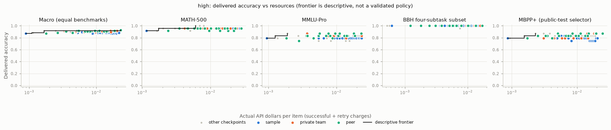

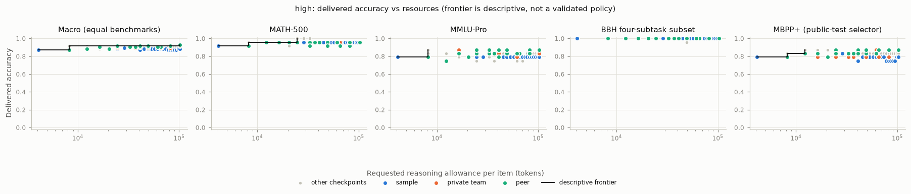

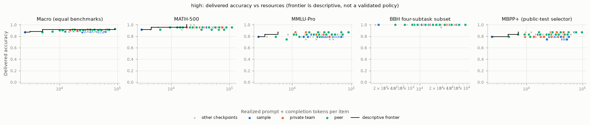

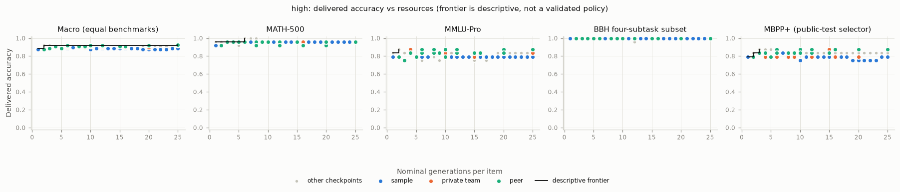

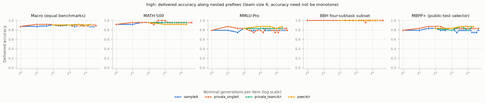

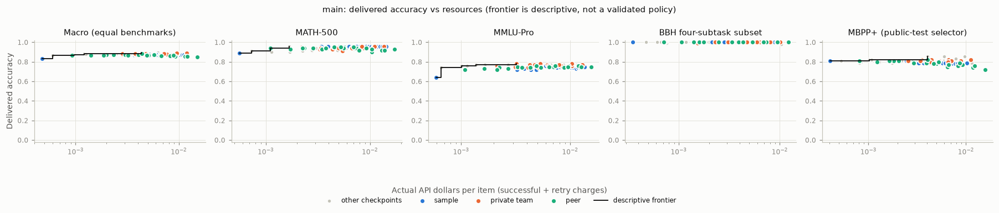

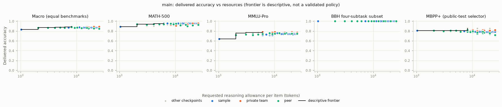

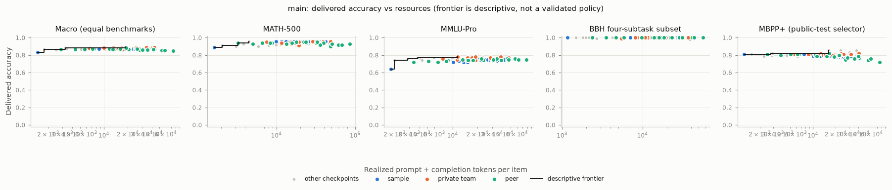

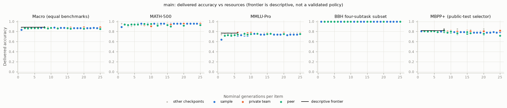

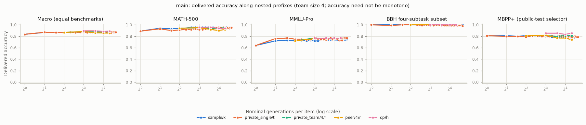

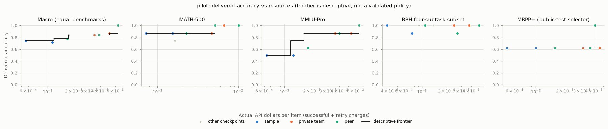

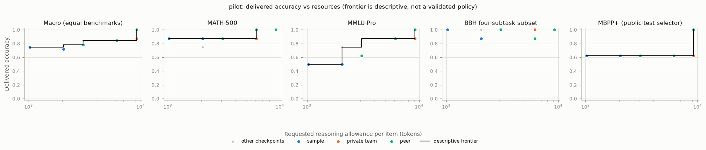

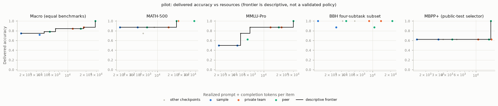

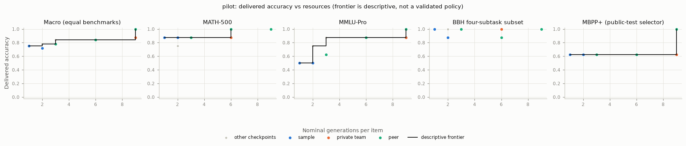

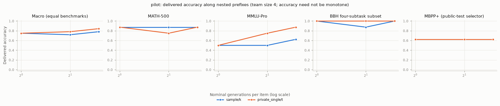

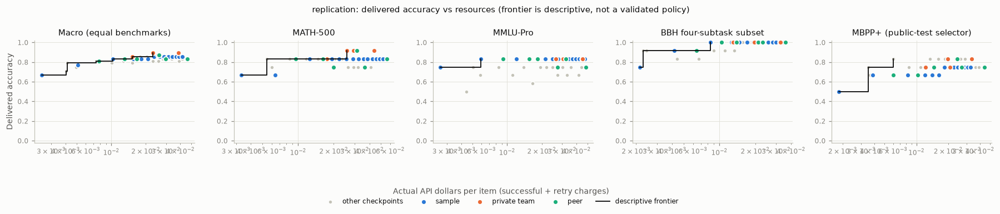

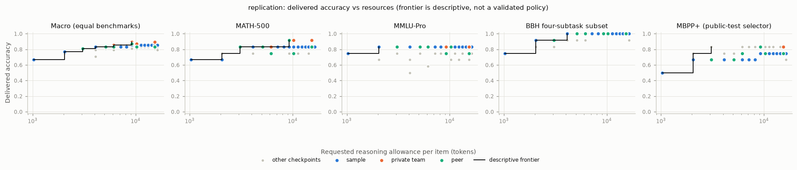

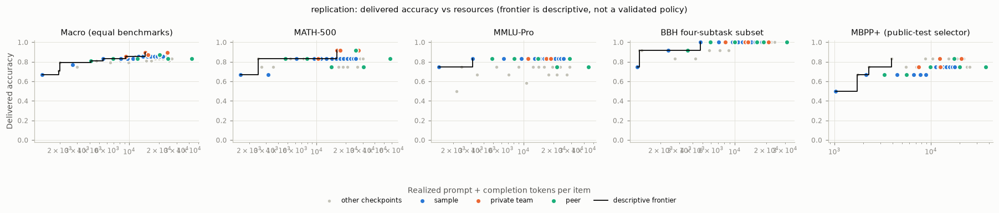

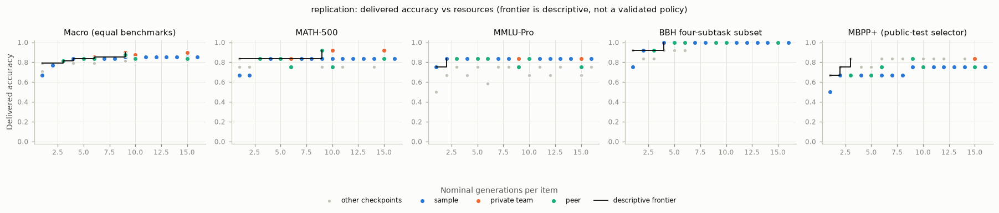

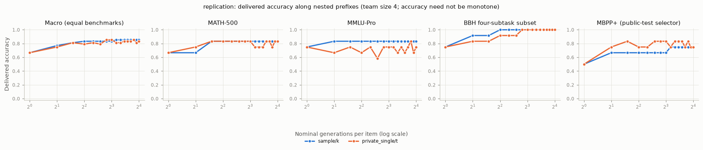

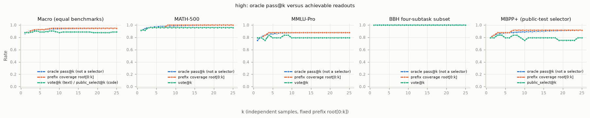

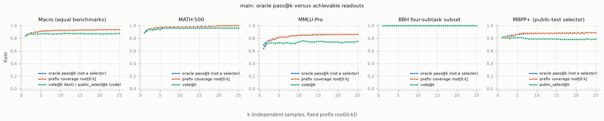

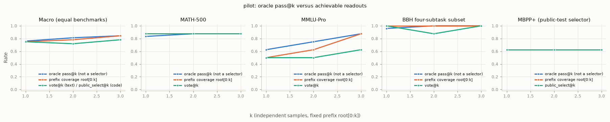

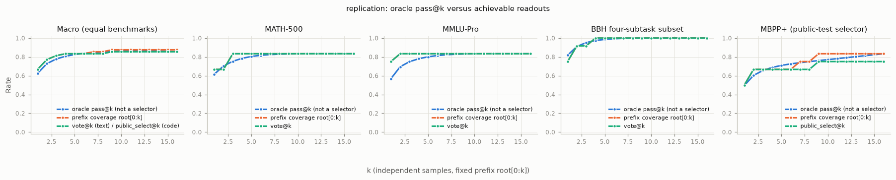

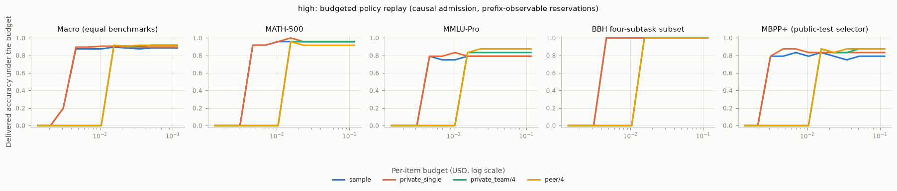

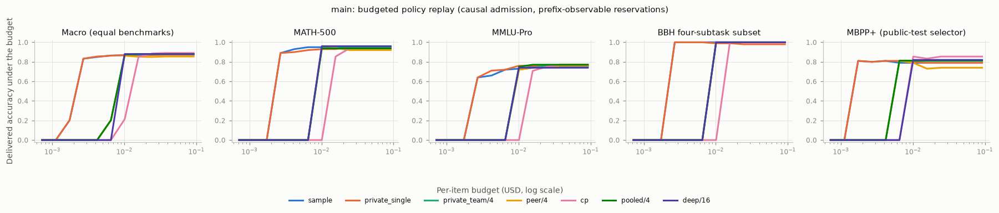

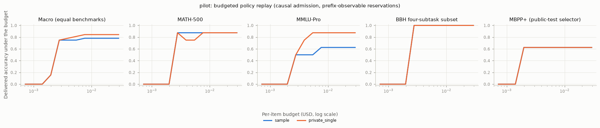

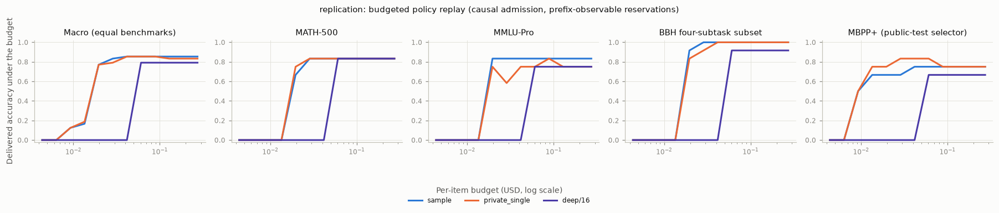

## Small-panel warnings

- small panel: bbh_logic4, math500, mbpp_plus, mmlu_pro with 4 independent items in some analysis population(s); intervals are unstable
- small panel: bbh_logic4, math500, mbpp_plus, mmlu_pro with 8 independent items in some analysis population(s); intervals are unstable
- small panel: bbh_logic4, math500, mbpp_plus, mmlu_pro with 12 independent items in some analysis population(s); intervals are unstable
- BBH subtask strata with 1 items: boolean_expressions, logical_deduction_seven_objects, temporal_sequences, tracking_shuffled_objects_seven_objects
- BBH subtask strata with 2 items: boolean_expressions, logical_deduction_seven_objects, temporal_sequences, tracking_shuffled_objects_seven_objects
- BBH subtask strata with 3 items: boolean_expressions, logical_deduction_seven_objects, temporal_sequences, tracking_shuffled_objects_seven_objects

## Notes

- high-vs-main: 48 shared item ids (48 high, 400 main); comparisons use shared ids only
- high-vs-main: 96 shared item ids (96 high, 400 main); comparisons use shared ids only

## Load and consistency problems

- none
