# Run report: `openrouter_forced_budget_v2`

**INTERIM REPORT: PARTIAL COLLECTION.** This report is partial and not a final result:

- 80 checkpoint rows lack a known delivered outcome (unrun, unselected, unsealed or ungraded)
- costs are not reconciled against provider usage (see COST_RECONCILIATION.md)

- Run directory: `merged`
- Input digest (sha256 over every input file): `2169fc79139832bf79d587f161e8ed4576d190ae225b591eefd432eaced42595`
- Config source: base study config; merged from shards ['mancer', 'parasail']
- Bootstrap replicates: 10000 (item-clustered within benchmark strata)

## Scope and labels

- Math answers (AIME, HMMT, Omni-MATH) are graded by pinned Math-Verify against the gold, with no LLM judge; Omni-MATH items whose gold is prose or not a parseable expression were excluded before any generation (engineering exclusions, not outcome-based selection).
- GPQA-Diamond options are shuffled once per item with a fixed seed; the gold letter is not fixed.
- Every generation's reasoning is **forced to exactly its budget** (A=1024 per call, m x A for deep/m): the THINK call bans the end-of-reasoning tokens and stops at max_tokens, and a second ANSWER call re-feeds the reasoning to write the visible answer. Requested equals realized reasoning (checked per node, Operations); realized tokens count THINK + ANSWER completions, never the re-fed reasoning in the ANSWER prompt. Forcing past the model's natural stopping point can yield recycled text; the effective-depth table reports tokens before loop onset.
- This is a token- and API-cost-accounted study, not a FLOP-matched experiment.
- Frontiers are descriptive: the best among evaluated configurations on this sample, never a validated optimal policy. Everything except the two primary contrasts is exploratory or descriptive.
- Oracle pass@k (an unavailable selector) is reported separately from achievable vote@k / public_select@k.
- Macro averages weight the four benchmarks equally; per-benchmark results are always shown.
- Panel variants (high allowance, second-model replication) are compared with main on shared item ids only (never the 96-item panel against all main items).

## Collection status

- Generation nodes terminal: 14031 / 14031
- Checkpoint rows with a known delivered outcome: 20138 / 20218

Unfinished partitions (rows whose delivered outcome is not yet known; see COMPLETENESS.md):

| partition_id | benchmark | rows_unknown | rows_planned |
|---|---|---|---|
| main | hmmt | 48 | 4848 |
| main | omni_math_hard | 32 | 4848 |

Independent-item counts per analysis population (the bootstrap cluster is the source item):

| population | partition_id | checkpoints | independent_items | items_aime | items_hmmt | items_omni_math_hard | items_gpqa_diamond | strata |
|---|---|---|---|---|---|---|---|---|
| main:population_0 (cp+deep+peer+pooled+private_single+private_team+sample) | main | 101 | 96 | 24 | 24 | 24 | 24 | aime=24;hmmt=24;omni_math_hard=24;gpqa_diamond=24 |
| pilot:population_0 (deep+peer+private_single+private_team+sample) | pilot | 12 | 32 | 8 | 8 | 8 | 8 | aime=8;hmmt=8;omni_math_hard=8;gpqa_diamond=8 |
| pilot:population_1 (peer) | pilot | 1 | 29 | 7 | 8 | 7 | 7 | aime=7;hmmt=8;omni_math_hard=7;gpqa_diamond=7 |

## Selection seals

Private grades are joined onto a selection only when its append-only batch seal verifies (file-byte sha256, count, chained previous seal).

| partition | batch | records | seal_count | hash_ok | chain | sealed_at | valid | problems |
|---|---|---|---|---|---|---|---|---|
| main | 0 | 11716 | 11716 | yes | genesis | 2026-09-18T17:10:51.970092+00:00 | yes |  |
| main | 1 | 7676 | 7676 | yes | genesis | 2026-09-18T15:41:52.082000+00:00 | yes |  |
| pilot | 0 | 488 | 488 | yes | genesis | 2026-09-18T10:18:37.533107+00:00 | yes |  |
| pilot | 1 | 338 | 338 | yes | genesis | 2026-09-18T10:06:00.932617+00:00 | yes |  |

Partitions with planned checkpoints but no sealed selection batch: calibration, calibration_natural, canary.

## Primary contrasts (frozen, main allowance)

Per-item contrast first, then equal-benchmark macro. Intervals: studentized item-cluster bootstrap when complete (at small n it can extend past the parameter range; the percentile interval is shown beside it), otherwise known-only percentile intervals labeled partial with fixed-population bounds. P-values (Holm over exactly these two) are reported only when both populations are fully known.

| contrast | level | n_items | n_complete | status | estimate | ci95 studentized | ci95 percentile | bounds | p | p_holm |
|---|---|---|---|---|---|---|---|---|---|---|
| primary_i_peer_vs_private_team_n4_r4 | macro | 96 | 95 | partial | 0.0417 | n/a | [-0.031, 0.115] | [0.042, 0.052] | withheld (incomplete) | withheld |
| primary_i_peer_vs_private_team_n4_r4 | aime | 24 | 24 | complete | 0.0417 | [-0.009, 0.042] | [0.000, 0.125] | [0.042, 0.042] | not reported (per-benchmark) | - |
| primary_i_peer_vs_private_team_n4_r4 | hmmt | 24 | 24 | complete | 0.1250 | [0.030, 0.263] | [0.000, 0.250] | [0.125, 0.125] | not reported (per-benchmark) | - |
| primary_i_peer_vs_private_team_n4_r4 | omni_math_hard | 24 | 23 | partial | 0.0000 | n/a | [-0.174, 0.174] | [0.000, 0.042] | not reported (per-benchmark) | - |
| primary_i_peer_vs_private_team_n4_r4 | gpqa_diamond | 24 | 24 | complete | 0.0000 | [-0.154, 0.154] | [-0.167, 0.167] | [0.000, 0.000] | not reported (per-benchmark) | - |
| primary_ii_cp_minus_private_team_gain_h3 | macro | 96 | 94 | partial | 0.0113 | n/a | [-0.072, 0.093] | [0.000, 0.021] | withheld (incomplete) | withheld |
| primary_ii_cp_minus_private_team_gain_h3 | aime | 24 | 24 | complete | -0.0417 | [-0.042, 0.009] | [-0.125, 0.000] | [-0.042, -0.042] | not reported (per-benchmark) | - |
| primary_ii_cp_minus_private_team_gain_h3 | hmmt | 24 | 23 | partial | 0.0000 | n/a | [-0.174, 0.174] | [0.000, 0.042] | not reported (per-benchmark) | - |
| primary_ii_cp_minus_private_team_gain_h3 | omni_math_hard | 24 | 23 | partial | 0.0870 | n/a | [-0.125, 0.292] | [0.042, 0.083] | not reported (per-benchmark) | - |
| primary_ii_cp_minus_private_team_gain_h3 | gpqa_diamond | 24 | 24 | complete | 0.0000 | [-0.171, 0.171] | [-0.167, 0.167] | [0.000, 0.000] | not reported (per-benchmark) | - |

### CP decomposition (descriptive)

`L = mean(Y_CP,h=0 - Y_PRIVATE_TEAM,r=1)`; `H(h) = mean[(Y_CP,h - Y_CP,0) - (Y_PRIVATE_TEAM,1+h - Y_PRIVATE_TEAM,1)]`. A descriptive decomposition of a paired controlled-exposure comparison at matched nominal generations; H alone is not a cost-optimized causal frontier.

| contrast | role | level | n_items | status | estimate | ci95 | bounds |
|---|---|---|---|---|---|---|---|
| L | descriptive | macro | 96 | partial | -0.0109 | [-0.075, 0.052] | [-0.021, 0.000] |
| L | descriptive | aime | 24 | complete | 0.0000 | [0.000, 0.000] | [0.000, 0.000] |
| L | descriptive | hmmt | 24 | partial | 0.0435 | [-0.091, 0.182] | [0.000, 0.042] |
| L | descriptive | omni_math_hard | 24 | partial | -0.0870 | [-0.261, 0.083] | [-0.083, -0.042] |
| L | descriptive | gpqa_diamond | 24 | complete | 0.0000 | [-0.125, 0.125] | [0.000, 0.000] |
| H(1) | descriptive | macro | 96 | partial | -0.0204 | [-0.073, 0.032] | [-0.031, -0.010] |
| H(1) | descriptive | aime | 24 | complete | -0.0833 | [-0.208, 0.000] | [-0.083, -0.083] |
| H(1) | descriptive | hmmt | 24 | partial | 0.0435 | [0.000, 0.136] | [0.042, 0.083] |
| H(1) | descriptive | omni_math_hard | 24 | partial | 0.0000 | [-0.130, 0.130] | [-0.042, 0.000] |
| H(1) | descriptive | gpqa_diamond | 24 | complete | -0.0417 | [-0.125, 0.000] | [-0.042, -0.042] |
| H(2) | descriptive | macro | 96 | partial | -0.0104 | [-0.074, 0.054] | [-0.031, 0.000] |
| H(2) | descriptive | aime | 24 | complete | 0.0000 | [0.000, 0.000] | [0.000, 0.000] |
| H(2) | descriptive | hmmt | 24 | partial | 0.0000 | [-0.130, 0.130] | [0.000, 0.042] |
| H(2) | descriptive | omni_math_hard | 24 | partial | 0.0000 | [-0.174, 0.174] | [-0.083, 0.000] |
| H(2) | descriptive | gpqa_diamond | 24 | complete | -0.0417 | [-0.167, 0.083] | [-0.042, -0.042] |
| H(3) | descriptive | macro | 96 | partial | 0.0113 | [-0.073, 0.094] | [0.000, 0.021] |
| H(3) | descriptive | aime | 24 | complete | -0.0417 | [-0.125, 0.000] | [-0.042, -0.042] |
| H(3) | descriptive | hmmt | 24 | partial | 0.0000 | [-0.174, 0.174] | [0.000, 0.042] |
| H(3) | descriptive | omni_math_hard | 24 | partial | 0.0870 | [-0.125, 0.292] | [0.042, 0.083] |
| H(3) | descriptive | gpqa_diamond | 24 | complete | 0.0000 | [-0.167, 0.167] | [0.000, 0.000] |
| cp/0 - private_team/4/1 | exploratory | macro | 96 | partial | -0.0109 | [-0.074, 0.053] | [-0.021, 0.000] |
| cp/0 - private_team/4/1 | exploratory | aime | 24 | complete | 0.0000 | [0.000, 0.000] | [0.000, 0.000] |
| cp/0 - private_team/4/1 | exploratory | hmmt | 24 | partial | 0.0435 | [-0.091, 0.190] | [0.000, 0.042] |
| cp/0 - private_team/4/1 | exploratory | omni_math_hard | 24 | partial | -0.0870 | [-0.261, 0.083] | [-0.083, -0.042] |
| cp/0 - private_team/4/1 | exploratory | gpqa_diamond | 24 | complete | 0.0000 | [-0.125, 0.125] | [0.000, 0.000] |
| cp/0 - peer/4/1 | exploratory | macro | 96 | partial | 0.0000 | [0.000, 0.000] | [-0.010, 0.010] |
| cp/0 - peer/4/1 | exploratory | aime | 24 | complete | 0.0000 | [0.000, 0.000] | [0.000, 0.000] |
| cp/0 - peer/4/1 | exploratory | hmmt | 24 | complete | 0.0000 | [0.000, 0.000] | [0.000, 0.000] |
| cp/0 - peer/4/1 | exploratory | omni_math_hard | 24 | partial | 0.0000 | [0.000, 0.000] | [-0.042, 0.042] |
| cp/0 - peer/4/1 | exploratory | gpqa_diamond | 24 | complete | 0.0000 | [0.000, 0.000] | [0.000, 0.000] |
| cp/1 - private_team/4/2 | exploratory | macro | 96 | complete | -0.0312 | [-0.104, 0.042] | [-0.031, -0.031] |
| cp/1 - private_team/4/2 | exploratory | aime | 24 | complete | -0.0833 | [-0.208, 0.000] | [-0.083, -0.083] |
| cp/1 - private_team/4/2 | exploratory | hmmt | 24 | complete | 0.0833 | [0.000, 0.208] | [0.083, 0.083] |
| cp/1 - private_team/4/2 | exploratory | omni_math_hard | 24 | complete | -0.0833 | [-0.292, 0.125] | [-0.083, -0.083] |
| cp/1 - private_team/4/2 | exploratory | gpqa_diamond | 24 | complete | -0.0417 | [-0.167, 0.083] | [-0.042, -0.042] |
| cp/1 - peer/4/2 | exploratory | macro | 96 | complete | 0.0000 | [-0.052, 0.052] | [0.000, 0.000] |
| cp/1 - peer/4/2 | exploratory | aime | 24 | complete | -0.0417 | [-0.125, 0.000] | [-0.042, -0.042] |
| cp/1 - peer/4/2 | exploratory | hmmt | 24 | complete | 0.0833 | [0.000, 0.208] | [0.083, 0.083] |
| cp/1 - peer/4/2 | exploratory | omni_math_hard | 24 | complete | -0.0833 | [-0.250, 0.083] | [-0.083, -0.083] |
| cp/1 - peer/4/2 | exploratory | gpqa_diamond | 24 | complete | 0.0417 | [0.000, 0.125] | [0.042, 0.042] |
| cp/2 - private_team/4/3 | exploratory | macro | 96 | partial | -0.0217 | [-0.073, 0.031] | [-0.031, -0.021] |
| cp/2 - private_team/4/3 | exploratory | aime | 24 | complete | 0.0000 | [0.000, 0.000] | [0.000, 0.000] |
| cp/2 - private_team/4/3 | exploratory | hmmt | 24 | complete | 0.0417 | [0.000, 0.125] | [0.042, 0.042] |
| cp/2 - private_team/4/3 | exploratory | omni_math_hard | 24 | partial | -0.0870 | [-0.261, 0.083] | [-0.125, -0.083] |
| cp/2 - private_team/4/3 | exploratory | gpqa_diamond | 24 | complete | -0.0417 | [-0.125, 0.000] | [-0.042, -0.042] |
| cp/2 - peer/4/3 | exploratory | macro | 96 | complete | -0.0521 | [-0.125, 0.010] | [-0.052, -0.052] |
| cp/2 - peer/4/3 | exploratory | aime | 24 | complete | -0.0833 | [-0.208, 0.000] | [-0.083, -0.083] |
| cp/2 - peer/4/3 | exploratory | hmmt | 24 | complete | -0.1250 | [-0.250, 0.000] | [-0.125, -0.125] |
| cp/2 - peer/4/3 | exploratory | omni_math_hard | 24 | complete | 0.0417 | [-0.125, 0.208] | [0.042, 0.042] |
| cp/2 - peer/4/3 | exploratory | gpqa_diamond | 24 | complete | -0.0417 | [-0.125, 0.000] | [-0.042, -0.042] |
| cp/3 - private_team/4/4 | exploratory | macro | 96 | complete | 0.0000 | [-0.052, 0.052] | [0.000, 0.000] |
| cp/3 - private_team/4/4 | exploratory | aime | 24 | complete | -0.0417 | [-0.125, 0.000] | [-0.042, -0.042] |
| cp/3 - private_team/4/4 | exploratory | hmmt | 24 | complete | 0.0417 | [0.000, 0.125] | [0.042, 0.042] |
| cp/3 - private_team/4/4 | exploratory | omni_math_hard | 24 | complete | 0.0000 | [-0.125, 0.125] | [0.000, 0.000] |
| cp/3 - private_team/4/4 | exploratory | gpqa_diamond | 24 | complete | 0.0000 | [-0.125, 0.125] | [0.000, 0.000] |
| cp/3 - peer/4/4 | exploratory | macro | 96 | partial | -0.0417 | [-0.115, 0.026] | [-0.052, -0.042] |
| cp/3 - peer/4/4 | exploratory | aime | 24 | complete | -0.0833 | [-0.208, 0.000] | [-0.083, -0.083] |
| cp/3 - peer/4/4 | exploratory | hmmt | 24 | complete | -0.0833 | [-0.208, 0.000] | [-0.083, -0.083] |
| cp/3 - peer/4/4 | exploratory | omni_math_hard | 24 | partial | 0.0000 | [-0.208, 0.208] | [-0.042, 0.000] |
| cp/3 - peer/4/4 | exploratory | gpqa_diamond | 24 | complete | 0.0000 | [-0.125, 0.125] | [0.000, 0.000] |

- cp/0 - peer/4/1 is identically 0 by construction: its terms name the same checkpoint pool (cp/0 is the peer/4/1 pool), so this row is a tautology, not a finding [cp/0 - peer/4/1:macro, cp/0 - peer/4/1:aime, cp/0 - peer/4/1:hmmt, cp/0 - peer/4/1:omni_math_hard, cp/0 - peer/4/1:gpqa_diamond]
- zero-width interval: every per-item difference is exactly 0, so the bootstrap is degenerate (se=0); read it as no item ever flipping, never as a precisely estimated null [L:aime, H(2):aime, cp/0 - private_team/4/1:aime, cp/2 - private_team/4/3:aime]

## Delivered accuracy (current view, every checkpoint)

Cells: accuracy (95% item-cluster percentile interval). `unknown [lower, upper]` gives fixed-denominator bounds when any outcome is unknown or unrun; `*` marks known-only partial intervals. Readouts: last answer for PRIVATE_SINGLE/DEEP/POOLED, plurality for text sample/team arms (public-test selection for a code benchmark, when present). Subgroup rows are in `tables/accuracy_summary`.

### Partition `main`

| checkpoint | macro | aime | hmmt | omni_math_hard | gpqa_diamond |
|---|---|---|---|---|---|
| sample/1 | unknown [0.333, 0.344] (0.250-0.422*) | 0.333 (0.167-0.542) | unknown [0.208, 0.250] (0.045-0.391*) | 0.167 (0.042-0.333) | 0.625 (0.417-0.792) |
| sample/2 | 0.344 (0.260-0.427) | 0.333 (0.167-0.542) | 0.167 (0.042-0.333) | 0.208 (0.042-0.375) | 0.667 (0.458-0.833) |
| sample/3 | 0.333 (0.250-0.417) | 0.333 (0.167-0.542) | 0.167 (0.042-0.333) | 0.167 (0.042-0.333) | 0.667 (0.458-0.833) |
| sample/4 | 0.354 (0.271-0.438) | 0.375 (0.208-0.583) | 0.167 (0.042-0.333) | 0.167 (0.042-0.333) | 0.708 (0.500-0.875) |
| sample/5 | 0.385 (0.292-0.479) | 0.375 (0.208-0.583) | 0.208 (0.042-0.375) | 0.292 (0.125-0.500) | 0.667 (0.458-0.833) |
| sample/6 | 0.396 (0.312-0.479) | 0.375 (0.208-0.583) | 0.167 (0.042-0.333) | 0.292 (0.125-0.500) | 0.750 (0.583-0.917) |
| sample/7 | 0.396 (0.312-0.479) | 0.375 (0.208-0.583) | 0.208 (0.042-0.375) | 0.250 (0.083-0.417) | 0.750 (0.583-0.917) |
| sample/8 | 0.385 (0.302-0.469) | 0.375 (0.208-0.583) | 0.208 (0.042-0.375) | 0.208 (0.042-0.375) | 0.750 (0.583-0.917) |
| sample/9 | 0.417 (0.333-0.500) | 0.375 (0.208-0.583) | 0.208 (0.042-0.375) | 0.292 (0.125-0.458) | 0.792 (0.625-0.958) |
| sample/10 | 0.417 (0.333-0.500) | 0.375 (0.208-0.583) | 0.208 (0.042-0.375) | 0.292 (0.125-0.458) | 0.792 (0.625-0.958) |
| sample/11 | 0.417 (0.333-0.510) | 0.375 (0.208-0.583) | 0.208 (0.042-0.375) | 0.292 (0.125-0.500) | 0.792 (0.625-0.958) |
| sample/12 | 0.417 (0.333-0.510) | 0.375 (0.208-0.583) | 0.208 (0.042-0.375) | 0.292 (0.125-0.500) | 0.792 (0.625-0.958) |
| sample/13 | 0.417 (0.333-0.510) | 0.375 (0.208-0.583) | 0.208 (0.042-0.375) | 0.292 (0.125-0.500) | 0.792 (0.625-0.958) |
| sample/14 | 0.417 (0.333-0.510) | 0.375 (0.208-0.583) | 0.208 (0.042-0.375) | 0.292 (0.125-0.500) | 0.792 (0.625-0.958) |
| sample/15 | 0.417 (0.333-0.510) | 0.375 (0.208-0.583) | 0.208 (0.042-0.375) | 0.292 (0.125-0.500) | 0.792 (0.625-0.958) |
| sample/16 | 0.417 (0.333-0.510) | 0.375 (0.208-0.583) | 0.208 (0.042-0.375) | 0.292 (0.125-0.500) | 0.792 (0.625-0.958) |
| sample/17 | 0.417 (0.333-0.510) | 0.375 (0.208-0.583) | 0.208 (0.042-0.375) | 0.292 (0.125-0.500) | 0.792 (0.625-0.958) |
| sample/18 | 0.417 (0.333-0.510) | 0.375 (0.208-0.583) | 0.208 (0.042-0.375) | 0.292 (0.125-0.500) | 0.792 (0.625-0.958) |
| sample/19 | 0.427 (0.344-0.521) | 0.375 (0.208-0.583) | 0.208 (0.042-0.375) | 0.333 (0.167-0.542) | 0.792 (0.625-0.958) |
| sample/20 | 0.438 (0.344-0.531) | 0.375 (0.208-0.583) | 0.250 (0.083-0.417) | 0.333 (0.167-0.542) | 0.792 (0.625-0.958) |
| sample/21 | 0.438 (0.344-0.531) | 0.375 (0.208-0.583) | 0.250 (0.083-0.417) | 0.333 (0.167-0.542) | 0.792 (0.625-0.958) |
| sample/22 | 0.427 (0.344-0.521) | 0.375 (0.208-0.583) | 0.208 (0.042-0.375) | 0.333 (0.167-0.542) | 0.792 (0.625-0.958) |
| sample/23 | 0.427 (0.344-0.521) | 0.375 (0.208-0.583) | 0.208 (0.042-0.375) | 0.333 (0.167-0.542) | 0.792 (0.625-0.958) |
| sample/24 | 0.427 (0.344-0.521) | 0.375 (0.208-0.583) | 0.208 (0.042-0.375) | 0.333 (0.167-0.542) | 0.792 (0.625-0.958) |
| sample/25 | 0.427 (0.344-0.521) | 0.375 (0.208-0.583) | 0.208 (0.042-0.375) | 0.333 (0.167-0.542) | 0.792 (0.625-0.958) |
| private_single/1 | unknown [0.333, 0.344] (0.250-0.422*) | 0.333 (0.167-0.542) | unknown [0.208, 0.250] (0.045-0.391*) | 0.167 (0.042-0.333) | 0.625 (0.417-0.792) |
| private_single/2 | unknown [0.385, 0.396] (0.295-0.479*) | 0.333 (0.167-0.542) | unknown [0.250, 0.292] (0.087-0.455*) | 0.292 (0.125-0.500) | 0.667 (0.458-0.833) |
| private_single/3 | unknown [0.427, 0.438] (0.344-0.515*) | 0.417 (0.208-0.625) | unknown [0.292, 0.333] (0.130-0.500*) | 0.167 (0.042-0.333) | 0.833 (0.667-0.958) |
| private_single/4 | unknown [0.458, 0.479] (0.374-0.554*) | 0.417 (0.208-0.625) | unknown [0.333, 0.375] (0.167-0.542*) | unknown [0.250, 0.292] (0.087-0.455*) | 0.833 (0.667-0.958) |
| private_single/5 | unknown [0.479, 0.500] (0.394-0.578*) | 0.417 (0.208-0.625) | unknown [0.375, 0.417] (0.208-0.591*) | unknown [0.292, 0.333] (0.125-0.500*) | 0.833 (0.667-0.958) |
| private_single/6 | unknown [0.479, 0.500] (0.392-0.579*) | 0.458 (0.250-0.667) | unknown [0.333, 0.375] (0.167-0.542*) | unknown [0.333, 0.375] (0.167-0.545*) | 0.792 (0.625-0.917) |
| private_single/7 | unknown [0.469, 0.490] (0.382-0.568*) | 0.458 (0.250-0.667) | unknown [0.333, 0.375] (0.167-0.542*) | unknown [0.333, 0.375] (0.167-0.545*) | 0.750 (0.583-0.917) |
| private_single/8 | unknown [0.490, 0.500] (0.399-0.586*) | 0.458 (0.250-0.667) | 0.375 (0.208-0.583) | unknown [0.333, 0.375] (0.167-0.545*) | 0.792 (0.625-0.958) |
| private_single/9 | 0.510 (0.417-0.604) | 0.458 (0.250-0.667) | 0.375 (0.208-0.583) | 0.375 (0.167-0.583) | 0.833 (0.667-0.958) |
| private_single/10 | unknown [0.490, 0.500] (0.399-0.587*) | 0.458 (0.250-0.667) | unknown [0.333, 0.375] (0.167-0.542*) | 0.375 (0.167-0.583) | 0.792 (0.625-0.958) |
| private_single/11 | 0.500 (0.406-0.594) | 0.458 (0.250-0.667) | 0.375 (0.208-0.583) | 0.333 (0.167-0.542) | 0.833 (0.667-0.958) |
| private_single/12 | 0.521 (0.427-0.615) | 0.417 (0.208-0.625) | 0.375 (0.208-0.583) | 0.417 (0.208-0.625) | 0.875 (0.750-1.000) |
| private_single/13 | unknown [0.510, 0.521] (0.420-0.607*) | 0.417 (0.208-0.625) | 0.375 (0.208-0.583) | unknown [0.417, 0.458] (0.238-0.636*) | 0.833 (0.667-0.958) |
| private_single/14 | unknown [0.490, 0.510] (0.408-0.587*) | 0.375 (0.208-0.583) | unknown [0.333, 0.375] (0.167-0.542*) | unknown [0.375, 0.417] (0.208-0.591*) | 0.875 (0.750-1.000) |
| private_single/15 | unknown [0.521, 0.542] (0.441-0.616*) | 0.417 (0.208-0.625) | unknown [0.333, 0.375] (0.167-0.542*) | unknown [0.375, 0.417] (0.208-0.591*) | 0.958 (0.875-1.000) |
| private_single/16 | unknown [0.521, 0.531] (0.438-0.614*) | 0.500 (0.292-0.708) | 0.292 (0.125-0.458) | unknown [0.375, 0.417] (0.208-0.591*) | 0.917 (0.792-1.000) |
| private_single/17 | unknown [0.542, 0.552] (0.458-0.634*) | 0.500 (0.292-0.708) | 0.375 (0.208-0.583) | unknown [0.333, 0.375] (0.167-0.545*) | 0.958 (0.875-1.000) |
| private_single/18 | unknown [0.521, 0.531] (0.438-0.613*) | 0.500 (0.292-0.708) | 0.333 (0.167-0.542) | unknown [0.333, 0.375] (0.167-0.545*) | 0.917 (0.792-1.000) |
| private_single/19 | unknown [0.531, 0.542] (0.448-0.625*) | 0.500 (0.292-0.708) | unknown [0.375, 0.417] (0.208-0.591*) | 0.333 (0.167-0.542) | 0.917 (0.792-1.000) |
| private_single/20 | unknown [0.500, 0.510] (0.417-0.594*) | 0.458 (0.250-0.667) | unknown [0.333, 0.375] (0.167-0.545*) | 0.292 (0.125-0.500) | 0.917 (0.792-1.000) |
| private_single/21 | unknown [0.521, 0.531] (0.434-0.619*) | 0.458 (0.250-0.667) | unknown [0.375, 0.417] (0.190-0.591*) | 0.375 (0.208-0.583) | 0.875 (0.750-1.000) |
| private_single/22 | 0.490 (0.396-0.583) | 0.458 (0.250-0.667) | 0.375 (0.167-0.583) | 0.333 (0.167-0.542) | 0.792 (0.625-0.958) |
| private_single/23 | unknown [0.521, 0.531] (0.433-0.615*) | 0.458 (0.250-0.667) | 0.375 (0.208-0.583) | unknown [0.375, 0.417] (0.208-0.591*) | 0.875 (0.750-1.000) |
| private_single/24 | unknown [0.542, 0.552] (0.451-0.639*) | 0.542 (0.333-0.750) | 0.417 (0.208-0.625) | unknown [0.375, 0.417] (0.208-0.591*) | 0.833 (0.667-0.958) |
| private_single/25 | unknown [0.531, 0.542] (0.441-0.628*) | 0.500 (0.292-0.708) | 0.417 (0.208-0.625) | unknown [0.375, 0.417] (0.208-0.591*) | 0.833 (0.667-0.958) |
| private_team/2/0 | 0.344 (0.260-0.427) | 0.333 (0.167-0.542) | 0.167 (0.042-0.333) | 0.208 (0.042-0.375) | 0.667 (0.458-0.833) |
| private_team/2/1 | 0.365 (0.281-0.448) | 0.333 (0.167-0.542) | 0.208 (0.042-0.375) | 0.208 (0.042-0.375) | 0.708 (0.500-0.875) |
| private_team/2/2 | unknown [0.385, 0.396] (0.302-0.473*) | 0.375 (0.208-0.583) | unknown [0.208, 0.250] (0.048-0.391*) | 0.208 (0.042-0.375) | 0.750 (0.583-0.917) |
| private_team/2/3 | unknown [0.417, 0.427] (0.333-0.510*) | 0.417 (0.208-0.625) | unknown [0.250, 0.292] (0.087-0.450*) | 0.250 (0.083-0.417) | 0.750 (0.583-0.917) |
| private_team/2/4 | unknown [0.448, 0.458] (0.358-0.542*) | 0.417 (0.208-0.625) | unknown [0.250, 0.292] (0.087-0.455*) | 0.333 (0.167-0.542) | 0.792 (0.625-0.958) |
| private_team/3/0 | 0.333 (0.250-0.417) | 0.333 (0.167-0.542) | 0.167 (0.042-0.333) | 0.167 (0.042-0.333) | 0.667 (0.458-0.833) |
| private_team/3/1 | 0.406 (0.312-0.500) | 0.375 (0.208-0.583) | 0.250 (0.083-0.417) | 0.292 (0.125-0.500) | 0.708 (0.500-0.875) |
| private_team/3/2 | unknown [0.458, 0.469] (0.375-0.547*) | 0.417 (0.208-0.625) | unknown [0.250, 0.292] (0.087-0.435*) | 0.292 (0.125-0.500) | 0.875 (0.708-1.000) |
| private_team/3/3 | unknown [0.469, 0.479] (0.380-0.562*) | 0.417 (0.208-0.625) | unknown [0.292, 0.333] (0.125-0.500*) | 0.375 (0.208-0.583) | 0.792 (0.625-0.958) |
| private_team/3/4 | 0.458 (0.365-0.552) | 0.417 (0.208-0.625) | 0.250 (0.083-0.417) | 0.375 (0.208-0.583) | 0.792 (0.625-0.958) |
| private_team/4/0 | 0.354 (0.271-0.438) | 0.375 (0.208-0.583) | 0.167 (0.042-0.333) | 0.167 (0.042-0.333) | 0.708 (0.500-0.875) |
| private_team/4/1 | unknown [0.406, 0.417] (0.323-0.500*) | 0.375 (0.208-0.583) | unknown [0.208, 0.250] (0.048-0.391*) | 0.292 (0.125-0.458) | 0.750 (0.583-0.917) |
| private_team/4/2 | 0.438 (0.354-0.521) | 0.458 (0.250-0.667) | 0.208 (0.042-0.375) | 0.292 (0.125-0.458) | 0.792 (0.625-0.917) |
| private_team/4/3 | unknown [0.448, 0.458] (0.360-0.542*) | 0.417 (0.208-0.625) | 0.208 (0.042-0.375) | unknown [0.417, 0.458] (0.238-0.636*) | 0.750 (0.583-0.917) |
| private_team/4/4 | 0.479 (0.385-0.573) | 0.458 (0.250-0.667) | 0.250 (0.083-0.417) | 0.417 (0.208-0.625) | 0.792 (0.625-0.958) |
| private_team/5/0 | 0.385 (0.292-0.479) | 0.375 (0.208-0.583) | 0.208 (0.042-0.375) | 0.292 (0.125-0.500) | 0.667 (0.458-0.833) |
| private_team/5/1 | unknown [0.427, 0.438] (0.339-0.521*) | 0.375 (0.208-0.583) | unknown [0.250, 0.292] (0.087-0.455*) | 0.333 (0.167-0.542) | 0.750 (0.583-0.917) |
| private_team/5/2 | 0.469 (0.385-0.552) | 0.458 (0.250-0.667) | 0.208 (0.042-0.375) | 0.333 (0.167-0.542) | 0.875 (0.750-1.000) |
| private_team/5/3 | unknown [0.458, 0.469] (0.375-0.552*) | 0.417 (0.208-0.625) | 0.208 (0.042-0.375) | unknown [0.417, 0.458] (0.238-0.636*) | 0.792 (0.625-0.917) |
| private_team/5/4 | unknown [0.490, 0.500] (0.406-0.583*) | 0.458 (0.250-0.667) | unknown [0.250, 0.292] (0.087-0.455*) | 0.417 (0.208-0.625) | 0.833 (0.667-0.958) |
| peer/2/0 | 0.344 (0.260-0.427) | 0.333 (0.167-0.542) | 0.167 (0.042-0.333) | 0.208 (0.042-0.375) | 0.667 (0.458-0.833) |
| peer/2/1 | 0.375 (0.292-0.458) | 0.375 (0.208-0.583) | 0.208 (0.042-0.375) | 0.208 (0.042-0.375) | 0.708 (0.542-0.875) |
| peer/2/2 | 0.396 (0.312-0.490) | 0.375 (0.208-0.583) | 0.208 (0.042-0.375) | 0.250 (0.083-0.417) | 0.750 (0.583-0.917) |
| peer/2/3 | 0.438 (0.344-0.531) | 0.375 (0.208-0.583) | 0.333 (0.167-0.542) | 0.333 (0.167-0.542) | 0.708 (0.542-0.875) |
| peer/2/4 | 0.469 (0.375-0.562) | 0.375 (0.208-0.583) | 0.375 (0.167-0.583) | 0.375 (0.208-0.583) | 0.750 (0.583-0.917) |
| peer/3/0 | 0.333 (0.250-0.417) | 0.333 (0.167-0.542) | 0.167 (0.042-0.333) | 0.167 (0.042-0.333) | 0.667 (0.458-0.833) |
| peer/3/1 | unknown [0.417, 0.427] (0.333-0.510*) | 0.375 (0.208-0.583) | unknown [0.250, 0.292] (0.087-0.455*) | 0.250 (0.083-0.417) | 0.792 (0.625-0.958) |
| peer/3/2 | 0.427 (0.344-0.510) | 0.375 (0.208-0.583) | 0.250 (0.083-0.417) | 0.292 (0.125-0.458) | 0.792 (0.625-0.958) |
| peer/3/3 | 0.448 (0.354-0.531) | 0.458 (0.250-0.667) | 0.250 (0.083-0.417) | 0.292 (0.125-0.458) | 0.792 (0.625-0.958) |
| peer/3/4 | 0.469 (0.375-0.552) | 0.500 (0.292-0.708) | 0.250 (0.083-0.417) | 0.292 (0.125-0.500) | 0.833 (0.667-0.958) |
| peer/4/0 | 0.354 (0.271-0.438) | 0.375 (0.208-0.583) | 0.167 (0.042-0.333) | 0.167 (0.042-0.333) | 0.708 (0.500-0.875) |
| peer/4/1 | unknown [0.396, 0.406] (0.312-0.490*) | 0.375 (0.208-0.583) | 0.250 (0.083-0.417) | unknown [0.208, 0.250] (0.045-0.391*) | 0.750 (0.583-0.917) |
| peer/4/2 | 0.406 (0.312-0.500) | 0.417 (0.208-0.625) | 0.208 (0.042-0.375) | 0.292 (0.125-0.458) | 0.708 (0.500-0.875) |
| peer/4/3 | 0.479 (0.385-0.573) | 0.500 (0.292-0.708) | 0.375 (0.167-0.583) | 0.292 (0.125-0.458) | 0.750 (0.583-0.917) |
| peer/4/4 | unknown [0.521, 0.531] (0.428-0.620*) | 0.500 (0.292-0.708) | 0.375 (0.167-0.583) | unknown [0.417, 0.458] (0.238-0.625*) | 0.792 (0.625-0.958) |
| peer/5/0 | 0.385 (0.292-0.479) | 0.375 (0.208-0.583) | 0.208 (0.042-0.375) | 0.292 (0.125-0.500) | 0.667 (0.458-0.833) |
| peer/5/1 | 0.406 (0.312-0.500) | 0.375 (0.208-0.583) | 0.250 (0.083-0.417) | 0.333 (0.167-0.542) | 0.667 (0.458-0.833) |
| peer/5/2 | 0.500 (0.417-0.583) | 0.417 (0.208-0.625) | 0.292 (0.125-0.458) | 0.417 (0.208-0.625) | 0.875 (0.708-1.000) |
| peer/5/3 | unknown [0.542, 0.552] (0.455-0.637*) | 0.500 (0.292-0.708) | 0.375 (0.167-0.583) | unknown [0.417, 0.458] (0.227-0.636*) | 0.875 (0.708-1.000) |
| peer/5/4 | unknown [0.573, 0.583] (0.489-0.667*) | 0.542 (0.333-0.750) | 0.417 (0.208-0.625) | unknown [0.417, 0.458] (0.227-0.636*) | 0.917 (0.792-1.000) |
| deep/1 | unknown [0.333, 0.344] (0.250-0.422*) | 0.333 (0.167-0.542) | unknown [0.208, 0.250] (0.045-0.391*) | 0.167 (0.042-0.333) | 0.625 (0.417-0.792) |
| deep/2 | unknown [0.438, 0.448] (0.348-0.531*) | 0.417 (0.208-0.625) | 0.292 (0.125-0.458) | unknown [0.292, 0.333] (0.130-0.500*) | 0.750 (0.583-0.917) |
| deep/4 | unknown [0.604, 0.615] (0.514-0.703*) | 0.667 (0.458-0.833) | unknown [0.500, 0.542] (0.304-0.727*) | 0.417 (0.208-0.625) | 0.833 (0.667-0.958) |
| deep/8 | 0.625 (0.531-0.719) | 0.708 (0.542-0.875) | 0.542 (0.333-0.750) | 0.458 (0.250-0.667) | 0.792 (0.625-0.917) |
| deep/16 | 0.792 (0.708-0.865) | 0.833 (0.667-0.958) | 0.792 (0.625-0.958) | 0.625 (0.417-0.792) | 0.917 (0.792-1.000) |
| deep/25 | 0.750 (0.667-0.823) | 0.917 (0.792-1.000) | 0.708 (0.500-0.875) | 0.500 (0.292-0.708) | 0.875 (0.750-1.000) |
| cp/0 | unknown [0.396, 0.406] (0.312-0.490*) | 0.375 (0.208-0.583) | 0.250 (0.083-0.417) | unknown [0.208, 0.250] (0.045-0.391*) | 0.750 (0.583-0.917) |
| cp/1 | 0.406 (0.323-0.500) | 0.375 (0.208-0.583) | 0.292 (0.125-0.500) | 0.208 (0.042-0.375) | 0.750 (0.583-0.917) |
| cp/2 | 0.427 (0.333-0.521) | 0.417 (0.208-0.625) | 0.250 (0.083-0.417) | 0.333 (0.167-0.542) | 0.708 (0.500-0.875) |
| cp/3 | 0.479 (0.385-0.573) | 0.417 (0.208-0.625) | 0.292 (0.125-0.500) | 0.417 (0.208-0.625) | 0.792 (0.625-0.917) |
| pooled/4 | unknown [0.406, 0.427] (0.318-0.504*) | 0.375 (0.208-0.583) | unknown [0.250, 0.292] (0.087-0.455*) | unknown [0.292, 0.333] (0.130-0.500*) | 0.708 (0.500-0.875) |

### Partition `pilot`

| checkpoint | macro | aime | hmmt | omni_math_hard | gpqa_diamond |
|---|---|---|---|---|---|
| sample/1 | 0.281 (0.125-0.438) | 0.250 (0.000-0.625) | 0.250 (0.000-0.625) | 0.250 (0.000-0.625) | 0.375 (0.125-0.750) |
| sample/2 | 0.281 (0.156-0.438) | 0.250 (0.000-0.625) | 0.500 (0.125-0.875) | 0.125 (0.000-0.375) | 0.250 (0.000-0.625) |
| sample/3 | 0.281 (0.125-0.438) | 0.250 (0.000-0.625) | 0.250 (0.000-0.625) | 0.250 (0.000-0.625) | 0.375 (0.125-0.750) |
| private_single/1 | 0.281 (0.125-0.438) | 0.250 (0.000-0.625) | 0.250 (0.000-0.625) | 0.250 (0.000-0.625) | 0.375 (0.125-0.750) |
| private_single/2 | 0.250 (0.125-0.406) | 0.375 (0.125-0.750) | 0.250 (0.000-0.625) | 0.125 (0.000-0.375) | 0.250 (0.000-0.625) |
| private_single/3 | 0.344 (0.188-0.500) | 0.500 (0.125-0.875) | 0.375 (0.125-0.750) | 0.250 (0.000-0.625) | 0.250 (0.000-0.625) |
| private_team/3/0 | 0.281 (0.125-0.438) | 0.250 (0.000-0.625) | 0.250 (0.000-0.625) | 0.250 (0.000-0.625) | 0.375 (0.125-0.750) |
| private_team/3/1 | 0.281 (0.125-0.438) | 0.375 (0.125-0.750) | 0.250 (0.000-0.625) | 0.250 (0.000-0.625) | 0.250 (0.000-0.625) |
| private_team/3/2 | 0.438 (0.281-0.594) | 0.375 (0.125-0.750) | 0.625 (0.250-0.875) | 0.375 (0.000-0.750) | 0.375 (0.125-0.750) |
| peer/3/0 | 0.281 (0.125-0.438) | 0.250 (0.000-0.625) | 0.250 (0.000-0.625) | 0.250 (0.000-0.625) | 0.375 (0.125-0.750) |
| peer/3/1 | 0.312 (0.156-0.469) | 0.375 (0.125-0.750) | 0.250 (0.000-0.625) | 0.125 (0.000-0.375) | 0.500 (0.125-0.875) |
| peer/3/2 | 0.379 (0.210-0.549) | 0.429 (0.143-0.857) | 0.375 (0.125-0.750) | 0.143 (0.000-0.429) | 0.571 (0.143-0.857) |
| deep/1 | 0.281 (0.125-0.438) | 0.250 (0.000-0.625) | 0.250 (0.000-0.625) | 0.250 (0.000-0.625) | 0.375 (0.125-0.750) |

## Coverage and selection gap (macro)

Oracle coverage of each checkpoint's own declared pool: the current view gives current coverage, the archive view archive coverage over candidates that policy really generated. `selection_gap = coverage - delivered` for candidate-only selectors on the same pool; empty for POOLED synthesis and whenever coverage or delivery is unknown. Per-benchmark rows: `tables/accuracy_summary`.

| partition_id | name | view | acc | coverage | selection_gap | n_coverage_unknown |
|---|---|---|---|---|---|---|
| main | sample/1 | archive | unknown | 0.336 | unknown | 1.000 |
| main | sample/1 | current | unknown | 0.336 | unknown | 1.000 |
| main | sample/2 | archive | 0.344 | 0.440 | unknown | 1.000 |
| main | sample/2 | current | 0.344 | 0.440 | unknown | 1.000 |
| main | sample/3 | archive | 0.333 | 0.440 | unknown | 1.000 |
| main | sample/3 | current | 0.333 | 0.440 | unknown | 1.000 |
| main | sample/4 | archive | 0.354 | 0.465 | unknown | 2.000 |
| main | sample/4 | current | 0.354 | 0.465 | unknown | 2.000 |
| main | sample/5 | archive | 0.385 | 0.476 | unknown | 2.000 |
| main | sample/5 | current | 0.385 | 0.476 | unknown | 2.000 |
| main | sample/6 | archive | 0.396 | 0.497 | unknown | 2.000 |
| main | sample/6 | current | 0.396 | 0.497 | unknown | 2.000 |
| main | sample/7 | archive | 0.396 | 0.519 | unknown | 2.000 |
| main | sample/7 | current | 0.396 | 0.519 | unknown | 2.000 |
| main | sample/8 | archive | 0.385 | 0.540 | unknown | 2.000 |
| main | sample/8 | current | 0.385 | 0.540 | unknown | 2.000 |
| main | sample/9 | archive | 0.417 | 0.540 | unknown | 2.000 |
| main | sample/9 | current | 0.417 | 0.540 | unknown | 2.000 |
| main | sample/10 | archive | 0.417 | 0.550 | unknown | 2.000 |
| main | sample/10 | current | 0.417 | 0.550 | unknown | 2.000 |
| main | sample/11 | archive | 0.417 | 0.550 | unknown | 2.000 |
| main | sample/11 | current | 0.417 | 0.550 | unknown | 2.000 |
| main | sample/12 | archive | 0.417 | 0.561 | unknown | 2.000 |
| main | sample/12 | current | 0.417 | 0.561 | unknown | 2.000 |
| main | sample/13 | archive | 0.417 | 0.561 | unknown | 2.000 |
| main | sample/13 | current | 0.417 | 0.561 | unknown | 2.000 |
| main | sample/14 | archive | 0.417 | 0.561 | unknown | 2.000 |
| main | sample/14 | current | 0.417 | 0.561 | unknown | 2.000 |
| main | sample/15 | archive | 0.417 | 0.571 | unknown | 2.000 |
| main | sample/15 | current | 0.417 | 0.571 | unknown | 2.000 |
| main | sample/16 | archive | 0.417 | 0.571 | unknown | 2.000 |
| main | sample/16 | current | 0.417 | 0.571 | unknown | 2.000 |
| main | sample/17 | archive | 0.417 | 0.582 | unknown | 2.000 |
| main | sample/17 | current | 0.417 | 0.582 | unknown | 2.000 |
| main | sample/18 | archive | 0.417 | 0.592 | unknown | 2.000 |
| main | sample/18 | current | 0.417 | 0.592 | unknown | 2.000 |
| main | sample/19 | archive | 0.427 | 0.592 | unknown | 2.000 |
| main | sample/19 | current | 0.427 | 0.592 | unknown | 2.000 |
| main | sample/20 | archive | 0.438 | 0.592 | unknown | 2.000 |
| main | sample/20 | current | 0.438 | 0.592 | unknown | 2.000 |
| main | sample/21 | archive | 0.438 | 0.592 | unknown | 2.000 |
| main | sample/21 | current | 0.438 | 0.592 | unknown | 2.000 |
| main | sample/22 | archive | 0.427 | 0.592 | unknown | 2.000 |
| main | sample/22 | current | 0.427 | 0.592 | unknown | 2.000 |
| main | sample/23 | archive | 0.427 | 0.603 | unknown | 2.000 |
| main | sample/23 | current | 0.427 | 0.603 | unknown | 2.000 |
| main | sample/24 | archive | 0.427 | 0.603 | unknown | 2.000 |
| main | sample/24 | current | 0.427 | 0.603 | unknown | 2.000 |
| main | sample/25 | archive | 0.427 | 0.603 | unknown | 2.000 |
| main | sample/25 | current | 0.427 | 0.603 | unknown | 2.000 |
| main | private_single/1 | archive | unknown | 0.336 | unknown | 1.000 |
| main | private_single/1 | current | unknown | 0.336 | unknown | 1.000 |
| main | private_single/2 | archive | unknown | 0.430 | unknown | 1.000 |
| main | private_single/2 | current | unknown | 0.388 | unknown | 1.000 |
| main | private_single/3 | archive | unknown | 0.504 | unknown | 1.000 |
| main | private_single/3 | current | unknown | 0.430 | unknown | 1.000 |
| main | private_single/4 | archive | unknown | 0.540 | unknown | 2.000 |
| main | private_single/4 | current | unknown | 0.465 | unknown | 2.000 |
| main | private_single/5 | archive | unknown | 0.550 | unknown | 2.000 |
| main | private_single/5 | current | unknown | 0.486 | unknown | 2.000 |
| main | private_single/6 | archive | unknown | 0.561 | unknown | 2.000 |
| main | private_single/6 | current | unknown | 0.486 | unknown | 2.000 |
| main | private_single/7 | archive | unknown | 0.561 | unknown | 2.000 |
| main | private_single/7 | current | unknown | 0.476 | unknown | 2.000 |
| main | private_single/8 | archive | unknown | 0.561 | unknown | 2.000 |
| main | private_single/8 | current | unknown | 0.493 | unknown | 1.000 |
| main | private_single/9 | archive | unknown | 0.561 | unknown | 2.000 |
| main | private_single/9 | current | 0.510 | 0.510 | 0.000 | 0.000 |
| main | private_single/10 | archive | unknown | 0.561 | unknown | 2.000 |
| main | private_single/10 | current | unknown | 0.493 | unknown | 1.000 |
| main | private_single/11 | archive | unknown | 0.604 | unknown | 2.000 |
| main | private_single/11 | current | 0.500 | 0.500 | 0.000 | 0.000 |
| main | private_single/12 | archive | 0.521 | 0.625 | unknown | 2.000 |
| main | private_single/12 | current | 0.521 | 0.521 | 0.000 | 0.000 |
| main | private_single/13 | archive | 0.521 | 0.636 | unknown | 2.000 |
| main | private_single/13 | current | unknown | 0.515 | unknown | 1.000 |
| main | private_single/14 | archive | unknown | 0.636 | unknown | 2.000 |
| main | private_single/14 | current | unknown | 0.497 | unknown | 2.000 |
| main | private_single/15 | archive | unknown | 0.647 | unknown | 2.000 |
| main | private_single/15 | current | unknown | 0.529 | unknown | 2.000 |
| main | private_single/16 | archive | unknown | 0.657 | unknown | 2.000 |
| main | private_single/16 | current | unknown | 0.525 | unknown | 1.000 |
| main | private_single/17 | archive | unknown | 0.657 | unknown | 2.000 |
| main | private_single/17 | current | unknown | 0.545 | unknown | 1.000 |
| main | private_single/18 | archive | unknown | 0.657 | unknown | 2.000 |
| main | private_single/18 | current | unknown | 0.524 | unknown | 1.000 |
| main | private_single/19 | archive | unknown | 0.668 | unknown | 2.000 |
| main | private_single/19 | current | unknown | 0.535 | unknown | 1.000 |
| main | private_single/20 | archive | unknown | 0.668 | unknown | 2.000 |
| main | private_single/20 | current | unknown | 0.504 | unknown | 1.000 |
| main | private_single/21 | archive | 0.552 | 0.668 | unknown | 2.000 |
| main | private_single/21 | current | unknown | 0.525 | unknown | 1.000 |
| main | private_single/22 | archive | 0.552 | 0.668 | unknown | 2.000 |
| main | private_single/22 | current | 0.490 | 0.490 | 0.000 | 0.000 |
| main | private_single/23 | archive | 0.552 | 0.668 | unknown | 2.000 |
| main | private_single/23 | current | unknown | 0.525 | unknown | 1.000 |
| main | private_single/24 | archive | 0.552 | 0.678 | unknown | 2.000 |
| main | private_single/24 | current | unknown | 0.546 | unknown | 1.000 |
| main | private_single/25 | archive | 0.573 | 0.689 | unknown | 2.000 |
| main | private_single/25 | current | unknown | 0.535 | unknown | 1.000 |
| main | private_team/2/0 | archive | 0.344 | 0.440 | unknown | 1.000 |
| main | private_team/2/0 | current | 0.344 | 0.440 | unknown | 1.000 |
| main | private_team/2/1 | archive | 0.385 | 0.524 | unknown | 1.000 |
| main | private_team/2/1 | current | 0.365 | 0.492 | unknown | 1.000 |
| main | private_team/2/2 | archive | unknown | 0.566 | unknown | 1.000 |
| main | private_team/2/2 | current | unknown | 0.493 | unknown | 1.000 |
| main | private_team/2/3 | archive | unknown | 0.603 | unknown | 2.000 |
| main | private_team/2/3 | current | unknown | 0.507 | unknown | 2.000 |
| main | private_team/2/4 | archive | unknown | 0.603 | unknown | 2.000 |
| main | private_team/2/4 | current | unknown | 0.540 | unknown | 2.000 |
| main | private_team/3/0 | archive | 0.333 | 0.440 | unknown | 1.000 |
| main | private_team/3/0 | current | 0.333 | 0.440 | unknown | 1.000 |
| main | private_team/3/1 | archive | 0.375 | 0.539 | unknown | 2.000 |
| main | private_team/3/1 | current | 0.406 | 0.517 | unknown | 2.000 |
| main | private_team/3/2 | archive | unknown | 0.580 | unknown | 2.000 |
| main | private_team/3/2 | current | unknown | 0.514 | unknown | 1.000 |
| main | private_team/3/3 | archive | unknown | 0.608 | unknown | 3.000 |
| main | private_team/3/3 | current | unknown | 0.540 | unknown | 2.000 |
| main | private_team/3/4 | archive | unknown | 0.608 | unknown | 3.000 |
| main | private_team/3/4 | current | 0.458 | 0.540 | unknown | 2.000 |
| main | private_team/4/0 | archive | 0.354 | 0.465 | unknown | 2.000 |
| main | private_team/4/0 | current | 0.354 | 0.465 | unknown | 2.000 |
| main | private_team/4/1 | archive | 0.375 | 0.566 | unknown | 3.000 |
| main | private_team/4/1 | current | unknown | 0.543 | unknown | 3.000 |
| main | private_team/4/2 | archive | unknown | 0.608 | unknown | 3.000 |
| main | private_team/4/2 | current | 0.438 | 0.539 | unknown | 2.000 |
| main | private_team/4/3 | archive | 0.396 | 0.640 | unknown | 3.000 |
| main | private_team/4/3 | current | unknown | 0.582 | unknown | 2.000 |
| main | private_team/4/4 | archive | 0.438 | 0.640 | unknown | 3.000 |
| main | private_team/4/4 | current | 0.479 | 0.577 | unknown | 3.000 |
| main | private_team/5/0 | archive | 0.385 | 0.476 | unknown | 2.000 |
| main | private_team/5/0 | current | 0.385 | 0.476 | unknown | 2.000 |
| main | private_team/5/1 | archive | 0.396 | 0.576 | unknown | 3.000 |
| main | private_team/5/1 | current | unknown | 0.565 | unknown | 3.000 |
| main | private_team/5/2 | archive | unknown | 0.618 | unknown | 3.000 |
| main | private_team/5/2 | current | 0.469 | 0.571 | unknown | 2.000 |
| main | private_team/5/3 | archive | 0.448 | 0.662 | unknown | 3.000 |
| main | private_team/5/3 | current | unknown | 0.604 | unknown | 2.000 |
| main | private_team/5/4 | archive | 0.469 | 0.662 | unknown | 3.000 |
| main | private_team/5/4 | current | unknown | 0.588 | unknown | 3.000 |
| main | peer/2/0 | archive | 0.344 | 0.440 | unknown | 1.000 |
| main | peer/2/0 | current | 0.344 | 0.440 | unknown | 1.000 |
| main | peer/2/1 | archive | 0.396 | 0.471 | unknown | 1.000 |
| main | peer/2/1 | current | 0.375 | 0.427 | 0.052 | 0.000 |
| main | peer/2/2 | archive | 0.396 | 0.503 | unknown | 1.000 |
| main | peer/2/2 | current | 0.396 | 0.458 | 0.063 | 0.000 |
| main | peer/2/3 | archive | 0.406 | 0.535 | unknown | 1.000 |
| main | peer/2/3 | current | 0.438 | 0.469 | 0.031 | 0.000 |
| main | peer/2/4 | archive | 0.427 | 0.567 | unknown | 1.000 |
| main | peer/2/4 | current | 0.469 | 0.490 | 0.021 | 0.000 |
| main | peer/3/0 | archive | 0.333 | 0.440 | unknown | 1.000 |
| main | peer/3/0 | current | 0.333 | 0.440 | unknown | 1.000 |
| main | peer/3/1 | archive | 0.406 | 0.504 | unknown | 1.000 |
| main | peer/3/1 | current | unknown | 0.472 | unknown | 1.000 |
| main | peer/3/2 | archive | 0.417 | 0.546 | unknown | 1.000 |
| main | peer/3/2 | current | 0.427 | 0.490 | 0.062 | 0.000 |
| main | peer/3/3 | archive | 0.427 | 0.577 | unknown | 1.000 |
| main | peer/3/3 | current | 0.448 | 0.510 | 0.062 | 0.000 |
| main | peer/3/4 | archive | 0.458 | 0.609 | unknown | 1.000 |
| main | peer/3/4 | current | 0.469 | 0.542 | 0.073 | 0.000 |
| main | peer/4/0 | archive | 0.354 | 0.465 | unknown | 2.000 |
| main | peer/4/0 | current | 0.354 | 0.465 | unknown | 2.000 |
| main | peer/4/1 | archive | 0.385 | 0.529 | unknown | 2.000 |
| main | peer/4/1 | current | unknown | 0.498 | unknown | 2.000 |
| main | peer/4/2 | archive | 0.396 | 0.561 | unknown | 2.000 |
| main | peer/4/2 | current | 0.406 | 0.515 | unknown | 1.000 |
| main | peer/4/3 | archive | 0.406 | 0.615 | unknown | 2.000 |
| main | peer/4/3 | current | 0.479 | 0.557 | unknown | 1.000 |
| main | peer/4/4 | archive | 0.469 | 0.626 | unknown | 2.000 |
| main | peer/4/4 | current | unknown | 0.551 | unknown | 2.000 |
| main | peer/5/0 | archive | 0.385 | 0.476 | unknown | 2.000 |
| main | peer/5/0 | current | 0.385 | 0.476 | unknown | 2.000 |
| main | peer/5/1 | archive | 0.396 | 0.551 | unknown | 2.000 |
| main | peer/5/1 | current | 0.406 | 0.519 | unknown | 2.000 |
| main | peer/5/2 | archive | 0.448 | 0.594 | unknown | 2.000 |
| main | peer/5/2 | current | 0.500 | 0.547 | unknown | 1.000 |
| main | peer/5/3 | archive | 0.531 | 0.636 | unknown | 2.000 |
| main | peer/5/3 | current | unknown | 0.588 | unknown | 1.000 |
| main | peer/5/4 | archive | 0.552 | 0.647 | unknown | 2.000 |
| main | peer/5/4 | current | unknown | 0.599 | unknown | 1.000 |
| main | deep/1 | archive | unknown | 0.336 | unknown | 1.000 |
| main | deep/1 | current | unknown | 0.336 | unknown | 1.000 |
| main | deep/2 | archive | unknown | 0.441 | unknown | 1.000 |
| main | deep/2 | current | unknown | 0.441 | unknown | 1.000 |
| main | deep/4 | archive | unknown | 0.610 | unknown | 1.000 |
| main | deep/4 | current | unknown | 0.610 | unknown | 1.000 |
| main | deep/8 | archive | 0.625 | 0.625 | 0.000 | 0.000 |
| main | deep/8 | current | 0.625 | 0.625 | 0.000 | 0.000 |
| main | deep/16 | archive | 0.792 | 0.792 | 0.000 | 0.000 |
| main | deep/16 | current | 0.792 | 0.792 | 0.000 | 0.000 |
| main | deep/25 | archive | 0.750 | 0.750 | 0.000 | 0.000 |
| main | deep/25 | current | 0.750 | 0.750 | 0.000 | 0.000 |
| main | cp/0 | archive | 0.385 | 0.529 | unknown | 2.000 |
| main | cp/0 | current | unknown | 0.498 | unknown | 2.000 |
| main | cp/1 | archive | 0.406 | 0.572 | unknown | 2.000 |
| main | cp/1 | current | 0.406 | 0.493 | unknown | 1.000 |
| main | cp/2 | archive | 0.427 | 0.614 | unknown | 2.000 |
| main | cp/2 | current | 0.427 | 0.555 | unknown | 1.000 |
| main | cp/3 | archive | 0.417 | 0.635 | unknown | 2.000 |
| main | cp/3 | current | 0.479 | 0.550 | unknown | 2.000 |
| main | pooled/4 | archive | unknown | 0.509 | unknown | 2.000 |
| main | pooled/4 | current | unknown | 0.412 | unknown | 2.000 |
| pilot | sample/1 | archive | 0.281 | 0.281 | 0.000 | 0.000 |
| pilot | sample/1 | current | 0.281 | 0.281 | 0.000 | 0.000 |
| pilot | sample/2 | archive | 0.281 | 0.469 | 0.188 | 0.000 |
| pilot | sample/2 | current | 0.281 | 0.469 | 0.188 | 0.000 |
| pilot | sample/3 | archive | 0.281 | 0.500 | 0.219 | 0.000 |
| pilot | sample/3 | current | 0.281 | 0.500 | 0.219 | 0.000 |
| pilot | private_single/1 | archive | 0.281 | 0.281 | 0.000 | 0.000 |
| pilot | private_single/1 | current | 0.281 | 0.281 | 0.000 | 0.000 |
| pilot | private_single/2 | archive | 0.250 | 0.312 | 0.062 | 0.000 |
| pilot | private_single/2 | current | 0.250 | 0.250 | 0.000 | 0.000 |
| pilot | private_single/3 | archive | 0.281 | 0.406 | 0.125 | 0.000 |
| pilot | private_single/3 | current | 0.344 | 0.344 | 0.000 | 0.000 |
| pilot | private_team/3/0 | archive | 0.281 | 0.500 | 0.219 | 0.000 |
| pilot | private_team/3/0 | current | 0.281 | 0.500 | 0.219 | 0.000 |
| pilot | private_team/3/1 | archive | 0.344 | 0.531 | 0.188 | 0.000 |
| pilot | private_team/3/1 | current | 0.281 | 0.469 | 0.188 | 0.000 |
| pilot | private_team/3/2 | archive | 0.344 | 0.656 | 0.312 | 0.000 |
| pilot | private_team/3/2 | current | 0.438 | 0.594 | 0.156 | 0.000 |
| pilot | peer/3/0 | archive | 0.281 | 0.500 | 0.219 | 0.000 |
| pilot | peer/3/0 | current | 0.281 | 0.500 | 0.219 | 0.000 |
| pilot | peer/3/1 | archive | 0.344 | 0.562 | 0.219 | 0.000 |
| pilot | peer/3/1 | current | 0.312 | 0.500 | 0.188 | 0.000 |
| pilot | peer/3/2 | archive | 0.446 | 0.621 | 0.174 | 0.000 |
| pilot | peer/3/2 | current | 0.379 | 0.518 | 0.138 | 0.000 |
| pilot | deep/1 | archive | 0.281 | 0.281 | 0.000 | 0.000 |
| pilot | deep/1 | current | 0.281 | 0.281 | 0.000 | 0.000 |

## Sampling: oracle pass@k versus achievable readouts

Oracle pass@k is the finite-bank estimator on the full independent bank (items with a fully known bank); it is not an available selector. `prefix coverage` and the readout (vote@k for text, public_select@k for MBPP+) use the same fixed prefix root[0:k]; their difference is the same-pool selection gap.

### Partition `main`

| k | macro pass@k | macro readout@k | aime pass@k | aime vote@k | hmmt pass@k | hmmt vote@k | omni_math_hard pass@k | omni_math_hard vote@k | gpqa_diamond pass@k | gpqa_diamond vote@k |
|---|---|---|---|---|---|---|---|---|---|---|
| 1 | 0.350 | 0.336 | 0.325 | 0.333 | 0.179 | 0.217 | 0.176 | 0.167 | 0.722 | 0.625 |
| 2 | 0.422 | 0.344 | 0.371 | 0.333 | 0.210 | 0.167 | 0.275 | 0.208 | 0.834 | 0.667 |
| 3 | 0.460 | 0.333 | 0.389 | 0.333 | 0.228 | 0.167 | 0.336 | 0.167 | 0.887 | 0.667 |
| 4 | 0.484 | 0.354 | 0.399 | 0.375 | 0.242 | 0.167 | 0.376 | 0.167 | 0.918 | 0.708 |
| 5 | 0.501 | 0.385 | 0.406 | 0.375 | 0.253 | 0.208 | 0.406 | 0.292 | 0.939 | 0.667 |
| 6 | 0.515 | 0.396 | 0.413 | 0.375 | 0.263 | 0.167 | 0.430 | 0.292 | 0.953 | 0.750 |
| 7 | 0.526 | 0.396 | 0.419 | 0.375 | 0.271 | 0.208 | 0.450 | 0.250 | 0.965 | 0.750 |
| 8 | 0.536 | 0.385 | 0.424 | 0.375 | 0.278 | 0.208 | 0.467 | 0.208 | 0.973 | 0.750 |
| 9 | 0.544 | 0.417 | 0.430 | 0.375 | 0.284 | 0.208 | 0.482 | 0.292 | 0.980 | 0.792 |
| 10 | 0.551 | 0.417 | 0.435 | 0.375 | 0.289 | 0.208 | 0.495 | 0.292 | 0.985 | 0.792 |
| 11 | 0.557 | 0.417 | 0.441 | 0.375 | 0.292 | 0.208 | 0.507 | 0.292 | 0.989 | 0.792 |
| 12 | 0.563 | 0.417 | 0.446 | 0.375 | 0.295 | 0.208 | 0.517 | 0.292 | 0.992 | 0.792 |
| 13 | 0.568 | 0.417 | 0.451 | 0.375 | 0.298 | 0.208 | 0.527 | 0.292 | 0.994 | 0.792 |
| 14 | 0.572 | 0.417 | 0.456 | 0.375 | 0.300 | 0.208 | 0.537 | 0.292 | 0.996 | 0.792 |
| 15 | 0.576 | 0.417 | 0.460 | 0.375 | 0.301 | 0.208 | 0.545 | 0.292 | 0.997 | 0.792 |
| 16 | 0.580 | 0.417 | 0.465 | 0.375 | 0.302 | 0.208 | 0.553 | 0.292 | 0.998 | 0.792 |
| 17 | 0.583 | 0.417 | 0.469 | 0.375 | 0.303 | 0.208 | 0.561 | 0.292 | 0.999 | 0.792 |
| 18 | 0.586 | 0.417 | 0.474 | 0.375 | 0.304 | 0.208 | 0.568 | 0.292 | 0.999 | 0.792 |
| 19 | 0.589 | 0.427 | 0.478 | 0.375 | 0.304 | 0.208 | 0.574 | 0.333 | 1.000 | 0.792 |
| 20 | 0.592 | 0.438 | 0.482 | 0.375 | 0.304 | 0.250 | 0.581 | 0.333 | 1.000 | 0.792 |
| 21 | 0.594 | 0.438 | 0.486 | 0.375 | 0.304 | 0.250 | 0.587 | 0.333 | 1.000 | 0.792 |
| 22 | 0.597 | 0.427 | 0.490 | 0.375 | 0.304 | 0.208 | 0.593 | 0.333 | 1.000 | 0.792 |
| 23 | 0.599 | 0.427 | 0.493 | 0.375 | 0.304 | 0.208 | 0.598 | 0.333 | 1.000 | 0.792 |
| 24 | 0.601 | 0.427 | 0.497 | 0.375 | 0.304 | 0.208 | 0.603 | 0.333 | 1.000 | 0.792 |
| 25 | 0.603 | 0.427 | 0.500 | 0.375 | 0.304 | 0.208 | 0.609 | 0.333 | 1.000 | 0.792 |

### Partition `pilot`

| k | macro pass@k | macro readout@k | aime pass@k | aime vote@k | hmmt pass@k | hmmt vote@k | omni_math_hard pass@k | omni_math_hard vote@k | gpqa_diamond pass@k | gpqa_diamond vote@k |
|---|---|---|---|---|---|---|---|---|---|---|
| 1 | 0.312 | 0.281 | 0.250 | 0.250 | 0.333 | 0.250 | 0.208 | 0.250 | 0.458 | 0.375 |
| 2 | 0.427 | 0.281 | 0.333 | 0.250 | 0.417 | 0.500 | 0.333 | 0.125 | 0.625 | 0.250 |
| 3 | 0.500 | 0.281 | 0.375 | 0.250 | 0.500 | 0.250 | 0.375 | 0.250 | 0.750 | 0.375 |

## Accuracy versus resources (policy ledger)

Per-item means of each checkpoint's own from-scratch ancestor set (source: agent 03 policy_cost_rows (cross-checked against local recomputation)); never total collection spend. `actual $` = successful + retry charges; retries also shown alone; `standardized $` prices all prompt tokens uncached at the planning snapshot. Macro rows weight benchmarks equally.

`realized tokens` = THINK + ANSWER completion tokens (forced run; the ANSWER prompt's re-fed reasoning is not counted again).

| partition | checkpoint | macro acc | actual $ | success $ | standardized $ | requested reasoning | realized tokens | reasoning tokens | nominal gens | retry $ |
|---|---|---|---|---|---|---|---|---|---|---|
| main | sample/1 | unknown | 0.003774 | 0.003774 | 0.004009 | 1024 | 1420 | 1024 | 1.0 | 0.000000 |
| main | sample/2 | 0.344 | 0.007532 | 0.007378 | 0.007839 | 2048 | 2769 | 2048 | 2.0 | 0.000153 |
| main | sample/3 | 0.333 | 0.011561 | 0.010947 | 0.011632 | 3072 | 4103 | 3072 | 3.0 | 0.000613 |
| main | sample/4 | 0.354 | 0.015351 | 0.014584 | 0.015488 | 4096 | 5463 | 4096 | 4.0 | 0.000767 |
| main | sample/5 | 0.385 | 0.019104 | 0.018184 | 0.019327 | 5120 | 6815 | 5120 | 5.0 | 0.000920 |
| main | sample/6 | 0.396 | 0.022870 | 0.021797 | 0.023162 | 6144 | 8166 | 6144 | 6.0 | 0.001074 |
| main | sample/7 | 0.396 | 0.026634 | 0.025406 | 0.027005 | 7168 | 9520 | 7168 | 7.0 | 0.001228 |
| main | sample/8 | 0.385 | 0.030536 | 0.029000 | 0.030823 | 8192 | 10864 | 8192 | 8.0 | 0.001536 |
| main | sample/9 | 0.417 | 0.034338 | 0.032647 | 0.034698 | 9216 | 12231 | 9216 | 9.0 | 0.001690 |
| main | sample/10 | 0.417 | 0.038259 | 0.036260 | 0.038543 | 10240 | 13586 | 10240 | 10.0 | 0.001999 |
| main | sample/11 | 0.417 | 0.041867 | 0.039869 | 0.042368 | 11264 | 14933 | 11264 | 11.0 | 0.001999 |
| main | sample/12 | 0.417 | 0.045467 | 0.043468 | 0.046191 | 12288 | 16279 | 12288 | 12.0 | 0.001999 |
| main | sample/13 | 0.417 | 0.049202 | 0.047049 | 0.049998 | 13312 | 17619 | 13312 | 13.0 | 0.002153 |
| main | sample/14 | 0.417 | 0.052927 | 0.050775 | 0.053952 | 14336 | 19017 | 14336 | 14.0 | 0.002153 |
| main | sample/15 | 0.417 | 0.056549 | 0.054396 | 0.057796 | 15360 | 20372 | 15360 | 15.0 | 0.002153 |
| main | sample/16 | 0.417 | 0.060157 | 0.058005 | 0.061630 | 16384 | 21722 | 16384 | 16.0 | 0.002153 |
| main | sample/17 | 0.417 | 0.063791 | 0.061638 | 0.065497 | 17408 | 23086 | 17408 | 17.0 | 0.002153 |
| main | sample/18 | 0.417 | 0.067439 | 0.065286 | 0.069368 | 18432 | 24451 | 18432 | 18.0 | 0.002153 |
| main | sample/19 | 0.427 | 0.071068 | 0.068915 | 0.073216 | 19456 | 25807 | 19456 | 19.0 | 0.002153 |
| main | sample/20 | 0.438 | 0.074796 | 0.072643 | 0.077165 | 20480 | 27204 | 20480 | 20.0 | 0.002153 |
| main | sample/21 | 0.438 | 0.078421 | 0.076269 | 0.081012 | 21504 | 28559 | 21504 | 21.0 | 0.002153 |
| main | sample/22 | 0.427 | 0.082179 | 0.079872 | 0.084845 | 22528 | 29909 | 22528 | 22.0 | 0.002307 |
| main | sample/23 | 0.427 | 0.085993 | 0.083532 | 0.088726 | 23552 | 31279 | 23552 | 23.0 | 0.002461 |
| main | sample/24 | 0.427 | 0.089766 | 0.087152 | 0.092570 | 24576 | 32633 | 24576 | 24.0 | 0.002615 |
| main | sample/25 | 0.427 | 0.093378 | 0.090764 | 0.096408 | 25600 | 33985 | 25600 | 25.0 | 0.002615 |
| main | private_single/1 | unknown | 0.003774 | 0.003774 | 0.004009 | 1024 | 1420 | 1024 | 1.0 | 0.000000 |
| main | private_single/2 | unknown | 0.007531 | 0.007531 | 0.008027 | 2048 | 2761 | 2048 | 2.0 | 0.000000 |
| main | private_single/3 | unknown | 0.011341 | 0.011341 | 0.012118 | 3072 | 4145 | 3072 | 3.0 | 0.000000 |
| main | private_single/4 | unknown | 0.015286 | 0.015129 | 0.016172 | 4096 | 5507 | 4096 | 4.0 | 0.000156 |
| main | private_single/5 | unknown | 0.019290 | 0.018976 | 0.020291 | 5120 | 6898 | 5120 | 5.0 | 0.000314 |
| main | private_single/6 | unknown | 0.023343 | 0.022718 | 0.024304 | 6144 | 8241 | 6144 | 6.0 | 0.000626 |
| main | private_single/7 | unknown | 0.027130 | 0.026504 | 0.028358 | 7168 | 9609 | 7168 | 7.0 | 0.000626 |
| main | private_single/8 | unknown | 0.030890 | 0.030264 | 0.032399 | 8192 | 10968 | 8192 | 8.0 | 0.000626 |
| main | private_single/9 | 0.510 | 0.034635 | 0.034009 | 0.036415 | 9216 | 12318 | 9216 | 9.0 | 0.000626 |
| main | private_single/10 | unknown | 0.038435 | 0.037809 | 0.040475 | 10240 | 13687 | 10240 | 10.0 | 0.000626 |
| main | private_single/11 | 0.500 | 0.042183 | 0.041557 | 0.044506 | 11264 | 15042 | 11264 | 11.0 | 0.000626 |
| main | private_single/12 | 0.521 | 0.046209 | 0.045428 | 0.048645 | 12288 | 16442 | 12288 | 12.0 | 0.000781 |
| main | private_single/13 | unknown | 0.049967 | 0.049186 | 0.052669 | 13312 | 17788 | 13312 | 13.0 | 0.000781 |
| main | private_single/14 | unknown | 0.053701 | 0.052921 | 0.056678 | 14336 | 19138 | 14336 | 14.0 | 0.000781 |
| main | private_single/15 | unknown | 0.057447 | 0.056666 | 0.060687 | 15360 | 20487 | 15360 | 15.0 | 0.000781 |
| main | private_single/16 | unknown | 0.061334 | 0.060397 | 0.064707 | 16384 | 21841 | 16384 | 16.0 | 0.000937 |
| main | private_single/17 | unknown | 0.065107 | 0.064169 | 0.068753 | 17408 | 23204 | 17408 | 17.0 | 0.000937 |
| main | private_single/18 | unknown | 0.068949 | 0.068012 | 0.072867 | 18432 | 24593 | 18432 | 18.0 | 0.000937 |
| main | private_single/19 | unknown | 0.072688 | 0.071724 | 0.076869 | 19456 | 25932 | 19456 | 19.0 | 0.000964 |
| main | private_single/20 | unknown | 0.076616 | 0.075652 | 0.081075 | 20480 | 27362 | 20480 | 20.0 | 0.000964 |
| main | private_single/21 | unknown | 0.080444 | 0.079480 | 0.085176 | 21504 | 28733 | 21504 | 21.0 | 0.000964 |
| main | private_single/22 | 0.490 | 0.084194 | 0.083230 | 0.089192 | 22528 | 30081 | 22528 | 22.0 | 0.000964 |
| main | private_single/23 | unknown | 0.087989 | 0.087025 | 0.093242 | 23552 | 31447 | 23552 | 23.0 | 0.000964 |
| main | private_single/24 | unknown | 0.091762 | 0.090798 | 0.097276 | 24576 | 32803 | 24576 | 24.0 | 0.000964 |
| main | private_single/25 | unknown | 0.095691 | 0.094569 | 0.101294 | 25600 | 34155 | 25600 | 25.0 | 0.001123 |
| main | private_team/2/0 | 0.344 | 0.007532 | 0.007378 | 0.007839 | 2048 | 2769 | 2048 | 2.0 | 0.000153 |
| main | private_team/2/1 | 0.365 | 0.015036 | 0.014883 | 0.015851 | 4096 | 5453 | 4096 | 4.0 | 0.000153 |
| main | private_team/2/2 | unknown | 0.022913 | 0.022450 | 0.023963 | 6144 | 8192 | 6144 | 6.0 | 0.000464 |
| main | private_team/2/3 | unknown | 0.030780 | 0.030003 | 0.032051 | 8192 | 10913 | 8192 | 8.0 | 0.000777 |
| main | private_team/2/4 | unknown | 0.038869 | 0.037622 | 0.040206 | 10240 | 13662 | 10240 | 10.0 | 0.001247 |
| main | private_team/3/0 | 0.333 | 0.011561 | 0.010947 | 0.011632 | 3072 | 4103 | 3072 | 3.0 | 0.000613 |
| main | private_team/3/1 | 0.406 | 0.022807 | 0.022194 | 0.023646 | 6144 | 8137 | 6144 | 6.0 | 0.000613 |
| main | private_team/3/2 | unknown | 0.034627 | 0.033548 | 0.035797 | 9216 | 12237 | 9216 | 9.0 | 0.001079 |
| main | private_team/3/3 | unknown | 0.046235 | 0.044842 | 0.047886 | 12288 | 16301 | 12288 | 12.0 | 0.001392 |
| main | private_team/3/4 | 0.458 | 0.058488 | 0.056312 | 0.060151 | 15360 | 20442 | 15360 | 15.0 | 0.002175 |
| main | private_team/4/0 | 0.354 | 0.015351 | 0.014584 | 0.015488 | 4096 | 5463 | 4096 | 4.0 | 0.000767 |
| main | private_team/4/1 | unknown | 0.030426 | 0.029659 | 0.031588 | 8192 | 10874 | 8192 | 8.0 | 0.000767 |
| main | private_team/4/2 | 0.438 | 0.046034 | 0.044801 | 0.047809 | 12288 | 16343 | 12288 | 12.0 | 0.001233 |
| main | private_team/4/3 | unknown | 0.061544 | 0.059842 | 0.063915 | 16384 | 21756 | 16384 | 16.0 | 0.001702 |
| main | private_team/4/4 | 0.479 | 0.077507 | 0.075022 | 0.080161 | 20480 | 27235 | 20480 | 20.0 | 0.002485 |
| main | private_team/5/0 | 0.385 | 0.019104 | 0.018184 | 0.019327 | 5120 | 6815 | 5120 | 5.0 | 0.000920 |
| main | private_team/5/1 | unknown | 0.037945 | 0.037025 | 0.039461 | 10240 | 13586 | 10240 | 10.0 | 0.000920 |
| main | private_team/5/2 | 0.469 | 0.057342 | 0.055956 | 0.059725 | 15360 | 20415 | 15360 | 15.0 | 0.001386 |
| main | private_team/5/3 | unknown | 0.076641 | 0.074786 | 0.079862 | 20480 | 27184 | 20480 | 20.0 | 0.001856 |
| main | private_team/5/4 | unknown | 0.096415 | 0.093776 | 0.100184 | 25600 | 34038 | 25600 | 25.0 | 0.002639 |
| main | peer/2/0 | 0.344 | 0.007532 | 0.007378 | 0.007839 | 2048 | 2769 | 2048 | 2.0 | 0.000153 |
| main | peer/2/1 | 0.375 | 0.015375 | 0.015222 | 0.016275 | 4096 | 5480 | 4096 | 4.0 | 0.000153 |
| main | peer/2/2 | 0.396 | 0.023580 | 0.023105 | 0.024738 | 6144 | 8222 | 6144 | 6.0 | 0.000475 |
| main | peer/2/3 | 0.438 | 0.031558 | 0.031084 | 0.033295 | 8192 | 10989 | 8192 | 8.0 | 0.000475 |
| main | peer/2/4 | 0.469 | 0.039468 | 0.038993 | 0.041770 | 10240 | 13714 | 10240 | 10.0 | 0.000475 |
| main | peer/3/0 | 0.333 | 0.011561 | 0.010947 | 0.011632 | 3072 | 4103 | 3072 | 3.0 | 0.000613 |
| main | peer/3/1 | unknown | 0.024027 | 0.023254 | 0.024930 | 6144 | 8245 | 6144 | 6.0 | 0.000773 |
| main | peer/3/2 | 0.427 | 0.036430 | 0.035499 | 0.038109 | 9216 | 12316 | 9216 | 9.0 | 0.000932 |
| main | peer/3/3 | 0.448 | 0.048703 | 0.047771 | 0.051284 | 12288 | 16423 | 12288 | 12.0 | 0.000932 |
| main | peer/3/4 | 0.469 | 0.061131 | 0.060199 | 0.064651 | 15360 | 20589 | 15360 | 15.0 | 0.000932 |
| main | peer/4/0 | 0.354 | 0.015351 | 0.014584 | 0.015488 | 4096 | 5463 | 4096 | 4.0 | 0.000767 |
| main | peer/4/1 | unknown | 0.032313 | 0.031386 | 0.033759 | 8192 | 10937 | 8192 | 8.0 | 0.000927 |
| main | peer/4/2 | 0.406 | 0.049621 | 0.048694 | 0.052460 | 12288 | 16570 | 12288 | 12.0 | 0.000927 |
| main | peer/4/3 | 0.479 | 0.067012 | 0.066052 | 0.071143 | 16384 | 22084 | 16384 | 16.0 | 0.000960 |
| main | peer/4/4 | unknown | 0.084234 | 0.083275 | 0.089740 | 20480 | 27645 | 20480 | 20.0 | 0.000960 |
| main | peer/5/0 | 0.385 | 0.019104 | 0.018184 | 0.019327 | 5120 | 6815 | 5120 | 5.0 | 0.000920 |
| main | peer/5/1 | 0.406 | 0.041146 | 0.039901 | 0.042919 | 10240 | 13638 | 10240 | 10.0 | 0.001245 |
| main | peer/5/2 | 0.500 | 0.063355 | 0.062109 | 0.066921 | 15360 | 20623 | 15360 | 15.0 | 0.001245 |
| main | peer/5/3 | unknown | 0.085677 | 0.084432 | 0.091208 | 20480 | 27554 | 20480 | 20.0 | 0.001245 |
| main | peer/5/4 | unknown | 0.107998 | 0.106587 | 0.115268 | 25600 | 34455 | 25600 | 25.0 | 0.001411 |
| main | deep/1 | unknown | 0.003774 | 0.003774 | 0.004009 | 1024 | 1420 | 1024 | 1.0 | 0.000000 |
| main | deep/2 | unknown | 0.006249 | 0.006249 | 0.006668 | 2048 | 2386 | 2048 | 1.0 | 0.000000 |
| main | deep/4 | unknown | 0.011452 | 0.011452 | 0.012202 | 4096 | 4403 | 4096 | 1.0 | 0.000000 |
| main | deep/8 | 0.625 | 0.021982 | 0.021982 | 0.023423 | 8192 | 8498 | 8192 | 1.0 | 0.000000 |
| main | deep/16 | 0.792 | 0.044287 | 0.043091 | 0.045858 | 16384 | 16686 | 16384 | 1.0 | 0.001196 |
| main | deep/25 | 0.750 | 0.068691 | 0.066950 | 0.071091 | 25600 | 25894 | 25600 | 1.0 | 0.001741 |
| main | cp/0 | unknown | 0.032313 | 0.031386 | 0.033759 | 8192 | 10937 | 8192 | 8.0 | 0.000927 |
| main | cp/1 | 0.406 | 0.048089 | 0.046532 | 0.049994 | 12288 | 16399 | 12288 | 12.0 | 0.001557 |
| main | cp/2 | 0.427 | 0.063849 | 0.061825 | 0.066368 | 16384 | 21920 | 16384 | 16.0 | 0.002025 |
| main | cp/3 | 0.479 | 0.079246 | 0.077065 | 0.082651 | 20480 | 27392 | 20480 | 20.0 | 0.002181 |
| main | pooled/4 | unknown | 0.019642 | 0.018875 | 0.020120 | 5120 | 6858 | 5120 | 5.0 | 0.000767 |
| pilot | sample/1 | 0.281 | 0.003572 | 0.003572 | 0.003820 | 1024 | 1346 | 1024 | 1.0 | 0.000000 |
| pilot | sample/2 | 0.281 | 0.011874 | 0.007087 | 0.007582 | 2048 | 2669 | 2048 | 2.0 | 0.004787 |
| pilot | sample/3 | 0.281 | 0.020697 | 0.010717 | 0.011446 | 3072 | 4033 | 3072 | 3.0 | 0.009980 |
| pilot | private_single/1 | 0.281 | 0.003572 | 0.003572 | 0.003820 | 1024 | 1346 | 1024 | 1.0 | 0.000000 |
| pilot | private_single/2 | 0.250 | 0.007281 | 0.007281 | 0.007792 | 2048 | 2682 | 2048 | 2.0 | 0.000000 |
| pilot | private_single/3 | 0.344 | 0.018585 | 0.010950 | 0.011762 | 3072 | 4020 | 3072 | 3.0 | 0.007635 |
| pilot | private_team/3/0 | 0.281 | 0.020697 | 0.010717 | 0.011446 | 3072 | 4033 | 3072 | 3.0 | 0.009980 |
| pilot | private_team/3/1 | 0.281 | 0.031834 | 0.021855 | 0.023414 | 6144 | 8064 | 6144 | 6.0 | 0.009980 |
| pilot | private_team/3/2 | 0.438 | 0.050512 | 0.032898 | 0.035327 | 9216 | 12076 | 9216 | 9.0 | 0.017614 |
| pilot | peer/3/0 | 0.281 | 0.020697 | 0.010717 | 0.011446 | 3072 | 4033 | 3072 | 3.0 | 0.009980 |
| pilot | peer/3/1 | 0.312 | 0.032974 | 0.022560 | 0.024326 | 6144 | 8048 | 6144 | 6.0 | 0.010414 |
| pilot | peer/3/2 | 0.379 | 0.045774 | 0.034364 | 0.037308 | 9216 | 12116 | 9216 | 9.0 | 0.011492 |
| pilot | deep/1 | 0.281 | 0.003572 | 0.003572 | 0.003820 | 1024 | 1346 | 1024 | 1.0 | 0.000000 |

### Descriptive frontier (best among evaluated configurations on this sample; not validated)

| partition_id | measure | name | mean_cost | acc |
|---|---|---|---|---|
| main | total_charged_usd | sample/2 | 0.007532 | 0.344 |
| main | total_charged_usd | private_team/2/1 | 0.015036 | 0.365 |
| main | total_charged_usd | peer/2/1 | 0.015375 | 0.375 |
| main | total_charged_usd | sample/5 | 0.019104 | 0.385 |
| main | total_charged_usd | deep/8 | 0.021982 | 0.625 |
| main | total_charged_usd | deep/16 | 0.044287 | 0.792 |
| pilot | total_charged_usd | sample/1 | 0.003572 | 0.281 |
| pilot | total_charged_usd | private_single/3 | 0.018585 | 0.344 |
| pilot | total_charged_usd | peer/3/2 | 0.045774 | 0.379 |
| pilot | total_charged_usd | private_team/3/2 | 0.050512 | 0.438 |
| main | success_cost_usd | sample/2 | 0.007378 | 0.344 |
| main | success_cost_usd | sample/4 | 0.014584 | 0.354 |
| main | success_cost_usd | private_team/2/1 | 0.014883 | 0.365 |
| main | success_cost_usd | peer/2/1 | 0.015222 | 0.375 |
| main | success_cost_usd | sample/5 | 0.018184 | 0.385 |
| main | success_cost_usd | sample/6 | 0.021797 | 0.396 |
| main | success_cost_usd | deep/8 | 0.021982 | 0.625 |
| main | success_cost_usd | deep/16 | 0.043091 | 0.792 |
| pilot | success_cost_usd | sample/1 | 0.003572 | 0.281 |
| pilot | success_cost_usd | private_single/3 | 0.010950 | 0.344 |
| pilot | success_cost_usd | private_team/3/2 | 0.032898 | 0.438 |
| main | standardized_uncached_cost_usd | sample/2 | 0.007839 | 0.344 |
| main | standardized_uncached_cost_usd | sample/4 | 0.015488 | 0.354 |
| main | standardized_uncached_cost_usd | private_team/2/1 | 0.015851 | 0.365 |
| main | standardized_uncached_cost_usd | peer/2/1 | 0.016275 | 0.375 |
| main | standardized_uncached_cost_usd | sample/5 | 0.019327 | 0.385 |
| main | standardized_uncached_cost_usd | sample/6 | 0.023162 | 0.396 |
| main | standardized_uncached_cost_usd | deep/8 | 0.023423 | 0.625 |
| main | standardized_uncached_cost_usd | deep/16 | 0.045858 | 0.792 |
| pilot | standardized_uncached_cost_usd | sample/1 | 0.003820 | 0.281 |
| pilot | standardized_uncached_cost_usd | private_single/3 | 0.011762 | 0.344 |
| pilot | standardized_uncached_cost_usd | private_team/3/2 | 0.035327 | 0.438 |
| main | requested_reasoning_tokens | sample/2 | 2048.000000 | 0.344 |
| main | requested_reasoning_tokens | peer/2/1 | 4096.000000 | 0.375 |
| main | requested_reasoning_tokens | sample/5 | 5120.000000 | 0.385 |
| main | requested_reasoning_tokens | private_team/3/1 | 6144.000000 | 0.406 |
| main | requested_reasoning_tokens | deep/8 | 8192.000000 | 0.625 |
| main | requested_reasoning_tokens | deep/16 | 16384.000000 | 0.792 |
| pilot | requested_reasoning_tokens | sample/1 | 1024.000000 | 0.281 |
| pilot | requested_reasoning_tokens | private_single/3 | 3072.000000 | 0.344 |
| pilot | requested_reasoning_tokens | private_team/3/2 | 9216.000000 | 0.438 |
| main | realized_tokens | sample/2 | 2769.437500 | 0.344 |
| main | realized_tokens | private_team/2/1 | 5453.145833 | 0.365 |
| main | realized_tokens | peer/2/1 | 5479.895833 | 0.375 |
| main | realized_tokens | sample/5 | 6815.041667 | 0.385 |
| main | realized_tokens | private_team/3/1 | 8137.031250 | 0.406 |
| main | realized_tokens | deep/8 | 8497.989583 | 0.625 |
| main | realized_tokens | deep/16 | 16685.687500 | 0.792 |
| pilot | realized_tokens | sample/1 | 1346.281250 | 0.281 |
| pilot | realized_tokens | private_single/3 | 4020.343750 | 0.344 |
| pilot | realized_tokens | private_team/3/2 | 12076.281250 | 0.438 |
| main | reasoning_tokens | sample/2 | 2048.000000 | 0.344 |
| main | reasoning_tokens | peer/2/1 | 4096.000000 | 0.375 |
| main | reasoning_tokens | sample/5 | 5120.000000 | 0.385 |
| main | reasoning_tokens | private_team/3/1 | 6144.000000 | 0.406 |
| main | reasoning_tokens | deep/8 | 8192.000000 | 0.625 |
| main | reasoning_tokens | deep/16 | 16384.000000 | 0.792 |
| pilot | reasoning_tokens | sample/1 | 1024.000000 | 0.281 |
| pilot | reasoning_tokens | private_single/3 | 3072.000000 | 0.344 |
| pilot | reasoning_tokens | private_team/3/2 | 9216.000000 | 0.438 |
| main | nominal_generations | deep/16 | 1.000000 | 0.792 |
| pilot | nominal_generations | sample/1 | 1.000000 | 0.281 |
| pilot | nominal_generations | private_single/3 | 3.000000 | 0.344 |
| pilot | nominal_generations | private_team/3/2 | 9.000000 | 0.438 |

### Local CPU (separate from API dollars)

Public-check and selector CPU are deployable selection work; private grading CPU is research evaluation and is never charged to a policy.

| partition | checkpoint | public-check CPU s | selector CPU s | private grading CPU s |
|---|---|---|---|---|
| main | sample/1 | unknown | 0.000 | 0.056 |
| main | sample/2 | unknown | 0.063 | 0.060 |
| main | sample/3 | unknown | 0.058 | 0.067 |
| main | sample/4 | unknown | 0.215 | 0.122 |
| main | sample/5 | unknown | 0.067 | 0.128 |
| main | sample/6 | unknown | 0.111 | 0.132 |
| main | sample/7 | unknown | 0.065 | 0.135 |
| main | sample/8 | unknown | 0.083 | 0.199 |
| main | sample/9 | unknown | 0.071 | 0.203 |
| main | sample/10 | unknown | 0.643 | 0.311 |
| main | sample/11 | unknown | 0.124 | 0.317 |
| main | sample/12 | unknown | 0.603 | 0.377 |
| main | sample/13 | unknown | 0.664 | 0.435 |
| main | sample/14 | unknown | 0.310 | 0.452 |
| main | sample/15 | unknown | 0.242 | 0.456 |
| main | sample/16 | unknown | 0.224 | 0.460 |
| main | sample/17 | unknown | 1.184 | 0.568 |
| main | sample/18 | unknown | 0.471 | 0.575 |
| main | sample/19 | unknown | 0.301 | 0.579 |
| main | sample/20 | unknown | 0.110 | 0.584 |
| main | sample/21 | unknown | 0.385 | 0.596 |
| main | sample/22 | unknown | 1.023 | 0.656 |
| main | sample/23 | unknown | 0.434 | 0.661 |
| main | sample/24 | unknown | 0.375 | 0.668 |
| main | sample/25 | unknown | 0.369 | 0.673 |
| main | private_single/1 | unknown | 0.000 | 0.056 |
| main | private_single/2 | unknown | 0.000 | 0.054 |
| main | private_single/3 | unknown | 0.000 | 0.074 |
| main | private_single/4 | unknown | 0.000 | 0.139 |
| main | private_single/5 | unknown | 0.000 | 0.129 |
| main | private_single/6 | unknown | 0.000 | 0.122 |
| main | private_single/7 | unknown | 0.000 | 0.114 |
| main | private_single/8 | unknown | 0.000 | 0.064 |
| main | private_single/9 | unknown | 0.000 | 0.004 |
| main | private_single/10 | unknown | 0.000 | 0.055 |
| main | private_single/11 | unknown | 0.000 | 0.021 |
| main | private_single/12 | unknown | 0.000 | 0.022 |
| main | private_single/13 | unknown | 0.000 | 0.056 |
| main | private_single/14 | unknown | 0.000 | 0.108 |
| main | private_single/15 | unknown | 0.000 | 0.111 |
| main | private_single/16 | unknown | 0.000 | 0.057 |
| main | private_single/17 | unknown | 0.000 | 0.057 |
| main | private_single/18 | unknown | 0.000 | 0.057 |
| main | private_single/19 | unknown | 0.000 | 0.057 |
| main | private_single/20 | unknown | 0.000 | 0.059 |
| main | private_single/21 | unknown | 0.000 | 0.060 |
| main | private_single/22 | unknown | 0.000 | 0.005 |
| main | private_single/23 | unknown | 0.000 | 0.056 |
| main | private_single/24 | unknown | 0.000 | 0.063 |
| main | private_single/25 | unknown | 0.000 | 0.057 |
| main | private_team/2/0 | unknown | 0.000 | 0.060 |
| main | private_team/2/1 | unknown | 0.055 | 0.059 |
| main | private_team/2/2 | unknown | 0.065 | 0.216 |
| main | private_team/2/3 | unknown | 0.069 | 0.144 |
| main | private_team/2/4 | unknown | 0.073 | 0.135 |
| main | private_team/3/0 | unknown | 0.000 | 0.067 |
| main | private_team/3/1 | unknown | 0.088 | 0.065 |
| main | private_team/3/2 | unknown | 0.211 | 0.228 |
| main | private_team/3/3 | unknown | 0.170 | 0.199 |
| main | private_team/3/4 | unknown | 0.071 | 0.141 |
| main | private_team/4/0 | unknown | 0.000 | 0.122 |
| main | private_team/4/1 | unknown | 0.217 | 0.175 |
| main | private_team/4/2 | unknown | 0.365 | 0.285 |
| main | private_team/4/3 | unknown | 0.168 | 0.255 |
| main | private_team/4/4 | unknown | 0.224 | 0.250 |
| main | private_team/5/0 | unknown | 0.000 | 0.128 |
| main | private_team/5/1 | unknown | 0.115 | 0.183 |
| main | private_team/5/2 | unknown | 0.249 | 0.343 |
| main | private_team/5/3 | unknown | 0.288 | 0.314 |
| main | private_team/5/4 | unknown | 0.285 | 0.307 |
| main | peer/2/0 | unknown | 0.000 | 0.060 |
| main | peer/2/1 | unknown | 0.002 | 0.008 |
| main | peer/2/2 | unknown | 0.003 | 0.013 |
| main | peer/2/3 | unknown | 0.002 | 0.008 |
| main | peer/2/4 | unknown | 0.005 | 0.011 |
| main | peer/3/0 | unknown | 0.000 | 0.067 |
| main | peer/3/1 | unknown | 0.110 | 0.066 |
| main | peer/3/2 | unknown | 0.023 | 0.025 |
| main | peer/3/3 | unknown | 0.007 | 0.012 |
| main | peer/3/4 | unknown | 0.014 | 0.017 |
| main | peer/4/0 | unknown | 0.000 | 0.122 |
| main | peer/4/1 | unknown | 0.328 | 0.181 |
| main | peer/4/2 | unknown | 0.132 | 0.073 |
| main | peer/4/3 | unknown | 0.170 | 0.126 |
| main | peer/4/4 | unknown | 0.163 | 0.280 |
| main | peer/5/0 | unknown | 0.000 | 0.128 |
| main | peer/5/1 | unknown | 0.616 | 0.210 |
| main | peer/5/2 | unknown | 0.238 | 0.187 |
| main | peer/5/3 | unknown | 0.230 | 0.232 |
| main | peer/5/4 | unknown | 0.081 | 0.194 |
| main | deep/1 | unknown | 0.000 | 0.056 |
| main | deep/2 | unknown | 0.000 | 0.056 |
| main | deep/4 | unknown | 0.000 | 0.064 |
| main | deep/8 | unknown | 0.000 | 0.005 |
| main | deep/16 | unknown | 0.000 | 0.004 |
| main | deep/25 | unknown | 0.000 | 0.006 |
| main | cp/0 | unknown | 0.000 | 0.181 |
| main | cp/1 | unknown | 0.278 | 0.124 |
| main | cp/2 | unknown | 0.171 | 0.070 |
| main | cp/3 | unknown | 0.209 | 0.142 |
| main | pooled/4 | unknown | 0.000 | 0.108 |
| pilot | sample/1 | unknown | 0.000 | 0.008 |
| pilot | sample/2 | unknown | 0.026 | 0.019 |
| pilot | sample/3 | unknown | 0.003 | 0.029 |
| pilot | private_single/1 | unknown | 0.000 | 0.008 |
| pilot | private_single/2 | unknown | 0.000 | 0.011 |
| pilot | private_single/3 | unknown | 0.000 | 0.012 |
| pilot | private_team/3/0 | unknown | 0.000 | 0.029 |
| pilot | private_team/3/1 | unknown | 0.010 | 0.042 |
| pilot | private_team/3/2 | unknown | 0.004 | 0.035 |
| pilot | peer/3/0 | unknown | 0.000 | 0.029 |
| pilot | peer/3/1 | unknown | 0.010 | 0.032 |
| pilot | peer/3/2 | unknown | 0.003 | 0.018 |
| pilot | deep/1 | unknown | 0.000 | 0.008 |

### Price units

| check | passed | detail |
|---|---|---|
| planning_prices_per_million | yes | qwen/qwen3.8-27b: in 0.24/M out 2.50/M |
| realized_cost_over_standardized_ratio | yes | median actual/standardized = 0.9574 over 14031 generations (a unit error shows as ~1e6 or ~1e-6; cache discounts and price drift move it moderately) |

## Budgeted policy replay (per-item dollar budgets)

Causal admission over stored prefixes: a call or synchronous round is admitted only when its ex ante reservation (rendered prompt size and declared caps) fits the remaining per-item budget; initialization that does not fit is an abstention, never a dropped item. Curves without a reservation basis are labeled descriptive.

| partition_id | trajectory | budget_usd | label | accuracy | abstention_rate | binding_cap_rate | mean_spend_usd | mean_slack_usd | n_unknown |
|---|---|---|---|---|---|---|---|---|---|
| main | cp | 0.007137 | budgeted policy replay | 0.000000 | 1.000000 | 1.000000 | 0.000000 | 0.007137 | 0 |
| main | cp | 0.010336 | budgeted policy replay | 0.000000 | 1.000000 | 1.000000 | 0.000000 | 0.010336 | 0 |
| main | cp | 0.014969 | budgeted policy replay | 0.000000 | 1.000000 | 1.000000 | 0.000000 | 0.014969 | 0 |
| main | cp | 0.021678 | budgeted policy replay | 0.000000 | 1.000000 | 1.000000 | 0.000000 | 0.021678 | 0 |
| main | cp | 0.031394 | budgeted policy replay | 0.000000 | 1.000000 | 1.000000 | 0.000000 | 0.031394 | 0 |
| main | cp | 0.045465 | budgeted policy replay | 0.000000 | 1.000000 | 1.000000 | 0.000000 | 0.045465 | 0 |
| main | cp | 0.065843 | budgeted policy replay | 0.000000 | 1.000000 | 1.000000 | 0.015351 | 0.050492 | 0 |
| main | cp | 0.095355 | budgeted policy replay | 0.406250 | 0.020833 | 1.000000 | 0.046719 | 0.048636 | 0 |
| main | cp | 0.138093 | budgeted policy replay | 0.479167 | 0.000000 | 0.062500 | 0.078266 | 0.059827 | 0 |
| main | cp | 0.199988 | budgeted policy replay | 0.479167 | 0.000000 | 0.000000 | 0.079246 | 0.120742 | 0 |
| main | cp | 0.289624 | budgeted policy replay | 0.479167 | 0.000000 | 0.000000 | 0.079246 | 0.210378 | 0 |
| main | cp | 0.419436 | budgeted policy replay | 0.479167 | 0.000000 | 0.000000 | 0.079246 | 0.340190 | 0 |
| main | deep/1 | 0.007137 | budgeted policy replay | 0.000000 | 1.000000 | 1.000000 | 0.000000 | 0.007137 | 0 |
| main | deep/1 | 0.010336 | budgeted policy replay | 0.000000 | 1.000000 | 1.000000 | 0.000000 | 0.010336 | 0 |
| main | deep/1 | 0.014969 | budgeted policy replay | unknown | 0.000000 | 0.000000 | 0.003774 | 0.011194 | 1 |
| main | deep/1 | 0.021678 | budgeted policy replay | unknown | 0.000000 | 0.000000 | 0.003774 | 0.017903 | 1 |
| main | deep/1 | 0.031394 | budgeted policy replay | unknown | 0.000000 | 0.000000 | 0.003774 | 0.027620 | 1 |
| main | deep/1 | 0.045465 | budgeted policy replay | unknown | 0.000000 | 0.000000 | 0.003774 | 0.041691 | 1 |
| main | deep/1 | 0.065843 | budgeted policy replay | unknown | 0.000000 | 0.000000 | 0.003774 | 0.062069 | 1 |
| main | deep/1 | 0.095355 | budgeted policy replay | unknown | 0.000000 | 0.000000 | 0.003774 | 0.091580 | 1 |
| main | deep/1 | 0.138093 | budgeted policy replay | unknown | 0.000000 | 0.000000 | 0.003774 | 0.134319 | 1 |
| main | deep/1 | 0.199988 | budgeted policy replay | unknown | 0.000000 | 0.000000 | 0.003774 | 0.196214 | 1 |
| main | deep/1 | 0.289624 | budgeted policy replay | unknown | 0.000000 | 0.000000 | 0.003774 | 0.285850 | 1 |
| main | deep/1 | 0.419436 | budgeted policy replay | unknown | 0.000000 | 0.000000 | 0.003774 | 0.415662 | 1 |
| main | deep/16 | 0.007137 | budgeted policy replay | 0.000000 | 1.000000 | 1.000000 | 0.000000 | 0.007137 | 0 |
| main | deep/16 | 0.010336 | budgeted policy replay | 0.000000 | 1.000000 | 1.000000 | 0.000000 | 0.010336 | 0 |
| main | deep/16 | 0.014969 | budgeted policy replay | 0.000000 | 1.000000 | 1.000000 | 0.000000 | 0.014969 | 0 |
| main | deep/16 | 0.021678 | budgeted policy replay | 0.000000 | 1.000000 | 1.000000 | 0.000000 | 0.021678 | 0 |
| main | deep/16 | 0.031394 | budgeted policy replay | 0.000000 | 1.000000 | 1.000000 | 0.000000 | 0.031394 | 0 |
| main | deep/16 | 0.045465 | budgeted policy replay | 0.000000 | 1.000000 | 1.000000 | 0.000000 | 0.045465 | 0 |
| main | deep/16 | 0.065843 | budgeted policy replay | 0.791667 | 0.000000 | 0.000000 | 0.044287 | 0.021556 | 0 |
| main | deep/16 | 0.095355 | budgeted policy replay | 0.791667 | 0.000000 | 0.000000 | 0.044287 | 0.051067 | 0 |
| main | deep/16 | 0.138093 | budgeted policy replay | 0.791667 | 0.000000 | 0.000000 | 0.044287 | 0.093806 | 0 |
| main | deep/16 | 0.199988 | budgeted policy replay | 0.791667 | 0.000000 | 0.000000 | 0.044287 | 0.155701 | 0 |
| main | deep/16 | 0.289624 | budgeted policy replay | 0.791667 | 0.000000 | 0.000000 | 0.044287 | 0.245337 | 0 |
| main | deep/16 | 0.419436 | budgeted policy replay | 0.791667 | 0.000000 | 0.000000 | 0.044287 | 0.375149 | 0 |
| main | deep/2 | 0.007137 | budgeted policy replay | 0.000000 | 1.000000 | 1.000000 | 0.000000 | 0.007137 | 0 |
| main | deep/2 | 0.010336 | budgeted policy replay | 0.000000 | 1.000000 | 1.000000 | 0.000000 | 0.010336 | 0 |
| main | deep/2 | 0.014969 | budgeted policy replay | 0.000000 | 1.000000 | 1.000000 | 0.000000 | 0.014969 | 0 |
| main | deep/2 | 0.021678 | budgeted policy replay | unknown | 0.000000 | 0.000000 | 0.006249 | 0.015429 | 1 |
| main | deep/2 | 0.031394 | budgeted policy replay | unknown | 0.000000 | 0.000000 | 0.006249 | 0.025145 | 1 |
| main | deep/2 | 0.045465 | budgeted policy replay | unknown | 0.000000 | 0.000000 | 0.006249 | 0.039216 | 1 |
| main | deep/2 | 0.065843 | budgeted policy replay | unknown | 0.000000 | 0.000000 | 0.006249 | 0.059594 | 1 |
| main | deep/2 | 0.095355 | budgeted policy replay | unknown | 0.000000 | 0.000000 | 0.006249 | 0.089105 | 1 |
| main | deep/2 | 0.138093 | budgeted policy replay | unknown | 0.000000 | 0.000000 | 0.006249 | 0.131844 | 1 |
| main | deep/2 | 0.199988 | budgeted policy replay | unknown | 0.000000 | 0.000000 | 0.006249 | 0.193739 | 1 |
| main | deep/2 | 0.289624 | budgeted policy replay | unknown | 0.000000 | 0.000000 | 0.006249 | 0.283375 | 1 |
| main | deep/2 | 0.419436 | budgeted policy replay | unknown | 0.000000 | 0.000000 | 0.006249 | 0.413187 | 1 |
| main | deep/25 | 0.007137 | budgeted policy replay | 0.000000 | 1.000000 | 1.000000 | 0.000000 | 0.007137 | 0 |
| main | deep/25 | 0.010336 | budgeted policy replay | 0.000000 | 1.000000 | 1.000000 | 0.000000 | 0.010336 | 0 |
| main | deep/25 | 0.014969 | budgeted policy replay | 0.000000 | 1.000000 | 1.000000 | 0.000000 | 0.014969 | 0 |
| main | deep/25 | 0.021678 | budgeted policy replay | 0.000000 | 1.000000 | 1.000000 | 0.000000 | 0.021678 | 0 |
| main | deep/25 | 0.031394 | budgeted policy replay | 0.000000 | 1.000000 | 1.000000 | 0.000000 | 0.031394 | 0 |
| main | deep/25 | 0.045465 | budgeted policy replay | 0.000000 | 1.000000 | 1.000000 | 0.000000 | 0.045465 | 0 |
| main | deep/25 | 0.065843 | budgeted policy replay | 0.000000 | 1.000000 | 1.000000 | 0.000000 | 0.065843 | 0 |
| main | deep/25 | 0.095355 | budgeted policy replay | 0.750000 | 0.000000 | 0.000000 | 0.068691 | 0.026664 | 0 |
| main | deep/25 | 0.138093 | budgeted policy replay | 0.750000 | 0.000000 | 0.000000 | 0.068691 | 0.069402 | 0 |
| main | deep/25 | 0.199988 | budgeted policy replay | 0.750000 | 0.000000 | 0.000000 | 0.068691 | 0.131297 | 0 |
| main | deep/25 | 0.289624 | budgeted policy replay | 0.750000 | 0.000000 | 0.000000 | 0.068691 | 0.220933 | 0 |
| main | deep/25 | 0.419436 | budgeted policy replay | 0.750000 | 0.000000 | 0.000000 | 0.068691 | 0.350745 | 0 |
| main | deep/4 | 0.007137 | budgeted policy replay | 0.000000 | 1.000000 | 1.000000 | 0.000000 | 0.007137 | 0 |
| main | deep/4 | 0.010336 | budgeted policy replay | 0.000000 | 1.000000 | 1.000000 | 0.000000 | 0.010336 | 0 |
| main | deep/4 | 0.014969 | budgeted policy replay | 0.000000 | 1.000000 | 1.000000 | 0.000000 | 0.014969 | 0 |
| main | deep/4 | 0.021678 | budgeted policy replay | 0.000000 | 1.000000 | 1.000000 | 0.000000 | 0.021678 | 0 |
| main | deep/4 | 0.031394 | budgeted policy replay | unknown | 0.000000 | 0.000000 | 0.011452 | 0.019942 | 1 |
| main | deep/4 | 0.045465 | budgeted policy replay | unknown | 0.000000 | 0.000000 | 0.011452 | 0.034013 | 1 |
| main | deep/4 | 0.065843 | budgeted policy replay | unknown | 0.000000 | 0.000000 | 0.011452 | 0.054391 | 1 |
| main | deep/4 | 0.095355 | budgeted policy replay | unknown | 0.000000 | 0.000000 | 0.011452 | 0.083903 | 1 |
| main | deep/4 | 0.138093 | budgeted policy replay | unknown | 0.000000 | 0.000000 | 0.011452 | 0.126641 | 1 |
| main | deep/4 | 0.199988 | budgeted policy replay | unknown | 0.000000 | 0.000000 | 0.011452 | 0.188536 | 1 |
| main | deep/4 | 0.289624 | budgeted policy replay | unknown | 0.000000 | 0.000000 | 0.011452 | 0.278172 | 1 |
| main | deep/4 | 0.419436 | budgeted policy replay | unknown | 0.000000 | 0.000000 | 0.011452 | 0.407984 | 1 |
| main | deep/8 | 0.007137 | budgeted policy replay | 0.000000 | 1.000000 | 1.000000 | 0.000000 | 0.007137 | 0 |
| main | deep/8 | 0.010336 | budgeted policy replay | 0.000000 | 1.000000 | 1.000000 | 0.000000 | 0.010336 | 0 |
| main | deep/8 | 0.014969 | budgeted policy replay | 0.000000 | 1.000000 | 1.000000 | 0.000000 | 0.014969 | 0 |
| main | deep/8 | 0.021678 | budgeted policy replay | 0.000000 | 1.000000 | 1.000000 | 0.000000 | 0.021678 | 0 |
| main | deep/8 | 0.031394 | budgeted policy replay | 0.000000 | 1.000000 | 1.000000 | 0.000000 | 0.031394 | 0 |
| main | deep/8 | 0.045465 | budgeted policy replay | 0.625000 | 0.000000 | 0.000000 | 0.021982 | 0.023484 | 0 |
| main | deep/8 | 0.065843 | budgeted policy replay | 0.625000 | 0.000000 | 0.000000 | 0.021982 | 0.043861 | 0 |
| main | deep/8 | 0.095355 | budgeted policy replay | 0.625000 | 0.000000 | 0.000000 | 0.021982 | 0.073373 | 0 |
| main | deep/8 | 0.138093 | budgeted policy replay | 0.625000 | 0.000000 | 0.000000 | 0.021982 | 0.116111 | 0 |
| main | deep/8 | 0.199988 | budgeted policy replay | 0.625000 | 0.000000 | 0.000000 | 0.021982 | 0.178006 | 0 |
| main | deep/8 | 0.289624 | budgeted policy replay | 0.625000 | 0.000000 | 0.000000 | 0.021982 | 0.267642 | 0 |
| main | deep/8 | 0.419436 | budgeted policy replay | 0.625000 | 0.000000 | 0.000000 | 0.021982 | 0.397454 | 0 |
| main | peer/2 | 0.007137 | budgeted policy replay | 0.000000 | 1.000000 | 1.000000 | 0.000000 | 0.007137 | 0 |
| main | peer/2 | 0.010336 | budgeted policy replay | 0.000000 | 1.000000 | 1.000000 | 0.000000 | 0.010336 | 0 |
| main | peer/2 | 0.014969 | budgeted policy replay | 0.000000 | 1.000000 | 1.000000 | 0.000000 | 0.014969 | 0 |
| main | peer/2 | 0.021678 | budgeted policy replay | 0.000000 | 1.000000 | 1.000000 | 0.000000 | 0.021678 | 0 |
| main | peer/2 | 0.031394 | budgeted policy replay | 0.343750 | 0.000000 | 1.000000 | 0.007532 | 0.023863 | 0 |
| main | peer/2 | 0.045465 | budgeted policy replay | 0.395833 | 0.000000 | 1.000000 | 0.020538 | 0.024927 | 0 |
| main | peer/2 | 0.065843 | budgeted policy replay | 0.479167 | 0.000000 | 0.104167 | 0.038367 | 0.027476 | 0 |
| main | peer/2 | 0.095355 | budgeted policy replay | 0.468750 | 0.000000 | 0.010417 | 0.039378 | 0.055977 | 0 |
| main | peer/2 | 0.138093 | budgeted policy replay | 0.468750 | 0.000000 | 0.000000 | 0.039468 | 0.098625 | 0 |
| main | peer/2 | 0.199988 | budgeted policy replay | 0.468750 | 0.000000 | 0.000000 | 0.039468 | 0.160520 | 0 |
| main | peer/2 | 0.289624 | budgeted policy replay | 0.468750 | 0.000000 | 0.000000 | 0.039468 | 0.250156 | 0 |
| main | peer/2 | 0.419436 | budgeted policy replay | 0.468750 | 0.000000 | 0.000000 | 0.039468 | 0.379968 | 0 |
| main | peer/3 | 0.007137 | budgeted policy replay | 0.000000 | 1.000000 | 1.000000 | 0.000000 | 0.007137 | 0 |
| main | peer/3 | 0.010336 | budgeted policy replay | 0.000000 | 1.000000 | 1.000000 | 0.000000 | 0.010336 | 0 |
| main | peer/3 | 0.014969 | budgeted policy replay | 0.000000 | 1.000000 | 1.000000 | 0.000000 | 0.014969 | 0 |
| main | peer/3 | 0.021678 | budgeted policy replay | 0.000000 | 1.000000 | 1.000000 | 0.000000 | 0.021678 | 0 |
| main | peer/3 | 0.031394 | budgeted policy replay | 0.000000 | 1.000000 | 1.000000 | 0.000000 | 0.031394 | 0 |
| main | peer/3 | 0.045465 | budgeted policy replay | 0.333333 | 0.000000 | 1.000000 | 0.011561 | 0.033905 | 0 |
| main | peer/3 | 0.065843 | budgeted policy replay | unknown | 0.000000 | 1.000000 | 0.027002 | 0.038842 | 1 |
| main | peer/3 | 0.095355 | budgeted policy replay | 0.468750 | 0.000000 | 0.291667 | 0.056544 | 0.038811 | 0 |
| main | peer/3 | 0.138093 | budgeted policy replay | 0.468750 | 0.000000 | 0.000000 | 0.061131 | 0.076962 | 0 |
| main | peer/3 | 0.199988 | budgeted policy replay | 0.468750 | 0.000000 | 0.000000 | 0.061131 | 0.138857 | 0 |
| main | peer/3 | 0.289624 | budgeted policy replay | 0.468750 | 0.000000 | 0.000000 | 0.061131 | 0.228493 | 0 |
| main | peer/3 | 0.419436 | budgeted policy replay | 0.468750 | 0.000000 | 0.000000 | 0.061131 | 0.358305 | 0 |
| main | peer/4 | 0.007137 | budgeted policy replay | 0.000000 | 1.000000 | 1.000000 | 0.000000 | 0.007137 | 0 |
| main | peer/4 | 0.010336 | budgeted policy replay | 0.000000 | 1.000000 | 1.000000 | 0.000000 | 0.010336 | 0 |
| main | peer/4 | 0.014969 | budgeted policy replay | 0.000000 | 1.000000 | 1.000000 | 0.000000 | 0.014969 | 0 |
| main | peer/4 | 0.021678 | budgeted policy replay | 0.000000 | 1.000000 | 1.000000 | 0.000000 | 0.021678 | 0 |
| main | peer/4 | 0.031394 | budgeted policy replay | 0.000000 | 1.000000 | 1.000000 | 0.000000 | 0.031394 | 0 |
| main | peer/4 | 0.045465 | budgeted policy replay | 0.000000 | 1.000000 | 1.000000 | 0.000000 | 0.045465 | 0 |
| main | peer/4 | 0.065843 | budgeted policy replay | 0.354167 | 0.000000 | 1.000000 | 0.015351 | 0.050492 | 0 |
| main | peer/4 | 0.095355 | budgeted policy replay | 0.406250 | 0.000000 | 1.000000 | 0.046838 | 0.048517 | 0 |
| main | peer/4 | 0.138093 | budgeted policy replay | unknown | 0.000000 | 0.093750 | 0.082142 | 0.055951 | 1 |
| main | peer/4 | 0.199988 | budgeted policy replay | unknown | 0.000000 | 0.000000 | 0.084234 | 0.115754 | 1 |
| main | peer/4 | 0.289624 | budgeted policy replay | unknown | 0.000000 | 0.000000 | 0.084234 | 0.205390 | 1 |
| main | peer/4 | 0.419436 | budgeted policy replay | unknown | 0.000000 | 0.000000 | 0.084234 | 0.335202 | 1 |
| main | peer/5 | 0.007137 | budgeted policy replay | 0.000000 | 1.000000 | 1.000000 | 0.000000 | 0.007137 | 0 |
| main | peer/5 | 0.010336 | budgeted policy replay | 0.000000 | 1.000000 | 1.000000 | 0.000000 | 0.010336 | 0 |
| main | peer/5 | 0.014969 | budgeted policy replay | 0.000000 | 1.000000 | 1.000000 | 0.000000 | 0.014969 | 0 |
| main | peer/5 | 0.021678 | budgeted policy replay | 0.000000 | 1.000000 | 1.000000 | 0.000000 | 0.021678 | 0 |
| main | peer/5 | 0.031394 | budgeted policy replay | 0.000000 | 1.000000 | 1.000000 | 0.000000 | 0.031394 | 0 |
| main | peer/5 | 0.045465 | budgeted policy replay | 0.000000 | 1.000000 | 1.000000 | 0.000000 | 0.045465 | 0 |
| main | peer/5 | 0.065843 | budgeted policy replay | 0.000000 | 1.000000 | 1.000000 | 0.000000 | 0.065843 | 0 |
| main | peer/5 | 0.095355 | budgeted policy replay | 0.416667 | 0.000000 | 1.000000 | 0.036550 | 0.058804 | 0 |
| main | peer/5 | 0.138093 | budgeted policy replay | 0.510417 | 0.000000 | 0.968750 | 0.073059 | 0.065034 | 0 |
| main | peer/5 | 0.199988 | budgeted policy replay | unknown | 0.000000 | 0.020833 | 0.107378 | 0.092610 | 1 |
| main | peer/5 | 0.289624 | budgeted policy replay | unknown | 0.000000 | 0.000000 | 0.107998 | 0.181626 | 1 |
| main | peer/5 | 0.419436 | budgeted policy replay | unknown | 0.000000 | 0.000000 | 0.107998 | 0.311438 | 1 |
| main | pooled/4 | 0.007137 | budgeted policy replay | 0.000000 | 1.000000 | 1.000000 | 0.000000 | 0.007137 | 0 |
| main | pooled/4 | 0.010336 | budgeted policy replay | 0.000000 | 1.000000 | 1.000000 | 0.000000 | 0.010336 | 0 |
| main | pooled/4 | 0.014969 | budgeted policy replay | 0.000000 | 1.000000 | 1.000000 | 0.000000 | 0.014969 | 0 |
| main | pooled/4 | 0.021678 | budgeted policy replay | 0.000000 | 1.000000 | 1.000000 | 0.000000 | 0.021678 | 0 |
| main | pooled/4 | 0.031394 | budgeted policy replay | 0.000000 | 1.000000 | 1.000000 | 0.000000 | 0.031394 | 0 |
| main | pooled/4 | 0.045465 | budgeted policy replay | 0.000000 | 1.000000 | 1.000000 | 0.000000 | 0.045465 | 0 |
| main | pooled/4 | 0.065843 | budgeted policy replay | unknown | 0.000000 | 0.000000 | 0.019642 | 0.046202 | 2 |
| main | pooled/4 | 0.095355 | budgeted policy replay | unknown | 0.000000 | 0.000000 | 0.019642 | 0.075713 | 2 |
| main | pooled/4 | 0.138093 | budgeted policy replay | unknown | 0.000000 | 0.000000 | 0.019642 | 0.118451 | 2 |
| main | pooled/4 | 0.199988 | budgeted policy replay | unknown | 0.000000 | 0.000000 | 0.019642 | 0.180346 | 2 |
| main | pooled/4 | 0.289624 | budgeted policy replay | unknown | 0.000000 | 0.000000 | 0.019642 | 0.269982 | 2 |
| main | pooled/4 | 0.419436 | budgeted policy replay | unknown | 0.000000 | 0.000000 | 0.019642 | 0.399794 | 2 |
| main | private_single | 0.007137 | budgeted policy replay | 0.000000 | 1.000000 | 1.000000 | 0.000000 | 0.007137 | 0 |
| main | private_single | 0.010336 | budgeted policy replay | 0.000000 | 1.000000 | 1.000000 | 0.000000 | 0.010336 | 0 |
| main | private_single | 0.014969 | budgeted policy replay | unknown | 0.000000 | 1.000000 | 0.003774 | 0.011194 | 1 |
| main | private_single | 0.021678 | budgeted policy replay | unknown | 0.000000 | 1.000000 | 0.009021 | 0.012657 | 1 |
| main | private_single | 0.031394 | budgeted policy replay | unknown | 0.000000 | 1.000000 | 0.019311 | 0.012083 | 2 |
| main | private_single | 0.045465 | budgeted policy replay | unknown | 0.000000 | 1.000000 | 0.032975 | 0.012491 | 1 |
| main | private_single | 0.065843 | budgeted policy replay | unknown | 0.000000 | 1.000000 | 0.053393 | 0.012450 | 1 |
| main | private_single | 0.095355 | budgeted policy replay | unknown | 0.000000 | 0.833333 | 0.082425 | 0.012930 | 1 |
| main | private_single | 0.138093 | budgeted policy replay | unknown | 0.000000 | 0.010417 | 0.095648 | 0.042445 | 1 |
| main | private_single | 0.199988 | budgeted policy replay | unknown | 0.000000 | 0.000000 | 0.095691 | 0.104297 | 1 |
| main | private_single | 0.289624 | budgeted policy replay | unknown | 0.000000 | 0.000000 | 0.095691 | 0.193933 | 1 |
| main | private_single | 0.419436 | budgeted policy replay | unknown | 0.000000 | 0.000000 | 0.095691 | 0.323745 | 1 |
| main | private_team/2 | 0.007137 | budgeted policy replay | 0.000000 | 1.000000 | 1.000000 | 0.000000 | 0.007137 | 0 |
| main | private_team/2 | 0.010336 | budgeted policy replay | 0.000000 | 1.000000 | 1.000000 | 0.000000 | 0.010336 | 0 |
| main | private_team/2 | 0.014969 | budgeted policy replay | 0.000000 | 1.000000 | 1.000000 | 0.000000 | 0.014969 | 0 |
| main | private_team/2 | 0.021678 | budgeted policy replay | 0.000000 | 1.000000 | 1.000000 | 0.000000 | 0.021678 | 0 |
| main | private_team/2 | 0.031394 | budgeted policy replay | 0.343750 | 0.000000 | 1.000000 | 0.007532 | 0.023863 | 0 |
| main | private_team/2 | 0.045465 | budgeted policy replay | unknown | 0.000000 | 1.000000 | 0.020996 | 0.024469 | 1 |
| main | private_team/2 | 0.065843 | budgeted policy replay | unknown | 0.000000 | 0.062500 | 0.037894 | 0.027949 | 1 |
| main | private_team/2 | 0.095355 | budgeted policy replay | unknown | 0.000000 | 0.010417 | 0.038787 | 0.056568 | 1 |
| main | private_team/2 | 0.138093 | budgeted policy replay | unknown | 0.000000 | 0.000000 | 0.038869 | 0.099224 | 1 |
| main | private_team/2 | 0.199988 | budgeted policy replay | unknown | 0.000000 | 0.000000 | 0.038869 | 0.161119 | 1 |
| main | private_team/2 | 0.289624 | budgeted policy replay | unknown | 0.000000 | 0.000000 | 0.038869 | 0.250755 | 1 |
| main | private_team/2 | 0.419436 | budgeted policy replay | unknown | 0.000000 | 0.000000 | 0.038869 | 0.380567 | 1 |
| main | private_team/3 | 0.007137 | budgeted policy replay | 0.000000 | 1.000000 | 1.000000 | 0.000000 | 0.007137 | 0 |
| main | private_team/3 | 0.010336 | budgeted policy replay | 0.000000 | 1.000000 | 1.000000 | 0.000000 | 0.010336 | 0 |
| main | private_team/3 | 0.014969 | budgeted policy replay | 0.000000 | 1.000000 | 1.000000 | 0.000000 | 0.014969 | 0 |
| main | private_team/3 | 0.021678 | budgeted policy replay | 0.000000 | 1.000000 | 1.000000 | 0.000000 | 0.021678 | 0 |
| main | private_team/3 | 0.031394 | budgeted policy replay | 0.000000 | 1.000000 | 1.000000 | 0.000000 | 0.031394 | 0 |
| main | private_team/3 | 0.045465 | budgeted policy replay | 0.333333 | 0.000000 | 1.000000 | 0.011561 | 0.033905 | 0 |
| main | private_team/3 | 0.065843 | budgeted policy replay | 0.458333 | 0.000000 | 1.000000 | 0.028528 | 0.037315 | 0 |
| main | private_team/3 | 0.095355 | budgeted policy replay | 0.468750 | 0.000000 | 0.135417 | 0.055994 | 0.039360 | 0 |
| main | private_team/3 | 0.138093 | budgeted policy replay | 0.458333 | 0.000000 | 0.010417 | 0.058366 | 0.079727 | 0 |
| main | private_team/3 | 0.199988 | budgeted policy replay | 0.458333 | 0.000000 | 0.000000 | 0.058488 | 0.141500 | 0 |
| main | private_team/3 | 0.289624 | budgeted policy replay | 0.458333 | 0.000000 | 0.000000 | 0.058488 | 0.231136 | 0 |
| main | private_team/3 | 0.419436 | budgeted policy replay | 0.458333 | 0.000000 | 0.000000 | 0.058488 | 0.360948 | 0 |
| main | private_team/4 | 0.007137 | budgeted policy replay | 0.000000 | 1.000000 | 1.000000 | 0.000000 | 0.007137 | 0 |
| main | private_team/4 | 0.010336 | budgeted policy replay | 0.000000 | 1.000000 | 1.000000 | 0.000000 | 0.010336 | 0 |
| main | private_team/4 | 0.014969 | budgeted policy replay | 0.000000 | 1.000000 | 1.000000 | 0.000000 | 0.014969 | 0 |
| main | private_team/4 | 0.021678 | budgeted policy replay | 0.000000 | 1.000000 | 1.000000 | 0.000000 | 0.021678 | 0 |
| main | private_team/4 | 0.031394 | budgeted policy replay | 0.000000 | 1.000000 | 1.000000 | 0.000000 | 0.031394 | 0 |
| main | private_team/4 | 0.045465 | budgeted policy replay | 0.000000 | 1.000000 | 1.000000 | 0.000000 | 0.045465 | 0 |
| main | private_team/4 | 0.065843 | budgeted policy replay | 0.354167 | 0.000000 | 1.000000 | 0.015351 | 0.050492 | 0 |
| main | private_team/4 | 0.095355 | budgeted policy replay | 0.437500 | 0.000000 | 1.000000 | 0.045138 | 0.050217 | 0 |
| main | private_team/4 | 0.138093 | budgeted policy replay | 0.479167 | 0.000000 | 0.031250 | 0.076720 | 0.061373 | 0 |
| main | private_team/4 | 0.199988 | budgeted policy replay | 0.479167 | 0.000000 | 0.000000 | 0.077507 | 0.122481 | 0 |
| main | private_team/4 | 0.289624 | budgeted policy replay | 0.479167 | 0.000000 | 0.000000 | 0.077507 | 0.212117 | 0 |
| main | private_team/4 | 0.419436 | budgeted policy replay | 0.479167 | 0.000000 | 0.000000 | 0.077507 | 0.341929 | 0 |
| main | private_team/5 | 0.007137 | budgeted policy replay | 0.000000 | 1.000000 | 1.000000 | 0.000000 | 0.007137 | 0 |
| main | private_team/5 | 0.010336 | budgeted policy replay | 0.000000 | 1.000000 | 1.000000 | 0.000000 | 0.010336 | 0 |
| main | private_team/5 | 0.014969 | budgeted policy replay | 0.000000 | 1.000000 | 1.000000 | 0.000000 | 0.014969 | 0 |
| main | private_team/5 | 0.021678 | budgeted policy replay | 0.000000 | 1.000000 | 1.000000 | 0.000000 | 0.021678 | 0 |
| main | private_team/5 | 0.031394 | budgeted policy replay | 0.000000 | 1.000000 | 1.000000 | 0.000000 | 0.031394 | 0 |
| main | private_team/5 | 0.045465 | budgeted policy replay | 0.000000 | 1.000000 | 1.000000 | 0.000000 | 0.045465 | 0 |
| main | private_team/5 | 0.065843 | budgeted policy replay | 0.000000 | 1.000000 | 1.000000 | 0.000000 | 0.065843 | 0 |
| main | private_team/5 | 0.095355 | budgeted policy replay | unknown | 0.000000 | 1.000000 | 0.036935 | 0.058420 | 1 |
| main | private_team/5 | 0.138093 | budgeted policy replay | unknown | 0.000000 | 0.875000 | 0.076224 | 0.061869 | 1 |
| main | private_team/5 | 0.199988 | budgeted policy replay | unknown | 0.000000 | 0.010417 | 0.096216 | 0.103772 | 1 |
| main | private_team/5 | 0.289624 | budgeted policy replay | unknown | 0.000000 | 0.000000 | 0.096415 | 0.193209 | 1 |
| main | private_team/5 | 0.419436 | budgeted policy replay | unknown | 0.000000 | 0.000000 | 0.096415 | 0.323021 | 1 |
| main | sample | 0.007137 | budgeted policy replay | 0.000000 | 1.000000 | 1.000000 | 0.000000 | 0.007137 | 0 |
| main | sample | 0.010336 | budgeted policy replay | 0.000000 | 1.000000 | 1.000000 | 0.000000 | 0.010336 | 0 |
| main | sample | 0.014969 | budgeted policy replay | unknown | 0.000000 | 1.000000 | 0.003774 | 0.011194 | 1 |
| main | sample | 0.021678 | budgeted policy replay | 0.333333 | 0.000000 | 1.000000 | 0.009821 | 0.011857 | 0 |
| main | sample | 0.031394 | budgeted policy replay | 0.395833 | 0.000000 | 1.000000 | 0.019195 | 0.012199 | 0 |
| main | sample | 0.045465 | budgeted policy replay | 0.406250 | 0.000000 | 1.000000 | 0.033390 | 0.012076 | 0 |
| main | sample | 0.065843 | budgeted policy replay | 0.416667 | 0.000000 | 1.000000 | 0.053699 | 0.012144 | 0 |
| main | sample | 0.095355 | budgeted policy replay | 0.427083 | 0.000000 | 0.791667 | 0.082301 | 0.013053 | 0 |
| main | sample | 0.138093 | budgeted policy replay | 0.427083 | 0.000000 | 0.031250 | 0.092691 | 0.045402 | 0 |
| main | sample | 0.199988 | budgeted policy replay | 0.427083 | 0.000000 | 0.000000 | 0.093378 | 0.106610 | 0 |
| main | sample | 0.289624 | budgeted policy replay | 0.427083 | 0.000000 | 0.000000 | 0.093378 | 0.196246 | 0 |
| main | sample | 0.419436 | budgeted policy replay | 0.427083 | 0.000000 | 0.000000 | 0.093378 | 0.326058 | 0 |
| pilot | deep/1 | 0.007137 | budgeted policy replay | 0.000000 | 1.000000 | 1.000000 | 0.000000 | 0.007137 | 0 |
| pilot | deep/1 | 0.009355 | budgeted policy replay | 0.000000 | 1.000000 | 1.000000 | 0.000000 | 0.009355 | 0 |
| pilot | deep/1 | 0.012261 | budgeted policy replay | 0.000000 | 1.000000 | 1.000000 | 0.000000 | 0.012261 | 0 |
| pilot | deep/1 | 0.016071 | budgeted policy replay | 0.281250 | 0.000000 | 0.000000 | 0.003572 | 0.012500 | 0 |
| pilot | deep/1 | 0.021065 | budgeted policy replay | 0.281250 | 0.000000 | 0.000000 | 0.003572 | 0.017493 | 0 |
| pilot | deep/1 | 0.027611 | budgeted policy replay | 0.281250 | 0.000000 | 0.000000 | 0.003572 | 0.024039 | 0 |
| pilot | deep/1 | 0.036191 | budgeted policy replay | 0.281250 | 0.000000 | 0.000000 | 0.003572 | 0.032619 | 0 |
| pilot | deep/1 | 0.047436 | budgeted policy replay | 0.281250 | 0.000000 | 0.000000 | 0.003572 | 0.043864 | 0 |
| pilot | deep/1 | 0.062176 | budgeted policy replay | 0.281250 | 0.000000 | 0.000000 | 0.003572 | 0.058604 | 0 |
| pilot | deep/1 | 0.081496 | budgeted policy replay | 0.281250 | 0.000000 | 0.000000 | 0.003572 | 0.077925 | 0 |
| pilot | deep/1 | 0.106820 | budgeted policy replay | 0.281250 | 0.000000 | 0.000000 | 0.003572 | 0.103248 | 0 |
| pilot | deep/1 | 0.140012 | budgeted policy replay | 0.281250 | 0.000000 | 0.000000 | 0.003572 | 0.136440 | 0 |
| pilot | peer/3 | 0.007137 | budgeted policy replay | 0.000000 | 1.000000 | 1.000000 | 0.000000 | 0.007137 | 0 |
| pilot | peer/3 | 0.009355 | budgeted policy replay | 0.000000 | 1.000000 | 1.000000 | 0.000000 | 0.009355 | 0 |
| pilot | peer/3 | 0.012261 | budgeted policy replay | 0.000000 | 1.000000 | 1.000000 | 0.000000 | 0.012261 | 0 |
| pilot | peer/3 | 0.016071 | budgeted policy replay | 0.000000 | 1.000000 | 1.000000 | 0.000000 | 0.016071 | 0 |
| pilot | peer/3 | 0.021065 | budgeted policy replay | 0.000000 | 1.000000 | 1.000000 | 0.000000 | 0.021065 | 0 |
| pilot | peer/3 | 0.027611 | budgeted policy replay | 0.000000 | 1.000000 | 1.000000 | 0.000000 | 0.027611 | 0 |
| pilot | peer/3 | 0.036191 | budgeted policy replay | 0.000000 | 1.000000 | 1.000000 | 0.000000 | 0.036191 | 0 |
| pilot | peer/3 | 0.047436 | budgeted policy replay | 0.281250 | 0.000000 | 1.000000 | 0.020697 | 0.026739 | 0 |
| pilot | peer/3 | 0.062176 | budgeted policy replay | 0.312500 | 0.000000 | 0.906250 | 0.027238 | 0.034938 | 0 |
| pilot | peer/3 | 0.081496 | budgeted policy replay | 0.343750 | 0.000000 | 0.312500 | 0.039188 | 0.042308 | 0 |
| pilot | peer/3 | 0.106820 | budgeted policy replay | 0.343750 | 0.000000 | 0.000000 | 0.043789 | 0.063031 | 0 |
| pilot | peer/3 | 0.140012 | budgeted policy replay | 0.343750 | 0.000000 | 0.000000 | 0.043789 | 0.096223 | 0 |
| pilot | private_single | 0.007137 | budgeted policy replay | 0.000000 | 1.000000 | 1.000000 | 0.000000 | 0.007137 | 0 |
| pilot | private_single | 0.009355 | budgeted policy replay | 0.000000 | 1.000000 | 1.000000 | 0.000000 | 0.009355 | 0 |
| pilot | private_single | 0.012261 | budgeted policy replay | 0.000000 | 1.000000 | 1.000000 | 0.000000 | 0.012261 | 0 |
| pilot | private_single | 0.016071 | budgeted policy replay | 0.281250 | 0.000000 | 1.000000 | 0.003572 | 0.012500 | 0 |
| pilot | private_single | 0.021065 | budgeted policy replay | 0.281250 | 0.000000 | 0.812500 | 0.009137 | 0.011928 | 0 |
| pilot | private_single | 0.027611 | budgeted policy replay | 0.343750 | 0.000000 | 0.000000 | 0.018585 | 0.009026 | 0 |
| pilot | private_single | 0.036191 | budgeted policy replay | 0.343750 | 0.000000 | 0.000000 | 0.018585 | 0.017606 | 0 |
| pilot | private_single | 0.047436 | budgeted policy replay | 0.343750 | 0.000000 | 0.000000 | 0.018585 | 0.028851 | 0 |
| pilot | private_single | 0.062176 | budgeted policy replay | 0.343750 | 0.000000 | 0.000000 | 0.018585 | 0.043591 | 0 |
| pilot | private_single | 0.081496 | budgeted policy replay | 0.343750 | 0.000000 | 0.000000 | 0.018585 | 0.062912 | 0 |
| pilot | private_single | 0.106820 | budgeted policy replay | 0.343750 | 0.000000 | 0.000000 | 0.018585 | 0.088235 | 0 |
| pilot | private_single | 0.140012 | budgeted policy replay | 0.343750 | 0.000000 | 0.000000 | 0.018585 | 0.121427 | 0 |
| pilot | private_team/3 | 0.007137 | budgeted policy replay | 0.000000 | 1.000000 | 1.000000 | 0.000000 | 0.007137 | 0 |
| pilot | private_team/3 | 0.009355 | budgeted policy replay | 0.000000 | 1.000000 | 1.000000 | 0.000000 | 0.009355 | 0 |
| pilot | private_team/3 | 0.012261 | budgeted policy replay | 0.000000 | 1.000000 | 1.000000 | 0.000000 | 0.012261 | 0 |
| pilot | private_team/3 | 0.016071 | budgeted policy replay | 0.000000 | 1.000000 | 1.000000 | 0.000000 | 0.016071 | 0 |
| pilot | private_team/3 | 0.021065 | budgeted policy replay | 0.000000 | 1.000000 | 1.000000 | 0.000000 | 0.021065 | 0 |
| pilot | private_team/3 | 0.027611 | budgeted policy replay | 0.000000 | 1.000000 | 1.000000 | 0.000000 | 0.027611 | 0 |
| pilot | private_team/3 | 0.036191 | budgeted policy replay | 0.000000 | 1.000000 | 1.000000 | 0.000000 | 0.036191 | 0 |
| pilot | private_team/3 | 0.047436 | budgeted policy replay | 0.281250 | 0.000000 | 1.000000 | 0.020697 | 0.026739 | 0 |
| pilot | private_team/3 | 0.062176 | budgeted policy replay | 0.312500 | 0.000000 | 1.000000 | 0.026395 | 0.035781 | 0 |
| pilot | private_team/3 | 0.081496 | budgeted policy replay | 0.406250 | 0.000000 | 0.312500 | 0.043172 | 0.038324 | 0 |
| pilot | private_team/3 | 0.106820 | budgeted policy replay | 0.437500 | 0.000000 | 0.000000 | 0.050512 | 0.056308 | 0 |
| pilot | private_team/3 | 0.140012 | budgeted policy replay | 0.437500 | 0.000000 | 0.000000 | 0.050512 | 0.089500 | 0 |
| pilot | sample | 0.007137 | budgeted policy replay | 0.000000 | 1.000000 | 1.000000 | 0.000000 | 0.007137 | 0 |
| pilot | sample | 0.009355 | budgeted policy replay | 0.000000 | 1.000000 | 1.000000 | 0.000000 | 0.009355 | 0 |
| pilot | sample | 0.012261 | budgeted policy replay | 0.000000 | 1.000000 | 1.000000 | 0.000000 | 0.012261 | 0 |
| pilot | sample | 0.016071 | budgeted policy replay | 0.281250 | 0.000000 | 1.000000 | 0.003572 | 0.012500 | 0 |
| pilot | sample | 0.021065 | budgeted policy replay | 0.250000 | 0.000000 | 0.781250 | 0.013440 | 0.007625 | 0 |
| pilot | sample | 0.027611 | budgeted policy replay | 0.250000 | 0.000000 | 0.343750 | 0.016463 | 0.011148 | 0 |
| pilot | sample | 0.036191 | budgeted policy replay | 0.281250 | 0.000000 | 0.125000 | 0.019266 | 0.016924 | 0 |
| pilot | sample | 0.047436 | budgeted policy replay | 0.281250 | 0.000000 | 0.000000 | 0.020697 | 0.026739 | 0 |
| pilot | sample | 0.062176 | budgeted policy replay | 0.281250 | 0.000000 | 0.000000 | 0.020697 | 0.041479 | 0 |
| pilot | sample | 0.081496 | budgeted policy replay | 0.281250 | 0.000000 | 0.000000 | 0.020697 | 0.060800 | 0 |
| pilot | sample | 0.106820 | budgeted policy replay | 0.281250 | 0.000000 | 0.000000 | 0.020697 | 0.086123 | 0 |
| pilot | sample | 0.140012 | budgeted policy replay | 0.281250 | 0.000000 | 0.000000 | 0.020697 | 0.119315 | 0 |

## Dynamics (known transitions, macro means per item)

Invalid outputs (I) stay distinct from valid wrong answers (W).

| partition_id | trajectory | from_step | to_step | n_items | correct_prev | correct_next | W_to_C | C_to_W | I_to_C | C_to_I | last_correct_lost | recovered |
|---|---|---|---|---|---|---|---|---|---|---|---|---|
| main | cp | 0 | 1 | 94 | 1.572 | 1.570 | 0.085 | 0.075 | 0.010 | 0.021 | 0.064 | 0.063 |
| main | cp | 1 | 2 | 95 | 1.562 | 1.677 | 0.157 | 0.063 | 0.021 | 0.000 | 0.011 | 0.073 |
| main | cp | 2 | 3 | 94 | 1.688 | 1.720 | 0.106 | 0.085 | 0.032 | 0.021 | 0.042 | 0.032 |
| main | peer/2 | 0 | 1 | 95 | 0.712 | 0.755 | 0.104 | 0.083 | 0.021 | 0.000 | 0.042 | 0.032 |
| main | peer/2 | 1 | 2 | 96 | 0.750 | 0.812 | 0.125 | 0.042 | 0.000 | 0.021 | 0.010 | 0.042 |
| main | peer/2 | 2 | 3 | 96 | 0.812 | 0.896 | 0.104 | 0.021 | 0.010 | 0.010 | 0.021 | 0.031 |
| main | peer/2 | 3 | 4 | 96 | 0.896 | 0.927 | 0.052 | 0.010 | 0.000 | 0.010 | 0.010 | 0.031 |
| main | peer/3 | 0 | 1 | 95 | 0.985 | 1.196 | 0.252 | 0.062 | 0.021 | 0.000 | 0.031 | 0.064 |
| main | peer/3 | 1 | 2 | 95 | 1.196 | 1.290 | 0.147 | 0.063 | 0.010 | 0.000 | 0.021 | 0.043 |
| main | peer/3 | 2 | 3 | 96 | 1.281 | 1.375 | 0.135 | 0.042 | 0.000 | 0.000 | 0.021 | 0.042 |
| main | peer/3 | 3 | 4 | 96 | 1.375 | 1.448 | 0.104 | 0.021 | 0.000 | 0.010 | 0.010 | 0.042 |
| main | peer/4 | 0 | 1 | 94 | 1.317 | 1.572 | 0.328 | 0.085 | 0.022 | 0.010 | 0.032 | 0.064 |
| main | peer/4 | 1 | 2 | 94 | 1.572 | 1.625 | 0.160 | 0.107 | 0.011 | 0.010 | 0.033 | 0.053 |
| main | peer/4 | 2 | 3 | 95 | 1.615 | 1.827 | 0.327 | 0.105 | 0.011 | 0.022 | 0.032 | 0.074 |
| main | peer/4 | 3 | 4 | 94 | 1.839 | 2.053 | 0.236 | 0.021 | 0.021 | 0.021 | 0.032 | 0.022 |
| main | peer/5 | 0 | 1 | 94 | 1.675 | 2.026 | 0.458 | 0.118 | 0.011 | 0.000 | 0.033 | 0.076 |
| main | peer/5 | 1 | 2 | 94 | 2.026 | 2.357 | 0.460 | 0.118 | 0.010 | 0.021 | 0.011 | 0.043 |
| main | peer/5 | 2 | 3 | 95 | 2.344 | 2.625 | 0.356 | 0.106 | 0.042 | 0.011 | 0.000 | 0.042 |
| main | peer/5 | 3 | 4 | 95 | 2.625 | 2.813 | 0.219 | 0.031 | 0.010 | 0.010 | 0.000 | 0.010 |
| main | private_single | 1 | 2 | 95 | 0.336 | 0.388 | 0.073 | 0.042 | 0.021 | 0.000 | 0.042 | 0.095 |
| main | private_single | 2 | 3 | 95 | 0.388 | 0.430 | 0.084 | 0.031 | 0.000 | 0.010 | 0.042 | 0.084 |
| main | private_single | 3 | 4 | 94 | 0.432 | 0.465 | 0.032 | 0.010 | 0.011 | 0.000 | 0.010 | 0.043 |
| main | private_single | 4 | 5 | 94 | 0.465 | 0.486 | 0.032 | 0.010 | 0.000 | 0.000 | 0.010 | 0.032 |
| main | private_single | 5 | 6 | 94 | 0.486 | 0.486 | 0.032 | 0.021 | 0.000 | 0.010 | 0.032 | 0.032 |
| main | private_single | 6 | 7 | 94 | 0.486 | 0.476 | 0.010 | 0.021 | 0.000 | 0.000 | 0.021 | 0.010 |
| main | private_single | 7 | 8 | 94 | 0.476 | 0.497 | 0.043 | 0.021 | 0.000 | 0.000 | 0.021 | 0.043 |
| main | private_single | 8 | 9 | 95 | 0.493 | 0.514 | 0.021 | 0.000 | 0.000 | 0.000 | 0.000 | 0.021 |
| main | private_single | 9 | 10 | 95 | 0.514 | 0.493 | 0.000 | 0.021 | 0.000 | 0.000 | 0.021 | 0.000 |
| main | private_single | 10 | 11 | 95 | 0.493 | 0.504 | 0.063 | 0.031 | 0.000 | 0.021 | 0.053 | 0.063 |
| main | private_single | 11 | 12 | 96 | 0.500 | 0.521 | 0.062 | 0.062 | 0.021 | 0.000 | 0.062 | 0.083 |
| main | private_single | 12 | 13 | 95 | 0.525 | 0.515 | 0.042 | 0.042 | 0.000 | 0.010 | 0.053 | 0.042 |
| main | private_single | 13 | 14 | 94 | 0.519 | 0.497 | 0.000 | 0.032 | 0.010 | 0.000 | 0.032 | 0.010 |
| main | private_single | 14 | 15 | 94 | 0.497 | 0.529 | 0.031 | 0.000 | 0.000 | 0.000 | 0.000 | 0.031 |
| main | private_single | 15 | 16 | 94 | 0.529 | 0.528 | 0.021 | 0.011 | 0.000 | 0.010 | 0.021 | 0.021 |
| main | private_single | 16 | 17 | 95 | 0.525 | 0.545 | 0.031 | 0.021 | 0.010 | 0.000 | 0.021 | 0.042 |
| main | private_single | 17 | 18 | 95 | 0.545 | 0.524 | 0.000 | 0.021 | 0.000 | 0.000 | 0.021 | 0.000 |
| main | private_single | 18 | 19 | 94 | 0.528 | 0.539 | 0.022 | 0.011 | 0.000 | 0.000 | 0.011 | 0.022 |
| main | private_single | 19 | 20 | 95 | 0.535 | 0.504 | 0.000 | 0.032 | 0.000 | 0.000 | 0.032 | 0.000 |
| main | private_single | 20 | 21 | 95 | 0.504 | 0.525 | 0.032 | 0.010 | 0.000 | 0.000 | 0.010 | 0.032 |
| main | private_single | 21 | 22 | 95 | 0.525 | 0.494 | 0.010 | 0.021 | 0.000 | 0.021 | 0.042 | 0.010 |
| main | private_single | 22 | 23 | 95 | 0.493 | 0.525 | 0.032 | 0.021 | 0.021 | 0.000 | 0.021 | 0.053 |
| main | private_single | 23 | 24 | 95 | 0.525 | 0.546 | 0.031 | 0.010 | 0.000 | 0.000 | 0.010 | 0.031 |
| main | private_single | 24 | 25 | 95 | 0.546 | 0.535 | 0.021 | 0.031 | 0.000 | 0.000 | 0.031 | 0.021 |
| main | private_team/2 | 0 | 1 | 95 | 0.712 | 0.786 | 0.125 | 0.063 | 0.021 | 0.010 | 0.032 | 0.084 |
| main | private_team/2 | 1 | 2 | 95 | 0.786 | 0.838 | 0.125 | 0.062 | 0.000 | 0.010 | 0.052 | 0.053 |
| main | private_team/2 | 2 | 3 | 94 | 0.843 | 0.876 | 0.064 | 0.042 | 0.011 | 0.000 | 0.021 | 0.033 |
| main | private_team/2 | 3 | 4 | 94 | 0.876 | 0.919 | 0.064 | 0.021 | 0.000 | 0.000 | 0.010 | 0.043 |
| main | private_team/3 | 0 | 1 | 94 | 0.991 | 1.139 | 0.221 | 0.084 | 0.022 | 0.010 | 0.022 | 0.097 |
| main | private_team/3 | 1 | 2 | 94 | 1.139 | 1.244 | 0.199 | 0.083 | 0.000 | 0.010 | 0.042 | 0.042 |
| main | private_team/3 | 2 | 3 | 94 | 1.243 | 1.277 | 0.096 | 0.073 | 0.011 | 0.000 | 0.010 | 0.033 |
| main | private_team/3 | 3 | 4 | 94 | 1.277 | 1.308 | 0.085 | 0.053 | 0.000 | 0.000 | 0.010 | 0.010 |
| main | private_team/4 | 0 | 1 | 93 | 1.326 | 1.539 | 0.299 | 0.097 | 0.022 | 0.010 | 0.022 | 0.097 |
| main | private_team/4 | 1 | 2 | 93 | 1.539 | 1.666 | 0.233 | 0.096 | 0.000 | 0.011 | 0.042 | 0.042 |
| main | private_team/4 | 2 | 3 | 94 | 1.655 | 1.721 | 0.139 | 0.084 | 0.011 | 0.000 | 0.000 | 0.043 |
| main | private_team/4 | 3 | 4 | 93 | 1.732 | 1.775 | 0.118 | 0.074 | 0.000 | 0.000 | 0.010 | 0.000 |
| main | private_team/5 | 0 | 1 | 93 | 1.686 | 1.985 | 0.395 | 0.108 | 0.022 | 0.010 | 0.011 | 0.097 |
| main | private_team/5 | 1 | 2 | 93 | 1.985 | 2.133 | 0.276 | 0.106 | 0.000 | 0.021 | 0.032 | 0.042 |
| main | private_team/5 | 2 | 3 | 94 | 2.120 | 2.164 | 0.161 | 0.138 | 0.021 | 0.000 | 0.010 | 0.043 |
| main | private_team/5 | 3 | 4 | 93 | 2.179 | 2.234 | 0.150 | 0.085 | 0.000 | 0.010 | 0.021 | 0.000 |
| pilot | peer/3 | 0 | 1 | 32 | 0.938 | 1.125 | 0.312 | 0.125 | 0.000 | 0.000 | 0.062 | 0.062 |
| pilot | peer/3 | 1 | 2 | 29 | 1.219 | 1.214 | 0.138 | 0.143 | 0.000 | 0.000 | 0.036 | 0.031 |
| pilot | private_single | 1 | 2 | 32 | 0.281 | 0.250 | 0.031 | 0.062 | 0.000 | 0.000 | 0.062 | 0.031 |
| pilot | private_single | 2 | 3 | 32 | 0.250 | 0.344 | 0.062 | 0.000 | 0.031 | 0.000 | 0.000 | 0.094 |
| pilot | private_team/3 | 0 | 1 | 32 | 0.938 | 0.938 | 0.125 | 0.125 | 0.000 | 0.000 | 0.062 | 0.031 |
| pilot | private_team/3 | 1 | 2 | 32 | 0.938 | 1.125 | 0.156 | 0.000 | 0.031 | 0.000 | 0.000 | 0.125 |

## Operations: realized versus requested budgets, headroom, truncation, cache, latency, retries

Per partition x generation kind x round (all benchmarks; per-benchmark rows in `tables/operations`). Prompt growth shows in `mean_prompt_tokens` across rounds; `mean_completion_over_cap` and `share_finish_length` show headroom use and truncation; a response-cache HIT on an independent draw is a blocker.

| partition_id | kind | team_size | update_round | generations | mean_prompt_tokens | mean_requested_reasoning | mean_reasoning_tokens | mean_completion_over_cap | share_finish_length | share_parse_invalid | share_response_cache_hit | mean_cached_prompt_share | share_packets_trimmed | mean_bytes_removed | context_limit_events | median_latency_seconds |
|---|---|---|---|---|---|---|---|---|---|---|---|---|---|---|---|---|
| calibration | root | 0 | 0 | 128 | 1893.625 | 1024.000 | 1024.000 | 0.263 | 0.000 | 0.000 | 0.000 | 0.084 | 0.000 | 0.000 | 0 | 20.802 |
| calibration_natural | root | 0 | 0 | 32 | 433.344 | 25600.000 | 16734.562 | 0.569 | 0.375 | 0.375 | 0.000 | 0.000 | 0.000 | 0.000 | 0 | 254.080 |
| canary | root | 0 | 0 | 48 | 6203.479 | 5376.000 | 5376.000 | 0.480 | 0.000 | 0.000 | 0.000 | 0.140 | 0.000 | 0.000 | 0 | 45.151 |
| main | communicate_then_private | 4 | 1 | 384 | 2687.021 | 1024.000 | 1024.000 | 0.267 | 0.003 | 0.016 | 0.000 | 0.083 | 0.000 | 0.000 | 0 | 27.882 |
| main | communicate_then_private | 4 | 2 | 384 | 2680.737 | 1024.000 | 1024.000 | 0.270 | 0.005 | 0.018 | 0.000 | 0.077 | 0.003 | 0.599 | 0 | 27.424 |
| main | communicate_then_private | 4 | 3 | 384 | 2710.154 | 1024.000 | 1024.000 | 0.267 | 0.003 | 0.013 | 0.000 | 0.066 | 0.000 | 0.000 | 0 | 27.066 |
| main | deep | 0 | 0 | 480 | 12147.442 | 11264.000 | 11264.000 | 0.661 | 0.000 | 0.000 | 0.000 | 0.111 | 0.000 | 0.000 | 0 | 167.289 |
| main | peer | 2 | 1 | 192 | 3456.755 | 1024.000 | 1024.000 | 0.265 | 0.000 | 0.005 | 0.000 | 0.079 | 0.010 | 23.177 | 0 | 27.991 |
| main | peer | 2 | 2 | 192 | 3350.703 | 1024.000 | 1024.000 | 0.268 | 0.000 | 0.010 | 0.000 | 0.076 | 0.000 | 0.000 | 0 | 27.689 |
| main | peer | 2 | 3 | 192 | 3413.766 | 1024.000 | 1024.000 | 0.270 | 0.005 | 0.021 | 0.000 | 0.070 | 0.000 | 0.000 | 0 | 28.086 |
| main | peer | 2 | 4 | 192 | 3465.911 | 1024.000 | 1024.000 | 0.266 | 0.000 | 0.016 | 0.000 | 0.055 | 0.000 | 0.000 | 0 | 27.406 |
| main | peer | 3 | 1 | 288 | 4090.399 | 1024.000 | 1024.000 | 0.270 | 0.007 | 0.014 | 0.000 | 0.085 | 0.010 | 23.177 | 0 | 29.149 |
| main | peer | 3 | 2 | 288 | 4168.635 | 1024.000 | 1024.000 | 0.265 | 0.000 | 0.007 | 0.000 | 0.063 | 0.010 | 19.760 | 0 | 26.892 |
| main | peer | 3 | 3 | 288 | 4037.868 | 1024.000 | 1024.000 | 0.267 | 0.003 | 0.003 | 0.000 | 0.056 | 0.000 | 0.000 | 0 | 27.711 |
| main | peer | 3 | 4 | 288 | 4100.507 | 1024.000 | 1024.000 | 0.271 | 0.007 | 0.007 | 0.000 | 0.054 | 0.010 | 18.188 | 0 | 27.453 |
| main | peer | 4 | 1 | 384 | 4775.594 | 1024.000 | 1024.000 | 0.267 | 0.003 | 0.013 | 0.000 | 0.095 | 0.010 | 23.177 | 0 | 29.660 |
| main | peer | 4 | 2 | 384 | 4811.404 | 1024.000 | 1024.000 | 0.275 | 0.010 | 0.018 | 0.000 | 0.069 | 0.000 | 0.000 | 0 | 27.962 |
| main | peer | 4 | 3 | 384 | 5102.060 | 1024.000 | 1024.000 | 0.269 | 0.003 | 0.016 | 0.000 | 0.051 | 0.021 | 55.823 | 0 | 27.940 |
| main | peer | 4 | 4 | 384 | 4890.878 | 1024.000 | 1024.000 | 0.272 | 0.005 | 0.013 | 0.000 | 0.058 | 0.000 | 0.000 | 0 | 28.063 |
| main | peer | 5 | 1 | 480 | 5445.979 | 1024.000 | 1024.000 | 0.267 | 0.000 | 0.015 | 0.000 | 0.076 | 0.010 | 23.177 | 0 | 29.304 |
| main | peer | 5 | 2 | 480 | 5449.894 | 1024.000 | 1024.000 | 0.273 | 0.006 | 0.013 | 0.000 | 0.058 | 0.000 | 0.000 | 0 | 28.798 |
| main | peer | 5 | 3 | 480 | 5798.871 | 1024.000 | 1024.000 | 0.271 | 0.004 | 0.013 | 0.000 | 0.075 | 0.000 | 0.000 | 0 | 28.146 |
| main | peer | 5 | 4 | 480 | 5672.569 | 1024.000 | 1024.000 | 0.270 | 0.004 | 0.010 | 0.000 | 0.072 | 0.010 | 34.021 | 0 | 27.996 |
| main | pooled | 4 | 0 | 96 | 4763.542 | 1024.000 | 1024.000 | 0.273 | 0.010 | 0.031 | 0.000 | 0.064 | 0.010 | 23.177 | 0 | 27.458 |
| main | private | 0 | 1 | 480 | 2673.240 | 1024.000 | 1024.000 | 0.264 | 0.000 | 0.006 | 0.000 | 0.069 | 0.002 | 4.635 | 0 | 27.400 |
| main | private | 0 | 2 | 480 | 2657.904 | 1024.000 | 1024.000 | 0.267 | 0.002 | 0.008 | 0.000 | 0.079 | 0.000 | 0.000 | 0 | 27.949 |
| main | private | 0 | 3 | 480 | 2678.762 | 1024.000 | 1024.000 | 0.264 | 0.000 | 0.002 | 0.000 | 0.071 | 0.002 | 5.954 | 0 | 27.237 |
| main | private | 0 | 4 | 480 | 2657.177 | 1024.000 | 1024.000 | 0.268 | 0.004 | 0.015 | 0.000 | 0.077 | 0.000 | 0.000 | 0 | 27.426 |
| main | private | 0 | 5 | 96 | 2731.479 | 1024.000 | 1024.000 | 0.262 | 0.000 | 0.021 | 0.000 | 0.079 | 0.000 | 0.000 | 0 | 27.238 |
| main | private | 0 | 6 | 96 | 2636.552 | 1024.000 | 1024.000 | 0.267 | 0.000 | 0.021 | 0.000 | 0.086 | 0.000 | 0.000 | 0 | 27.322 |
| main | private | 0 | 7 | 96 | 2686.885 | 1024.000 | 1024.000 | 0.265 | 0.000 | 0.010 | 0.000 | 0.106 | 0.000 | 0.000 | 0 | 28.610 |
| main | private | 0 | 8 | 96 | 2666.188 | 1024.000 | 1024.000 | 0.264 | 0.000 | 0.021 | 0.000 | 0.096 | 0.000 | 0.000 | 0 | 25.803 |
| main | private | 0 | 9 | 96 | 2651.406 | 1024.000 | 1024.000 | 0.267 | 0.000 | 0.000 | 0.000 | 0.064 | 0.000 | 0.000 | 0 | 26.687 |
| main | private | 0 | 10 | 96 | 2687.927 | 1024.000 | 1024.000 | 0.265 | 0.000 | 0.021 | 0.000 | 0.111 | 0.000 | 0.000 | 0 | 25.039 |
| main | private | 0 | 11 | 96 | 2658.875 | 1024.000 | 1024.000 | 0.274 | 0.010 | 0.010 | 0.000 | 0.080 | 0.000 | 0.000 | 0 | 26.146 |
| main | private | 0 | 12 | 96 | 2750.552 | 1024.000 | 1024.000 | 0.263 | 0.000 | 0.010 | 0.000 | 0.078 | 0.000 | 0.000 | 0 | 26.814 |
| main | private | 0 | 13 | 96 | 2640.875 | 1024.000 | 1024.000 | 0.264 | 0.000 | 0.000 | 0.000 | 0.106 | 0.000 | 0.000 | 0 | 26.671 |
| main | private | 0 | 14 | 96 | 2650.260 | 1024.000 | 1024.000 | 0.263 | 0.000 | 0.000 | 0.000 | 0.079 | 0.000 | 0.000 | 0 | 28.746 |
| main | private | 0 | 15 | 96 | 2647.219 | 1024.000 | 1024.000 | 0.264 | 0.000 | 0.021 | 0.000 | 0.128 | 0.000 | 0.000 | 0 | 27.318 |
| main | private | 0 | 16 | 96 | 2657.979 | 1024.000 | 1024.000 | 0.266 | 0.000 | 0.000 | 0.000 | 0.098 | 0.000 | 0.000 | 0 | 27.174 |
| main | private | 0 | 17 | 96 | 2676.323 | 1024.000 | 1024.000 | 0.271 | 0.010 | 0.010 | 0.000 | 0.068 | 0.000 | 0.000 | 0 | 27.677 |
| main | private | 0 | 18 | 96 | 2726.938 | 1024.000 | 1024.000 | 0.262 | 0.000 | 0.010 | 0.000 | 0.122 | 0.000 | 0.000 | 0 | 26.843 |
| main | private | 0 | 19 | 96 | 2627.708 | 1024.000 | 1024.000 | 0.279 | 0.021 | 0.021 | 0.000 | 0.089 | 0.000 | 0.000 | 0 | 26.758 |
| main | private | 0 | 20 | 96 | 2810.281 | 1024.000 | 1024.000 | 0.268 | 0.000 | 0.000 | 0.000 | 0.085 | 0.000 | 0.000 | 0 | 27.959 |
| main | private | 0 | 21 | 96 | 2690.646 | 1024.000 | 1024.000 | 0.263 | 0.000 | 0.021 | 0.000 | 0.083 | 0.000 | 0.000 | 0 | 27.246 |
| main | private | 0 | 22 | 96 | 2646.615 | 1024.000 | 1024.000 | 0.267 | 0.000 | 0.000 | 0.000 | 0.057 | 0.000 | 0.000 | 0 | 27.698 |
| main | private | 0 | 23 | 96 | 2681.104 | 1024.000 | 1024.000 | 0.265 | 0.000 | 0.010 | 0.000 | 0.070 | 0.000 | 0.000 | 0 | 26.197 |
| main | private | 0 | 24 | 96 | 2662.521 | 1024.000 | 1024.000 | 0.264 | 0.000 | 0.010 | 0.000 | 0.043 | 0.000 | 0.000 | 0 | 27.154 |
| main | root | 0 | 0 | 2400 | 1907.555 | 1024.000 | 1024.000 | 0.266 | 0.002 | 0.005 | 0.000 | 0.052 | 0.000 | 0.000 | 0 | 28.863 |
| pilot | deep | 0 | 0 | 8 | 26427.375 | 25600.000 | 25600.000 | 0.870 | 0.000 | 0.000 | 0.000 | 0.367 | 0.000 | 0.000 | 0 | 363.677 |
| pilot | peer | 3 | 1 | 96 | 3948.031 | 1024.000 | 1024.000 | 0.261 | 0.000 | 0.021 | 0.000 | 0.116 | 0.000 | 0.000 | 0 | 22.307 |
| pilot | peer | 3 | 2 | 87 | 3927.563 | 1024.000 | 1024.000 | 0.265 | 0.000 | 0.000 | 0.000 | 0.122 | 0.000 | 0.000 | 0 | 21.934 |
| pilot | private | 0 | 1 | 96 | 2624.427 | 1024.000 | 1024.000 | 0.262 | 0.000 | 0.000 | 0.000 | 0.102 | 0.000 | 0.000 | 0 | 22.651 |
| pilot | private | 0 | 2 | 96 | 2615.802 | 1024.000 | 1024.000 | 0.261 | 0.000 | 0.031 | 0.000 | 0.131 | 0.000 | 0.000 | 0 | 21.757 |
| pilot | root | 0 | 0 | 96 | 1893.667 | 1024.000 | 1024.000 | 0.263 | 0.000 | 0.000 | 0.000 | 0.094 | 0.000 | 0.000 | 0 | 20.965 |

Billed retries: 242 extra attempts on 234 nodes, 2.265571 USD (details: `tables/billed_retries`).

Context-limit events logged: 0 (`state/context_limit_events.jsonl`); superseded verdicts kept for audit: 0 grades, 0 public checks.

Stop reasons and gate decisions:

| source | field | value |
|---|---|---|
| gates/gate0_preflight.json | decision | advance (passed=True) |
| gates/gate1_canary.json | decision | advance (passed=True) |
| gates/gate2_pilot.json | decision | advance_owner_override (passed=False) |
| gates/gate2_pilot.json | decision | stop_notify (passed=False) |
| gates/gate0_preflight.json | decision | advance (passed=True) |
| gates/gate1_canary.json | decision | advance (passed=True) |
| gates/gate2_pilot.json | decision | advance (passed=True) |

## Grader and checker provenance

Versions of the private graders and public checkers behind every verdict. A non-production (stub) version is labelled and keeps the report interim.

| partition_id | benchmark | source | version | verdicts | non_production |
|---|---|---|---|---|---|
| calibration | aime | private_grader | text-grade-v1+text-normalize-v1+math-parse-v3+math-verify==0.9.0 | 32 | no |
| calibration | gpqa_diamond | private_grader | text-grade-v1+text-normalize-v1+math-parse-v3+math-verify==0.9.0 | 32 | no |
| calibration | hmmt | private_grader | text-grade-v1+text-normalize-v1+math-parse-v3+math-verify==0.9.0 | 32 | no |
| calibration | omni_math_hard | private_grader | text-grade-v1+text-normalize-v1+math-parse-v3+math-verify==0.9.0 | 32 | no |
| calibration_natural | aime | private_grader | text-grade-v1+text-normalize-v1+math-parse-v3+math-verify==0.9.0 | 8 | no |
| calibration_natural | gpqa_diamond | private_grader | text-grade-v1+text-normalize-v1+math-parse-v3+math-verify==0.9.0 | 8 | no |
| calibration_natural | hmmt | private_grader | text-grade-v1+text-normalize-v1+math-parse-v3+math-verify==0.9.0 | 8 | no |
| calibration_natural | omni_math_hard | private_grader | text-grade-v1+text-normalize-v1+math-parse-v3+math-verify==0.9.0 | 8 | no |
| canary | aime | private_grader | text-grade-v1+text-normalize-v1+math-parse-v3+math-verify==0.9.0 | 12 | no |
| canary | gpqa_diamond | private_grader | text-grade-v1+text-normalize-v1+math-parse-v3+math-verify==0.9.0 | 12 | no |
| canary | hmmt | private_grader | text-grade-v1+text-normalize-v1+math-parse-v3+math-verify==0.9.0 | 12 | no |
| canary | omni_math_hard | private_grader | text-grade-v1+text-normalize-v1+math-parse-v3+math-verify==0.9.0 | 12 | no |
| main | aime | private_grader | text-grade-v1+text-normalize-v1+math-parse-v3+math-verify==0.9.0 | 3336 | no |
| main | gpqa_diamond | private_grader | text-grade-v1+text-normalize-v1+math-parse-v3+math-verify==0.9.0 | 3336 | no |
| main | hmmt | private_grader | text-grade-v1+text-normalize-v1+math-parse-v3+math-verify==0.9.0 | 3336 | no |
| main | omni_math_hard | private_grader | text-grade-v1+text-normalize-v1+math-parse-v3+math-verify==0.9.0 | 3336 | no |
| pilot | aime | private_grader | text-grade-v1+text-normalize-v1+math-parse-v3+math-verify==0.9.0 | 119 | no |
| pilot | gpqa_diamond | private_grader | text-grade-v1+text-normalize-v1+math-parse-v3+math-verify==0.9.0 | 119 | no |
| pilot | hmmt | private_grader | text-grade-v1+text-normalize-v1+math-parse-v3+math-verify==0.9.0 | 122 | no |
| pilot | omni_math_hard | private_grader | text-grade-v1+text-normalize-v1+math-parse-v3+math-verify==0.9.0 | 119 | no |

## Amendments

- none recorded in `amendments.jsonl`

## Figures

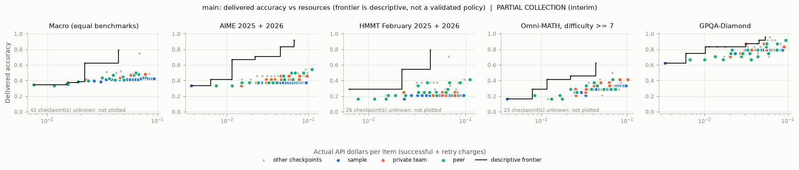

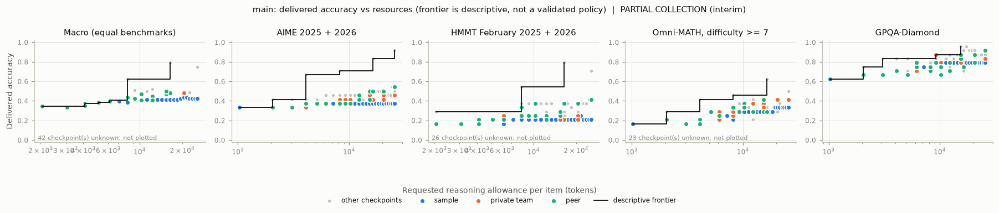

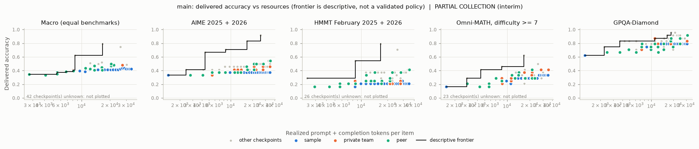

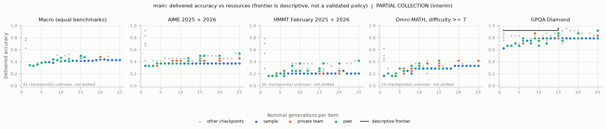

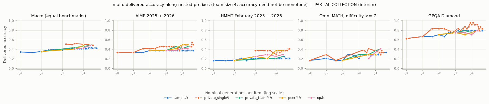

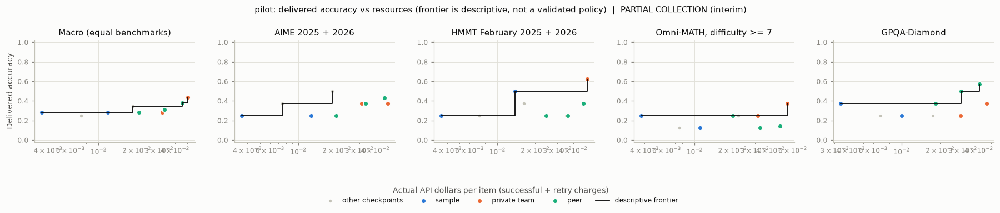

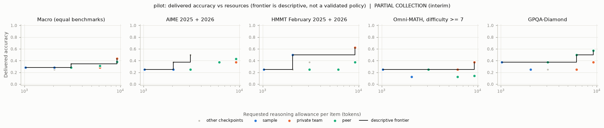

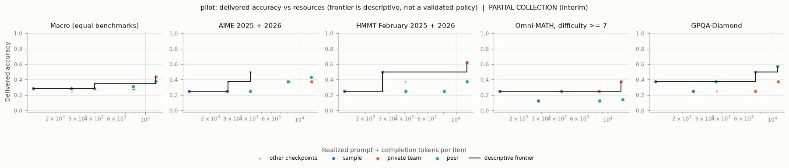

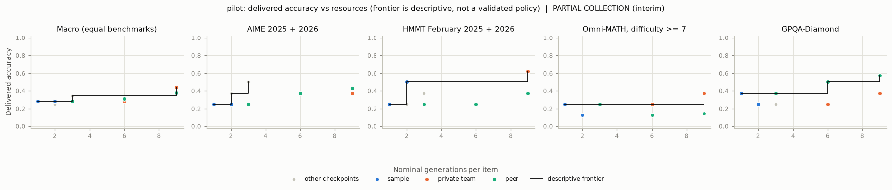

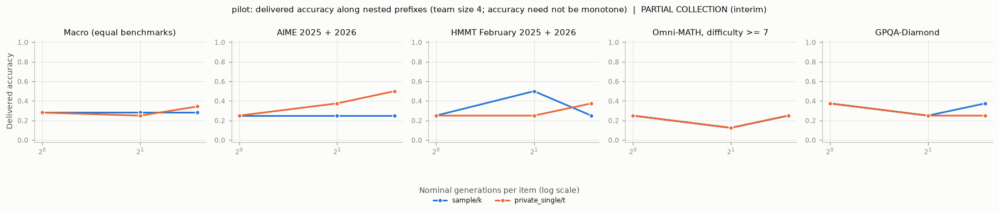

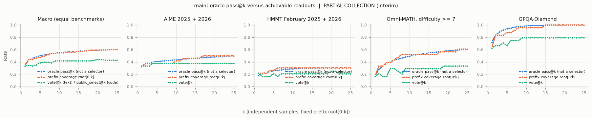

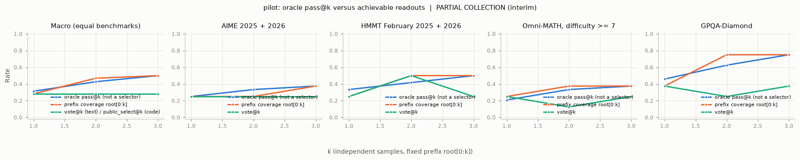

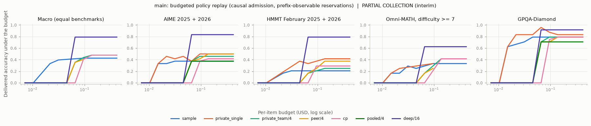

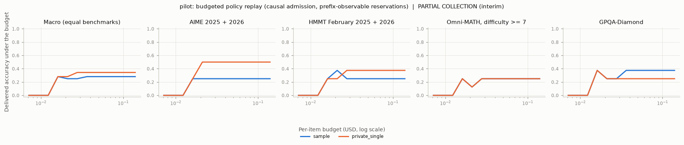

## Small-panel warnings

- small panel: aime, gpqa_diamond, omni_math_hard with 7 independent items in some analysis population(s); intervals are unstable
- small panel: aime, gpqa_diamond, hmmt, omni_math_hard with 8 independent items in some analysis population(s); intervals are unstable
- both primary populations must be fully known (no unknown or unrun outcomes, >=2 items per stratum) before p-values and Holm are reported.

## Notes

- none

## Load and consistency problems

- none
